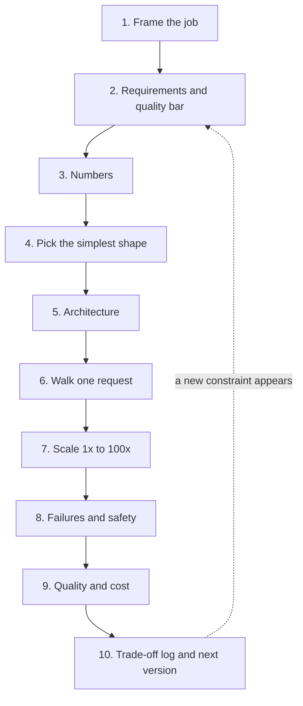
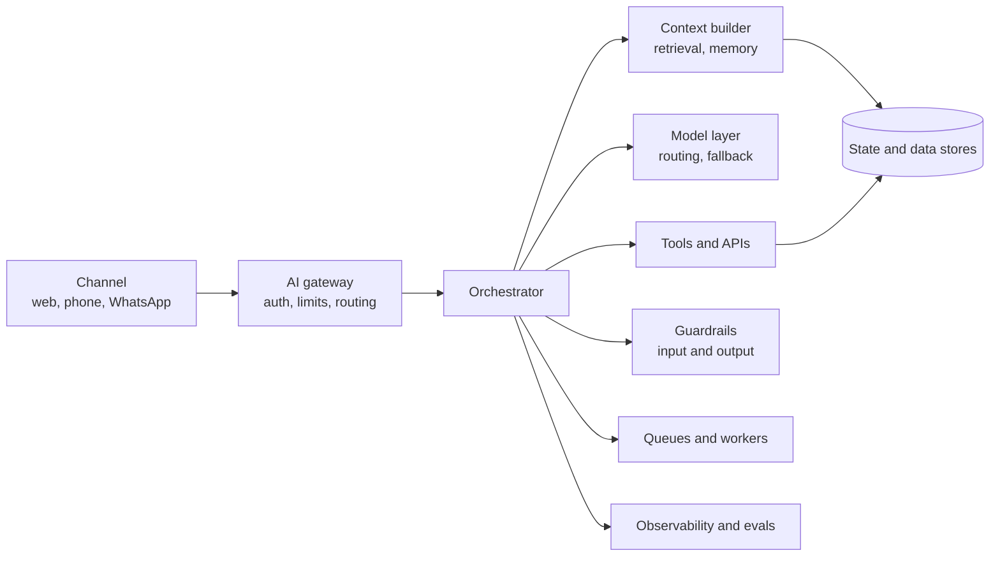

# How to design any AI system: a 10-step method

Every case study in this playbook follows the same 10 steps. Learn the steps once and you can design a system we haven't written yet, or explain one in an interview.

The method is short on purpose. The depth lives in the case studies. If a word here is new to you, the [AI Engineering Playbook](https://github.com/NeuralSaasAi/ai-engineering-playbook) (Part 1) explains it.

## Step 1: Frame the job

Say who uses the system, what job it does for them, and what "done" looks like. Then ask the question most teams skip: does this need AI at all?

If a search box, a rule, or a form solves the problem, use that. AI earns its cost when the input is messy language, images or audio, and a fixed rule can't cover the variety.

Ask yourself:

- Who is the user, and what do they do today without this system?
- What is the cheapest thing that could work?
- What does a wrong answer cost: an annoyed user, lost money, or a safety problem?

## Step 2: Requirements and quality bar

Split requirements into three groups.

1. **Functional.** What the system does. Give each a priority: P0 (must have), P1 (should have).
2. **Non-functional.** How well it does it, as numbers. "Fast" is not a requirement. "The first word appears in under 1.5 seconds for 95 percent of chats" is.
3. **Quality bar.** How right it must be, and who judges. Decide this before you build, because it decides everything after.

Also list security and compliance needs now: personal data, who may see what, and rules for your industry or country. These are much harder to add later.

## Step 3: Numbers

Do the arithmetic before you draw boxes. It tells you whether you have a small problem or a very large one. Write every formula down and state every assumption.

| What | Formula |
|---|---|
| Requests per second at peak | requests per day × peak factor ÷ 86,400 |
| Tokens per day | requests per day × (input tokens + output tokens) |
| Model cost per day | requests per day × (input tokens × input price + output tokens × output price) |
| Requests running at once | arrival rate (per second) × average time per request (seconds) |
| Vector storage | number of chunks × dimensions × bytes per dimension |
| GPU memory for model weights | parameters × bytes per parameter |
| GPU memory for the KV cache | tokens in flight × KV bytes per token |

A few notes on the table:

- The peak factor is how much busier your busiest period is than the average. Use 3 to 5 for office-hours traffic and say it's an assumption.
- A float32 number takes 4 bytes. Ten million chunks with 1,536 dimensions need 10,000,000 × 1,536 × 4 bytes, which is about 61 GB, before any index overhead.
- A model with 70 billion parameters stored in 16-bit format needs 70 billion × 2 bytes, which is 140 GB for the weights alone.
- The KV cache holds the model's working memory for each token in flight. Its size depends on the model's design (layers, key-value heads, head size), so look up the model card and compute the bytes per token.

## Step 4: Pick the simplest shape

Choose the lowest rung of this ladder that meets your requirements.

| Rung | Shape | Use it when |
|---|---|---|
| 1 | One model call | The task fits in one prompt |
| 2 | Fixed pipeline (retrieve, then answer) | The steps are always the same |
| 3 | Router | Different requests need different handling or different models |
| 4 | Tool-calling agent | The steps depend on what the model finds along the way |
| 5 | Multiple agents | Parts of the work need separate context, permissions or skills |

Write down why each lower rung fails. If you can't, use the lower rung. Higher rungs cost more, run slower, and fail in more ways.

## Step 5: Architecture

Most AI systems are built from the same blocks. Pick the ones you need and skip the rest.

Draw your own version with real names for each box. Keep it to one page.

## Step 6: Walk one request

Pick one realistic request and follow it through every box, with a time budget for each step. A sequence diagram works well.

This step finds problems the architecture diagram hides. If the total budget is 1,500 ms and retrieval alone takes 900 ms, you know where to work.

## Step 7: Scale 1x to 100x

Ask what breaks first when load grows ten times, then a hundred times. For AI systems the usual answers are:

- The model provider's rate limits (tokens per minute) or your own GPUs.
- The vector database, once the index no longer fits in memory.
- Long-running jobs that outlive a web request.
- One customer using more than their share (the "noisy neighbor").
- Cost, which grows with traffic even when everything else holds.

For each, name the fix: caching, batching, queues, durable job runners, per-customer quotas, or more regions. Record what each fix costs in money and in complexity.

## Step 8: Failures and safety

List how the system fails, how you will notice, and what happens next. Cover at least these:

- The model provider is down or slow.
- The model answers confidently and wrongly.
- A user, or a document the system reads, tries prompt injection.
- A tool call fails halfway.
- An agent loops without finishing.
- Cost spikes because of a bug or abuse.

For each failure, choose a response: timeout, retry with backoff, fallback model, circuit breaker, budget limit, human handoff, or a plain "I can't help with that".

## Step 9: Quality and cost

**Quality.** Build a small set of real examples with known good answers before launch. Run it on every change to a prompt, model or index. Add online signals once users arrive: thumbs up and down, escalation rate, and a sample of conversations reviewed by people. Decide what result blocks a release.

**Cost.** Pick the unit of work (one conversation, one call minute, one document). Compute its cost from your step 3 formulas. Then find the one lever that moves the total most. It is often not the model price. In support systems, for example, it is usually the share of cases that need a human.

## Step 10: Trade-off log and next version

For each important decision, write the options, your choice, the reason, and what would make you change your mind. Then sketch three versions: what you ship first, what you add when it works, and what you add when it must scale.

If you discover a new constraint along the way, go back to step 2. Real designs loop.

## A worked example: an FAQ bot for 200 people

A company with 200 staff wants a bot that answers HR and IT questions from its own documents.

1. **Job.** Answer policy questions faster than the HR inbox does. Rules and search alone fail because people phrase questions in many ways.
2. **Requirements.** P0: answer from company documents and cite the source. P1: hand over to a person. Target: answer in under 5 seconds, wrong answers under 5 percent on a test set. Data is internal, so no staff data leaves the approved vendor.
3. **Numbers.** Assume 300 questions per day, 1,500 input tokens and 300 output tokens each. Assume a price of $2 per 1M input tokens and $8 per 1M output tokens. Cost per question = 1,500 ÷ 1,000,000 × $2 + 300 ÷ 1,000,000 × $8 = $0.003 + $0.0024 = $0.0054. Cost per day = 300 × $0.0054 = $1.62, about $49 a month. Peak requests per second = 300 × 5 ÷ 86,400 = 0.017.
4. **Shape.** Rung 2, a fixed pipeline: search the documents, then answer. At 0.017 requests per second there is no scaling problem, so a router or agent adds cost with no benefit.
5. **Architecture.** Chat channel, a thin service, a vector search over documents, one model call, and logging.
6. **One request.** Search 300 ms, model call 2,500 ms, answer streamed. About 3 seconds, inside the 5-second target.
7. **Scale.** At 100 times the load (30,000 questions per day) the cost is about $162 a day, so check rate limits and add an answer cache.
8. **Failures.** If the model is down, show the top three document links. If no document matches, say so instead of guessing.
9. **Quality and cost.** A test set of 50 real questions, run before each change. Cost lever: shorter retrieved context.
10. **Trade-offs.** We chose a pipeline over an agent to keep answers predictable. We would revisit if people start asking multi-step questions, such as "book leave and tell my manager".

## Where each step lives in a case study

| Method step | Case study section |
|---|---|
| 1. Frame the job | The scenario |
| 2. Requirements and quality bar | Requirements |
| 3. Numbers | Numbers |
| 4. Pick the simplest shape | Choosing the shape |
| 5. Architecture | Architecture, Deep dives |
| 6. Walk one request | One request, end to end |
| 7. Scale 1x to 100x | Scaling from 1x to 100x |
| 8. Failures and safety | Failure modes and safety |
| 9. Quality and cost | Measuring quality, Cost |
| 10. Trade-off log and next version | Trade-offs we made, What teams get wrong |

The sections `At a glance`, `Interview mode`, `Concepts used` and `Further reading` help the reader and are not design steps.

Ready to read one? Start from the catalog in the [README](README.md).
