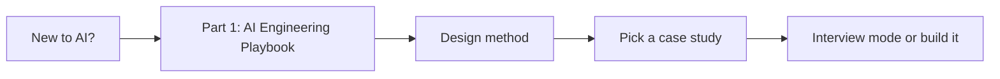

# AI System Design Playbook: 20 Real-World AI Architecture Case Studies

**Real AI systems, designed step by step, in plain English.** Twenty detailed AI system design case studies, each from a different industry or problem: customer support agents, WhatsApp commerce, telecom voice AI, legal RAG, AI tutors, clinical scribes, fraud detection, claims processing, coding agents, text-to-SQL, content moderation, and an enterprise LLM gateway. Each one covers the numbers, the architecture, which tools to build it with, how it breaks, how it scales, and what it costs.

Free, open source, and written for engineers who want to understand how production LLM and agent systems are really built, or who are preparing for an AI system design interview.

**Jump to:** [Website](https://ai-system-design-playbook.neuralsaasai.com/) · [Pick your path](#pick-your-path) · [Case studies](#case-studies) · [Design method](DESIGN-METHOD.md) · [FAQ](#questions-people-ask) · [Contribute](#contribute)

> [!NOTE]
> **Part 2 of 2.** The [AI Engineering Playbook](https://github.com/NeuralSaasAi/ai-engineering-playbook) (Part 1) teaches the concepts, from zero to intermediate. This playbook (Part 2) shows how those concepts combine into real systems, with scale, trade-offs and failure modes. New to embeddings, RAG or tool calling? Start with Part 1, then come back.

## Pick your path

Click your situation to expand a suggested reading order.

<strong>I have an AI system design interview coming up</strong>

1. Read the [design method](DESIGN-METHOD.md) once. It gives you the 10 steps to structure any answer.
2. Read the Interview mode section of [case study 1](case-studies/01-customer-support-agent.md), then [case study 4](case-studies/04-law-firm-knowledge-assistant.md) for retrieval and permissions.
3. Pick the one closest to the company you are interviewing with and time yourself with its 45-minute plan.

<strong>I am building a chatbot or support agent</strong>

1. [Customer support agent with human handoff](case-studies/01-customer-support-agent.md)
2. [WhatsApp commerce agent](case-studies/02-whatsapp-commerce-agent.md)
3. [Citizen services assistant](case-studies/18-citizen-services-assistant.md) for strict grounding and audit trails

<strong>I am building a voice product</strong>

1. [Real-time voice agent](case-studies/03-telecom-voice-agent.md) for streaming and latency budgets
2. [Clinical voice scribe](case-studies/06-clinical-voice-scribe.md) for speech-to-text with sign-off

<strong>I am building agents that take actions</strong>

1. [How a coding agent works](case-studies/10-coding-agent.md)
2. [Trip planning and booking agent](case-studies/13-travel-booking-agent.md) for undo steps and durable execution
3. [Security alert triage agent](case-studies/19-security-alert-triage.md) for untrusted input and human approval

<strong>I need to control AI cost, quality or safety across a company</strong>

1. [Company AI gateway and model router](case-studies/20-ai-gateway-router.md)
2. [Content moderation at scale](case-studies/12-content-moderation.md) for cheap-to-expensive cascades
3. [Fraud detection with explanations](case-studies/07-fraud-detection.md) for keeping the model off the hot path

## I want to

| I want to... | Go to |
|---|---|
| Learn a method I can reuse on any AI design problem | [How to design any AI system](DESIGN-METHOD.md) |
| See how a support, WhatsApp, voice, tutoring or citizen-service bot is built | [Talking to customers](#talking-to-customers) |
| Build search that respects permissions, or turn documents and audio into data | [Knowledge and documents](#knowledge-and-documents) |
| Understand coding, travel, hiring, logistics and security agents | [Agents that take action](#agents-that-take-action) |
| Design real-time decisions, moderation or sensor systems | [Decisions, safety and sensing at scale](#decisions-safety-and-sensing-at-scale) |
| Control cost and limits across many AI apps | [Platform](#platform) |
| Prepare for an AI system design interview | Every case study has an "Interview mode" section with a timed walkthrough and follow-up questions |
| Write a case study | [CONTRIBUTING.md](CONTRIBUTING.md) |

## How each case study works

Every case study uses the same 17 sections, so you always know where to look. Each section starts with two or three plain sentences, then goes deep.

| You will find | What it gives you |
|---|---|
| The scenario and requirements | A made-up company with real-sized numbers, and what "good" means |
| Numbers | Back-of-envelope math with every formula shown |
| Choosing the shape | Why a simple pipeline, a router, or an agent |
| Architecture and one request, end to end | Diagrams and a latency budget |
| Deep dives | The three or four hardest parts, with the options we weighed |
| Scaling from 1x to 100x | What breaks first and how to fix it |
| Failure modes and safety | How it fails and what you do about it |
| Measuring quality and cost | Metrics, release gates, cost per unit of work |
| Interview mode | A 45-minute plan and follow-up questions with answers |

The scenarios are fictional, so numbers are illustrative. Prices appear only as stated assumptions inside the cost formulas, so the math stays useful when vendor prices change.

## Case studies

Every case study targets a different industry or problem, so each visit teaches something new. Status: 📝 planned, 🚧 draft, ✅ reviewed. Want to write one? See [Contributing](CONTRIBUTING.md).

### Talking to customers

| # | Case study | Industry | Problem | Key patterns | Status |
|---|---|---|---|---|---|
| 1 | [Customer support agent with human handoff](case-studies/01-customer-support-agent.md) | Software (SaaS) | A small-business software company answers 500K conversations a month | Model cascade, grounded answers, signal-based escalation, safe tools, warm handoff | 🚧 Draft |
| 2 | [WhatsApp commerce agent](case-studies/02-whatsapp-commerce-agent.md) | Retail (D2C) | An Indian home-goods brand handles 2M chats a month in Hindi, English and Hinglish | 24-hour message window, templates, webhooks, idempotency, catalog and order tools | 🚧 Draft |
| 3 | [Real-time voice agent](case-studies/03-telecom-voice-agent.md) | Telecom | A mobile operator's call center takes 5,000 calls at once, each turn answered in under 800 ms | Streaming speech and language models, turn detection, barge-in, telephony | 🚧 Draft |
| 5 | [AI tutor for school students](case-studies/05-ai-tutor.md) | Education | 1M students in India at a very low cost per student | Curriculum-grounded answers, student memory, safety for minors, hints instead of answers | 🚧 Draft |
| 17 | [Farmer advisory with photo diagnosis](case-studies/17-farmer-advisory.md) | Agriculture | 2M farmers with weak networks ask about crop disease, weather and prices | Image diagnosis, local-language voice, offline-first, SMS fallback | 🚧 Draft |
| 18 | [Citizen services assistant](case-studies/18-citizen-services-assistant.md) | Government | A state portal serves 20M citizens in 12 languages | Strict grounding in official sources, audit trail, accessibility, data residency | 🚧 Draft |

### Knowledge and documents

| # | Case study | Industry | Problem | Key patterns | Status |
|---|---|---|---|---|---|
| 4 | [Law firm knowledge assistant](case-studies/04-law-firm-knowledge-assistant.md) | Legal | 2,000 lawyers search 3M documents, with client matters walled off from each other | Permission-aware retrieval, page-level citations, no-leak behavior, incremental sync | 🚧 Draft |
| 6 | [Clinical voice scribe](case-studies/06-clinical-voice-scribe.md) | Healthcare | 2,000 clinicians turn visit audio into notes | Speech-to-text, health-data rules, notes linked to source audio, clinician sign-off | 🚧 Draft |
| 8 | [Claims processing agent](case-studies/08-claims-processing-agent.md) | Insurance | A motor insurer handles 80K claims a month with photos, PDFs and forms | Multimodal extraction, confidence thresholds, straight-through processing, adjuster review | 🚧 Draft |
| 11 | [Text-to-SQL analytics agent](case-studies/11-text-to-sql-agent.md) | Business analytics | 500 analysts query 3,000 tables in plain English | Schema retrieval, query validation, read-only access, row-level security | 🚧 Draft |

### Agents that take action

| # | Case study | Industry | Problem | Key patterns | Status |
|---|---|---|---|---|---|
| 10 | [How a coding agent works](case-studies/10-coding-agent.md) | Developer tools | From one developer to 10,000 seats | Agent loop, tools, sandbox, code index, context compaction, sub-agents | 🚧 Draft |
| 13 | [Trip planning and booking agent](case-studies/13-travel-booking-agent.md) | Travel | 300K trip chats a month against live prices and seats | Multi-step planning, changing inventory, undo steps for failed bookings, durable execution | 🚧 Draft |
| 14 | [Recruiting and screening agent](case-studies/14-recruiting-agent.md) | Human resources | A staffing firm receives 200K applications a month | Rubric-based scoring, bias testing, human decision, audit trail, privacy | 🚧 Draft |
| 16 | [Shipment exceptions agent](case-studies/16-shipment-exceptions-agent.md) | Logistics | A freight forwarder gets 10K delay and customs emails a day | Event-driven agent, email parsing, system integration, approvals, deadline clocks | 🚧 Draft |
| 19 | [Security alert triage agent](case-studies/19-security-alert-triage.md) | Cybersecurity | A security team faces 50K alerts a day | Tool use over logs, untrusted input, human approval for response actions, evidence trail | 🚧 Draft |

### Decisions, safety and sensing at scale

| # | Case study | Industry | Problem | Key patterns | Status |
|---|---|---|---|---|---|
| 7 | [Fraud detection with explanations](case-studies/07-fraud-detection.md) | Banking | A decision in 100 ms at 10K transactions a second | ML and rules on the hot path, language model explanations off it, feedback labels, drift | 🚧 Draft |
| 9 | [Defect and maintenance copilot](case-studies/09-manufacturing-copilot.md) | Manufacturing | 12 plants with edge cameras and 30 years of manuals | Vision at the edge, retrieval over manuals plus sensor data, offline mode | 🚧 Draft |
| 12 | [Content moderation at scale](case-studies/12-content-moderation.md) | Social media | 50M posts a day | Cheap-to-expensive classifier cascade, policy as prompt, appeals | 🚧 Draft |
| 15 | [Home energy advisor](case-studies/15-home-energy-advisor.md) | Energy | A utility with 3M smart meters sends savings advice | Numbers computed by code, language model explains, batch insights, proactive messages | 🚧 Draft |

### Platform

| # | Case study | Industry | Problem | Key patterns | Status |
|---|---|---|---|---|---|
| 20 | [Company AI gateway and model router](case-studies/20-ai-gateway-router.md) | Enterprise IT platform | 200 internal apps share model access and one budget | Token-based rate limits, fallback, cost attribution, semantic cache, policy enforcement | 🚧 Draft |

More are coming, for example deep research for investment analysts, self-hosted model serving on GPUs, multi-tenant RAG platforms, eval-gated releases, AI answer engines and computer-use agents. [Suggest one](https://github.com/NeuralSaasAi/ai-system-design-playbook/issues/new?template=propose-case-study.yml). The only rule: it must target an industry or problem the catalog doesn't cover yet.

## Questions people ask

<strong>What is AI system design?</strong>

It is the work of designing everything around an AI model so it serves real users: how requests flow, where data comes from, how it stays fast, safe and affordable, and how you know it is working.

<strong>How is this different from the AI Engineering Playbook?</strong>

Part 1 teaches the building blocks and is written for beginners up to intermediate. Part 2 assumes you know the blocks and shows how they fit together at scale.

<strong>Is it useful for AI and LLM system design interviews?</strong>

Yes. Each case study includes a timed walkthrough and follow-up questions. The [design method](DESIGN-METHOD.md) gives you a repeatable way to structure any answer.

<strong>Which topics does it cover?</strong>

Retrieval-augmented generation (RAG), AI agents, tool calling, voice AI, multimodal extraction, guardrails, evaluation, caching, rate limits, model routing, cost estimation and scaling from 1x to 100x.

<strong>Is it free? Can I contribute?</strong>

Yes to both. Read [CONTRIBUTING.md](CONTRIBUTING.md), then claim a planned case study or fix something you find.

## Contribute

Found a mistake, want a case study, or have a production story to share? [Open an issue](https://github.com/NeuralSaasAi/ai-system-design-playbook/issues/new/choose) or send a pull request. Small fixes help as much as big ones. Star the repo to follow new case studies as they land.

Read our [style guide](STYLE.md) before writing, and the [Code of Conduct](CODE_OF_CONDUCT.md) before joining in.

## Why this exists

[Why we built this](WHY-THIS-EXISTS.md)

## License

Content is licensed under [CC BY-SA 4.0](LICENSE). Maintained by [NeuralSaaS](https://github.com/NeuralSaasAi).
