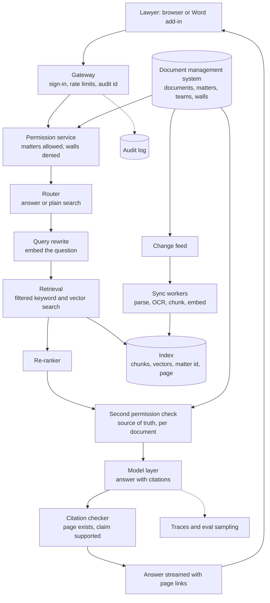
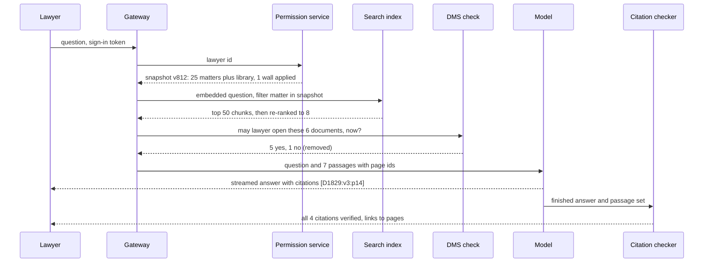

# Law firm knowledge assistant with walled-off client matters

> [!NOTE]
> The law firm in this case study is fictional. Its numbers are made up to make the design concrete. Prices and rates are stated assumptions, not real quotes. New to AI terms? Start with [the word list](#words-used-in-this-case-study), and see [the layers and tools](#layers-and-tools) for what to build each part with. This is a design exercise, not legal advice. Professional conduct rules differ by country and by state, so check yours.

## At a glance

| | |
|---|---|
| **Problem** | Let 2,000 lawyers ask questions across 3M firm documents and get answers with page-level citations, while no lawyer can ever see or learn about a matter they are walled off from. |
| **Scale** | 3M documents, 48M searchable chunks, about 12,000 questions a day, peak under 1 question per second. |
| **Key patterns** | Permission-aware retrieval, page-level citations, no-leak behavior, incremental sync, defense in depth. |
| **Difficulty** | Advanced. |
| **Read time** | About 40 minutes. |

## The scenario

Harlan Pryce LLP is a made-up law firm with 2,000 lawyers in 14 offices. It holds 3 million documents in a document management system (DMS): contracts, court filings, emails, memos and research. Every document belongs to a client matter, which is one piece of work for one client, such as "Acme acquires Bolt". Lawyers find precedents today with keyword search and by asking colleagues.

The firm wants an assistant that answers questions in plain language, such as "What indemnity cap did we agree in our last two logistics acquisitions?", and cites the exact page of each source. The hard part is not the answer. It is that many matters are walled off from each other, and one leaked sentence can break a duty to a client.

Why walls exist: a firm may act for two clients on opposite sides of a deal, or hire a lawyer from a rival firm who worked on a matter that the new firm now opposes. In the United States, [ABA Model Rule 1.10](https://www.americanbar.org/groups/professional_responsibility/publications/model_rules_of_professional_conduct/rule_1_10_imputation_of_conflicts_of_interest_general_rule/) lets a firm continue in some of these cases if the affected lawyer is timely screened from any part in the matter. A screen only counts if it is real. A search tool that surfaces the screened matter's documents would defeat it.

| Measure | Today | Target |
|---|---|---|
| Lawyers | 2,000 | 2,000 |
| Documents | 3M | 3M |
| Questions per active lawyer per day | About 3 searches | 10 questions (assumed) |
| Time to find a usable precedent (median) | 25 minutes (assumed) | Under 5 minutes |
| Answers with a page-level citation | Not applicable | 100% of factual claims |
| Documents shown from a matter the lawyer may not see | Not measured | Zero |
| New or changed document searchable | Next day | Within 15 minutes |
| Access removed, and search stops showing it | Within a day | Within 60 seconds |

## Requirements

This system has two jobs that fight each other: find useful material across the whole firm, and never cross a wall. The requirements below give each job a priority and a number, and they put the second job first.

Functional requirements:

| Requirement | Priority |
|---|---|
| Answer questions using only documents the asking lawyer may see | P0 |
| Cite each claim with document, version and page, and open the page on click | P0 |
| Say "nothing found" in the same way for forbidden and missing documents | P0 |
| Keep the index in step with the DMS, including edits, deletes, moves and permission changes | P0 |
| Respect ethical walls (screens) as hard denies that override any grant | P0 |
| Filter by client, matter, practice area, date and document type | P1 |
| Open-ended search that returns a ranked list without an answer | P1 |
| Save a research thread under the matter it belongs to | P1 |

Non-functional requirements, each with the reason for the number:

| Requirement | Target | Why |
|---|---|---|
| First visible word | Under 2 s at p95 | Lawyers compare it with the keyword search they have now |
| Full answer | Under 12 s at p95 | Answers stream, and long ones are read as they arrive |
| Cross-matter leaks | Zero, tested on every release | One leak can mean a conflict, a malpractice claim, or a lost client |
| Access removal takes effect | Within 60 s | A lawyer who is walled off at 10:00 must not see the matter at 10:05 |
| New document searchable | Within 15 min | Lawyers work on live deals and fresh filings |
| Citation precision | At least 98% of citations support the claim | A wrong citation in a filing is a professional risk |
| Availability | 99.9% in working hours | Lawyers bill by the hour and will not wait |

Security and compliance needs:

- The identity and the matter list come from the firm's systems of record, not from the model or the browser.
- Walls are hard denies. A deny always wins over an allow.
- Client data stays in approved regions and with vendors whose contracts forbid training on the data and limit retention. Some clients' outside-counsel guidelines forbid certain AI use altogether, so the system needs a per-matter "no AI" flag.
- Every question, every retrieved chunk and every access decision is logged for audit. The log itself is protected by the same walls.
- Privilege matters. The assistant must not mix a privileged memo into a document that is shared outside the firm. It labels sources and leaves the sharing decision to the lawyer.

## Numbers

We estimate load, storage, ingestion and cost before drawing anything. The formulas follow the [design method](../DESIGN-METHOD.md), and every assumption is stated so you can change it.

Documents and chunks:

- Pages = documents × pages per document = 3,000,000 × 8 = 24,000,000. Eight pages is the assumed average, because the corpus mixes one-page emails with 200-page agreements.
- Tokens per page is assumed at 650 (about 500 words). A chunk holds at most 350 tokens and never crosses a page, so each page makes 2 chunks (350 + 300).
- Chunks = pages × chunks per page = 24,000,000 × 2 = 48,000,000. Chunks per document = 48,000,000 ÷ 3,000,000 = 16.
- Tokens to embed once = pages × tokens per page = 24,000,000 × 650 = 15.6 billion.

Vector storage, using 1,024 dimensions stored as half-precision numbers (2 bytes each):

- Bytes per vector = 1,024 × 2 = 2,048.
- Vector storage = chunks × bytes per vector = 48,000,000 × 2,048 = 98.3 GB.
- With an assumed index overhead of 1.5×: 98.3 × 1.5 = about 147 GB. In 32-bit floats the vectors alone would be 48,000,000 × 1,024 × 4 = 196.6 GB.

Permissions, which drive the design:

- Matters = 60,000, so documents per matter = 3,000,000 ÷ 60,000 = 50 on average.
- The firm library (precedent banks, know-how notes and templates open to everyone) is assumed at 150,000 documents.
- A typical lawyer works on 25 matters. Documents visible = own matters + library = 25 × 50 + 150,000 = 151,250. Chunks visible = 151,250 × 16 = 2,420,000.
- Share of the index a typical lawyer may see = 2,420,000 ÷ 48,000,000 = 5.04%. Without the library the share is 25 × 50 × 16 ÷ 48,000,000 = 20,000 ÷ 48,000,000 = 0.04%.

This share matters because of how approximate vector indexes work. The [pgvector documentation](https://github.com/pgvector/pgvector) explains that with an approximate index the filter runs after the index scan. If a condition matches 10% of rows and the search keeps 40 candidates, only 4 rows survive on average. At our 5.04% share the same search keeps 40 × 0.0504 = 2.0 rows, and at 0.04% it keeps 40 × 0.0004 = 0.017 rows, so most queries would return nothing. We fix this in deep dive 1.

Questions:

- Active lawyers per day = 2,000 × 60% = 1,200. Questions per day = 1,200 × 10 = 12,000. Questions per month = 12,000 × 22 working days = 264,000.
- Average questions per second over a day = 12,000 ÷ 86,400 = 0.14. Peak questions per second = 12,000 × 5 ÷ 86,400 = 0.69. The peak factor of 5 is an assumption for office hours.
- Questions in flight at peak = 0.69 × 12 seconds = about 8.

Tokens and model cost per question. Assume a large model costs $3 per 1M input tokens and $15 per 1M output tokens, and a small model costs $0.25 and $1.25.

- Input tokens = instructions 800 + chat so far 600 + 8 passages × 400 = 3,200 + question 80 = 4,680. Output tokens = 500.
- Tokens per question = 4,680 + 500 = 5,180. Peak tokens per minute = 0.69 × 5,180 × 60 = about 215,000. This is the number to compare with a provider's rate limit.
- Answer cost = 4,680 ÷ 1,000,000 × $3 + 500 ÷ 1,000,000 × $15 = $0.01404 + $0.0075 = $0.02154.
- Query rewrite and embedding, assumed $0.0005. Re-ranking, assumed $0.002. Citation support check (small model, 1,500 tokens in, 100 out) = 1,500 ÷ 1,000,000 × $0.25 + 100 ÷ 1,000,000 × $1.25 = $0.000375 + $0.000125 = $0.0005.
- Cost per question = $0.02154 + $0.0005 + $0.002 + $0.0005 = **$0.02454**.

Ingestion:

- Initial embedding = 15.6 billion tokens ÷ 1,000,000 × $0.10 (assumed embedding price) = $1,560. At an assumed 50,000 tokens per second, 15,600,000,000 ÷ 50,000 = 312,000 seconds, about 3.6 days.
- Scanned pages are assumed at 15% and need OCR (text recognition) at an assumed $1.50 per 1,000 pages. Initial OCR = 24,000,000 × 15% ÷ 1,000 × $1.50 = $5,400.
- New or changed documents per day are assumed at 20,000. Chunks per day = 20,000 × 16 = 320,000, which is 320,000 ÷ 86,400 = 3.7 chunks per second.
- Daily embedding = 320,000 × 325 average tokens = 104 million tokens ÷ 1,000,000 × $0.10 = $10.40. Re-embedding the whole corpus every night would cost $1,560 a day, which is 1,560 ÷ 10.40 = 150 times more. This is the case for incremental sync.

## Choosing the shape

The simplest design that could work is a good keyword search over the DMS, which is what the firm has. It fails on questions that need meaning ("agreements where the buyer took on environmental risk") and on questions that need an answer built from many documents. A model with the whole corpus pasted in is impossible: 15.6 billion tokens will never fit in a context window.

Walking up the ladder from the [design method](../DESIGN-METHOD.md):

| Rung | Verdict |
|---|---|
| One model call | Fails. The corpus is 15.6 billion tokens. |
| Fixed pipeline (permission filter, retrieve, answer, cite) | Fits the main use. Every question follows the same steps. |
| Router | Useful and small. It sends "list me the documents" to plain search and "what did we agree" to the answer path. |
| Tool-calling agent with a loop | Not needed in version 1. A loop that issues many searches multiplies the places where a permission bug can hide, and each search costs money. |
| Multiple agents | Not needed. Walls are enforced by code in one place, and splitting work among agents adds more places to enforce them. |

We stop at a router plus a pipeline. The permission filter sits before retrieval and again after it, and the model never receives a document the lawyer cannot open. If a later version adds a research agent for multi-step work, it runs with the same permission snapshot and the same retrieval service, and gets no tool that bypasses them.

## Architecture

A question arrives with the lawyer's identity. The permission service turns that identity into a list of matters the lawyer may search, minus any walls. Retrieval searches only inside that list, a re-ranker picks the best passages, and a second permission check runs on those passages. The model writes an answer with page-level citations, and a checker confirms each citation before the lawyer sees a final result. A separate sync pipeline keeps the index in step with the DMS.



The next three parts are written for readers who are new to AI. The word list explains the terms. The layers part explains each box, what it does here, and which kind of tool can build it. The build order shows a sensible order for a small team.

### Words used in this case study

If a word in this page is new to you, find it here. Each entry says what the word means in this design, not in general.

| Word | What it means here |
|---|---|
| Token | A small piece of text, about three quarters of an English word. Models read and write tokens, and providers charge per token. |
| Embedding | A list of numbers that stands for the meaning of a piece of text. Texts with similar meaning get similar numbers. |
| Vector search | Finding the chunks whose embeddings are closest to the question's embedding. It finds meaning, even when the words differ. |
| Keyword search | Finding chunks that contain the same words. It finds exact terms, such as a clause number or a party name. |
| RAG | Retrieval-augmented generation. Search first, then give the best passages to the model so it answers from them. |
| Chunk | A piece of a document, here at most 350 tokens and always inside one page, that is stored and searched on its own. |
| Re-ranker | A second, more careful scoring step that puts the best search results first. |
| Cache | A saved result that we reuse instead of computing it again. |
| Memory | What the system remembers about this chat. Here it is kept to one lawyer and one matter or search scope. |
| Guardrail | A check that blocks or changes something unsafe before it reaches the lawyer or a tool. |
| Matter | One piece of work for one client. Documents and permissions are organized by matter. |
| Ethical wall (screen) | A rule that keeps named lawyers away from a matter's documents. In the system it is a hard deny. |
| DMS | Document management system. The firm's store of record for documents, versions and who may open them. |
| Permission snapshot | The list of matters one lawyer may search at one moment, with a version number. It is taken at the start of each request. |
| Permission-aware retrieval | Search that only looks at chunks the asking person may see, so forbidden text is never retrieved at all. |
| Page-level citation | A reference that names the document, the version and the page, and links to that page. |
| No-leak behavior | The rule that the system answers the same way when something is forbidden as when it does not exist. |
| Change feed | A stream of events or a list of changes since a saved position, offered by the DMS, that says what was added, edited, moved or deleted. |
| Incremental sync | Processing only what changed, instead of rebuilding the whole index. |
| OCR | Optical character recognition. Turning a scanned page image into text. |
| Canary document | A planted test document with a unique phrase, placed in a matter on purpose, to prove it never reaches someone without access. |
| p95 | The time that 95 out of 100 requests beat. It shows slow cases that an average hides. |

### Layers and tools

We split the system into ten layers. Each layer has one job, and each can be built with a different category of tool. They are listed in the order a question meets them, and the sync layer comes last because it runs on its own schedule.

Tool names are examples as of November 2026. They are not endorsements, and tools change faster than categories. Before choosing, check that the project is maintained and that its license and data terms suit a law firm.

Four layers are easy to mix up: memory, retrieval, cache and permissions. Permissions are the new one, and they touch all the others.

| | Memory | Retrieval (RAG) | Cache | Permissions |
|---|---|---|---|---|
| The question it answers | What was said in this chat? | What do the firm's documents say? | Have we already computed this? | May this lawyer see this? |
| What it holds | Recent messages and a short summary | Chunks, vectors, page numbers, matter ids | Saved results such as question embeddings | Matter membership, walls, document-to-matter links |
| Whose data | One lawyer, one thread | The firm's, shared but filtered per lawyer | Depends on the cache | The firm's systems of record |
| How it changes | After every turn | When a document changes | It expires on a timer or when its source changes | When the firm changes a team or a wall |
| Risk if it is wrong | A fact from the wrong matter in a chat | A stale or forbidden passage | An answer shown to a person who may not see it | A leak or a lawyer locked out |

#### Layer 1: gateway and identity

The gateway is the front door. It signs the lawyer in through the firm's single sign-on, applies rate limits, assigns an audit id to the request, and streams the answer back. It also sits in front of the model calls, so budgets and failover live in one place.

In this design the lawyer's identity comes from the sign-in token. The gateway never accepts a user id, a matter id or a permission list from the browser or from the model.

| Category | Examples | Pick it when |
|---|---|---|
| Existing single sign-on | Okta, Microsoft Entra ID, Ping Identity | The firm already signs lawyers in this way. Reuse it |
| API gateway | NGINX, Envoy, your cloud provider's gateway | You need rate limits and request logging in front of the service |
| AI gateway for model calls | LiteLLM, Portkey, Kong AI Gateway | You want fallback between providers, budgets and one log of model calls |

First version: reuse the firm's sign-in and put a small AI gateway in front of the model calls. What goes wrong: a client that sends its own matter filter and a service that trusts it. Derive the filter on the server, always.

#### Layer 2: permission service

This is the most important layer. It answers one question: "Which matters may this lawyer search right now?" It reads the DMS (the system of record) for matter membership and for walls, merges them with a rule that any deny wins, and returns a permission snapshot: a set of allowed matter ids, a flag for the firm library, and a version number.

The service keeps the last snapshot for a lawyer for up to 60 seconds, so most questions need no DMS call. A change in the DMS sends an event that clears that lawyer's snapshot at once. The 60 seconds is a limit, not the usual delay.

| Category | Examples | Pick it when |
|---|---|---|
| Read the DMS directly | The document management API of the firm's DMS, such as iManage or NetDocuments | The DMS is the system of record and its API is fast enough |
| Authorization engine | Open Policy Agent, OpenFGA, Cedar | The rules get complex, such as inherited access and temporary grants, and you want them in one tested place |
| Snapshot cache | Redis or Valkey | You need fast reads with a short life and an event to clear them |

First version: call the DMS API, merge allows and denies in about 100 lines of code with a test for each rule, and cache the snapshot for 60 seconds with event-based clearing. What goes wrong: letting the index become the source of truth for who may see what. The index holds a matter id on each chunk and nothing more.

#### Layer 3: router and query understanding

The router reads the question and decides which path to use: the answer path or a plain ranked list. Query understanding then rewrites the question for search, for example by turning "that Acme deal" into "Acme" plus the matter filter the lawyer picked, and by expanding abbreviations that lawyers use.

It reads only the question, the current chat and the user's own filters. It never reads documents the lawyer cannot see.

| Category | Examples | Pick it when |
|---|---|---|
| Small language model with structured output | A small hosted model asked to return JSON in a fixed shape | You want to start now, with no training data |

First version: a small model with structured output, plus rules for the plain-search path. What goes wrong: a rewrite that adds a client name from earlier in the chat and widens the search. The rewrite may narrow a search and may never widen the permission snapshot.

#### Layer 4: retrieval (RAG)

Retrieval finds the passages that answer the question, so the model reads facts and does not guess. It has five parts.

1. **Ingestion.** Read each document, split it into pages, then split each page into chunks of at most 350 tokens. Store the document id, version, matter id, page number, document type, date and author next to each chunk.
2. **Embedding.** Turn each chunk into an embedding. The same step runs on the question at search time.
3. **Index.** Store embeddings and keywords so they can be searched with a filter on `matter_id`.
4. **Filtered search.** Run keyword and vector search together (hybrid search), restricted to the allowed matters in the permission snapshot.
5. **Re-ranking.** Take the top 50 results, score them again with a more careful model, and keep the best 8.

Sizes were computed in the numbers section: 48 million chunks, about 98 GB of vectors in half precision, about 147 GB with index overhead. That does not fit comfortably in the memory of one ordinary server, so plan for a search cluster of several nodes or for disk-based indexes. Postgres with pgvector can index `halfvec` columns up to 4,000 dimensions, so 1,024 dimensions fit, but at this size most teams use a dedicated search engine.

| Category | Examples | Pick it when |
|---|---|---|
| Vector search inside your database | Postgres with pgvector | Under about 10 million chunks, or you want one system to run |
| Search engine with keyword and vector search | Elasticsearch, OpenSearch | You need exact terms (clause numbers, party names) and meaning in one place, with filters |
| Dedicated vector database | Qdrant, Weaviate, Milvus, Vespa | The index is large and filtering is heavy |
| Managed search with security filters | Azure AI Search | You are already on that cloud and want a ready-made filter pattern |
| Embedding models | Hosted embedding APIs, open-source embedding models you host | Hosted for speed to start. Self-hosted when client terms forbid sending text out |
| Re-rankers | Hosted rerank APIs, open-source cross-encoder models | You want better top results without changing the index |

First version: Elasticsearch or OpenSearch for hybrid search with a filter on `matter_id`, one embedding model whose terms the firm has approved, and a hosted or self-hosted re-ranker. What goes wrong: a filter applied after the vector search, which returns too few results (see deep dive 1).

#### Layer 5: second permission check

After the re-ranker picks the best 8 chunks, the system asks the DMS source of truth one more question per document: "May this lawyer open this document, in this version, now?" This is a batch call for up to 8 documents. It catches three cases that the index cannot know about: an access change in the last few seconds, a document that was moved to another matter and whose chunk is not yet updated, and a version that was withdrawn.

| Category | Examples | Pick it when |
|---|---|---|
| Batch check against the DMS API | The DMS's own permission or document-info endpoint | The DMS can answer 8 documents in under 50 ms |
| Row-level security in the chunk store | Postgres row-level security policies | The chunk text lives in Postgres and you want the database to enforce the rule as well |

The [Postgres documentation on row security](https://www.postgresql.org/docs/current/ddl-rowsecurity.html) explains the base behavior that makes this a good backstop: once a table has row security on, every row access must pass a policy, and with no policy the table shows nothing at all.

First version: the batch check against the DMS, and Postgres row-level security on the table that holds chunk text, using a session setting for the lawyer. What goes wrong: a check that fails open when the DMS is slow. It must fail closed: drop the chunk.

#### Layer 6: models and citation checking

The model writes the answer from the 8 passages. Each passage reaches the model with an id such as `[D1829:v3:p14]` (document, version, page). The prompt requires every factual sentence to end with one or more ids, and to say so when the passages do not contain the answer. A checker then verifies each citation, as deep dive 2 describes.

| Category | Examples | Pick it when |
|---|---|---|
| Hosted model APIs | The APIs from Anthropic, OpenAI, Google and others | You want the best quality and the contract gives no training on the data and limited retention |
| Models inside a cloud platform | Amazon Bedrock, Google Vertex AI, Azure OpenAI | Your data rules or contracts say the data must stay in your cloud account and region |
| Open-weight models you host | Open models served with vLLM or similar software on your own GPUs | Clients forbid third-party processing, or volume is steady and high |
| Citation and support checking | A small model asked "does this passage support this sentence?" | You need a cheap second opinion on each claim |

First version: one hosted model inside the firm's cloud account behind the gateway, plus a small model for the citation check. What goes wrong: the model cites a passage that was never in the prompt. The checker rejects any id outside the set it was given.

#### Layer 7: memory

Memory lets a lawyer ask follow-up questions ("and what about the second deal?"). It is deliberately small here. A thread keeps the last few turns (up to about 600 tokens) and a short summary of older turns. Each thread is stored under the lawyer and under a search scope: either one matter or "all my matters".

There is no long-term memory about a lawyer across matters. A fact the assistant learned while working in a matter could otherwise appear in an answer about another matter. When a thread is reopened, every stored citation is checked again against a fresh permission snapshot, and passages from matters the lawyer can no longer see are removed from the history.

| Category | Examples | Pick it when |
|---|---|---|
| Key-value store | Redis or Valkey | The data is short-lived, such as the turns of a live chat |
| Relational database | Postgres | Saved research threads must be kept, and filed under a matter |
| Memory frameworks | Mem0, Zep, Letta | Not in this design. Automatic memory crosses matter boundaries by default, and that is the one thing we cannot allow |

First version: Redis for live threads, Postgres for saved ones, both keyed by lawyer and scope. What goes wrong: a summary that carries a client name from one matter into a thread about another. Build the summary only from passages in the thread's scope.

#### Layer 8: caches

A cache stores a result so we can reuse it. Here the safe caches are the ones that do not depend on who is asking.

| Cache | What it saves | Safe? |
|---|---|---|
| Prompt cache | The provider's work on the fixed start of the prompt (instructions) | Yes. It holds no client text. Put the fixed text first |
| Question embedding cache | The embedding of the question text, keyed by a hash of the text | Yes. The same text gives the same numbers for everyone |
| Permission snapshot | A lawyer's allowed matters, for up to 60 s | Yes, if events clear it and its version is stamped on each request |
| Search result cache | The top chunks for a question | No. The result depends on who asks. If you build it, key it on the question plus the snapshot version, and expect low hits |
| Answer cache | The final answer text | No. An answer built from one lawyer's visible documents must not go to another |

The rule is simple: any cache that stores client text must include the permission snapshot version in its key, or must not exist. We do not build an answer cache. At 12,000 questions a day with different documents behind each lawyer, the hit rate would be low and the risk is not worth it.

First version: prompt cache, question embedding cache and the permission snapshot. What goes wrong: a shared cache key with no snapshot version, so a lawyer who lost access still gets the saved answer.

#### Layer 9: audit, observability and evals

Observability means you can see what happened on every request: the audit id, the snapshot version, the allowed matter count, the chunks retrieved, the chunks dropped by the second check, the answer, the time and the cost. Evals are the automatic tests that tell you whether a change made things better or worse. The audit log also serves the firm's own compliance team if a client asks who saw what.

The log contains client information, so it follows the same walls: a log entry is filed under the matters it mentions, and only people with access to those matters can open it in full. Engineers see counts and ids by default.

| Category | Examples | Pick it when |
|---|---|---|
| Tracing | OpenTelemetry, Langfuse, Arize Phoenix | You want one view per request with each step and its cost |
| Eval runners | promptfoo, Ragas, or your own script with a judge function | You want the golden set and the leak tests to run on every change |
| Append-only audit storage | A write-once bucket, or a database table with no update rights | Compliance needs a record that cannot be edited |

First version: structured logs with the audit id, a tracing tool, an append-only audit table, and a script that runs the golden set and the leak tests in the build pipeline. What goes wrong: logging the full prompt where every engineer can read it. Log ids and counts, and keep the text behind the walls.

#### Layer 10: ingestion and incremental sync

Sync keeps the index in step with the DMS. It reads a change feed, which tells it what was added, edited, moved or deleted since a saved position, and it handles each change with the cheapest action that makes the index correct. Deep dive 4 explains the actions.

| Category | Examples | Pick it when |
|---|---|---|
| Change feed from the DMS | Webhooks or a "changes since" API in the DMS | The DMS offers one. This is the first choice |
| Message queue between feed and workers | Apache Kafka, Amazon SQS, RabbitMQ | You need retries, ordering per document and a way to absorb bursts |
| Document parsing | Apache Tika, PyMuPDF, pdfplumber | You need text and page numbers from Word, PDF and email files |
| OCR | Tesseract, cloud OCR services | Scanned pages exist, here about 15% of them |
| Scheduled reconciliation | A nightly job in your scheduler | You need a safety net for lost events |

First version: the DMS change feed, a queue, parse-and-embed workers, and a nightly reconciliation job that counts documents per matter in the DMS and in the index. What goes wrong: events arrive out of order, and an old version overwrites a new one. Always compare version numbers before writing.

### Build order

Build the system in stages, and put each stage in front of real data before adding the next. This order puts permissions and the leak tests first, because they are the hardest to add later. The steps are a sequence, not a schedule.

1. **Stage 0: permissions and test matters.** Build the permission service against the DMS. Create a test set of 20 matters with planted canary documents, 40 test lawyers, and walls of every kind: direct, inherited and temporary. Test: for every lawyer and every canary, the service says allow or deny as expected. Done when: all the permission cases pass and the tests run in the build pipeline.
2. **Stage 1: retrieval over one practice group.** Ingest one group's documents (about 50,000). Build parse, chunk and embed with page numbers, the filtered hybrid search, and the re-ranker. Test: the leak tests, plus 100 real questions with expected documents. Done when: no canary appears for a lawyer without access, and the right document is in the top 8 for most questions.
3. **Stage 2: answers with page-level citations.** Add the model, the citation format and the citation checker. Test: the golden set, scored for answer quality and citation precision. Done when: citation precision is at least 98% and an unsupported question gets "nothing found".
4. **Stage 3: second permission check and no-leak behavior.** Add the per-document check after re-ranking, fail-closed rules, one standard answer for "nothing found" and a timing test. Test: forbidden and missing documents give the same reply and take about the same time. Done when: a red team of three people cannot tell the two cases apart.
5. **Stage 4: incremental sync at full scale.** Add the change feed, tombstones, version checks, metadata-only updates for moves and permission changes, and reconciliation. Load the other 2.95 million documents in the background. Test: edit, move, delete and revoke access on test documents and time each. Done when: edits show up within 15 minutes and revoked access stops results within 60 seconds.
6. **Stage 5: rollout and scale.** Add the "no AI" matter flag, the Word add-in, the audit views for compliance and dashboards. Roll out firm by practice group, with the leak tests running nightly. Done when: the numbers in the scaling section hold in a load test.

## One request, end to end

Here is one concrete question. A lawyer on the Acme matter asks: "What indemnity cap did we accept in our last two logistics acquisitions?" We follow it through the system and budget the time for each step.



The second check removed one passage because the DMS showed that its document moved to a walled matter 20 seconds earlier. The index still held the old matter id. The answer is built from the remaining 7 passages, and the lawyer sees nothing that hints at the removed one.

Latency budget for the answer path:

| Step | Budget | If it overruns |
|---|---|---|
| Gateway and sign-in | 30 ms | Check the session cache |
| Permission snapshot (cached) | 30 ms | On a miss, call the DMS, which adds about 150 ms |
| Query rewrite and embedding | 150 ms | Use the question as written |
| Filtered hybrid search | 120 ms | Reduce to the top 30 candidates |
| Re-ranking | 200 ms | Use the search order for the top 8 |
| Second permission check | 40 ms | Fail closed: drop what cannot be checked |
| Model: time to first token | 800 ms | Switch to the second provider after 1.5 s |
| **First visible word** | **about 1,370 ms** | Under the 2-second target |
| Streaming 500 tokens at about 80 per second | 6,250 ms | The lawyer is already reading |
| Citation support check on the full answer | 700 ms | Show the answer, with "checking citations" until done |

The first visible word is 30 + 30 + 150 + 120 + 200 + 40 + 800 = 1,370 ms. The citation marker check (is this id one we sent?) runs while the answer streams, since it is a simple lookup. The slower check, whether each passage supports its sentence, runs when the answer ends.

## Deep dives

Four parts of this design need more care than the rest: permission-aware retrieval, page-level citations, no-leak behavior, and incremental sync.

### Deep dive 1: permission-aware retrieval

The problem: a lawyer may see about 5% of the index, and for some lawyers well under 1%. A plain vector search followed by a permission filter returns almost nothing, and a search that skips the filter returns forbidden text. We need to search only inside the allowed set, and we need the set to stay correct as people move between matters.

Options we considered:

1. **Search everything, filter the results.** Easy to build, and it fails twice. As the numbers section showed, with 40 candidates and a 5.04% share we keep about 2 rows. And forbidden text is already inside the system's memory when the filter runs, so one bug in the filter becomes a leak.
2. **One index per matter or per team.** Strong isolation, but 60,000 matters means 60,000 indexes, and a lawyer on 25 matters needs 25 searches merged. Too much to run, though it is a good fit for the most sensitive matters (see below).
3. **One index, a `matter_id` on every chunk, and a filter applied during the search.** The search only visits chunks whose matter is in the allowed set. Membership is not stored in the index. It is resolved at query time by the permission service.

We chose option 3, and we use option 2 for a short list of "restricted" matters (for example, a public takeover with a strict need-to-know list) that get their own small index with their own access list.

Where to store the permission: on the chunk, or in the permission service? The Azure AI Search article on [security filters](https://learn.microsoft.com/en-us/azure/search/search-security-trimming-for-azure-search) describes the common version of this pattern: store the group or user identifiers on each document in the index, and filter on them at query time. It also notes that the filter only trims results, and that the application must still authenticate the user. That works when access rarely changes. Law firm access changes often, so we compare the two ways:

- Store member ids on each chunk. Adding a lawyer to a matter with 5,000 documents means updating 5,000 × 16 = 80,000 chunks. Removing a wall means the same, and in the minutes it takes, the old state is live.
- Store only `matter_id` on each chunk. Adding a lawyer is one change in the permission service, and takes effect when the snapshot is cleared, within seconds. Moving one document to another matter updates 16 chunks, with no re-embedding.

We store the matter id on the chunk and the membership in the permission service. The index says which matter a chunk belongs to. The permission service says who may see that matter.

The filter must run during the search. If the allowed set is small, search it exactly:

```python
EXACT_LIMIT = 50_000          # chunks; 50,000 x 1,024 = 51M multiply-adds, a few ms

def search(question_vec, question_text, snapshot):
    allowed = snapshot.matter_ids            # from the permission service, never from the client
    n = index.count_chunks(matter_ids=allowed, library=snapshot.library)
    if n <= EXACT_LIMIT:
        return index.exact_search(question_vec, question_text, matter_ids=allowed)
    return index.filtered_ann_search(question_vec, question_text,
                                     matter_ids=allowed, library=snapshot.library,
                                     candidates=200)
```

The threshold is an assumption to tune. For larger sets, use a search that applies the filter as it walks the index, and keep walking until it has enough results. In pgvector this is called iterative index scan, and the [pgvector README](https://github.com/pgvector/pgvector) describes it along with partitioning for tenants. A search engine with filter-aware vector search does the same job. Either way, the test is the same: for a lawyer who may see 0.04% of the index, a question must still return its 8 best passages from that 0.04%, not 0.017 on average.

Walls are applied before the search, not after. The permission service builds the allowed set as: matters where the lawyer is a member, plus the library, minus every matter under a wall that names the lawyer. A deny always wins. If a lawyer is both on the team of a matter and screened from it (a rare data error), the screen wins, and an alert fires.

The second check (Layer 5) and row-level security on the chunk text table are backstops. They exist so that one wrong filter in one layer is a bug, and not a leak. This is defense in depth: no single layer is trusted to be right.

> [!WARNING]
> Never enforce a wall in the prompt. A line such as "do not reveal matter Bolt" is not access control. The [OWASP guidance on sensitive information disclosure](https://genai.owasp.org/llmrisk/llm022025-sensitive-information-disclosure/) says that restrictions in a system prompt may not be honored and can be bypassed with prompt injection. Keep forbidden text out of the prompt entirely.

### Deep dive 2: page-level citations

The problem: a lawyer will not trust, and should not rely on, a claim without seeing the page. A citation to "the 2023 SPA" is not enough when the agreement has 140 pages. And a model can invent a citation that looks right.

We make citations a property of the data, not of the model's memory.

1. **Chunks never cross a page.** Each chunk stores `doc_id`, `version`, `page` and the character range on the page. A chunk that would run over a page break is cut at the break. This costs a little context quality at page edges and buys exact page numbers.
2. **Ids in the prompt.** Each passage is shown to the model as `[D1829:v3:p14]` followed by its text. The model is asked to end every factual sentence with the ids that support it.
3. **Citations are checked in code.** A checker runs two tests. First, every id in the answer must be one of the ids in the prompt, and the page must exist in the document version. Second, a small model reads each sentence with its cited passage and answers "supported", "partly" or "not supported".

```python
def check_citations(answer_sentences, passages_sent):
    problems = []
    for s in answer_sentences:
        if not s.cited_ids:
            problems.append((s, "no citation"))
        for cid in s.cited_ids:
            if cid not in passages_sent:                 # id the model made up
                problems.append((s, f"unknown id {cid}"))
            elif support(passages_sent[cid].text, s.text) == "not supported":
                problems.append((s, f"not supported by {cid}"))
    return problems                                      # empty list means all good
```

If the checker finds a problem, the sentence is marked in the interface ("could not verify this source") and the failure is logged. A sentence with an unknown id is removed. If more than one sentence in five fails, the system replaces the answer with the list of passages and says so.

Finally, links open the page with a permission check. A click on `[D1829:v3:p14]` opens the DMS viewer at that page. The viewer applies the DMS's own permission rules, so even a copied link is useless to someone without access.

Version matters: a lawyer must know whether the page is from the signed version or a draft. The citation shows the version label from the DMS ("executed", "draft 3"), and retrieval prefers executed versions when the question is about what was agreed.

### Deep dive 3: no-leak behavior

The problem: leaks happen in places other than the answer text. A message such as "I found 12 documents but you cannot see them" confirms that a matter exists. A different error for forbidden and missing documents does the same. Even a slower response can give it away.

The rule: **for the asking lawyer, a forbidden document and a missing document look identical.** We apply it in each place a signal could escape.

| Place | Rule |
|---|---|
| Search results and counts | Counts come only from the allowed set. Never show "12 results hidden" |
| "Nothing found" reply | One standard message for no results, no access and no match: "I could not find this in the matters you can access" |
| Suggested next steps | Never name a matter, client or document the lawyer cannot open |
| Errors | The same error code and text for "not allowed" and "does not exist" |
| Timing | The permission filter runs before the search, so a forbidden document costs no search time. Test that response times for forbidden and missing queries do not differ by more than normal noise |
| Chat history | On reopening a thread, re-check each stored citation, and remove passages from matters the lawyer can no longer see |
| Filters and autocomplete | Client and matter pickers list only allowed items |
| Logs and dashboards | Engineers see counts and ids. Full text sits behind the walls |
| Documents with instructions inside | Retrieved text is treated as data. The model has no tool that reads other matters, so an instruction hidden in a document cannot reach one |

One case needs more thought: a wall that changes during a session. A lawyer is screened at 10:00. A thread started at 9:50 may still hold passages from the now-forbidden matter. Our rule is that every request starts with a fresh snapshot (cached for at most 60 seconds, and cleared by the DMS event), and the thread history is filtered with that snapshot, so passages from the screened matter vanish from the context from the next question on.

The test for this layer is not a review of the code. It is the canary test: plant a document with a unique phrase in each test matter, then for every pair of (lawyer, matter without access) ask questions designed to reach it, in many phrasings, and assert that the phrase never appears in the answer, the citations, the logs the lawyer can see, or the timing profile. These tests run on every release and nightly against production data with real canaries.

### Deep dive 4: incremental sync

The problem: 3 million documents change every day. As the numbers section showed, re-embedding the whole corpus nightly would cost $1,560 a day against $10.40 for the changes alone, and it would still be a day behind. We also need to handle changes that are not content changes: a document moves to another matter, a wall appears, a document is deleted.

Each kind of change has its own cheapest action:

| Change in the DMS | Action in the index | Cost |
|---|---|---|
| New document | Parse, OCR if scanned, chunk, embed, write | Full: 16 chunks embedded |
| New version of a document | Compare chunk hashes per page, embed only changed chunks, write the new version, retire the old one | Part of 16 chunks |
| Same content, new name or metadata | Update metadata only | No embedding |
| Document moved to another matter | Update `matter_id` on its chunks | About 16 small writes, no embedding |
| Matter team or wall changed | Nothing in the index. The permission service gets an event and clears its snapshots | One event |
| Document deleted | Write a tombstone, delete its chunks | About 16 deletes |

The feed itself needs care. Events can arrive twice, late, or out of order, and a worker can crash mid-document. These rules keep the index correct:

- Each event carries a document id and a version number. A worker writes a chunk set only if its version is newer than the stored one, so an old event cannot overwrite a new state.
- A document's chunks are written under the new version first, then a single switch makes the new version live and hides the old one. A search never sees half of a document.
- Each chunk has a content hash. If a new version differs only on page 40, only page 40's chunks are embedded again.
- The feed position is saved after the work is done, not before, so a crash repeats work and does not skip it. Writes are safe to repeat.
- A nightly reconciliation job counts documents and compares a hash of the document list per matter in the DMS and in the index. It repairs differences and reports them. A growing difference count is an early sign that events are being lost.

```python
def apply_change(event, index):
    stored = index.get_version(event.doc_id)           # None if never seen
    if stored is not None and event.version <= stored:
        return                                          # old or duplicate event: ignore
    if event.kind == "deleted":
        index.delete_document(event.doc_id, tombstone_version=event.version)
    elif event.kind == "moved":
        index.set_matter(event.doc_id, event.new_matter_id)   # metadata only
    else:
        pages = parse_with_ocr_if_needed(event.doc_id, event.version)
        new_chunks = [c for c in chunk_by_page(pages) if not index.has_hash(c.hash)]
        index.write_version(event.doc_id, event.version, embed(new_chunks))
```

Throughput: 320,000 chunks a day is 3.7 chunks per second, which is small. The initial load of 48 million chunks (about 3.6 days at 50,000 tokens per second) is the real peak. Run it in the background with a lower priority, matter by matter, and open each practice group to search as its matters finish.

A lost event is the hardest failure, because nobody notices it. The reconciliation job is the safety net, and the 15-minute freshness target is checked by a synthetic test: every hour, a bot adds a test document in a test matter and measures the time until a search finds it.

## Scaling from 1x to 100x

Load will not stay at 2,000 lawyers. The table shows ten times (a firm network of 20,000 lawyers) and one hundred times (a platform serving many firms, each with its own walled index). Every number follows from the formulas in the numbers section.

| Load | Peak questions per second | In flight | Peak tokens per minute | Chunks and index size (half precision, 1.5× overhead) | What breaks first | Fix |
|---|---|---|---|---|---|---|
| 1x | 0.69 | about 8 | 0.22 million | 48M, 147 GB | Nothing yet. Watch DMS call volume | Snapshot cache, batch checks |
| 10x | 6.9 | about 83 | 2.2 million | 480M, about 1.5 TB | Index memory, and the DMS permission API | Shard the index by matter group, replicate permissions into a fast table, raise provider limits |
| 100x | 69 | about 830 | 22 million | 4.8B, about 14.7 TB | Cost, and one big index for many firms | One index per firm, dedicated model capacity, cheaper models for the citation check |

The reasoning behind the fixes:

- **Index memory.** Bytes of vectors = chunks × 2,048. At 10x, 480,000,000 × 2,048 = 983 GB, and with the 1.5× overhead about 1.5 TB. Shard by a hash of `matter_id` so one matter lives on one shard. A lawyer's allowed set then touches a bounded number of shards.
- **The permission source.** At 69 questions per second, each needing a snapshot and 8 document checks, the DMS API becomes a bottleneck. We replicate matter membership, walls and document-to-matter links into a table the assistant owns, kept within seconds of the DMS by the same change feed. The DMS stays the source of truth, and the periodic comparison catches drift.
- **Separate tenants.** At 100x the extra users are other firms. Firms must not share an index, because a shared approximate index lets one tenant's vectors affect another's recall, as the pgvector README notes for multi-tenant use. One index and one set of keys per firm gives a clean wall and simple deletion if a firm leaves.
- **Provider limits.** Peak tokens per minute = 0.69 × 5,180 × 60 = 215,000 at 1x, and 100 times that at 100x. Add a second provider behind the gateway before reaching 10x.
- **Cost.** Model cost scales linearly at about $6,480 a month at 1x, $64,800 at 10x and $648,000 at 100x. Fewer passages per prompt and a smaller model for easy questions are the main levers.

## Failure modes and safety

This system fails in ordinary ways more often than in dramatic ones, but the dramatic one, a leak, is the one that matters most. The table lists what we plan for, how we notice, and what happens next.

| Failure | How we notice | What we do |
|---|---|---|
| Chunk shown from a matter the lawyer may not see | Canary tests, second check drops, alert on any mismatch between the index matter id and the DMS | Drop the chunk, alert security at once, treat as an incident, find which layer let it through |
| Permission service or DMS is slow or down | Timeouts on snapshot or batch check | Fail closed: use the last snapshot for up to 60 s, then show search as unavailable. Never widen access |
| Stale index after a missed event | Reconciliation counts differ, hourly synthetic test late | Repair the matter, replay the feed from the last good position, alert on lag over 15 minutes |
| Access removed but results still shown | Revocation test: remove a test lawyer from a test matter and query every 5 s | Cache clear on event. Page the owner if it takes over 60 s |
| Model provider is slow or down | Timeouts, error rate over 2% for one minute | Fail over to the second provider. If both fail, return the ranked list of passages with page links |
| Invented or unsupported citation | Citation checker, thumbs-down, golden set regressions | Remove or flag the sentence, replace the answer with passages if more than one in five fail |
| Prompt injection inside a document | Injection screen on passages, output checks, tool calls that do not match the question | The model has no tools beyond search, and the filter is set in code. Block links and instructions in the output |
| Answer built on a draft or withdrawn version | Version labels in the citation, a flag from the DMS | Prefer executed versions, show the label, drop withdrawn versions at the second check |
| Runaway loop or repeated search | More than 3 searches per question, a high spend rate | Hard caps per question and per lawyer |
| Cost spike from a bug or abuse | Spend per hour above 3 times the average | Per-lawyer token budget, global circuit breaker to the small model |
| Client forbids AI on a matter | The "no AI" flag on the matter | Exclude it from the index, or keep it in a separate index that the assistant never opens |
| Personal data and client text in logs | Scanner on stored traces | Log ids and counts, keep text behind the walls, purge and alert if found |

One failure looks like success: an answer that is well written, cites real pages, and is wrong because it picked the superseded agreement. Quality tests must include questions where the newest version is the right one. The assistant also never presents an answer as legal advice. It shows its sources and says what it did not find, and the lawyer decides.

## Measuring quality

"Good" has to be defined before launch, or every change turns into an argument. Quality has two parts here: whether the assistant helps (right answers, right pages), and whether it is safe (zero leaks). Lawyers judge the first. Tests judge the second, and there is no tolerance for failure on the second.

Metrics and targets:

| Metric | How it is measured | Target |
|---|---|---|
| Cross-matter leaks | Canary tests for every pair of lawyer and walled matter, plus the revocation test | Zero. Any failure blocks the release |
| Forbidden and missing look the same | Paired queries, comparing reply text, error code and timing | Identical text and code. Timing within normal noise |
| Retrieval recall at 8 | Share of golden questions where a correct source is in the top 8 passages | At least 90% |
| Citation precision | Share of citations whose page supports the sentence, graded by lawyers on a sample | At least 98% |
| Answer correctness | Golden set, graded by two senior associates against reference answers | At least 90% fully correct, under 2% wrong |
| Freshness | Hourly synthetic document test | 95% searchable within 15 minutes |
| Access change time | Revocation test | Under 60 s |
| First visible word | Measured at the browser | Under 2 s at p95 |
| Cost per question | Tokens times price, plus retrieval | Under $0.03 |

The golden set is built with the firm's knowledge lawyers. They write 300 real questions from past research requests, mark the documents and pages that answer each one, and mark 40 questions that have no answer in the corpus. The set covers each practice area in proportion to use, and includes questions where the latest version is the right one. We keep a separate set of 60 leak cases: attempts to reach a walled matter by name, by topic, by quoting a phrase from it, and by asking the assistant to compare it with a visible matter.

An automatic judge, a large model told to grade an answer against the reference, makes the golden set cheap to run. We trust the judge only after checking it. Lawyers label 200 answers, we compare their grades with the judge's, and we require agreement of at least 85% before using the judge to gate a release.

Release process: a change to a prompt, model, chunking rule or index goes to one practice group first, then to the firm. The leak tests and the golden set must pass at each step, and no practice area may fall more than one point against the current version. In production, 5% of questions are graded by the judge, and every thumbs-down is read by a knowledge lawyer each week.

## Cost

Money goes to three places: model calls, ingestion and the search cluster. The formulas in the numbers section give the unit cost, and the monthly view shows where it matters. All prices are the assumptions stated above.

| Item | Calculation | Per month |
|---|---|---|
| Model and retrieval calls | 264,000 × $0.02454 | about $6,480 |
| Embedding for new and changed documents | $10.40 × 30 | $312 |
| OCR for new and changed documents | 20,000 × 8 pages × 15% ÷ 1,000 × $1.50 × 30 | $1,080 |
| Fixed infrastructure (search cluster, database, workers, logs, audit) | Assumed | $9,000 |
| **Total** | | **about $16,900** |

The one-time cost to load the corpus is $1,560 for embeddings plus $5,400 for OCR, which is $6,960. The monthly cost per question is $16,872 ÷ 264,000 = $0.064, and per lawyer it is $16,872 ÷ 2,000 = $8.44.

The value side, using assumptions you can change: if 20% of questions save a lawyer 6 minutes, the saving is 264,000 × 20% × 6 ÷ 60 = 5,280 hours a month. At an internal cost of $150 an hour that is 5,280 × $150 = $792,000, which is about 47 times the monthly cost. Treat this as a hypothesis to test in the pilot, not a promise.

Cost levers in order of impact:

1. **The share of questions that actually save time.** The bill barely changes with the answer quality, but the value does. Improving recall matters more than any cost saving.
2. **Passages per prompt.** Dropping from 8 passages to 5 saves 3 × 400 = 1,200 input tokens, which is 1,200 ÷ 1,000,000 × $3 = $0.0036 per question, or $0.0036 × 264,000 = about $950 a month. Do it only if the golden set holds.
3. **Fixed infrastructure.** At $9,000 it is the biggest line item. Half-precision vectors already cut the vector storage in half, from 196.6 GB to 98.3 GB.
4. **Incremental sync.** It saves $1,560 − $10.40 = about $1,550 a day against a nightly rebuild.

## Trade-offs we made

We recorded the decisions, the options, and the conditions under which we would change our mind. Revisit this table when numbers shift.

| Decision | Options | Choice | Why | Revisit when |
|---|---|---|---|---|
| Where permissions live | Member ids on chunks, matter id on chunks with membership in a service | Matter id on chunks, membership in the service | A team change touches 1 record, not 80,000 chunks, and takes effect in seconds | The DMS cannot serve snapshots fast enough, so we replicate them |
| Where to filter | After search, during search | During search, plus a second check on the results | Post-filtering returns about 2 of 40 rows at best, and keeps forbidden text in memory | A search product offers an equal or better built-in model that we can test |
| Index layout | One index per matter, one shared index, one per firm | One shared index per firm, separate small indexes for restricted matters | 60,000 indexes is too many, and a few matters need hard isolation | The set of restricted matters grows large |
| Orchestration | Agent loop, router plus pipeline | Router plus pipeline | Fewer places to enforce walls, predictable cost | Multi-step research becomes a large share of traffic |
| Wall enforcement | In the prompt, in code | In code, never in the prompt | Prompts can be bypassed | Never |
| Failure of a check | Fail open, fail closed | Fail closed | A missing answer costs minutes, a leak costs a client | Never for permissions |
| Long-term memory | Automatic memory, none across matters | None across matters | Memory that crosses matters is a leak path | A per-matter memory with the matter's permissions passes the leak tests |
| Answer cache | Build one, skip it | Skip it | Low hit rate, and an answer is tied to one lawyer's permissions | Hit rates on a keyed-by-snapshot cache prove worth it |
| Sync | Nightly rebuild, change feed with reconciliation | Change feed with reconciliation | $10.40 a day against $1,560, and 15-minute freshness | The DMS offers no feed |

Versions: v1 is the permission service, filtered retrieval, cited answers, the second check and incremental sync for the library and a few practice groups. v2 adds all practice groups, the Word add-in, saved threads, restricted-matter indexes and audit views. v3 adds a research agent for multi-step work, with the same snapshot and no extra access, and per-firm indexes for a multi-firm platform.

## What teams get wrong

Most failures of first versions come from the same few mistakes. Each one below comes with a sign that you are making it.

- **Filtering after the search.** The demo works on a small index, then real users with narrow access get empty or odd results. Sign: result counts fall as the corpus grows.
- **Treating the prompt as the wall.** An instruction to ignore a matter is not access control. Sign: the only protection against a leak is a sentence in the system prompt.
- **Copying permissions into the index.** The index falls out of date the minute a team changes. Sign: an access change needs a re-index.
- **Trusting the client's filter.** A filter or user id comes from the browser. Sign: the API accepts a `matter_ids` parameter.
- **A "nothing found" message that explains too much.** "You do not have access to 3 documents" is a leak. Sign: different messages for forbidden and missing.
- **Shared caches without a permission key.** Sign: a cache key built from the question text alone, for a value that contains client text.
- **Memory that carries facts across matters.** Sign: a chat about one client mentions another.
- **Citations from memory.** The model writes a plausible reference with no check. Sign: no code compares cited ids with the passage ids.
- **Testing leaks by reading the code.** Sign: no planted canary documents and no tests for walled lawyers.

## Interview mode

If you get this problem in an interview, you have about 45 minutes. Spend the time like this, and say your assumptions out loud as you go.

| Minutes | What to do |
|---|---|
| 0 to 5 | Ask what a leak costs, how permissions are modelled, where documents live, how fast access changes, and which clients forbid AI |
| 5 to 10 | State requirements as numbers, and do the chunk, share-of-index and cost math on the board |
| 10 to 15 | Argue for a router plus a pipeline, and say why not an agent |
| 15 to 30 | Draw the architecture, walk one request, then go deep on permission-aware retrieval and no-leak behavior |
| 30 to 38 | Cover incremental sync, scale to 10x and 100x, and list failure modes |
| 38 to 43 | Define quality metrics, the canary tests and the release gate |
| 43 to 45 | Summarize the trade-offs and what you would build in v2 |

Follow-up questions an interviewer may ask:

**1. A partner is added to a screened matter by mistake. How does the system react?**

<details>
<summary>Answer</summary>

The permission service merges allows and denies, and a deny always wins. If a wall names the partner, the matter is removed from the allowed set even though the partner is on the team. An alert goes to the firm's conflicts team, because the data is contradictory. The index needs no change, because it holds only the matter id on each chunk. Search and the second check both use the permission service, so the partner never sees the matter's passages while the contradiction is fixed.

</details>

**2. Why not apply the permission filter after vector search? It is simpler.**

<details>
<summary>Answer</summary>

Because an approximate vector index keeps a short list of nearest candidates, and the filter only trims that list. With 40 candidates and a lawyer who may see 5.04% of chunks, we keep about 2 on average. For a lawyer who may see 0.04%, we keep 0.017. Answers would be empty or weak for exactly the lawyers with narrow access. It also brings forbidden text into the process before the filter runs. We filter during the search, and we check again after.

</details>

**3. A lawyer is removed from a matter at 10:00. What can they still see at 10:01?**

<details>
<summary>Answer</summary>

Nothing from that matter. The DMS event clears the lawyer's cached snapshot, and the next request builds a new one without the matter. Even if the event is lost, the snapshot expires after 60 seconds. The second check asks the DMS about each final document, so a stale snapshot would still be caught for the 8 documents that reach the model. Old chat history is filtered with the new snapshot too, so earlier passages from that matter drop out of the context.

</details>

**4. How do you stop the model from inventing a citation?**

<details>
<summary>Answer</summary>

Citations are ids supplied by our code, with document, version and page. A checker rejects any id that is not in the set we sent, and a small model checks that each cited passage supports the sentence. Unsupported sentences are flagged or removed, and a high failure rate replaces the answer with the passages. The model never types a page number from memory. It copies an id we gave it.

</details>

## Concepts used

This case study relies on a few ideas. The [design method](../DESIGN-METHOD.md) explains how every case study is built, and the first case study, [the customer support agent](01-customer-support-agent.md), covers the basics of retrieval, grounded answers, guardrails and release gates that this one builds on.

Advanced ideas introduced here: permission snapshots with version stamps, matter-id filtering with membership resolved at query time, a second permission check after re-ranking, page-bound chunking for citations, code-checked citations, identical behavior for forbidden and missing documents, metadata-only updates for moves, and reconciliation jobs.

## Further reading

These are the primary sources behind the facts in this case study. Check them again before you rely on them, because documentation changes.

- [PostgreSQL documentation: row security policies](https://www.postgresql.org/docs/current/ddl-rowsecurity.html). Read it for how row-level security works, including default deny when no policy exists.
- [pgvector README](https://github.com/pgvector/pgvector). Read the filtering, iterative index scan and multitenancy sections for how filters interact with approximate vector indexes.
- [Azure AI Search: security filter pattern](https://learn.microsoft.com/en-us/azure/search/search-security-trimming-for-azure-search). Read it for the pattern of storing principal ids on documents and filtering at query time.
- [ABA Model Rule 1.10: imputation of conflicts of interest](https://www.americanbar.org/groups/professional_responsibility/publications/model_rules_of_professional_conduct/rule_1_10_imputation_of_conflicts_of_interest_general_rule/). Read it for the rule that makes screening a legal matter, and check your own jurisdiction's version.
- [OWASP Top 10 for LLM applications: sensitive information disclosure](https://genai.owasp.org/llmrisk/llm022025-sensitive-information-disclosure/). Read it for why access control must not rely on system prompt restrictions.
