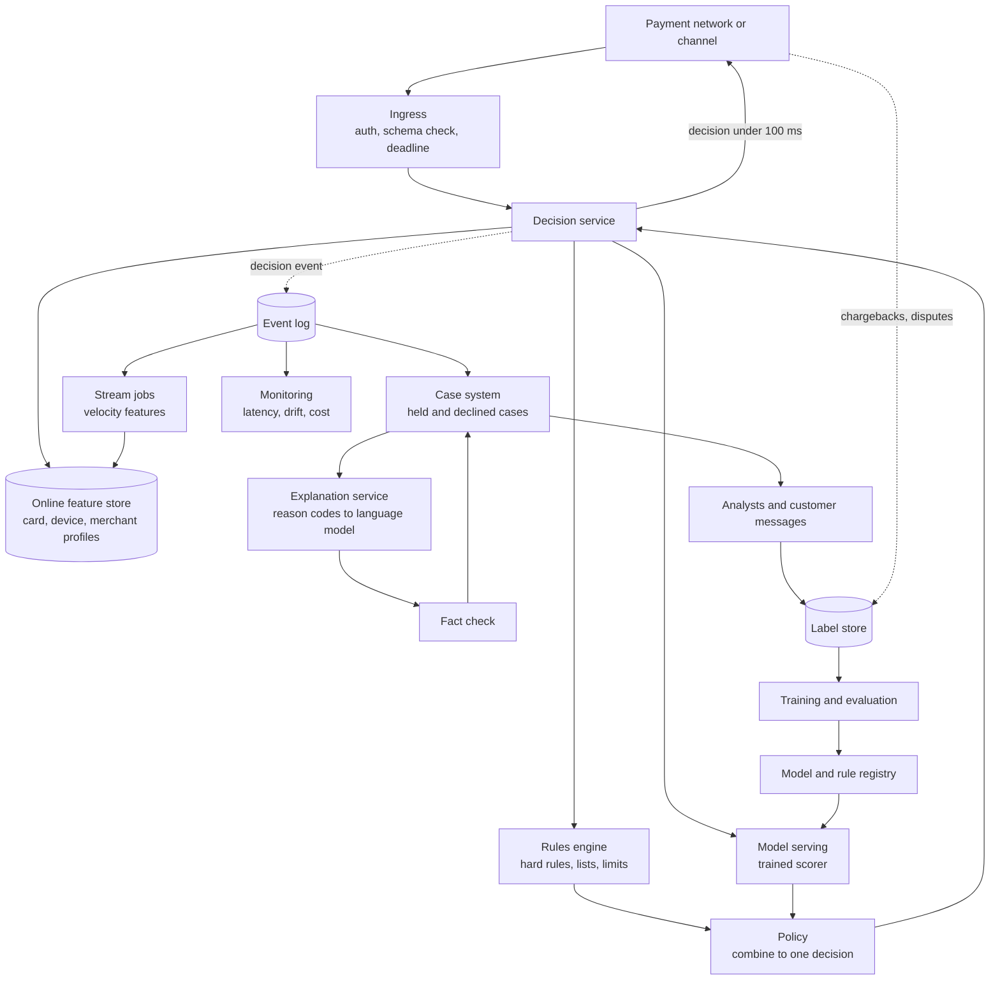
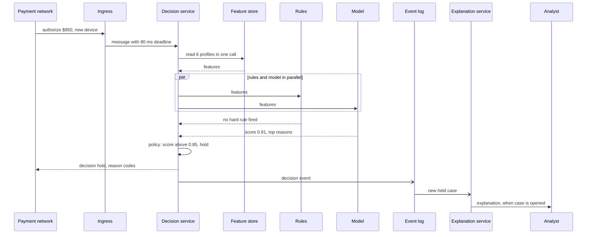

# Fraud detection with explanations

> [!NOTE]
> The bank in this case study is fictional. Its numbers are made up to make the design concrete. Prices, rates and delays are stated assumptions, not measurements. New to AI terms? Start with [the word list](#words-used-in-this-case-study), and see [the layers and tools](#layers-and-tools) for what to build each part with.

## At a glance

| | |
|---|---|
| **Problem** | Decide approve, step-up, hold or decline for every payment within 100 ms, then explain each risky decision to analysts and customers. |
| **Scale** | Peak of 10,000 transactions a second, about 86 million a day. |
| **Key patterns** | Rules and a trained model on the hot path, language model explanations off it, delayed feedback labels, drift monitoring, safe fallback on timeout. |
| **Difficulty** | Advanced. |
| **Read time** | About 40 minutes. |

## The scenario

Harbor Bank is a made-up retail bank with card, bank transfer and mobile wallet payments. Every payment must get a fraud decision before the bank answers the payment network, and that answer has a hard time limit. Today a rules engine makes the call, fraud analysts review a queue of held payments, and a decline reaches the customer as a short code with no reason.

Two things hurt. Fraud patterns change faster than analysts can write rules, and good customers are declined without any explanation, which creates calls to support. The team wants a trained model beside the rules, plain-language explanations for analysts and customers, and a loop that learns from outcomes.

The explanations must never slow the decision. This is the main design idea of the case study: the decision is a fast, deterministic computation, and the language model works later, on a copy of the facts.

| Measure | Today | Target |
|---|---|---|
| Peak transactions per second | 10,000 | 10,000 |
| Decision time (p99, at the 99th percentile) | 60 ms | Under 100 ms |
| Fraud caught, by value | 55% | 80% |
| Share of transactions declined or held | 0.35% | 0.2% |
| Analyst time to understand one case | About 6 minutes (assumed) | Under 2 minutes |
| Decline reason shown to the customer | None | A plain sentence |

The mix of outcomes we aim for: about 99.8% approved straight away, and the other 0.2% declined or held. A separate step-up outcome asks the customer to confirm in the banking app, and it is counted in the approved group once the customer confirms.

## Requirements

A fraud system makes two kinds of mistakes, and both cost money. Missing a fraud loses the payment amount. Blocking a real customer loses trust and creates support work. The requirements give each side a number, and they put the explanation feature in its own place so it can never put the decision at risk.

Functional requirements:

| Requirement | Priority |
|---|---|
| Return one of four decisions for every transaction: approve, step-up, hold, decline | P0 |
| Apply hard rules, such as sanctions lists and blocked cards, before any model | P0 |
| Score each transaction with a trained model | P0 |
| Return reason codes with every non-approve decision | P0 |
| Send held cases to analysts with a plain-language explanation | P0 |
| Give the customer a short, safe reason for a step-up or decline | P1 |
| Record outcomes (customer confirmation, analyst decision, chargeback) as labels | P0 |
| Detect drift and alert the model team | P1 |
| Replay past traffic against a new model or rule set before release | P1 |

Non-functional requirements, each with the reason for the number:

| Requirement | Target | Why |
|---|---|---|
| Decision time | Under 100 ms at p99 | The payment network expects a reply in a fixed time, and the bank budgets 100 ms of it for the fraud check (assumed) |
| Availability of the decision path | 99.99% | A fraud outage either blocks payments or lets fraud through |
| Fraud caught, by value | 80% | Set with the risk team from the loss numbers in the Cost section |
| Declined or held share | At most 0.2% | Each wrong block costs about $5 in support and lost trust (assumed) |
| Explanations | Ready within 5 s for 95% of held cases | An analyst should not wait when opening a case |
| Explanation facts correct | 100% of figures and reasons match the case data | A wrong explanation is worse than none |
| Label freshness | Model retrained weekly, using labels at least 60 days old for chargebacks | Chargebacks arrive late (see deep dive 4) |

Security and compliance needs: decisions and the data behind them are kept for audit. Card numbers are tokenized, and the language model never sees a full card number, name or address. Model changes follow the bank's model risk process, and the US Federal Reserve's [SR 11-7 guidance on model risk management](https://www.federalreserve.gov/boarddocs/srletters/2011/sr1107.htm) is a good reference for what that process contains. Rules about automated decisions and customer explanations differ by country, so check the ones where your customers live. The language model can explain a decision but can never change it.

## Numbers

Before drawing anything, we estimate the load and the bill. The formulas follow the [design method](../DESIGN-METHOD.md), and every assumption is stated so you can change it.

Traffic:

- Average transactions per second = peak ÷ peak factor = 10,000 ÷ 10 = 1,000. The peak factor of 10 is an assumption for shopping days and paydays against a quiet night.
- Transactions per day = 1,000 × 86,400 = 86,400,000.
- Transactions per month = 86,400,000 × 30 = 2,592,000,000.
- Decisions in flight at peak = arrival rate × time per decision = 10,000 × 0.05 s = 500, using an assumed typical decision time of 50 ms. At the full 100 ms budget the number is 10,000 × 0.1 = 1,000.

Scoring capacity:

- Model scoring time = 3 ms of one CPU core per transaction (assumed, for a gradient-boosted tree model, see the layer on model serving). Rules take 0.2 ms.
- Cores busy at peak = 10,000 × (0.003 + 0.0002) = 32.
- Cores to buy = 32 ÷ target utilization 0.5 = 64, so that bursts do not queue.
- Cores with one zone lost = 64 × 2 = 128, because we run in two zones and either one must carry the full peak alone.

Feature store (the fast lookup store for "what do we know about this card, device and merchant"):

- Lookups per second at peak = 10,000 × 6 entities per transaction (card, account, customer, device, merchant, payee) = 60,000.
- Memory = entity profiles × bytes per profile = 30,000,000 × 1,500 = 45 GB, and 90 GB with two copies.

Tail latency from fan-out:

- The 6 entities live on 4 feature store nodes, so one decision calls up to 4 nodes in parallel.
- If each node is slow (over 30 ms) for 1% of calls, the chance that at least one of the 4 is slow = 1 − 0.99⁴ = 1 − 0.9606 = 0.0394, about 3.9%. That is far more than 1%, and it is why the design needs a deadline and a fallback.

Decisions and explanations:

- Declined or held per day = 86,400,000 × 0.2% = 172,800.
- Average explanation requests per second = 172,800 ÷ 86,400 = 2. Peak = 2 × 10 = 20 per second.
- Explanations in flight = 20 per second × 2 s per language model call = 40.

Model cost for explanations. Assume a small model costs $0.25 per 1M input tokens and $1.25 per 1M output tokens, as placeholder prices.

- Tokens per explanation = 900 in (case facts, reason codes, rules that fired, policy text) + 150 out.
- Cost per explanation = 900 ÷ 1,000,000 × $0.25 + 150 ÷ 1,000,000 × $1.25 = $0.000225 + $0.0001875 = $0.0004125.
- Writing one for every case = 172,800 × $0.0004125 = $71.28 a day, or $2,138 a month.
- Writing one only when an analyst opens the case (assumed 25% of cases) = 43,200 × $0.0004125 = $17.82 a day, or about $535 a month.

Infrastructure, with assumed prices:

- Scoring fleet = 128 cores × $0.04 per core-hour × 730 hours = $3,738 a month.
- Feature store = 4 nodes × $700 = $2,800 a month.
- Event log, stream processing, storage and monitoring = $6,000 a month (assumed).
- Total = $3,738 + $2,800 + $6,000 + $535 = **$13,073 a month**.
- Cost per 1,000 transactions = $13,073 ÷ (2,592,000,000 ÷ 1,000) = $13,073 ÷ 2,592,000 = **$0.0050**.

The fraud numbers, which are far larger:

- Assume fraud is 0.02% of transactions by count and averages $80. Fraud per month = 2,592,000,000 × 0.0002 = 518,400 transactions, worth 518,400 × $80 = $41,472,000.
- Each point of fraud caught = 1% × $41,472,000 = $414,720 a month. That is 32 times the whole monthly infrastructure bill ($414,720 ÷ $13,073). A better model is worth much more than a cheaper one.
- At 80% recall, fraud caught = 0.8 × 518,400 = 414,720 transactions. Declined or held = 2,592,000,000 × 0.2% = 5,184,000. Precision = 414,720 ÷ 5,184,000 = 8%, so 92% of blocked transactions are real customers, most of them freed by a step-up or a call. Wrongly blocked = 5,184,000 − 414,720 = 4,769,280, or 4,769,280 ÷ (2,592,000,000 − 518,400) = 0.18% of good transactions.
- At $5 per wrongly blocked transaction (assumed), the false-positive cost is 4,769,280 × $5 = $23,846,400 a month. A 10% cut in wrong blocks saves 476,928 × $5 = $2,384,640.

Hold both ideas: the language model costs about $535 a month and the fraud and friction costs run into millions, so the money is in the decision quality, not in the explanation prices.

## Choosing the shape

The simplest design that could work is the rules engine Harbor has today. It fails because rules only catch patterns people already know, and each new rule adds a new way to block good customers. A model alone fails too: it cannot express hard facts like "this card is reported stolen" or "this country is sanctioned", and regulators and analysts want rules they can read.

Walking up the ladder from the [design method](../DESIGN-METHOD.md):

| Rung | Verdict |
|---|---|
| One model call | A language model on the hot path fails: it takes about a second, costs far more per call, and gives different answers to the same input. At 10,000 per second the cost would also be huge. |
| Fixed pipeline | Fits the hot path: fetch features, run rules, score with a trained model, combine into one decision. |
| Router | Useful in a small form: a payment type (card present, online, transfer) picks the model and rule set. |
| Tool-calling agent | Not for the decision. The decision must be fast, repeatable and auditable. |
| Multiple agents | Not needed. |

So the decision path is a fixed pipeline with no language model in it. A language model joins on a second path, after the decision, where it turns structured facts into sentences. That second path is a small fixed pipeline too: read case facts, write an explanation, check it against the facts, store it. We do not use an agent because the steps never change and the output must be checkable.

## Architecture

Every transaction enters the decision service, which fetches features, runs the rules and the model in parallel, and combines the results with a policy table. The decision goes back at once. A copy of the transaction, the features and the decision go to an event log. From there, stream jobs update features, the case system opens cases for analysts, the explanation service writes plain-language text, and the label and training jobs learn from outcomes.



Solid arrows are the hot path, the code that must finish in 100 ms. Dotted arrows and everything below the event log run later, and a slow or broken part there cannot delay a payment.

The three parts below are written for readers who are new to AI. The word list explains the terms. The layers part explains each box, what it does here, and which kind of tool can build it. The build order shows a sensible order for a small team.

### Words used in this case study

If a word on this page is new to you, find it here. Each entry says what the word means in this design, not in general.

| Word | What it means here |
|---|---|
| Token | A small piece of text, about three quarters of an English word. Language models read and write tokens, and providers charge per token. |
| Embedding | A list of numbers that stands for the meaning of a piece of text. We do not need embeddings on the hot path. |
| RAG | Retrieval-augmented generation. Search first, then give the best passages to a language model. Here, the explanation service reads policy text this way. |
| Cache | A saved result that we reuse instead of computing it again. |
| Memory | What a system remembers between requests. In this design that is the feature store, not the language model. |
| Guardrail | A check that blocks or changes something unsafe. Here, a fact check stops explanations that contain wrong numbers. |
| p95, p99 | The time that 95 or 99 out of 100 requests beat. Fraud decisions are judged at p99 because slow outliers still delay a real payment. |
| Transaction | One payment attempt: a card purchase, a bank transfer or a wallet payment. |
| Decision | The answer for one transaction: approve, step-up, hold or decline. |
| Step-up | Asking the customer to prove it is them, for example by confirming in the banking app. |
| Hold | Pausing a transaction so an analyst can review it. |
| Feature | One input number for the model, such as "payments from this card in the last hour". |
| Feature store | A fast database of features, read for every transaction. |
| Velocity feature | A count or sum over a time window, such as the number of payments in 10 minutes. |
| Rule | A readable condition with a fixed action, such as "decline if the card is reported stolen". |
| Model | A program trained on past transactions that gives each new one a risk score between 0 and 1. |
| Gradient-boosted trees | A common model type for table data. It is made of many small decision trees and scores in a few milliseconds on a CPU. |
| Reason code | A short code saying which features or rules drove a decision, such as `NEW_DEVICE_HIGH_AMOUNT`. |
| Attribution (SHAP) | A method that splits a model's score into a contribution per feature. We use it to produce reason codes. |
| Label | The known answer for a past transaction: fraud or not fraud. |
| Chargeback | A dispute where the customer's bank takes a payment back. It is the slowest and most reliable fraud label. |
| Drift | A change in the data or in fraud behavior that makes a model worse over time. |
| PSI | Population stability index, a number that shows how much a distribution moved. Formula in deep dive 4. |
| Champion and challenger | The model in production and a new candidate that runs beside it without making decisions. |
| Shadow mode | Running a new model on live traffic and recording what it would do, with no effect on customers. |
| Event log | An append-only stream of records that many jobs can read at their own pace. |
| Idempotent | Safe to repeat. Running it twice has the same effect as running it once. |
| Deadline | The latest time by which a step must answer. After it, the system uses a fallback. |

### Layers and tools

We split the system into ten layers. Each layer has one job, and each can be built with a different category of tool. This part walks through them in the order a transaction meets them. For each layer you get what it is, what it does here, the kinds of tools you can choose from, and what we would pick first.

Tool names are examples as of November 2026. They are not endorsements, and tools change faster than categories. Before choosing, check that the project is maintained and that its license suits you.

Four layers hold data that people often mix up: the online feature store, the event log, the label store and the cache. They all store things about transactions, but they answer different questions.

| | Online feature store | Event log | Label store | Cache |
|---|---|---|---|---|
| The question it answers | What do we know about this card right now? | What happened, in order? | Was it fraud in the end? | Have we already computed this? |
| What it holds | Profiles and counters per card, device, merchant | Every transaction, decision and feature value | Outcomes with the date each one arrived | Saved results, such as a country risk table |
| Who reads it | The decision service, per transaction | Stream jobs, cases, training, audit | Training and evaluation | Whoever saved it |
| How it changes | On every transaction | Append only | Weeks later, as outcomes arrive | Expires on a timer |
| Risk if it is wrong | A wrong decision now | Lost history, no audit trail | A model that learns the wrong thing | A stale answer |

#### Layer 1: ingress

Ingress is the front door. It authenticates the caller, checks that the message has the right shape, stamps it with a deadline, and passes it to the decision service. It also protects the service from overload by shedding non-urgent traffic first.

The deadline matters most. Ingress sets "answer by 80 ms from arrival" and every later step reads that number. A step that cannot finish in time gives up and the system uses a fallback, so the payment network always gets an answer.

| Category | Examples | Pick it when |
|---|---|---|
| Your payment switch or API gateway | Your existing card switch, Envoy, NGINX | You already have a front door for payment messages. Reuse it |
| Service mesh with timeouts and retries | Envoy-based meshes, Linkerd | You want deadlines and retry limits in one place |
| Binary message formats | Protocol Buffers over gRPC | Parsing JSON takes a noticeable share of the budget |

First version: the existing payment switch calling the decision service over gRPC with a deadline on every call. What goes wrong: retries that multiply load during a slowdown. Allow at most one retry, and only while the deadline allows.

#### Layer 2: feature store

The feature store holds what we know about each card, device, merchant and customer: the number of payments in the last hour, the usual spending hour, the countries seen, the age of the device. The decision service reads about 6 profiles per transaction. Without a feature store, the model would have to compute these numbers from raw history on every call, which is too slow.

Features come in two kinds. Slow features, such as "average payment size over 90 days", are computed in batch each night and loaded. Fast features, such as "payments in the last 5 minutes", are updated by stream jobs and by a small write inside the decision itself (see deep dive 1).

| Category | Examples | Pick it when |
|---|---|---|
| In-memory key-value store | Redis or Valkey, Aerospike | You need reads in about a millisecond and have tens of GB of data |
| Feature store platform | Feast, Tecton, Hopsworks | You want one definition of each feature for both training and serving |
| Wide-column database | Cassandra, ScyllaDB, DynamoDB | The profiles are too large for memory, or you need many regions |

First version: Redis or Valkey for the online profiles, with feature definitions kept in one shared code module so training and serving compute the same thing. What goes wrong: training and serving compute a feature slightly differently, so the model sees different data in production. This is called training-serving skew. Log the feature values used for each decision and compare them with the training values.

#### Layer 3: rules engine

The rules engine runs readable conditions with fixed actions. It handles what a model should not guess: stolen cards, sanctioned countries, amount limits, and temporary rules written in response to an attack this morning. Rules run in under a millisecond because they are plain comparisons.

| Category | Examples | Pick it when |
|---|---|---|
| Rules written as code or configuration | A small interpreter for a rule file you version in git | You have tens of rules and want them reviewed like code |
| Rules engines | Drools, Open Policy Agent | You have hundreds of rules and need a standard way to author and test them |
| Fraud platform rule builders | The rule screens in fraud vendor products | Analysts, not engineers, must change rules every day |

First version: a rule file in git with tests, loaded into memory and hot-reloaded. What goes wrong: old rules are never removed, so the engine slowly blocks more good customers. Give each rule an owner and an expiry date, and report how often each rule fires and how often it is right.

#### Layer 4: model serving

The model gives each transaction a risk score between 0 and 1. A gradient-boosted tree model on table data is the usual first choice for fraud, because it scores in a few milliseconds on a CPU, handles missing values, and gives per-feature attributions for reason codes. The model is loaded in memory inside the scoring service, so a score is a function call, not a network call.

| Category | Examples | Pick it when |
|---|---|---|
| Tree libraries | XGBoost, LightGBM, scikit-learn | The data is a table of features. This is the default for fraud |
| Model export and fast runtime | ONNX Runtime, Treelite | You train in Python but want to score in a faster language or process |
| Model server | Triton Inference Server, KServe, Seldon | You need many models, versioning and a standard serving API |
| Neural networks | PyTorch, TensorFlow | You model sequences (a card's last 50 payments) or graphs (who pays whom), and a tree model has stopped improving |

First version: one gradient-boosted tree model, exported and loaded into the decision service process. What goes wrong: a score that arrives after the deadline is useless. Measure p99 scoring time on each new model before it ships, and refuse to deploy one that exceeds its budget of 15 ms.

#### Layer 5: decision policy

The policy turns the rule results and the model score into one decision. It is a small, readable table, not another model. A risk team can read it, change a threshold, and see what changes. It also chooses the reason codes to return.

| Category | Examples | Pick it when |
|---|---|---|
| Threshold table in configuration | A versioned file of score bands per payment type | You have a few bands. Start here |
| Policy engine | Open Policy Agent, Drools | Policy has many conditions and needs formal review |
| Cost-based optimizer | A job that picks thresholds from loss and friction costs | You want thresholds set by money, as in deep dive 2 |

First version: a table of score bands per payment type, where a hard rule always beats the score. What goes wrong: thresholds set once and never revisited. Review them whenever the fraud rate or customer mix shifts.

#### Layer 6: event log and stream jobs

The event log records every transaction with its features, rule results, score and decision. Many jobs read from it independently: velocity feature updates, case creation, the explanation service, monitoring and training data. Because the log is append only, a new job can replay history to catch up, and an audit can reconstruct any past decision.

Writing to the log happens after the decision is sent, so a slow log cannot delay a payment. If the log is down, the decision service buffers events locally and replays them.

| Category | Examples | Pick it when |
|---|---|---|
| Distributed log | Apache Kafka, Redpanda, Amazon Kinesis, Google Pub/Sub | You need ordered, replayable streams at 10,000 events a second or more |
| Stream processors | Apache Flink, Kafka Streams, Spark Structured Streaming | You compute windowed counts and joins on the stream |
| Object storage and table formats | Parquet files on S3 or similar, Apache Iceberg | You keep months of history cheaply for training and audit |

First version: Kafka or a managed equivalent, one Flink or Kafka Streams job for velocity features, and a nightly copy to object storage. What goes wrong: a consumer falls behind and velocity features go stale. Alert on consumer lag, and fall back to the in-decision counters.

#### Layer 7: case system and human review

The case system opens a case for every held or declined transaction and shows analysts the facts, the reason codes and the explanation. It collects the analyst's decision, which is a high-quality label. Analysts are expensive, so the system sorts the queue by expected loss, not by arrival time.

| Category | Examples | Pick it when |
|---|---|---|
| Case management product | The case tools in fraud platforms, or a general tool such as ServiceNow | Your analysts already work in one and it has an API |
| A simple screen you build | A table in Postgres and a small web page | You have a small team and no case tool |

First version: a table of cases in Postgres and a small review screen that stores the decision with a reason. What goes wrong: analysts decide without writing why, and the labels become noisy. Make a fraud or not-fraud choice required and keep the free-text note optional.

#### Layer 8: explanation service

The explanation service turns structured facts into plain sentences. It never sees raw card data, and it never decides anything. It reads the case facts (amount, merchant category, country, time, device age), the rules that fired, the reason codes with their attribution values, and a short piece of policy text. It writes a short explanation for the analyst. For the customer it does less: a template picks the sentence from a short approved list, and the language model only varies the wording within strict limits, if at all.

| Category | Examples | Pick it when |
|---|---|---|
| Templates | A string per reason code, filled with values from the case | The reasons are few and fixed. The default for customer messages |
| Small hosted language model | The small tiers of the hosted model APIs | You want natural analyst summaries that read several facts together |
| Self-hosted small model | An open-weight model served with vLLM or similar | Case data may not leave your network, or volume is very high |
| Fact checker | Your own code that compares every number and name in the text to the case | Always. It is the guardrail for this layer |

First version: language model summaries for analysts only, templates for customers, and a fact checker on both. What goes wrong: the model states a reason that is not in the data. The fact checker in deep dive 3 catches this, and the case then shows the plain reason codes instead.

#### Layer 9: labels, training and evaluation

Labels are the known outcomes: confirmed by the customer, decided by an analyst, or charged back weeks later. The label store keeps each label with the date it arrived, so training can ask "what did we know on this day?". The training job builds a dataset from the event log and the labels, trains a candidate, and compares it with the champion on a time-based test set.

| Category | Examples | Pick it when |
|---|---|---|
| Workflow orchestrator | Apache Airflow, Dagster, Prefect | You run nightly and weekly jobs with dependencies |
| Experiment tracking and model registry | MLflow, Weights & Biases, your cloud platform's registry | You need to know which data and code made which model |
| Evaluation code | Your own scripts with scikit-learn metrics | Always. The metrics here are specific to your loss numbers |

First version: a weekly Airflow job, MLflow for the registry, and an evaluation script that blocks a release that does worse than the champion. What goes wrong: training on random splits of data, which leaks the future into the past. Always split by time.

#### Layer 10: monitoring and drift detection

Monitoring watches latency, errors, the share of each decision, rule hit rates, score distributions and the age of labels. It is also where drift shows up first, because labels come weeks late but score distributions change at once.

| Category | Examples | Pick it when |
|---|---|---|
| Metrics and dashboards | Prometheus with Grafana, or your cloud provider's monitoring | You want latency, errors and decision mix with alerts |
| Tracing | OpenTelemetry with a tracing backend | You want to see where the milliseconds went for a slow decision |
| Data and model monitoring | Evidently, WhyLabs, Arize, or your own PSI job | You want ready-made drift reports on features and scores |

First version: Prometheus and Grafana for service metrics, and a nightly PSI job on the top 20 features and on the score. What goes wrong: alerts on every small shift, so people stop reading them. Page only on large, sustained changes.

### Build order

Build the system in stages, and put each stage in front of real traffic before you add the next. The order follows risk: first the model watches without acting, then it acts on a small slice, then the explanations arrive, and the learning loop closes last. The steps are a sequence, not a schedule.

1. **Stage 0: the baseline and the log.** Keep today's rules engine as the decision maker. Add the event log and write every transaction, feature and decision to it. Build the label store from analyst decisions and chargebacks. Test: replay one day from the log. Done when: you can rebuild any past decision's inputs.
2. **Stage 1: shadow model.** Train a tree model on historical data with a time-based split. Run it in shadow mode on live traffic and record its score next to the rules' decision. Test: measure fraud caught and flagged share in shadow, and measure p99 scoring time. Done when: the model beats the rules on the evaluation set and scores within its 15 ms budget.
3. **Stage 2: the model on the hot path, on a small slice.** Add the policy table and a deadline with a rules-only fallback. Send 1% of traffic to the new path, with a kill switch. Test: a forced slow feature store, to confirm the fallback works. Done when: p99 stays under 100 ms and fraud caught is not below the rules-only slice.
4. **Stage 3: reason codes and analyst explanations.** Compute attributions for each non-approve decision, build the case screen, and add the language model explanation with the fact checker. Test: the fact checker on a set of cases with planted errors. Done when: analysts open a case and see a correct explanation within 5 s.
5. **Stage 4: customer messages and step-up.** Add template messages for customers and the in-app step-up flow, and record step-up responses as labels. Test: every reason code has an approved message. Done when: no customer message carries detail that would help a fraudster tune an attack.
6. **Stage 5: closed learning loop.** Add weekly retraining, the champion and challenger process, the PSI jobs and the exploration traffic from deep dive 4. Done when: a new model goes from training to a canary release with no manual steps except approval.
7. **Stage 6: scale and reach.** Add a second region, more payment types and sequence or graph models, as the numbers in the scaling section call for. Done when: a load test passes at the next target size.

## One request, end to end

Here is one concrete transaction. A customer of Harbor Bank, who normally pays small amounts in Pune, makes a $950 online purchase from a new device late at night. We follow it through the system and budget the time for each step.



The score of 0.91 falls in the hold band, so the transaction is held and a case opens. The network gets its answer from the decision service before the explanation work even starts. When the analyst opens the case, the explanation service reads the case facts and writes: "A $950 online purchase from a device first seen 20 minutes ago, at 2:10 a.m. This card's usual payment is about $30, and it has not been used online at night before." The fact checker confirms each figure against the case before the text is shown.

Latency budget for the decision path:

| Step | Budget | If it overruns |
|---|---|---|
| Ingress and parse | 5 ms | Shed non-urgent traffic first |
| Feature fetch (one pipelined call per node, in parallel) | 15 ms | At 30 ms, use stale or default features and skip the model |
| Rules (in parallel with the model) | 5 ms | Rules are in memory, so overruns point to a bug |
| Model score (in parallel with the rules) | 15 ms | At the deadline, use the rules-only decision |
| Policy | 3 ms | Table lookup, should not overrun |
| Response | 4 ms | Check the network path |
| **Typical total** | **about 42 ms** | Critical path = 5 + 15 + max(5, 15) + 3 + 4 = 42 ms |
| Reserve for the tail | 58 ms | Absorbs queueing, garbage collection and slow nodes. The hard deadline is 80 ms |

The typical total is 42 ms, so the 100 ms limit is about the tail. A step that is slow for 1 in 100 calls, combined across the 4 feature nodes, is slow for about 3.9% of decisions (calculated above). The deadline and the fallback take care of those.

## Deep dives

Four parts of this design deserve more care than the rest: staying inside 100 ms when parts are slow, combining rules and a model into one decision, explaining decisions with a language model without risking them, and learning from labels that arrive late.

### Deep dive 1: staying inside 100 ms

A fast average does not help a payment that took 400 ms. The design goal is a bounded worst case, and the main tool is the deadline. The idea comes from the paper [The Tail at Scale](https://research.google/pubs/the-tail-at-scale/), which shows how calling many servers makes slow responses common even when each server is rarely slow.

Options we considered:

1. **Wait for everything.** Simple, but the 3.9% slow chance from the Numbers section lands on the customer.
2. **Hedged requests.** If a feature read has not answered after 8 ms, send the same read to the replica and use whichever answers first. This cuts the slow share, at the cost of a small share of extra reads.
3. **Deadline with graceful fallback.** Every step knows how much time is left, and the system has a defined answer when time runs out.

We use options 2 and 3 together. The fallback ladder is:

| Situation | What the system does |
|---|---|
| Feature read late at 30 ms | Use the in-decision counters and any cached profile, skip the model, use rules-only |
| Model late | Use the rules-only decision |
| Rules engine unavailable | Use a minimal built-in policy: approve under a low amount limit, step-up above it |
| Deadline of 80 ms reached | Return the fallback decision now |

The fallback never defaults to "decline everything", because that stops all payments, and never to "approve everything", because that invites fraud during an outage. The built-in policy uses the amount and the customer's usual spending to decide, and it is reviewed by the risk team.

Velocity features need special care. A fraudster who sends five payments in one second should be caught by the third. If velocity counters are updated by a stream job after the decision, the second and third payments do not see the first. So the decision service writes a small atomic counter increment for the card and device in the same store, as part of the decision:

```python
def decide(txn, deadline):
    feats = fetch_features(txn, timeout=deadline.left(30))   # None on timeout
    counters = incr_counters(txn.card, txn.device)           # atomic, about 1 ms
    hard = rules.evaluate(txn, feats, counters)              # always runs
    score = model.score(txn, feats, counters) if feats and deadline.left() > 15 else None
    return policy.combine(hard, score, txn.payment_type)
```

The increment is idempotent for a retry: it uses the transaction ID as a key, so a repeated message does not count twice. The stream job later writes the heavier features, such as averages over days.

### Deep dive 2: rules and a model together

Rules and a trained model are good at different things, so we keep both. Rules are exact, readable and fast to change in an emergency. The model finds weak signals that add up, which no analyst would write as a rule.

The two do not vote. They are combined in a fixed order:

1. Hard rules first. A stolen-card or sanctions rule ends the decision, whatever the model says.
2. The model score then picks a band: approve, step-up, hold or decline.
3. Soft rules adjust the band by at most one step. For example, a trusted-device rule can lower hold to step-up, and a known-attack rule can raise approve to step-up.

The thresholds come from money, not from a feeling about the score. For each score band we know how many fraud and good transactions fall in it, from the evaluation set. For one transaction with fraud probability p and amount A, blocking costs (1 − p) × F, where F is the cost of friction (assumed $5 for a wrongly blocked good customer, as in the Numbers section). Not blocking costs p × A, the expected loss. So block when p × A > (1 − p) × F, which gives:

p > F ÷ (A + F)

For the $950 purchase above, the threshold is 5 ÷ (950 + 5) = 0.0052. In plain terms: for a large payment, it is worth stepping up the customer at a very low probability of fraud, because a step-up is cheap and the loss is large. For a $20 payment, the threshold is 5 ÷ 25 = 0.2. That is why thresholds depend on the amount, and why the policy table has amount bands. In practice, step-up costs less than a decline, so the table has two thresholds per amount band, one for step-up and one for hold or decline.

The model score must be calibrated for this to work: a score of 0.2 should mean about 20% of such transactions are fraud. Check calibration on the time-based test set, and fix it with a calibration step if needed.

### Deep dive 3: explanations that cannot hurt the decision

A language model is good at writing a clear paragraph from facts and bad at being a source of facts. So the design keeps the decision and the reasons in structured data, and the model only writes sentences about them.

The path has four rules:

1. **Reasons come from the decision, not from the model.** The scoring service computes reason codes from rule results and per-feature attributions. The [SHAP paper](https://arxiv.org/abs/1705.07874) describes the attribution method. For a tree model, the top 3 attributions by size give the reasons.
2. **The language model sees only what an analyst may see.** Tokenized IDs, amounts, merchant category, country, time, device age, reason codes with values, and the rules that fired. No full card number, no name, no address.
3. **Every claim is checked.** After the text is written, code checks that each number, date, country and merchant in the text appears in the case facts, and that each reason named is one of the reason codes. A failed check means the text is discarded and the case shows the plain reason codes.
4. **Off the hot path, with its own limits.** The service reads from the event log at its own pace. If the language model is slow or down, cases still open with reason codes, and nothing about the payment changes.

```python
def explain(case):
    facts = case.facts_for_analyst()           # structured, no raw card data
    text = llm.write(prompt_for(facts), max_tokens=150)
    claims = extract_figures_and_reasons(text)
    if all(c in facts.allowed_values() for c in claims):
        return text
    return render_reason_codes(case.reason_codes)   # plain fallback
```

Customer messages are more sensitive, because an explanation that is too detailed teaches a fraudster which signal tripped. So customers get a short sentence from an approved list ("We held this payment because it looked different from your usual activity. Please confirm in the app."), not the attribution detail. Analysts get the detail.

The input to the language model includes data from outside, such as merchant names and free-text notes from customers, which anyone can write. Treat them as untrusted text. The defense is the same as for tools in other designs: the model has no tools and no power to change anything, and its output is checked against the facts. See the Part 1 note on [prompt injection](https://github.com/NeuralSaasAi/ai-engineering-playbook/blob/main/04-llm-security/prompt-injection.md).

Cost control comes from writing the explanation when an analyst opens the case, not when it is created. In the Numbers section that is $535 a month instead of $2,138.

### Deep dive 4: delayed labels, drift and the feedback loop

A fraud model learns from outcomes, but outcomes arrive late and are biased. This is the hardest part of the design, and the part teams most often skip.

**Labels arrive at different speeds.** We assume these sources and delays, and you should measure your own:

| Label source | Typical delay (assumed) | Share of all fraud it finds (assumed) | Quality |
|---|---|---|---|
| Customer denies a step-up in the app | Minutes | 30% | High, but only for transactions we challenged |
| Analyst decision on a held case | Hours | 20% | High, but only for held transactions |
| Customer reports fraud by phone or app | Days | 25% | Good |
| Chargeback or dispute | Weeks, up to 60 days | 25% | Highest, but late |

The delay creates a trap. If you train on last week's data, most of its fraud is not labeled yet, and the model learns that fraud is rare. The rule: only train on a transaction when its labels have had time to mature. With chargebacks arriving up to 60 days late, the training cutoff is today minus 60 days. The newest 60 days are used only for monitoring, with caution.

A second trap: **we only see outcomes for what we let through.** A declined transaction never shows whether it was fraud. If the model only learns from approved transactions, it never finds out about its mistakes on blocked ones. The fix is exploration: approve a small random slice of transactions that would have been blocked, and learn from them. To keep the loss small, we cap it by amount.

- Blocked per day = 172,800. Assume 30% are under $20. Exploration rate = 1%.
- Explored per day = 172,800 × 0.30 × 0.01 = 518.4 transactions.
- Fraud among them, at the 8% precision from the Numbers section = 518.4 × 0.08 = 41.5.
- Worst-case loss per day = 41.5 × $20 = $829, or about $24,900 a month.

That is roughly 6% of one point of recall ($414,720), so it is cheap compared with the value of unbiased labels. The risk team must approve it, and it must be recorded in the log so that training can weight those rows.

**Drift has two kinds.** Data drift means the inputs changed: a new payment method, a holiday, a new merchant type. Concept drift means the link between inputs and fraud changed: fraudsters found a new technique. Data drift shows up at once in the inputs. Concept drift shows up in the labels, weeks later, so we watch proxies that move sooner: the score distribution, the decision mix, the step-up pass rate and the analyst's agree rate.

For data drift we use the population stability index. Split a feature (or the score) into bins. Let e be the share of last quarter's training data in each bin, and a the share of today's live data. Then:

PSI = sum over bins of (a − e) × ln(a ÷ e)

A worked example with three bins: e = 0.5, 0.3, 0.2 and a = 0.4, 0.3, 0.3. The terms are (0.4 − 0.5) × ln(0.4 ÷ 0.5) = −0.1 × −0.2231 = 0.0223, then 0 for the middle bin, then (0.3 − 0.2) × ln(0.3 ÷ 0.2) = 0.1 × 0.4055 = 0.0405. PSI = 0.0223 + 0 + 0.0405 = 0.063. We set the alert levels at 0.1 (look at it) and 0.25 (page someone). These two levels are common rules of thumb and our assumption, so tune them to your data.

```python
def psi(expected_share, actual_share, eps=1e-6):
    total = 0.0
    for e, a in zip(expected_share, actual_share):
        e, a = max(e, eps), max(a, eps)
        total += (a - e) * math.log(a / e)
    return total
```

The paper [Hidden Technical Debt in Machine Learning Systems](https://papers.nips.cc/paper_files/paper/2015/hash/86df7dcfd896fcaf2674f757a2463eba-Abstract.html) lists risks like this one, including hidden feedback loops and changes in the outside world. Our model's own decisions change the data it later learns from. That is a feedback loop, and exploration traffic is one control for it.

A new model goes out in four steps: offline test on a time-based split, shadow mode, a canary on 1% of traffic, then full release. Fraud teams also keep a fast path for rules: when an attack starts, an analyst can add a rule within minutes, long before a model can be retrained.

## Scaling from 1x to 100x

Load will not stay at 10,000 transactions a second. Here is what changes at ten and one hundred times, computed from the numbers above. The 100x case is a shared platform serving many banks, or a very large payment network.

| Load | Peak per second | Feature lookups per second | Scoring cores (with one zone lost) | Peak explanations per second | What breaks first | Fix |
|---|---|---|---|---|---|---|
| 1x | 10,000 | 60,000 | 128 | 20 | Nothing yet. Tail latency from fan-out is the first risk. | Deadline, hedged reads, fallback |
| 10x | 100,000 | 600,000 | 1,280 | 200 | The feature store: more nodes mean more fan-out and more slow calls | Co-locate all features of one card on one node, shard by card, add replicas |
| 100x | 1,000,000 | 6,000,000 | 12,800 | 2,000 | Event log throughput, cross-region latency, the language model rate limit | Partitioned logs per region, regional decision services, queue explanations and write them on open only |

The reasoning behind the fixes:

- **Fan-out.** At 1x a decision calls up to 4 nodes. If the four were one node (all of a card's data sharded together), the slow-call chance falls from 1 − 0.99⁴ = 3.9% to 1%. This is the first change to make at 10x. The cost is that one hot card can overload one node, so add a local cache for the busiest cards.
- **Scoring cores.** Cores scale linearly: 128 × 10 = 1,280 and 128 × 100 = 12,800. Monthly scoring cost scales the same way: $3,738 becomes $37,380 and $373,800. At 100x, batch several transactions into one model call only if you can keep the added wait under about 2 ms.
- **Model size.** Moving from trees to a neural network for sequences can raise scoring time from 3 ms to 10 ms or more. Run that model on GPUs or smaller dedicated servers, and keep a tree model as the fallback.
- **Event log.** At 100x the average is 100,000 events a second. At about 2 KB each (assumed), that is 200 MB a second, or about 17 TB a day. Choose retention with care, keep full detail for a short time, and move to compact summaries after that.
- **Explanations.** At 100x, peak explanations are 2,000 a second and the language model bill is 100 × $535 = $53,500 a month if still written only on open. The queue absorbs bursts, since analysts do not need text within a millisecond.
- **Noisy neighbor.** On a shared platform, one bank's attack or load test must not slow the others. Give each bank its own quotas and its own partition.

## Failure modes and safety

This system fails in ways that cost money fast, so each failure needs a defined behavior before launch. The table lists the failures, how we notice and what the system does. The rule behind it: the decision path degrades toward simpler logic, never toward silence.

| Failure | How we detect it | What we do |
|---|---|---|
| Feature store slow or down | Read latency, timeouts, hit rate | Fall back to in-decision counters and the rules-only decision, as in deep dive 1 |
| Model server or model file broken | Score latency, errors, score distribution jumps | Rules-only decision, roll back to the previous model |
| Bad model release | Canary metrics: decision mix, step-up rate, score distribution | The kill switch returns traffic to the champion in seconds |
| Rule written in a hurry blocks good customers | Rule hit rate, declines per rule, support contacts | Each rule has an owner and a dry-run mode, and can be switched off on its own |
| Event log or consumers behind | Consumer lag | Local buffer on the decision service, in-decision counters, scale consumers |
| Language model down or slow | Explanation latency and errors | Cases open with reason codes only. No effect on payments |
| Explanation states a wrong fact | The fact checker rejects it. A sample is reviewed by people | Show reason codes instead, and log the miss to improve the prompt |
| Customer message leaks detail useful to fraudsters | Review of the approved message list | Customers get only approved sentences, not attribution detail |
| Prompt injection through merchant names or notes | Fact checker finds claims not in the data | The model has no tools, sees no raw card data, and its text is only shown after the check |
| Drift goes unnoticed | PSI above 0.25, falling analyst agree rate, rising chargebacks | Page the model team, tighten rules, retrain with fresh data |
| Fraud ring tests the thresholds | Many small declines from related devices or accounts | Rules on shared devices, limits per device, and exploration is capped by amount |
| Label feedback poisoned | Sudden change in label rates from one source | Hold training, check the source, exclude the affected window |
| Cost spike | Language model spend per hour against a budget | Budget cap on explanation calls. Cases still show reason codes |

Safety for people matters too. A false decline can strand a customer abroad or block rent. Declines for vulnerable situations, such as a hold on a salary credit, need a fast human path, and the app must always offer a way to contact the bank. Keep an audit record of each decision, the rules and model version used, and the reason codes, so any decision can be explained to a customer or a regulator later.

## Measuring quality

Good here means catching fraud and not blocking customers, within the time limit, with explanations that are right. The risk team decides the targets, because the trade-off is a business decision. Before launch, evaluate on a time-based split: train on older data and test on the next period, never on a random mix.

| Metric | Target | How we measure |
|---|---|---|
| Fraud caught, by value (recall) | At least 80% | Fraud value blocked ÷ all fraud value, on matured labels |
| Declined or held share | At most 0.2% | Count from the event log |
| Precision of blocks | Track it. It is 8% at the plan in the Numbers section | Confirmed fraud ÷ blocks |
| Good customers wrongly blocked | At most 0.18% of good transactions | From step-up results and analyst decisions |
| Decision time | Under 100 ms at p99, under 80 ms at p95 | Tracing on every decision |
| Fallback rate | Under 0.5% of decisions | Share of decisions that used a fallback |
| Score calibration | Observed fraud rate within 20% of predicted per band | Calibration table on the test set |
| Drift | PSI under 0.1 on the score and the top features | Nightly job |
| Explanation facts correct | 100% pass the fact checker, 98% rated useful by analysts | Fact check results and an analyst rating button |
| Analyst time per case | Under 2 minutes | Case timestamps |

The test set is built from past transactions with matured labels, with a separate set of recent attack patterns, so a model that did well on last year's fraud still has to handle this month's. A small set of 200 cases with planted errors tests the fact checker, such as a wrong amount or a reason that is not in the data.

What blocks a release: lower fraud caught than the champion at the same blocked share, a worse calibration, a scoring time over 15 ms at p99, or any failed check in the explanation test set. Production releases go through shadow mode and a 1% canary, and the canary is compared with the champion on the same traffic.

In production, watch the decision mix per hour, rule hit rates, score distribution, fallback rate, label arrival rates, analyst agreement with the model's top reasons, and support contacts about declines.

## Cost

Most of the money is not in the model or the infrastructure. The Numbers section shows the pieces: the infrastructure costs $13,073 a month including the language model, and the fraud it faces costs $41,472,000 a month before any controls.

Cost per 1,000 transactions = $13,073 ÷ 2,592,000 = $0.0050, from the Numbers section. Per day, that is about $436 (that is $13,073 ÷ 30).

| Part | Monthly cost | Share of total |
|---|---|---|
| Scoring fleet (128 cores) | $3,738 | 29% |
| Feature store (4 nodes) | $2,800 | 21% |
| Event log, streaming, storage, monitoring | $6,000 | 46% |
| Explanations (written on open) | $535 | 4% |
| **Total** | **$13,073** | |

Each share is the part divided by $13,073. For example, $3,738 ÷ $13,073 = 29%.

The explanation feature costs about 4% of the bill, and that is with a language model. Writing every explanation up front would cost $2,138 instead, which would raise the total to $14,676. Lazy writing is a simple lever, but it is not the big one.

The lever that moves the total most is quality of the decision. One point of recall is worth $414,720 a month, and a 10% cut in wrongly blocked transactions is worth $2,384,640 a month. Both are far larger than the whole infrastructure bill. So spend engineering time on better features, fresher labels and well-chosen thresholds before spending it on trimming servers. The exploration traffic costs up to about $24,900 a month in the worst case, and it pays for itself if the better labels raise recall by one-tenth of a point (0.1 × $414,720 = $41,472). Measure that gain before you decide to keep it.

## Trade-offs we made

Decisions in a fraud system are hard to reverse, and people will ask why they were made. This table records the main ones and what would make us change each.

| Decision | Options | Choice | Reason | What would change our mind |
|---|---|---|---|---|
| Language model on the hot path | On the hot path, off it | Off it | A model call takes about a second and gives different answers to the same input. The budget is 100 ms | A model that is fast, cheap and repeatable at 10,000 a second, with an audit story that satisfies the risk team |
| First model type | Trees, neural networks | Gradient-boosted trees | Fast on CPU, good on table data, easy to explain | Sequence or graph signals that trees cannot capture, shown on the test set |
| Rules and model | Rules only, model only, both | Both, in a fixed order | Rules give exact, reviewable control. The model gives weak signals | A bank with no need for hard lists, which is unlikely |
| Fallback on timeout | Approve, decline, rules-only | Rules-only, then a minimal policy | Neither approve-all nor decline-all is acceptable | Evidence that a different fallback has lower cost for a payment type |
| Explanation timing | On creation, on open | On open | Cuts the explanation bill from $2,138 to $535 a month | Analysts complain about waiting, or cases are opened most of the time |
| Customer explanations | Free text from the model, approved templates | Approved templates | A detailed reason helps a fraudster. A wrong reason harms a customer | Regulators or customers need more detail, with review of each new message |
| Training data cutoff | Use the newest data, wait for labels | Wait 60 days for chargebacks | Recent fraud is mostly unlabeled | A faster, trusted label source that covers most fraud |
| Exploration traffic | None, small capped slice | Small slice, capped at $20 | Unbiased labels, bounded loss of about $24,900 a month | The risk team judges the cost too high, or measurements show no gain |
| Velocity counters | Stream job only, also in the decision | Both | Stream jobs lag, so bursts get through | A stream path that is always under 5 ms behind |

## What teams get wrong

A first version of a fraud system usually fails in the same few ways. Each item below says how to spot the mistake and how to avoid it.

- **Putting the language model in the decision.** You spot it when p99 latency is over a second or the same transaction gets different answers. Keep the decision as a fixed, testable computation, and explain it afterwards.
- **Random train and test splits.** You spot it when offline results look great and production is worse. Use time-based splits, and keep a recent period as the final test.
- **Training on unmatured labels.** You spot it when the model's predicted fraud rate falls each week. Wait until labels have had time to arrive, as in deep dive 4.
- **Learning only from what you approved.** You spot it when the model never gets better on the cases it blocks. Add a small, capped exploration slice, and log it.
- **Training-serving skew.** You spot it when feature values in production differ from the same feature in training. Share one feature definition, log served values and compare them.
- **Averages instead of tails.** You spot it when the dashboard shows 30 ms and the network reports timeouts. Watch p99, and test with slow dependencies.
- **Rules that never expire.** You spot it when the declined share creeps up with no new fraud. Give every rule an owner, an expiry and a hit-rate report.
- **Explanations nobody checks.** You spot it when an analyst finds a sentence that contradicts the case. Add a fact checker, and a rating button on every explanation.
- **Explaining too much to customers.** You spot it when fraud rings adapt within days of a message change. Use short approved sentences for customers, and keep detail for analysts.
- **Ignoring the customer's side.** You spot it when support contacts rise after each release. Track false declines and step-up pass rates next to fraud caught.

## Interview mode

In a 45-minute interview, spend the first ten minutes on the scenario, requirements and the numbers, because the 100 ms limit and the 10,000 per second rate shape everything. Then draw the hot path and the cold path, and say clearly which one the language model is on. Use the rest of the time for the deep dives and failures.

A timed plan:

| Minutes | What to cover |
|---|---|
| 0 to 5 | The job: four decisions, two kinds of mistake, and why a language model is not the decision maker |
| 5 to 12 | Requirements and the numbers: 10,000 per second, in-flight decisions, the cores, the fan-out tail, the cost |
| 12 to 22 | The architecture: hot path (features, rules, model, policy) and cold path (log, cases, explanations, labels) |
| 22 to 32 | Deep dives: the deadline and fallback, thresholds from cost, delayed labels and drift |
| 32 to 40 | Failures, scaling to 100x, quality gates |
| 40 to 45 | Trade-offs and what you would build first |

**Follow-up: why not ask a language model to make the fraud decision?**

<details>
<summary>Answer</summary>

It is too slow for a 100 ms budget at 10,000 a second, it can give different answers to the same input, and it is hard to audit. Fraud decisions need a fixed, tested computation. A language model is a good fit for the explanation, where it turns known facts into sentences and a fact checker validates the result.

</details>

**Follow-up: what happens when the feature store is slow?**

<details>
<summary>Answer</summary>

Each decision has a deadline. If the features are late (30 ms), the system skips the model and uses the rules and the in-decision counters. If everything is down, a minimal built-in policy approves small payments and steps up large ones. Hedged reads cut the slow share, and sharding by card cuts the fan-out from 4 nodes to 1.

</details>

**Follow-up: how do you train when fraud labels arrive 60 days late?**

<details>
<summary>Answer</summary>

Train only on transactions old enough for their labels to have arrived, so the cutoff is today minus 60 days. Use faster signals (step-up results, analyst decisions, customer reports) for monitoring and for quick rule changes. Watch drift on inputs and scores, which show change at once.

</details>

**Follow-up: how do you know the model is wrong about transactions you blocked?**

<details>
<summary>Answer</summary>

You do not, unless you let a small random slice of would-be blocks through. In this design that is 1% of blocked payments under $20, with a worst-case loss of about $829 a day. The outcomes of those payments give unbiased labels.

</details>

**Follow-up: how do you stop the explanation from lying?**

<details>
<summary>Answer</summary>

The reasons come from the scoring service, not the language model. The model only sees approved facts. Code checks that every number and reason in the text appears in the case data. A text that fails is replaced by the plain reason codes.

</details>

## Concepts used

This case study relies on a few ideas from Part 1, and it adds several that are new to the playbook. If tokens, embeddings or RAG are unfamiliar, read the Part 1 notes first.

- Part 1 basics: [embeddings](https://github.com/NeuralSaasAi/ai-engineering-playbook/blob/main/00-foundations/embeddings.md) and [prompt injection](https://github.com/NeuralSaasAi/ai-engineering-playbook/blob/main/04-llm-security/prompt-injection.md).
- Hot path and cold path: the decision runs in a fixed, bounded time, and slower work reads from the event log later.
- Deadlines and fallbacks: every step knows the time left and has a defined answer when it runs out.
- Tail latency from fan-out: the chance that at least one of n calls is slow is 1 − (1 − p)ⁿ.
- Cost-based thresholds: block when p > F ÷ (A + F).
- Delayed and biased labels: train on matured data, and explore a small capped slice.
- Drift: the population stability index for inputs, proxies for concept drift.
- Fact-checked generation: a language model writes sentences, and code verifies every claim against structured data.

## Further reading

These sources back the ideas on this page. Each is a primary source or official document.

- [The Tail at Scale](https://research.google/pubs/the-tail-at-scale/): why calling many servers makes slow responses common, and how hedged requests help.
- [Hidden Technical Debt in Machine Learning Systems](https://papers.nips.cc/paper_files/paper/2015/hash/86df7dcfd896fcaf2674f757a2463eba-Abstract.html): the maintenance risks of production ML, including feedback loops and changes in the outside world.
- [A Unified Approach to Interpreting Model Predictions](https://arxiv.org/abs/1705.07874): the SHAP paper, which defines per-feature attributions used for reason codes.
- [SR 11-7: Guidance on Model Risk Management](https://www.federalreserve.gov/boarddocs/srletters/2011/sr1107.htm): the US supervisory letter on how banks should develop, validate and monitor models.
- [Stripe: idempotent requests](https://docs.stripe.com/api/idempotent_requests): how idempotency keys make retries safe, the same idea used for the decision counters.
