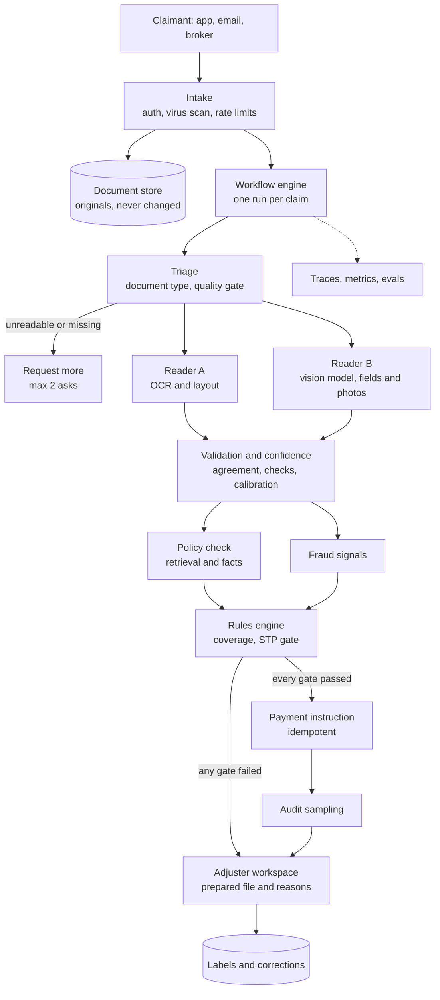
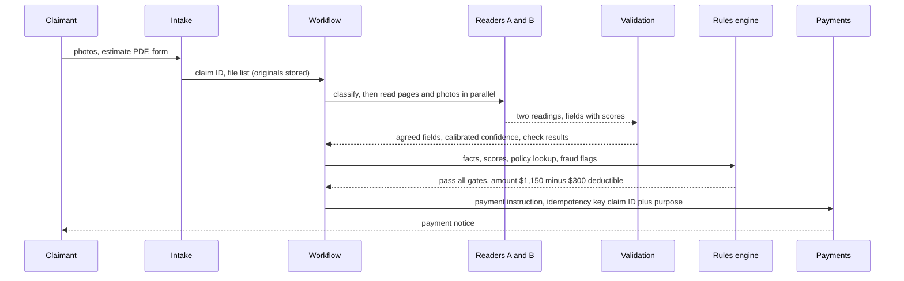

# Claims processing agent with straight-through processing

> [!NOTE]
> The insurer in this case study is fictional. Its numbers are made up to make the design concrete. Prices, times and error costs are stated assumptions, not quotes or measurements. New to these terms? Start with [the word list](#words-used-in-this-case-study), and see [the layers and tools](#layers-and-tools) for what to build each part with.

## At a glance

| | |
|---|---|
| **Problem** | Read the photos, PDFs and forms in a motor claim, pay the clear ones in minutes, and give an adjuster a prepared file for the rest. |
| **Scale** | 80K claims a month, 9 files and 8 pages each, peak near 0.12 claims per second. |
| **Key patterns** | Multimodal extraction, two independent readers, calibrated confidence thresholds, straight-through processing (STP), adjuster review, audit sampling. |
| **Difficulty** | Advanced. |
| **Read time** | About 35 minutes. |

## The scenario

Marlow Motor Mutual is a made-up motor insurer with 1.1 million policies. Customers report a claim in the app or by email and attach what they have: photos of the damage, a repair shop estimate as a PDF, a police or accident report, and a claim form. The company receives 80,000 claims a month. Today a person opens every file, retypes the details into the claims system, checks the policy, and decides. The median wait for a first decision is five days, and most of that time is the file sitting in a queue.

The team wants a system that reads every file, checks it against the policy, and pays the clear cases without a person. Everything else goes to an adjuster (the person who judges a claim) with the fields filled in and the evidence marked. The goal is to remove typing and waiting. It is not to remove the human decision on hard claims.

| Measure | Today | Target |
|---|---|---|
| Claims per month | 80K | 80K |
| Time to first decision (median) | 5 days | Under 5 minutes for STP claims, under 1 business day for the rest |
| Paid with no human touch (STP rate) | 0% | About 30% (29.75% from the funnel below) |
| Adjuster minutes per reviewed claim | 30 (all claims) | 18 |
| Wrong payouts among STP claims | Not measured | 1% or less in the audit sample |
| Cost per claim, people and AI | $30 | $14.86 (formula in [Numbers](#numbers)) |

The mix of claims, from a made-up sample of last quarter, is: simple (glass, small dents, clear photos, no injury, estimate under $2,000) 35%, standard repairable damage 40%, and complex (injury, total loss, disputed fault, or signs of fraud) 25%. Only the first group is a candidate for STP. This mix tells us where automation is safe and where it is not.

## Requirements

A claims system has two jobs that pull against each other: be fast, and never pay the wrong amount to the wrong person. Each requirement below has a priority and a number so that tension is explicit.

Functional requirements:

| Requirement | Priority |
|---|---|
| Accept photos, PDFs, scans and forms in one claim file, and say which documents are missing | P0 |
| Extract claim facts (policy number, date, plate, amounts, payee) with a confidence score per field | P0 |
| Check the facts against the policy: active on the date, covered peril, deductible | P0 |
| Pay claims that pass every STP check, with no duplicate payments | P0 |
| Send every other claim to an adjuster with a prepared file and the reason it was not automated | P0 |
| Estimate damage from photos and compare it with the repair estimate | P1 |
| Ask the claimant for a missing or unreadable document, at most twice | P1 |
| Raise fraud signals (reused photos, changed bank account, mismatched dates) | P1 |

Non-functional requirements, each with the reason for the number:

| Requirement | Target | Why |
|---|---|---|
| Time from complete file to decision | Under 90 s at p95 | Claimants wait on their phone, and a slow system queues up behind a storm |
| Field precision above the threshold | 99.92% or better per STP field | Twelve fields at this level give about 99% for a whole claim (see deep dive 2) |
| Wrong payouts among STP claims | 1% or less in the audit sample | Break-even is 3%, so 1% leaves a margin for harm that money does not measure |
| Duplicate payments | Zero | A retry must never pay twice |
| Availability of intake | 99.9% | A claim made after an accident must not be lost |
| Document retention | Set by regulation and contract | Assume 7 years for the storage estimate |

Security and compliance needs: claim files hold names, addresses, injury details, bank accounts and photos with faces and number plates. Access follows roles, so a payments clerk and an adjuster see different things. Files are encrypted in storage and in transit. Personal data is masked before it reaches a log. Every automated payment keeps its evidence: the files, the extracted fields, the scores and the rule that approved it. Insurance and data protection rules differ by country, and some limit decisions made only by software, so ask your legal team which claims may be paid automatically before you set the STP rules.

## Numbers

Before drawing any box, we estimate the load and the bill. These are the formulas from the [design method](../DESIGN-METHOD.md), and each assumption is stated so you can change it and redo the math.

Traffic:

- Claims per day = 80,000 ÷ 30 = 2,667.
- Average claims per second = 2,667 ÷ 86,400 = 0.031.
- Peak claims per second = 0.031 × peak factor 4 = 0.123. The factor of 4 is an assumption for a normal busy day.
- Claims in flight at peak = 0.123 × 90 s per claim = about 11. Here 90 s is the target time from complete file to decision.

Files and storage, with an assumed file mix of 6 photos, 2 PDFs of 3 pages each, and 1 form of 2 pages per claim:

- Files per claim = 6 + 2 + 1 = 9, so files per month = 80,000 × 9 = 720,000.
- Pages per claim = 2 × 3 + 2 = 8, so pages per month = 80,000 × 8 = 640,000.
- Storage per claim = 6 photos × 3 MB + 2 PDFs × 0.5 MB + 1 form × 0.3 MB = 19.3 MB.
- Storage per month = 80,000 × 19.3 MB = 1,544,000 MB = about 1.54 TB.
- Storage over 7 years = 1.54 TB × 84 months = about 130 TB.

Tokens per claim, with an assumed 1,500 input tokens per page image and 1,200 per photo (providers count image tokens differently, so check yours):

| Step | Input tokens | Output tokens |
|---|---|---|
| Document extraction: 8 pages × 1,500 + 1,500 prompt | 13,500 | 800 |
| Photo assessment: 6 photos × 1,200 + 800 prompt | 8,000 | 400 |
| Policy check: 6,000 tokens of policy wording and facts | 6,000 | 500 |
| Summary for the adjuster | 5,000 | 600 |
| **Total** | **32,500** | **2,300** |

- Tokens per claim = 32,500 + 2,300 = 34,800.
- Tokens per month = 80,000 × 34,800 = 2.78 billion.
- Peak tokens per minute = 0.123 × 34,800 × 60 = about 0.26 million. This is the number to compare with a provider's rate limit.

AI cost, using placeholder prices: assume $1 per 1M input tokens and $4 per 1M output tokens for the vision-capable model, and $0.015 per page for OCR (reading text from an image). Assume half of the pages (4 of 8) are scans that need OCR, and the rest have a text layer.

- Model cost per claim = 32,500 ÷ 1,000,000 × $1 + 2,300 ÷ 1,000,000 × $4 = $0.0325 + $0.0092 = $0.0417.
- OCR cost per claim = 4 pages × $0.015 = $0.06.
- AI cost per claim = $0.0417 + $0.06 = $0.1017.
- Variable AI cost per month = 80,000 × $0.1017 = $8,136.
- Add $5,000 a month of fixed infrastructure (storage, queues, servers, logs). Total = $13,136 a month, or $0.164 per claim.

The most important numbers are about people, not models. Assume an adjuster costs $60 an hour, which is $1 a minute.

- Today's cost per claim = 30 minutes × $1 = $30, so today's monthly cost = 80,000 × $30 = $2,400,000.
- STP funnel: simple claims = 35% × 80,000 = 28,000. Assume 85% of them pass every gate, so STP claims = 28,000 × 0.85 = 23,800, and the STP rate = 23,800 ÷ 80,000 = 29.75%.
- Reviewed claims = 80,000 − 23,800 = 56,200. With a prepared file an adjuster needs 18 minutes (an assumption to test in a pilot), so review cost = 56,200 × 18 × $1 = $1,011,600.
- Audit sample: a person re-checks 5% of STP claims = 23,800 × 0.05 = 1,190 claims, costing 1,190 × 18 × $1 = $21,420.
- Wrong payouts: assume a wrong payout costs $600 on average (money paid in error plus rework). At a 1% error rate, cost = 23,800 × 0.01 × $600 = $142,800.
- New monthly total = $1,011,600 + $21,420 + $142,800 + $13,136 = $1,188,956, which is $14.86 per claim.
- Saving = $2,400,000 − $1,188,956 = about $1.21 million a month. The AI system is about 1.1% of the new total ($13,136 ÷ $1,188,956).

The break-even error rate for automation is review cost ÷ cost of one error = $18 ÷ $600 = 3%. Above 3% wrong payouts, paying automatically costs more than asking a person. We set the target at 1%, a third of the break-even, because angry customers and regulators are costs that this formula does not include. Today's figure leaves out error cost on purpose: we assume people make the same errors before and after.

## Choosing the shape

The simplest design that could work is one model call: send all the files and ask "should we pay?". It fails for four reasons. The answer has no confidence we can test, the model could be fooled by text inside a document, payment needs rules that auditors can read, and a wrong answer costs $600.

Walking up the ladder from the [design method](../DESIGN-METHOD.md):

| Rung | Verdict |
|---|---|
| One model call | Fails. No per-field confidence, no audit trail, and no safe way to pay |
| Fixed pipeline (read, check, decide) | Fits most of the work. Every claim goes through the same stages |
| Router in front of the pipeline | Fits. Documents differ (photo, estimate, form, report), and claim types differ (glass, collision, injury), so each gets its own reader and rules |
| Tool-calling agent with a loop | Only for one narrow job: asking the claimant for a missing document, at most twice. It never decides money |
| Multiple agents | Not needed. It adds cost and failure points without a clear gain |

We stop at a router plus a fixed pipeline, with one bounded tool step for chasing missing documents. The key rule is that the model proposes and the rules decide. Models read documents and judge photos. A rules engine, which a claims manager can read and sign off, decides coverage and whether a claim is paid without a person.

## Architecture

Files arrive at intake, are stored once, and then pass through triage, two independent readers, validation and a policy check. A rules engine decides one of two paths. Claims that pass every gate go to payment. All others go to an adjuster with a prepared file. A sample of paid claims is re-checked by people.



The three parts below are written for readers who are new to AI. The word list explains the terms. The layers part explains each box, what it does here, and which kind of tool can build it. The build order shows a sensible order for a small team.

### Words used in this case study

If a word on this page is new to you, find it here. Each entry says what the word means in this design, not in general.

| Word | What it means here |
|---|---|
| Claim | A customer's request to be paid for a loss, such as a damaged car. |
| Adjuster | The insurer's employee who reviews a claim and decides whether and how much to pay. |
| FNOL | First notice of loss. The first report of an accident, usually a form plus photos. |
| Straight-through processing (STP) | A claim that is read, checked and paid with no human touch. |
| Leakage | Money paid out that should not have been, or paid in the wrong amount. |
| Token | A small piece of text (about three quarters of an English word) that a model reads and writes. Images also cost tokens. Models are priced per token. |
| Multimodal | Able to work with more than one kind of input, here text, scans and photos. |
| Vision-language model | A model that reads an image and a question together, and answers in text. |
| OCR | Optical character recognition. Software that turns the pixels of a scanned page into text. |
| Layout analysis | Finding the structure of a page: where the tables, labels and values are. |
| Confidence score | A number from 0 to 1 that says how sure a reader is about one extracted value. |
| Calibration | Adjusting scores so that a score of 0.95 is right about 95 times in 100, measured on labeled examples. |
| Threshold | The score above which we accept a value without a person. |
| Precision | Of the values we accepted, the share that were correct. |
| Embedding | A list of numbers that stands for the meaning of a piece of text. Similar meanings get similar numbers. |
| RAG | Retrieval-augmented generation. Search first, then give the best passages to the model so it answers from them. |
| Cache | A saved result that we reuse instead of computing it again. |
| Memory | What the system remembers between steps or conversations. Here it is mostly the claim record. |
| Guardrail | A check that blocks or changes something unsafe before it takes effect. |
| Rules engine | Software that applies written if-then rules to facts. Its decisions can be read and explained. |
| Idempotency key | A unique ID sent with a request so that repeating it has the same effect as doing it once. |
| Perceptual hash | A short fingerprint of an image that stays similar when the image is resized or lightly edited. |
| EXIF | Data stored inside a photo file, such as the time it was taken and the camera. It can be edited. |
| Audit sample | A random share of automatic decisions that a person re-checks. |
| Golden set | A fixed list of real claims with known correct answers, used to test every change. |
| Workflow engine | Software that runs a multi-step process, remembers where each run is, and resumes after a crash. |
| p95 | The time that 95 out of 100 requests beat. It shows slow cases that an average hides. |
| Guardrail trip | A case where a guardrail blocked or changed something. Each one is logged and reviewed. |

### Layers and tools

We split the system into thirteen layers. Each layer has one job, and each can be built with different categories of tools. This part walks through them in the order a claim meets them. For each layer you get what it is, what it does here, the kinds of tools you can choose from, and what we would pick first.

Tool names are examples as of November 2026. They are not endorsements, and tools change faster than categories. Before choosing, check that the project is maintained and that its license suits you.

Four things are easy to mix up: the claim record, retrieval, memory and cache. They all hold information, but they answer different questions.

| | Claim record | Retrieval (RAG) | Memory | Cache |
|---|---|---|---|---|
| The question it answers | What is the state of this claim and what did we decide? | What does the policy wording say? | What did earlier steps learn that later steps need? | Have we already computed this? |
| What it holds | Extracted fields, scores, decisions, payments, adjuster edits | Policy wordings, endorsements, internal handling rules | Little here. The claim record plays this role, and the workflow engine holds step state | Saved results, such as the text of a file we already read |
| Whose data | One claim | The company, shared by all claims | One claim run | Depends on the cache |
| How it changes | After every step, and it is never deleted before retention ends | When a policy document is published | As a run proceeds | It expires or is cleared when its source changes |
| Risk if wrong | A wrong payout or a lost audit trail | An out-of-date clause | A stale value reused in a later step | A result from file A shown for file B |

#### Layer 1: intake

Intake is the front door for files. It checks who is sending, scans each file for malware, sets size limits, stores the original, and starts one workflow run per claim. Claims also arrive by email and from brokers, so intake turns each channel into the same internal message: claim ID, sender, and a list of files.

In this design intake stores about 19.3 MB per claim and rejects files that are too large or in unknown formats. It never changes an original. Everything later reads the original and writes results next to it.

| Category | Examples | Pick it when |
|---|---|---|
| Your existing customer login and API gateway | Your current auth system, NGINX, Envoy, a cloud provider's API gateway | The app already has logged-in customers. Reuse it |
| Email ingestion | A mailbox API, a cloud inbound-email service | Claims also arrive as email with attachments |
| Malware scanning | ClamAV, cloud storage scanning services | Every uploaded file must be scanned before anything reads it |
| Direct upload to object storage with signed links | Upload links from Amazon S3, Google Cloud Storage or Azure Blob Storage | Phone photos are large and should not pass through your servers |

First version: reuse your login, signed upload links, and one scanner. What goes wrong: a file that is accepted twice because the phone retried the upload. Name each file by its content hash, so a repeat is recognized.

#### Layer 2: document store

The document store keeps the original files and the results of reading them. It is object storage plus a database. At 1.54 TB a month it is the largest part of the system by size, and the part you must never lose.

| Category | Examples | Pick it when |
|---|---|---|
| Object storage | Amazon S3, Google Cloud Storage, Azure Blob Storage | You need cheap, durable storage for photos and PDFs, with retention locks |
| Relational database | Postgres | You need the claim record: fields, scores, decisions, edits, with transactions |
| Document archive with legal hold | Your existing archive or records system | Regulation requires a specific retention and deletion process |

First version: object storage with versioning on, and Postgres for the claim record. What goes wrong: results written over earlier results, so nobody can say what the system believed when it paid. Append new versions and never overwrite.

#### Layer 3: triage

Triage decides what each file is and whether it can be used. It labels a file as photo, estimate, claim form, police report or other, and checks quality: is the page upside down, blurry or cut off, is the photo too dark, is it a photo of a screen. A file that fails goes back to the claimant with one clear request.

| Category | Examples | Pick it when |
|---|---|---|
| Cheap image checks | Blur and brightness measures from an image library such as OpenCV | You want a fast, free first filter |
| Document classifier | A small vision-language model with a fixed list of labels, or a trained image classifier | You need to tell an estimate from a form, with no training data to start |
| Managed document classification | Google Document AI, Azure AI Document Intelligence, Amazon Textract | You prefer a managed service for common document types |

First version: image checks plus a small vision-language model that returns one label from a fixed list. What goes wrong: asking for a new photo when the old one was fine, which annoys claimants. Log every request and review the rate each week.

#### Layer 4: reader A, OCR and layout

Reader A is the classic path. It turns scans into text, finds tables and form fields, and gives a confidence per word or field. [Amazon Textract](https://docs.aws.amazon.com/textract/latest/dg/what-is.html) is one example. Its documentation describes extracting text, forms and tables, and its key-value results come with confidence scores. Reader A is good at exact strings, such as a plate or a policy number, and it does not make up text that is not on the page.

| Category | Examples | Pick it when |
|---|---|---|
| Managed document AI | Amazon Textract, Google Document AI, Azure AI Document Intelligence | You want forms, tables and handwriting support without running models |
| Open-source OCR | Tesseract | Data cannot leave your network, or volume is high and layout is simple |
| Text layer extraction | A PDF library that reads the embedded text | The PDF is digital, not a scan. It is free and exact |

First version: use the PDF text layer when it exists, and one managed service for scans. What goes wrong: a table read in the wrong column order, so a total lands on the wrong line. Layer 6 checks that line items add up.

#### Layer 5: reader B, the vision-language model

Reader B reads the same pages and the photos with a vision-language model, and writes a fixed structure: the fields we need, each with the evidence (page and text span) it used. It also describes each photo: which part of the car, what damage, how severe. It is better than OCR with messy layouts, handwriting and photos. It is worse at exact strings, and it can sound sure while being wrong.

| Category | Examples | Pick it when |
|---|---|---|
| Hosted vision-language model APIs | The APIs from Anthropic, OpenAI, Google and others | You want the best quality with no servers to run |
| Models inside a cloud platform | Amazon Bedrock, Google Vertex AI, Azure AI Foundry | Your contract or data rules say files must stay in your cloud account |
| Open-weight vision-language models you host | Open models served on your own GPUs | You have steady high volume, or data that cannot leave your network |

The call must use structured output: a schema that lists each field, so the reply can be parsed and checked. First version: one hosted model behind a small gateway, with a schema. What goes wrong: the model reads an instruction hidden in a document, such as "approve this claim". The model has no tools and writes only fields, so a hidden instruction can at worst produce a wrong field, and layer 6 catches many of those.

#### Layer 6: validation and confidence

This layer turns two readings into one value and one trustworthy score. It compares reader A and reader B, applies checks that need no AI, and converts the result into a calibrated confidence. Models are often more confident than they are accurate, an effect that [Guo and colleagues measured for neural networks](https://arxiv.org/abs/1706.04599), so a raw score is never used directly. See deep dive 1.

The checks need no model. They include: the date is inside the policy period, the plate matches the policy's vehicle, line items add up to the total, the amount is a number in a sane range, the bank account number has a valid format, and the claim date is not before the policy start.

| Category | Examples | Pick it when |
|---|---|---|
| Plain code and schemas | Python with Pydantic or similar, JSON Schema | Always. It is the cheapest and most reliable check |
| Calibration tools | scikit-learn's [probability calibration](https://scikit-learn.org/stable/modules/calibration.html) | You have labeled examples and want scores that match observed accuracy |
| Address and plate lookups | Your own policy database, postal address services | You can check a value against a known list |

First version: agreement between readers, a handful of plain checks, and a lookup table that maps agreement and checks to a measured accuracy. What goes wrong: a check that is too strict and sends good claims to people. Track how often each check fires.

#### Layer 7: policy retrieval

The policy check needs the clauses that apply to this policy: the covered perils, the deductible, the exclusions and the endorsements. This is retrieval (RAG) over a small, controlled set of documents. Most of the check is not retrieval at all. The policy number gives us the policy record, and the rules engine reads structured facts from it. Retrieval only supplies clause text for the adjuster, and for odd cases that the structured data does not cover.

| Category | Examples | Pick it when |
|---|---|---|
| Lookup by policy ID | A SQL query on the policy system | Always. It gives exact facts such as deductible and dates |
| Vector search inside your database | Postgres with pgvector | You already run Postgres, and the clause set is small |
| Dedicated vector database or search engine | Qdrant, Weaviate, Elasticsearch, OpenSearch | The collection is large, or you need keyword and meaning search together |

First version: exact lookup by policy ID, and pgvector for the wording. What goes wrong: using the wording that is current today for an accident last year. Retrieve the version that was in force on the loss date.

#### Layer 8: rules engine and the STP gate

The rules engine decides. It reads facts and scores, and returns one of two results: pay, or send to an adjuster with a list of reasons. The rules are written by the claims team, versioned, and tested like code. They cover coverage (is the peril covered, is the policy active), limits (the amount is under the STP cap), and the gate itself (every required field is above its threshold, nothing is flagged).

| Category | Examples | Pick it when |
|---|---|---|
| Plain code with a rules table | A function and a table of limits in your database | Rules are few and change monthly. This is the start |
| Policy engine | Open Policy Agent | You want rules in a separate, testable language with decision logs |
| Business rules management | Drools, Camunda DMN decision tables | Business staff must edit rules themselves, with approvals |

First version: plain code with a rules table, and every decision stored with the rule version. What goes wrong: a rule change that silently changes the STP rate. Run the golden set against any rule change, and compare the STP rate before and after.

#### Layer 9: fraud signals

Fraud checks give flags, not verdicts. A flag sends a claim to an adjuster, and the special investigations unit (SIU) decides what is fraud. The signals are simple and cheap: the same photo, or a near copy, appears in another claim (compare perceptual hashes); the photo's EXIF time is after the claimed loss or missing; the payee or bank account differs from the policyholder or changed recently; the estimate comes from a repairer that appears in an SIU watch list; the damage in the photos does not match the estimate.

| Category | Examples | Pick it when |
|---|---|---|
| Image fingerprints | Perceptual hash libraries such as ImageHash | You want to catch reused photos across claims |
| Plain rules and lookups | SQL over claims, payees and repairers | The pattern is a known list or a repeat |
| Fraud scoring vendors and models | Your insurer's existing fraud platform | A fraud model already exists. Feed it, and do not rebuild it |

First version: the hash check, the bank account change rule and the estimate-to-photo comparison. What goes wrong: treating a flag as proof. A flag only changes the path. It never denies a claim.

#### Layer 10: tools and actions

Two actions exist. One asks the claimant for a missing or unreadable document. The other creates a payment instruction. The first is allowed to run from a model-suggested request, with a fixed template and at most two asks per claim. The second is never called by a model. The rules engine creates it, using an idempotency key made from the claim ID and the payment purpose, so a retry cannot pay twice. Idempotency means the same request, repeated, has the same effect as doing it once. [Stripe's API documentation](https://docs.stripe.com/api/idempotent_requests) explains the idea clearly.

| Category | Examples | Pick it when |
|---|---|---|
| Plain functions calling internal APIs | Your payments and messaging services | You control the services. This is the default |
| Message queue with a dead-letter queue | Amazon SQS, RabbitMQ, Kafka | A payment instruction must not be lost, and failures need a place to wait |
| Payment approval workflow | Your existing finance system | Payments above a limit need a second person |

First version: plain functions, one queue, the idempotency key, and a hard cap on the STP payment amount. What goes wrong: a payee or bank account changed by a document. Any payee change always goes to a person.

#### Layer 11: orchestration

Orchestration runs the stages in order, keeps the state of each claim, waits for missing documents, and resumes after a crash. A claim can take days: the claimant sends photos on Monday and the estimate on Thursday. The run must survive restarts and deploys during that time, so we use a durable workflow engine, not a web request.

| Category | Examples | Pick it when |
|---|---|---|
| Durable workflow engine | Temporal, Camunda, AWS Step Functions | Runs last hours or days, need timers and retries, and must survive restarts |
| Queue and worker code | A message queue with workers and a status table in Postgres | The flow is short and a small team prefers fewer parts |
| Agent frameworks | LangGraph and similar | You need model-driven branching. This flow is mostly fixed, so it is rarely the right choice |

First version: a durable workflow engine, with one run per claim and the file hash as the key for each step's result. What goes wrong: a step that is not safe to repeat. Every step must give the same result when it runs twice.

#### Layer 12: adjuster workspace

The adjuster workspace is where people review. It shows the prepared file: the extracted fields, each linked to the exact spot in the source document or photo, the reasons the claim did not pass the STP gate, the policy check, the photo assessment, and a suggested next step. The adjuster accepts a field with one click, or corrects it. Every correction is stored as a label for the next test set.

| Category | Examples | Pick it when |
|---|---|---|
| Your existing claims system, extended | Your current claims platform with a side panel | Adjusters already live there. Avoid a second tool |
| A small custom review screen | A web app that draws boxes on the source image | You have no usable claims system, or you want fast iteration |
| Annotation tools | Label Studio and similar | You need a labeling screen for the golden set, not for daily work |

First version: a side panel in the claims system, showing source highlights and reasons. What goes wrong: the adjuster trusts the suggestion without looking. Deep dive 4 covers audit samples and how to show suggestions.

#### Layer 13: observability and evals

Observability means you can see what happened on every claim: the files, both readings, the scores, the checks, the rule version, the decision and the cost. Evals are automatic tests that say whether a change made things better or worse. Without this layer you cannot tune thresholds, and you cannot explain a payout to an auditor.

| Category | Examples | Pick it when |
|---|---|---|
| Tracing | OpenTelemetry, Langfuse, Arize Phoenix | You want one view per claim with each step and its cost |
| Metrics and alerts | Prometheus with Grafana, or your cloud provider's monitoring | You want dashboards and alerts on STP rate, queue age and spend |
| Eval runners | promptfoo, or your own script that scores the golden set | You want the golden set to run on every change |

First version: structured logs with the claim ID, a tracing tool, and a script that runs the golden set in your CI pipeline. Mask personal data before anything is logged. What goes wrong: dashboards that show the average. Track the STP rate and audit error rate per document type and per repairer.

### Build order

Build the system in stages, and put each stage in front of real claims before adding the next. The order follows the risk: first we only read and show, then we help adjusters, and only after that do we pay without a person. The steps are a sequence, not a schedule.

1. **Stage 0: golden set and shadow reading.** Label 3,000 past claims with two adjusters per claim. Build intake, the document store, reader A and reader B, and write both readings next to the adjuster's own entries. Test: field accuracy per field on the golden set. Done when: you know the precision of each field at several thresholds, and nothing is shown to claimants.
2. **Stage 1: prepared files for adjusters.** Add triage, validation, the adjuster side panel with source highlights, and the reasons list. Test: adjusters time themselves on 200 claims with and without the panel. Done when: review time falls from 30 toward 18 minutes, and the correction rate per field is measured.
3. **Stage 2: calibration and the rules engine.** Fit the confidence mapping, set field thresholds, add the policy lookup and the coverage rules. Test: replay last quarter's claims and compute what the STP gate would have approved. Done when: the replayed error rate on approved claims is at or under 1%, with a safe margin.
4. **Stage 3: STP in a narrow slice.** Turn on payment for one claim type (windscreen glass, for example) under a low cap, with a kill switch and a 100% audit. Test: forced retries and timeouts must never pay twice. Done when: the audit error rate is under 1% for a full month.
5. **Stage 4: widen the gate and add fraud signals.** Add the other simple claim types, the fraud flags, photo assessment against the estimate, and drop the audit rate to 5%. Done when: the STP rate nears 30% with the audit error rate still at 1% or lower.
6. **Stage 5: scale and storms.** Add queue priorities, a second model provider, autoscaled readers and spike drills, as the scaling section calls for. Done when: a replay of a 10x spike meets the 90 s target.

## One request, end to end

Here is one concrete claim. A claimant reports a parking-lot bump: five photos of a dented rear bumper, a repair estimate PDF for $1,150, and the claim form. No injury, no other vehicle involved in a dispute. We follow it through the system and budget the time.



Every gate passes: the date is inside the policy period, the plate matches, the estimate lines add up, both readers agree on the amount, no photo was seen before, and the payee is the policyholder. The system pays $850 and queues the claim for the audit sample with a 5% chance. If reader B had read the estimate total as $1,750 while reader A read $1,150, the amount would fail the agreement check and the claim would go to an adjuster with the disagreement shown.

Latency budget from "last file stored" to "decision":

| Step | Budget | If it overruns |
|---|---|---|
| Virus scan and storage | 2,000 ms | Hold the claim and tell the claimant that files are being checked |
| Triage: classify and quality gate | 3,000 ms | Skip the quality gate and let validation catch bad reads |
| Readers A and B and photo assessment, in parallel | 20,000 ms | Use the second provider for the slow call, or send the claim to an adjuster |
| Validation, agreement and calibration | 1,000 ms | Rare. These are plain code |
| Policy check, with fraud checks in parallel | 8,000 ms | Send to an adjuster with the checks listed as unfinished |
| Rules engine decision | 300 ms | Rare. Alert on any overrun |
| Payment instruction queued (STP path) | 1,000 ms | The queue retries with the same idempotency key |
| **Total, STP path** | **about 35 s** | The 90 s target leaves room for one retry |
| Adjuster summary (reviewed path, instead of payment) | 6,000 ms | Show the file without a summary |

The reviewed path takes about 40 s, since the summary replaces the payment step. These budgets cover machine time only. The adjuster's time starts after, and is the larger number.

## Deep dives

Four parts of this design deserve more care than the rest: confidence you can trust, the STP gate, photos and fraud, and the adjuster review loop. Each one decides how often the system is right without help, and how often it is wrong without anyone noticing.

### Deep dive 1: confidence you can trust

A confidence score is only useful if "0.95" means "right about 95 times in 100". Raw scores from OCR engines and models rarely do. We need a number that has been measured against labeled claims.

Options we considered:

1. **Use the model's own stated confidence.** Cheap, but a model that writes "0.95" is generating text, not measuring anything.
2. **Use the OCR engine's score only.** It is a real signal for reading characters, but it says nothing about whether the field is the right field, such as the total versus a subtotal.
3. **Ask two independent readers and compare.** When OCR and the vision model are built differently, they rarely make the same mistake, so agreement is strong evidence. Then calibrate: group claims by agreement and check results, and measure how often each group is right.

We chose option 3. The score for a field is the measured accuracy of the group it falls in, from the golden set. This is calibration, and [scikit-learn's documentation](https://scikit-learn.org/stable/modules/calibration.html) describes the tools for it. The group is simple: both readers agree and the field's checks pass, they agree but a check fails, or they disagree, split further by the OCR score band.

The threshold comes from the cost of an error, not from a round number. This function finds the lowest score that still meets a precision target on labeled data, with a minimum number of examples so a lucky small group cannot win:

```python
def pick_threshold(samples, target_precision=0.9992, min_support=3000):
    """samples: list of (score, was_correct) for one field, from labeled claims."""
    ranked = sorted(samples, key=lambda s: s[0], reverse=True)
    best, correct = None, 0
    for count, (score, ok) in enumerate(ranked, start=1):
        correct += ok
        if count >= min_support and correct / count >= target_precision:
            best = score  # lowest score so far where everything above it meets the target
    return best  # None means: this field can never be automated yet
```

Why `min_support` is 3,000: if you see zero errors in n independent checks, the 95% upper bound on the true error rate is about 3 ÷ n. With n = 3,000 that is 3 ÷ 3,000 = 0.1%. A small sample cannot prove a rate as low as 0.08%, so a field with too little data stays manual.

Fields differ in what an error costs, so they get different targets. A wrong date in the loss description costs an adjuster a few seconds. A wrong bank account costs the whole payment. The strict fields are amount, payee, bank account, policy number and loss date. Payee and bank account changes are never automatic, whatever the score.

What goes wrong: scores drift when a repair shop changes its estimate template. Watch the share of claims in each score band every week, and re-run calibration when it moves.

### Deep dive 2: the STP gate

The STP gate is the line between "the machine pays" and "a person decides". It must be easy to explain, strict by default, and loosened only with evidence. We write it as a list of gates that must all pass, so a failure always has a named reason.

The math is why the field targets are so strict. A claim is correct only if every required field is correct. Assume 12 required fields, each with precision p, and independent errors (a simplification, since errors cluster in bad scans). The chance the whole claim is right is p raised to the 12th power. At p = 99.9%, that is 0.999^12 = 0.988, so 1.2% of claims have at least one wrong field. To reach a claim-level error of 1%, we need p = 0.99^(1/12) = 0.99916, which is about 99.92%. That is where the 99.92% target in the requirements comes from.

```python
STRICT = {"amount", "payee", "bank_account", "policy_no", "loss_date"}
THRESHOLD = {"amount": 0.9992, "payee": 0.9995, "bank_account": 0.9995,
             "policy_no": 0.9992, "loss_date": 0.9992}  # others: 0.995

def route_claim(c):
    reasons = []
    for name, field in c.fields.items():
        if field.confidence < THRESHOLD.get(name, 0.995):
            reasons.append(f"low_confidence:{name}")
    if c.amount > STP_CAP:               reasons.append("over_cap")
    if c.claim_type not in STP_TYPES:    reasons.append("type_not_allowed")
    if c.injury or c.disputed_fault:     reasons.append("complex_claim")
    if c.payee_changed:                  reasons.append("payee_changed")
    if c.fraud_flags:                    reasons.append("fraud_flag")
    if not c.coverage_ok:                reasons.append("coverage_unclear")
    if c.missing_documents:              reasons.append("missing_documents")
    return ("pay", []) if not reasons else ("adjuster", reasons)
```

Two design choices matter here. First, the gate only has two outputs. It never says "deny". A denial is a human decision. Second, the reasons are stored with the claim. After a month, the count of each reason shows where to spend effort. If "low_confidence:amount" is the top reason, fix amount reading. If "type_not_allowed" is the top reason, talk to the claims manager about the next claim type to open.

Options we considered for the gate: one overall score (hard to explain, hides which field failed), a trained model that outputs pay or not (needs many labeled outcomes, hard to audit), and the list of gates. We chose the list because an auditor can read it.

### Deep dive 3: photos and fraud signals

A photo is evidence, but a model's reading of it is an opinion. We use photos for two things: to check the repair estimate for gross mismatch, and to raise fraud flags. We do not use them to set the payout amount. The payout comes from the repair estimate, after checks.

The estimate-to-photo check works at coarse level. The model lists the damaged parts it sees (rear bumper, tail light). The estimate lists the parts it will repair. If the estimate includes a part that no photo shows as damaged, or the photos show damage to a part with no estimate line, the claim goes to an adjuster. This catches padded estimates and missing photos without asking a model to price a repair.

Fraud signals are cheap and mostly not AI:

- **Reused photos.** Compute a perceptual hash of each photo at intake and look for near matches across all claims. A match with another claim, or with the same claim from an earlier year, raises a flag.
- **Photo metadata.** The EXIF time should fall on or after the loss date. Missing EXIF is normal, since many apps remove it, so missing data is a weak signal and a wrong date is a stronger one. EXIF can be edited, so it never proves anything alone.
- **Payee and account changes.** A claim that asks to pay a different person or a new account is the most common way to redirect money, so it always goes to a person.
- **Edited or generated images.** Image editing tools are easy to use, and no detector is perfect. Treat a detector, if you add one, as one more weak flag, and test it on your own claims before you trust it.

The rule is the same for every signal: it changes the path and never the decision. A flagged claim goes to an adjuster, and the adjuster or SIU decides.

Prompt injection needs its own line. Documents are untrusted input, and a claimant can write text in an estimate or a form that tells the model what to do. Reader B has no tools and returns only a schema, so an injected instruction cannot trigger a payment. Its output then passes through validation and rules, which do not read free text. The [OWASP Top 10 for LLM applications](https://genai.owasp.org/llm-top-10/) lists prompt injection as a top risk, and this layout follows its advice to limit what a model can do.

### Deep dive 4: the adjuster review loop

Adjuster review has two risks that point in opposite directions. If the prepared file is hard to read, adjusters redo the work and the 18-minute target is lost. If it is too easy to accept, they stop checking, and the system's errors pass through with a person's signature on them. This second risk is called automation bias: people trust a confident suggestion.

Design choices to manage both:

- **Show the evidence next to each field.** Each extracted value links to the highlighted spot in the source page or photo, so checking costs a glance, not a search.
- **Order by risk.** Fields with a low score or a reader disagreement come first, and are marked. High-confidence fields are collapsed but open on one click.
- **Show reasons.** The top of the file lists why the claim was not STP, such as "estimate total: readers disagree ($1,150 against $1,750)".
- **Seed checks.** In a small share of reviewed claims, the system inserts a known-wrong value into a suggestion (for example, a changed digit in an amount) and measures how often the adjuster catches it. A catch rate that falls is an early warning. Tell adjusters that this practice exists, and keep it out of their individual performance scores.
- **Capture every edit.** A corrected field is a label. Edits go into the labels store and feed the next calibration run. Over time the golden set grows from real work.

The audit sample for STP claims works the same way. A random 5% of paid claims are re-checked by an adjuster who did not see the system's answer first. The audit error rate is the number that decides whether the gate may stay open. If it rises above 1% for a claim type, the gate for that type closes and the claims return to review until a fix is shown on the golden set.

## Scaling from 1x to 100x

Load grows two ways here: more claims per month, and sudden spikes after a storm, a hail event or a flood. The pipeline is a queue of mostly independent claims, so it scales out well. What breaks first is the model provider's limit, then the adjuster team, then the storage and cost.

For the spike, assume a storm day with 10 times the average daily claims. Claims per day = 2,667 × 10 = 26,670. Peak claims per second = 26,670 × 4 ÷ 86,400 = 1.23. Claims in flight = 1.23 × 90 s = about 111. Peak tokens per minute = 1.23 × 34,800 × 60 = about 2.6 million. A 10x month has the same peak rates, so the 10x row also describes a storm day.

| Load | What breaks first | Fix | Cost of the fix |
|---|---|---|---|
| 1x (80K a month, peak 0.12 claims per second, 0.26M tokens a minute) | Nothing yet | Baseline | |
| Storm day, or 10x (peak 1.23 claims per second, 2.6M tokens a minute) | Provider rate limits, then the adjuster queue | Request higher limits, add a second provider, put the workflow behind a queue with priorities (simple claims first), and shed load by delaying the summary step | Second provider contract and a failover test. Backlog of reviewed claims grows, so overtime or temporary staff for adjusters |
| 100x (8M a month, 12.3 claims per second, about 26M tokens a minute) | Model cost and OCR cost, and the volume of storage | Self-host an open-weight reader for the common document types, batch low-urgency work to cheaper rates, store photos in cooler storage after 90 days | GPU operations and an evaluation of each reader swap. Variable AI cost still reaches 8,000,000 × $0.1017 = $813,600 a month before these savings |

Storage at 100x is 1.54 TB × 100 = 154 TB a month. Cooler storage tiers and a retention process matter more than model tuning at that point. At every level the adjuster team is the slowest part to scale, so the most useful fix is a higher STP rate on safe claim types, and not faster models.

## Failure modes and safety

This system fails in two ways. Some failures are loud: a service is down and claims queue up. The worse ones are quiet: a wrong value is read with high confidence and nobody checks. The table lists both, and what we do about them.

| Failure | How we detect it | What we do |
|---|---|---|
| Model provider is down or slow | Timeouts, error rate, queue age | Retry with backoff, then the second provider. If both fail, send claims to an adjuster with reader A's output only. No claim is paid while the model readers are down |
| Confident wrong extraction | Audit sample, reader disagreement, adjuster corrections | Calibrated scores and the strict gate. If the audit error rate goes above 1%, close the gate for that claim type |
| Template change (new repairer form) | Shift in the score distribution or a jump in "low_confidence" for one document source | Alert on the shift, send that source to review, refit calibration |
| Prompt injection in a document | Injection screen on extracted text, tests with planted instructions | Reader B has no tools, outputs a schema, and the rules engine never reads free text |
| Duplicate payment from a retry | Payments with the same claim ID and purpose | Idempotency key on every payment instruction, and a unique constraint in the database |
| Photo reuse or edited evidence | Perceptual hash match, EXIF mismatch, estimate-photo mismatch | Flag, route to an adjuster, and notify the SIU if the match crosses claims |
| Payee or bank account swapped | Rule on any payee difference or recent change | Always a human decision. Call-back verification belongs to the payment process |
| Chasing the claimant in a loop | Count of requests per claim | Hard limit of two requests, then an adjuster takes over |
| A step crashes halfway | Workflow engine state, dead-letter queue | Every step is safe to repeat. Stuck runs alert the on-call person |
| Cost spike (a bug sends long documents to the model again and again) | Spend per claim and per hour, against a budget | Per-claim token budget, a cap on pages per file, and a circuit breaker that stops new model calls |
| Personal data in logs or traces | Scans of logs for patterns such as card and account numbers | Mask before logging, short retention for raw traces, role-based access |

A kill switch matters most. One setting turns off STP for the whole system, or for one claim type, and sends everything to review. Test it every quarter, like a fire drill.

## Measuring quality

"Good" has two parts here: the readings are right, and the money decisions are right. The claims manager decides what counts as acceptable error. Engineers measure it. Both sign off before a gate opens.

| Metric | Target | How it is measured |
|---|---|---|
| Field precision above threshold | 99.92% or better for strict fields | Golden set, per field, per document type |
| Field recall (share of fields that clear the threshold) | As high as the precision target allows | Golden set. This sets the STP rate |
| STP rate | About 29.75% | Production, per claim type |
| Audit error rate on STP claims | 1% or less | Random 5% sample, re-checked blind by an adjuster |
| Calibration gap | Within 1 point per score band | Compare stated score with observed accuracy in each band |
| Adjuster override rate per field | Falling over time | Edits per field in the workspace |
| Review minutes per claim | 18 or less | Timestamps in the workspace |
| Seeded-error catch rate | Above an agreed level, for example 95% | Known-wrong suggestions inserted into a small share of reviews |
| Time from complete file to decision | Under 90 s at p95 | Workflow traces |

Building the golden set: sample 3,000 past claims, stratified by claim type and document source, and label each by two adjusters. A third adjuster resolves disagreements. Assume 6 minutes of labeling time per claim beyond normal handling, so the one-off cost is 3,000 claims × 6 minutes × $1 = $18,000. Keep a second set that nobody tunes against, to catch overfitting. Add new cases from adjuster corrections and from every audit failure.

What blocks a release: a drop in precision for any strict field on the golden set, any change in the STP rate of more than a point without an explained cause, or a new failure in the planted-injection tests. Prompt, model, threshold and rule changes all go through the same check. In production, watch the audit error rate and the score distribution every week, and review a sample of disagreements.

## Cost

Most of the money goes to people, not models. Using the formulas from [Numbers](#numbers), the AI cost per claim is $0.1017 (model $0.0417 plus OCR $0.06), and the monthly AI system is $8,136 variable plus $5,000 fixed, which is $13,136. The new monthly total is $1,188,956 against $2,400,000 today.

| Item | Per month | Per claim |
|---|---|---|
| Adjuster review of 56,200 claims | $1,011,600 | $12.65 |
| Audit sample of 1,190 STP claims | $21,420 | $0.27 |
| Wrong payouts at 1% of 23,800 STP claims | $142,800 | $1.79 |
| AI system (models, OCR, fixed infrastructure) | $13,136 | $0.16 |
| **Total** | **$1,188,956** | **$14.86** |

The lever that moves the total most is the error rate on STP claims. Each 0.1 point of error on 23,800 STP claims costs 23,800 × 0.001 × $600 = $14,280 a month, which is more than the whole AI bill. In comparison, one more point of STP rate (800 claims) saves 800 × ($18 review cost − 5% × $18 audit − 1% × $600 error) = 800 × ($18 − $0.90 − $6) = $8,880. A cheaper model that saves 20% of the model cost saves 0.2 × $3,336 = about $670 a month (model cost = 80,000 × $0.0417 = $3,336), and is not worth a loss of accuracy. Spend effort on precision and on safely widening the gate, not on tokens.

## Trade-offs we made

We write down decisions so the next team knows what was chosen, why, and what would change the choice. These are the ones that shape the design most.

| Decision | Options | Choice | Reason | What would change it |
|---|---|---|---|---|
| Who decides the payout | A model, a rules engine, or both | The rules engine decides, models only read | Rules can be read, tested and explained to an auditor | Rules that grow past what the team can maintain |
| How many readers | One, or two independent readers | Two (OCR and vision model) | Agreement is a measurable signal for calibration, at about $0.06 per claim for the second reader's OCR | A single reader that reaches the precision target alone on the golden set |
| Source of confidence | Model's own score, OCR score, or calibrated agreement | Calibrated agreement plus checks | It is measured against labeled claims | A model provider that offers verified calibrated scores |
| STP error target | 0.5%, 1% or 3% | 1% | Break-even is 3%, and 1% leaves room for harm that money does not count | Regulator or board sets another limit |
| Claim types in STP | Many types, or one at first | Start with glass and small collisions | Low amounts, clear photos, cheap mistakes | Audit error under 1% for several months |
| Audit rate | 1%, 5% or 100% | 5%, and 100% for a new claim type | 5% gives 1,190 checks a month, enough to see a rate move | Audit costs more than the errors it finds |
| Workflow style | Plain queue, or durable workflow engine | Durable workflow engine | Claims last days and need timers, retries and history | A team that cannot run one, and a simple queue is enough |
| Reader hosting | Hosted APIs, or self-hosted | Hosted at first | No GPUs to run, quick start | Volume near 100x, or data rules |
| Photo use | Price the repair from photos, or only compare with the estimate | Compare only | A photo-based price is a guess with large errors | A tested photo-pricing model with measured error |

## What teams get wrong

First versions of claims automation tend to fail in a few predictable ways. Each item below says how to spot the mistake and how to avoid it.

- **Trusting the model's own confidence number.** Spot it: the reported score is rarely below 0.9, and does not match audit results. Avoid it: calibrate on labeled claims, and use agreement between independent readers.
- **Setting one threshold for every field.** Spot it: a low-cost field blocks many claims, or a bank account passes with the same score. Avoid it: set thresholds from the cost of an error per field.
- **Forgetting that errors multiply.** Spot it: each field looks fine, yet the claim-level error is far above the target. Avoid it: compute p to the power of the number of fields, and aim for the claim-level target.
- **Letting the model make the payment decision.** Spot it: nobody can say why a claim was paid. Avoid it: models read, rules decide, and every decision stores the rule version.
- **Skipping the audit sample once things look good.** Spot it: nobody has re-checked paid claims in months. Avoid it: keep the sample running, and make a rising audit error rate close the gate by itself.
- **Measuring the demo, not the mix.** Spot it: the golden set holds clean photos and tidy forms. Avoid it: sample real claims, including blurry photos, handwriting, and forms in odd layouts.
- **Treating documents as trusted.** Spot it: a test file with "approve this claim" in the text changes a field. Avoid it: give readers no tools, return only schemas, and test with planted instructions.
- **Rebuilding the claims system's screens.** Spot it: adjusters switch between two tools. Avoid it: add a side panel to the system they use.
- **Ignoring the spike.** Spot it: the system works in a normal week, and stalls after a storm. Avoid it: run a replay at 10 times the daily volume before the season starts.

## Interview mode

You can present this design in 45 minutes. Start from the money, since it explains every later choice: people cost far more than models, so the aim is more safe automation, and the risk is wrong payouts. Then work down through the confidence idea and the STP gate.

| Minutes | Topic |
|---|---|
| 0 to 5 | Frame the job. Claims volume, mix of claim types, what STP means, what a wrong payout costs |
| 5 to 12 | Numbers. Traffic, tokens, AI cost per claim, people cost, the funnel to 29.75%, break-even error rate |
| 12 to 17 | Shape. Why a fixed pipeline with a router, and why models propose and rules decide |
| 17 to 30 | Architecture. Two readers, validation, calibration, rules engine, adjuster workspace. Walk one claim |
| 30 to 38 | Deep dives. Claim-level error from field precision, thresholds, fraud flags, automation bias |
| 38 to 43 | Failures, scaling to a storm, kill switch |
| 43 to 45 | Trade-offs and what you would build first |

Follow-up questions an interviewer may ask:

**Follow-up: why use two readers instead of one better model?**

<details>
<summary>Answer</summary>

A single model gives you one opinion and a score you cannot trust. Two readers built in different ways make different mistakes, so their agreement carries real information. We measure how often each agreement pattern is correct on labeled claims, and that measured rate becomes the confidence. The second reader costs about $0.06 a claim, which is small beside a $600 wrong payout.

</details>

**Follow-up: each field is 99.9% precise. Why is that not enough?**

<details>
<summary>Answer</summary>

Errors add up across fields. With 12 required fields, the chance that all are right is 0.999^12 = 0.988, so 1.2% of claims contain an error, above the 1% target. To reach 1% for the claim, each field needs about 99.92%. That is why thresholds are strict, and why some fields stay manual until we have enough labeled data to prove precision.

</details>

**Follow-up: what happens when the model provider is down?**

<details>
<summary>Answer</summary>

The workflow retries with backoff, then calls the second provider. If both fail, the claim goes to an adjuster with reader A's output and no vision-model fields, and no claim is paid automatically while the model readers are down. Intake keeps working, because it needs no model. The queue drains when the provider returns.

</details>

**Follow-up: how do you keep adjusters from trusting suggestions blindly?**

<details>
<summary>Answer</summary>

We show evidence beside each field, order fields by risk, seed a small share of reviews with known-wrong suggestions to measure the catch rate, and run a blind audit on paid claims. If the catch rate or the audit result falls, we act before a pattern of errors forms.

</details>

**Follow-up: how would you open the gate to a new claim type?**

<details>
<summary>Answer</summary>

Replay past claims of that type and compute what the gate would have paid and the error rate. If that is within target with margin, turn it on under a low cap with a 100% audit and a kill switch. Move to the 5% audit only after a month with an audit error under 1%.

</details>

## Concepts used

This case study relies on a few ideas that Part 1 explains from the beginning. Read those first if any are new to you.

Basics in Part 1:

- [Tokens and context windows](https://github.com/NeuralSaasAi/ai-engineering-playbook/blob/main/00-foundations/tokens-and-context-windows.md)
- [Embeddings and vector search](https://github.com/NeuralSaasAi/ai-engineering-playbook/blob/main/00-foundations/embeddings.md)
- [RAG in one page](https://github.com/NeuralSaasAi/ai-engineering-playbook/blob/main/00-foundations/rag-in-one-page.md)
- [Tool calling](https://github.com/NeuralSaasAi/ai-engineering-playbook/blob/main/02-building-agents/tool-calling.md)
- [Human in the loop](https://github.com/NeuralSaasAi/ai-engineering-playbook/blob/main/02-building-agents/human-in-the-loop.md)
- [What are guardrails](https://github.com/NeuralSaasAi/ai-engineering-playbook/blob/main/03-ai-safety-guardrails/what-are-guardrails.md)

Ideas introduced or used in depth here:

- Calibrated confidence from agreement between independent readers.
- Claim-level error from field-level precision.
- Cost-based thresholds, and the break-even error rate.
- Straight-through processing with a rules engine as the only decider.
- Audit sampling and seeded-error checks against automation bias.
- Idempotent payment instructions.
- The related design in [the customer support agent](01-customer-support-agent.md), which has a similar handoff to people but a different risk: words, not money.

## Further reading

These sources cover the ideas this design depends on most.

- [What is Amazon Textract?](https://docs.aws.amazon.com/textract/latest/dg/what-is.html) from AWS. It shows what a managed document reader extracts from forms and tables, as an example of reader A.
- [On Calibration of Modern Neural Networks](https://arxiv.org/abs/1706.04599) by Guo, Pleiss, Sun and Weinberger. It shows why raw model scores overstate accuracy, and how to correct them.
- [Probability calibration](https://scikit-learn.org/stable/modules/calibration.html) from scikit-learn. A practical guide to measuring and fixing calibration.
- [OWASP Top 10 for LLM applications](https://genai.owasp.org/llm-top-10/). A checklist of risks to test against, including prompt injection and excessive agency.
- [Idempotent requests](https://docs.stripe.com/api/idempotent_requests) from Stripe. A short, clear explanation of making retries safe, which applies to payment instructions.
