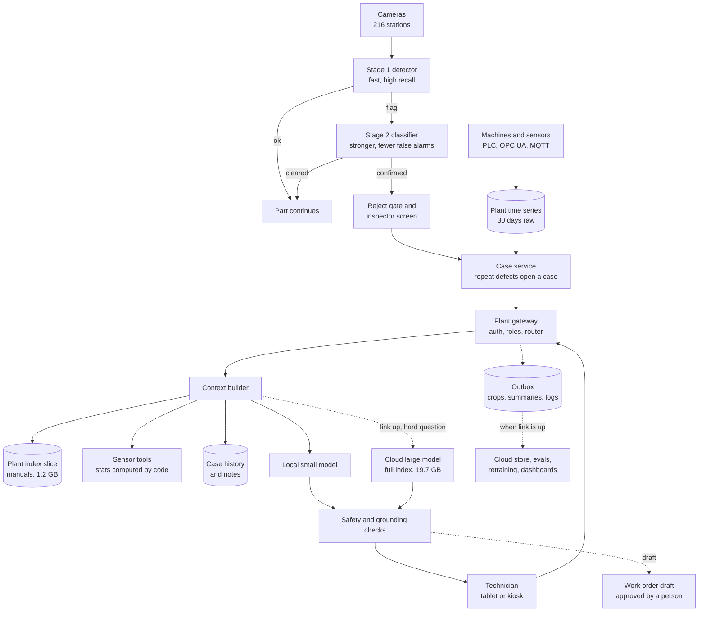
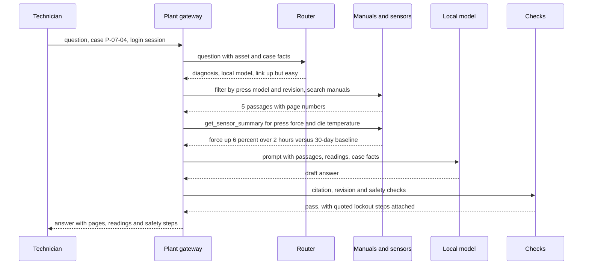

# Defect and maintenance copilot

> [!NOTE]
> The company in this case study is fictional. Its numbers are made up to make the design concrete. Prices and hardware costs are stated assumptions, not real quotes. New to AI terms? Start with [the word list](#words-used-in-this-case-study), and see [the layers and tools](#layers-and-tools) for what to build each part with.

## At a glance

| | |
|---|---|
| **Problem** | Spot defects on the line within a second, and help technicians diagnose the cause from 30 years of manuals and live machine data, even when the plant has no internet. |
| **Scale** | 12 plants, 216 cameras, about 12.4M frames a day, about 10,700 copilot requests a day. |
| **Key patterns** | Two-stage vision at the edge, asset-aware retrieval over manuals, sensor data read by tools, offline mode with a sync outbox, safety text quoted and never paraphrased. |
| **Difficulty** | Advanced. |
| **Read time** | About 40 minutes. |

## The scenario

Kestrel Components is a made-up maker of stamped and molded metal and plastic parts. It runs 12 plants, each with 6 production lines. Every line has 3 inspection stations with one camera each, so there are 216 cameras in total. The plants hold about 40,000 manuals, wiring diagrams, service bulletins and repair notes written over 30 years. Some are clean PDFs, and many are scans of paper.

Two groups of people use the system. Line inspectors decide whether a flagged part is really defective. Maintenance technicians repair machines and today search shared drives and call the one engineer who remembers how a 1998 press was rebuilt. The company wants cameras that catch defects automatically, and a copilot that answers "what is probably wrong, and how do I check it?" with page references and live machine readings. Plants lose their internet link now and then, and production does not stop when that happens, so the system must keep working without the cloud.

| Measure | Today | Target |
|---|---|---|
| Inspection frames per day | 12.4M, checked by people on sampled parts only | 12.4M, all checked by a model |
| Defects caught before shipping | Not measured | At least 97% (recall) |
| Flags a human must review per line per hour | Not applicable | Under 20 |
| Time to find the right manual page | About 25 minutes | Under 1 minute |
| Unplanned downtime per plant per month | 40 hours (assumed) | 7.5% less (see the Cost section) |
| Copilot works with the internet down | No | Yes, with a smaller model and a plant-local index |

## Requirements

A manufacturing copilot has two jobs that run at different speeds. The vision job decides in well under a second while a part moves down the line. The language job helps a person over several seconds, and it must be right about safety. The requirements below give each a priority and a number.

Functional requirements:

| Requirement | Priority |
|---|---|
| Inspect every frame at the line and flag suspect parts without the cloud | P0 |
| Re-check each flagged part with a second, stronger model before a person sees it | P0 |
| Answer maintenance questions from manuals, with the page and manual revision cited | P0 |
| Read live and past sensor data for the machine in question, and use it in the answer | P0 |
| Keep working at the plant with no internet, and sync when the link returns | P0 |
| Open a case automatically when the same defect repeats on one line | P1 |
| Draft a work order for the maintenance system, for a person to approve | P1 |
| Take technician notes and photos, and add them to the case history | P1 |
| Answer in the languages the plants use | P1 |

Non-functional requirements, each with the reason for the number:

| Requirement | Target | Why |
|---|---|---|
| Decision from frame to flag | Under 500 ms at p99 | The reject gate is about 3 seconds downstream of the camera (assumed), and the part must not pass it |
| Overall defect recall | At least 97% | Escapes reach customers. Missed defects cost more than false alarms |
| Review load | Under 20 flags per line per hour | More than that and inspectors stop reading the flags |
| First visible word of an answer | Under 1.5 s at p95 | Technicians stand at a machine with tools in their hands |
| Plant availability of the copilot | 99.9%, including WAN outages | The link to the cloud is the part we do not control |
| Wrong procedure in an answer | Zero tolerance for safety steps | A wrong lockout step can injure someone |
| Raw video leaving a plant | None, only flagged crops and summaries | The link cannot carry it, and video shows workers |

Security, safety and compliance needs: machine data and drawings are company secrets, so the cloud receives only what it needs, encrypted in transit. Cameras see people, so the edge system stores the minimum, keeps frames for a short set time, and blurs or crops out people where the camera view allows. Each plant belongs to a role group, and a technician sees only the machines and cases of their own plant unless a manager grants more. The copilot never gives its own version of a safety procedure. It shows the plant's approved text with the manual page, and a person carries out the steps. Rules differ by country, so check the regulations where each plant sits. In the United States, for example, [OSHA's lockout/tagout rule](https://www.ecfr.gov/current/title-29/subtitle-B/chapter-XVII/part-1910/subpart-J/section-1910.147) requires written, specific procedures for isolating machine energy before servicing.

## Numbers

Before drawing anything, we estimate the load, the storage and the bill. Every assumption is stated so you can change it. The formulas follow the [design method](../DESIGN-METHOD.md).

Vision load, per day. Assume 1 frame per second per camera, 16 production hours a day and 25 production days a month.

- Cameras = plants × lines × stations = 12 × 6 × 3 = 216.
- Frames per day = 216 × 16 × 3,600 = 12,441,600.
- Raw video per day = 12,441,600 × 1.5 MB (an assumed JPEG size) = 18.7 TB.
- Raw video rate per plant = 18 cameras × 1.5 MB per second = 27 MB per second = 216 Mbit per second. If a plant link is 100 Mbit per second (assumed), the video does not fit, and it would fill the whole link. This is the reason vision runs at the edge.

Edge compute, per plant. Assume the first-stage model needs 15 ms of GPU time per frame.

- GPU busy fraction = frames per second × seconds per frame = 18 × 0.015 = 0.27.
- At a 2× burst (line restarts after a stop) = 0.54. One edge GPU server can carry a plant, and we install two so one can fail.

Flags and review load. Assume 0.1% of frames show a real defect, the first stage flags 0.5% of frames and catches 99% of real defects, and the second stage keeps 98% of those real defects and 20% of the false alarms.

- Real defects per day = 12,441,600 × 0.001 = 12,442.
- Stage 1 flags = 12,441,600 × 0.005 = 62,208. Real defects among them = 12,442 × 0.99 = 12,317. False alarms = 62,208 − 12,317 = 49,891.
- Stage 2 passes = 12,317 × 0.98 + 49,891 × 0.20 = 12,071 + 9,978 = 22,049.
- Overall recall = 0.99 × 0.98 = 97.0%. Precision = 12,071 ÷ 22,049 = 54.7%.
- Review load per line per hour = 22,049 ÷ 72 lines ÷ 16 hours = 19.1. This is just under the target of 20. Without stage 2, the same load would be 62,208 ÷ 72 ÷ 16 = 54 flags per line per hour, which is why we need two stages.

Uploads from the plants:

- Flagged crops per day = 22,049 × 150 KB (an assumed crop size) = 3.3 GB, or 276 MB per plant.
- Sensor data: 60 machines per plant × 8 sensors = 480 sensors per plant and 5,760 in total, sampled once per second. Raw readings per day = 5,760 × 86,400 = 497.7M, at 16 bytes each = 8.0 GB (664 MB per plant).
- One-minute summaries (min, max, mean) keep 5,760 × 1,440 = 8,294,400 rows a day, which is 60 times fewer rows. At 32 bytes each = 265 MB a day, or 22 MB per plant.
- Plants keep the raw readings for 30 days: 664 MB × 30 = 19.9 GB per plant.

Manuals and the search index:

- Pages = 40,000 documents × 60 pages = 2.4M. Scanned pages = 40% × 2.4M = 960,000.
- Passages = 2.4M pages × 2 passages per page = 4.8M, at about 350 tokens each.
- Cloud index size = passages × dimensions × bytes per number = 4,800,000 × 1,024 × 4 = 19.7 GB (32-bit numbers).
- A plant uses about a quarter of the documents, because many machines repeat across plants. Plant slice = 1,200,000 × 1,024 × 1 byte = 1.2 GB when compressed to 8-bit numbers. Compression loses some accuracy, so we test it before shipping.
- One-time ingestion: OCR at an assumed $0.0015 per page = 960,000 × $0.0015 = $1,440. Embeddings at an assumed $0.10 per 1M tokens = 4,800,000 × 350 ÷ 1,000,000 × $0.10 = $168.

Copilot load. Assume 40 users per plant and 20 questions per user per production day. Assume 1 in 20 confirmed flags opens an automatic case.

- User questions per day = 12 × 40 × 20 = 9,600. Automatic cases per day = 22,049 ÷ 20 = 1,102. Requests per day = 10,702.
- Average requests per second = 10,702 ÷ (16 × 3,600) = 0.186. Peak = 0.186 × 4 (shift starts, assumed) = 0.74 per second across all plants.
- Requests in flight at peak = 0.74 × 8 seconds = about 6.

Tokens per request:

- Input = system prompt and tool definitions 1,000 + five retrieved passages at 350 each 1,750 + sensor summary 400 + defect facts 150 + conversation so far 500 + question 60 = 3,860 tokens.
- Output = 300 tokens.

Model cost, using placeholder prices. Assume a large cloud model at $3 per 1M input tokens and $15 per 1M output tokens. The small model at each plant runs on our own hardware, so it has no per-token fee.

- Large-model request = 3,860 ÷ 1,000,000 × $3 + 300 ÷ 1,000,000 × $15 = $0.01158 + $0.0045 = $0.01608.
- Plants answer 60% of requests locally and send 40% to the cloud when the link is up (the routing rule is in deep dive 4). Cloud requests per month = 10,702 × 25 × 0.40 = 107,020.
- Cloud model cost = 107,020 × $0.01608 = $1,721.
- Image cost: assume 20% of cloud requests include a defect crop at 800 extra input tokens. 107,020 × 0.20 × 800 ÷ 1,000,000 × $3 = $51.
- Retrieval and re-ranking in the cloud, assumed at $0.0004 per request = 107,020 × $0.0004 = $43.
- Cloud tokens per minute at peak = 0.74 × 0.40 × (3,860 + 300) × 60 = about 74,000. This is the number to compare with a provider's rate limit.

Fixed cost. Assume each plant buys two vision servers at $12,000 and one language-model server at $15,000, and the cost is spread over 36 months.

- Hardware per month = 12 plants × (2 × $12,000 + $15,000) ÷ 36 = $468,000 ÷ 36 = $13,000.
- Cloud fixed cost (search, storage, queues, logs) = $6,000 a month, assumed.
- Total per month = $13,000 + $6,000 + $1,721 + $51 + $43 = $20,815, about **$20,800**.
- Per frame = $20,815 ÷ (12,441,600 × 25) = about $0.00007, or $0.07 per 1,000 frames.

The number that matters more is downtime. Assume 40 hours of unplanned downtime per plant per month at $8,000 an hour.

- Downtime cost per month = 12 × 40 × $8,000 = $3,840,000.
- If diagnosis is 30% of repair time and the copilot cuts diagnosis time by 25%, downtime falls by 0.30 × 0.25 = 7.5%, which is worth 0.075 × $3,840,000 = $288,000 a month.
- Each 1 point of downtime saved is worth 1% × $3,840,000 = $38,400 a month. That is more than the whole cloud model bill many times over. Shaving 10% off token cost saves about $180 a month.

## Choosing the shape

The simplest design that could work is one cloud model that receives each camera frame and the manuals. It fails on three counts: the video does not fit through the plant link, the decision must arrive in under 500 ms, and plants must work when the link is down.

Walking up the ladder from the [design method](../DESIGN-METHOD.md):

| Rung | Verdict |
|---|---|
| One model call in the cloud | Fails. No bandwidth for video, too slow for the line, and unusable offline. |
| Fixed pipeline | Fits the vision path. Frame, detector, re-check, decision. The steps never change. |
| Router | Fits the copilot. Questions need different handling: a lookup, a diagnosis with sensors, or a safety procedure. The router also picks the local or the cloud model. |
| Tool-calling agent with a loop | Used in a small way. The model may call up to four tools per request (search manuals, read sensors, read case history, draft a work order). We cap the loop. |
| Multiple agents | Not needed. One bounded agent per request is easier to test, and each request touches one machine. |

We stop at two separate paths. The vision path is a fixed pipeline at the edge, with no language model in it. The copilot path is a router plus a small tool-calling loop, with a local model and a cloud model. Keeping the language model out of the vision path means a model outage or a slow answer can never stop the line.

## Architecture

Cameras feed an edge vision pipeline at each plant. Flagged crops, sensor summaries and copilot logs go through a plant gateway to the cloud when the link is up, and wait in an outbox when it is not. The copilot runs in two places: a small model with a plant-sized index at the plant, and a large model with the full index in the cloud. A router chooses between them.



The three parts below are written for readers who are new to AI. The word list explains the terms. The layers part explains each box, what it does here, and which kind of tool can build it. The build order shows a sensible order for a small team.

### Words used in this case study

If a word in this page is new to you, find it here. Each entry says what the word means in this design, not in general.

| Word | What it means here |
|---|---|
| Token | A small piece of text, about three quarters of an English word. Models read and write tokens, and providers charge per token. |
| Model (LLM) | The program that reads text and writes text. LLM stands for large language model. |
| Embedding | A list of numbers that stands for the meaning of a piece of text. Texts with similar meaning get similar numbers. |
| RAG | Retrieval-augmented generation. Search first, then give the best passages to the model so it answers from them. |
| Memory | What the system remembers about a case or a machine, such as past repairs and technician notes. |
| Guardrail | A check that blocks or changes something unsafe before it reaches the technician. |
| Tool | A function the model can ask the system to run, such as "get sensor summary for press 4". |
| p95, p99 | The time that 95 (or 99) out of 100 requests beat. They show slow cases that an average hides. |
| Edge | Computers at the plant, next to the machines, as opposed to the cloud. |
| Recall | Of all real defects, the share the system caught. |
| PLC | Programmable logic controller. The small industrial computer that runs a machine. |
| OPC UA, MQTT | Common industrial protocols for reading machine values (OPC UA) and moving small messages between systems (MQTT). |
| Asset | A specific machine. The asset registry says which model it is, which software and hardware revision it has, and where it stands. |
| Revision | A version of a manual or a machine. A procedure for revision B may be wrong for revision C. |
| OCR | Optical character recognition. Turning a scanned page into text. |
| CMMS | Computerized maintenance management system. The tool that holds work orders and repair history. |
| Lockout/tagout | The procedure of cutting off and locking a machine's energy sources before anyone works on it. |
| Outbox | A local queue on disk. Messages wait in it until the cloud can be reached, then they are sent. |
| Drift | A slow change in the world that makes a model worse, such as a new material or lighting at a station. |
| Golden set | A fixed list of real questions or frames with known good answers, used to test every change. |

### Layers and tools

We split the system into ten layers. Each layer has one job, and each can be built with a different category of tool. This part walks through them in the order data meets them. For each layer you get what it is, what it does here, the kinds of tools you can choose from, and what we would pick first.

Tool names are examples as of November 2026. They are not endorsements, and tools change faster than categories. We checked that each named open-source project had recent activity, but you should check maintenance and license again before choosing.

Three layers are easy to mix up: manuals retrieval, sensor data and case memory. All three feed the model, but they answer different questions.

| | Manuals retrieval | Sensor data | Case memory |
|---|---|---|---|
| The question it answers | What do the documents say about this kind of machine and fault? | What is this machine doing now, and what did it do before the fault? | What has already been tried on this machine or this case? |
| What it holds | Passages from manuals, bulletins and approved procedures | Numbers in time order | Technician notes, closed work orders, earlier answers |
| How it is searched | Meaning search and keyword search, filtered by machine model and revision | Exact queries by machine, sensor and time window | Lookup by machine and case, plus search over notes |
| How it changes | When a manual is added or revised | Every second | After every case |
| What the model sees | A few quoted passages with page numbers | A short summary computed by code | A few lines per past case |
| Risk if it is wrong | A procedure for the wrong revision | A wrong number stated as fact | A stale or wrong note repeated as truth |

#### Layer 1: cameras and edge vision

This layer turns camera frames into flags. It has two stages. Stage 1 is a small, fast detector that runs on every frame and is tuned to miss almost nothing, at the price of many false alarms. Stage 2 is a larger classifier that looks only at the crops stage 1 flagged, and rejects most false alarms. Both run on an edge GPU server at the plant, and neither talks to the cloud while it works.

Stage 1 needs 15 ms per frame, so it uses 27% of one GPU for 18 cameras. Stage 2 sees 0.5% of frames, so it adds almost nothing to the load. Models are trained in the cloud on labeled crops, exported to a portable format, and shipped to the plants in rings (one line, then one plant, then all).

| Category | Examples | Pick it when |
|---|---|---|
| Camera capture and video handling | GStreamer, the camera vendor's SDK | You need frames from industrial cameras with fixed timing and lighting |
| Model runtimes for edge hardware | ONNX Runtime, NVIDIA TensorRT, OpenVINO | You want to run one trained model fast on the plant's GPU or CPU |
| Anomaly detection from good samples | Methods such as PatchCore (see Further reading) | You have few defect images, because defects are rare, but many good ones |
| Supervised detectors and classifiers | Object detectors and image classifiers trained on labeled defects | You have enough labeled defects of each type |
| Labeling tools | CVAT, Label Studio | Inspectors and engineers need to mark defects on crops |

First version: a supervised classifier for the three most common defect types, plus an anomaly detector trained on good parts for everything else, in one ONNX file per station type. What goes wrong: a new material, a new light bulb or a new supplier changes the pictures, and the model starts flagging good parts. Track the flag rate per station per hour and alert when it moves by more than 30% against its 7-day average.

#### Layer 2: plant gateway and sync

The gateway is the front door at each plant. It checks who the technician is, applies the role rules, routes each request, and owns the outbox. It also decides between the local and the cloud model. The cloud side of the gateway receives synced data and sends back updates: new manual passages, new vision models and new settings.

The outbox is a local database table. Every item to send (a crop, a summary row, a copilot log, a technician note) is written there first, with an ID, and removed only when the cloud confirms it. Messages between systems use a queue protocol that can deliver at least once, and the receiver ignores duplicates by ID. Deep dive 4 shows the code.

| Category | Examples | Pick it when |
|---|---|---|
| Existing login and role system | Your single sign-on, with a local copy of roles at each plant | Technicians already log in somewhere. Reuse it, and cache the roles so login works offline |
| Message broker for plant data | MQTT brokers such as Eclipse Mosquitto, NATS | You need small messages, many publishers and delivery that survives a lost link |
| Local database for the outbox | SQLite in write-ahead log mode, Postgres | You need a durable queue on one machine with no extra service |
| Edge orchestration | K3s, the edge services of the large cloud providers | You must update software and models on 12 or more sites from one place |

First version: SQLite for the outbox, an MQTT broker at each plant for sensor and flag messages, and a plain HTTPS call to the cloud for the sync. What goes wrong: the roles cache expires during a long outage and nobody can log in. Cache roles for at least 7 days and test a plant with the link cut.

#### Layer 3: manuals ingestion

Ingestion turns 30 years of documents into passages the system can search. It is where manufacturing differs most from a web help center. Many pages are scans. Tables hold the values people need (torque, clearances, fuse ratings). Drawings carry part numbers. One manual may cover three revisions of a machine.

Steps, for each document:

1. **Read.** Digital PDFs give text directly. Scans go through OCR. Record the OCR confidence for each page.
2. **Split.** Cut at headings into passages of about 350 tokens. Keep a table whole, with its header row repeated, instead of cutting it in the middle.
3. **Tag.** Store, with every passage: machine model, revision range, manual title, page number, language, document date, and whether it is an approved safety procedure.
4. **Link to assets.** Connect each document to the machines it covers in the asset registry.
5. **Flag the doubtful.** Pages with OCR confidence under a set threshold go to a person to fix. Their text is marked "unverified" until then.

| Category | Examples | Pick it when |
|---|---|---|
| OCR engines | Tesseract, PaddleOCR, cloud OCR services | You have scanned pages. Test two on 100 of your own pages, because old, stained scans behave differently from clean ones |
| Layout and table extraction | Document-parsing libraries and cloud document services | Tables carry the key values and plain OCR scrambles them |
| Asset registry | Your CMMS, or a table in Postgres | You need to map each document to machine model and revision |
| Review tool | A spreadsheet or a small web screen | A person must confirm low-confidence pages |

First version: OCR the 100 most-used manuals first, and have a maintenance engineer check 50 pages of each batch against the paper original. What goes wrong: the OCR reads a "0" as "8" in a torque value, and the answer is wrong with a confident citation. Store the page image beside the text, show it with the answer, and quote values from the image for any number that matters.

#### Layer 4: retrieval (RAG)

Retrieval finds the passages that answer the question. Here it must respect the machine in front of the technician. It runs four parts.

1. **Filter.** From the asset ID, find the machine model and revision, and keep only passages for that model and revision range, plus approved general safety documents.
2. **Search.** Run meaning search and keyword search together. Part numbers, error codes and drawing numbers need the keyword side. "Press makes a knocking noise" needs the meaning side.
3. **Merge and re-rank.** Take about 50 results from both, score them again with a more careful model, and keep the best five.
4. **Mark superseded content.** A bulletin that replaces an older procedure down-ranks the old one, and the answer says so.

The plant slice is 1.2 GB (from the numbers), so it fits in memory on the plant's language-model server. The cloud holds all 4.8M passages. The same ingestion output feeds both, and a version number on each index tells the technician how old their slice is.

| Category | Examples | Pick it when |
|---|---|---|
| Vector search inside a database | Postgres with pgvector, SQLite with a vector extension | You want one simple store. It fits the plant slice and the cloud index at this size |
| Dedicated vector database | Qdrant, Milvus, Weaviate | The index grows past a few million passages, or you need heavy filtering at high search volume |
| Keyword search | Postgres full-text search, a search engine | Part numbers and error codes must match exactly |
| Embedding and re-rank models | Open-source models that you run at the plant, hosted APIs in the cloud | The plant needs the same embedding model offline as the cloud uses online. Mixing two models breaks the match |

First version: Postgres with pgvector in the cloud, an 8-bit copy of the plant slice in a local store, the same open-source embedding model on both sides, and a local re-ranker. What goes wrong: the plant embeds questions with one model and the cloud index was built with another, and results look random. Version the embedding model next to the index and refuse to load a mismatch.

#### Layer 5: sensor data and tools

Machine values arrive from PLCs and sensors. We do not put raw numbers in the prompt. Models are poor at arithmetic over thousands of readings, and the data is large. Instead, tools compute a short, exact summary in code, and the model explains it.

Each plant keeps 30 days of raw readings in a time-series store (19.9 GB, from the numbers). The cloud keeps one-minute summaries. A tool such as `get_sensor_summary(machine, from, to)` returns, for each sensor, the latest value, the mean over the window, the mean over the same hours of the last 30 days, the percent change and any alarm limits crossed.

| Category | Examples | Pick it when |
|---|---|---|
| Industrial data collection | OPC UA servers and clients, MQTT, the PLC vendor's gateway | Your machines already expose values this way |
| Time-series database | TimescaleDB (on Postgres), InfluxDB, plain Postgres tables | You query by machine, sensor and time window. At this size Postgres alone is enough |
| Rules and baselines | Plain code, simple statistical limits per sensor | You want a fault alert that engineers can read and argue with |
| Anomaly models on sensors | Models trained on each machine's normal behavior | Rules miss slow drift, and you have months of history |

First version: Postgres with TimescaleDB at each plant, simple baselines computed in code, and no anomaly model. What goes wrong: sensor clocks differ by minutes, so a defect and a pressure spike look unrelated. Sync clocks with NTP and store the sensor's own timestamp and the receive time.

#### Layer 6: models

Two language models share the copilot work. A small open-weight model runs on the plant's language-model server and answers about 60% of requests with no per-token fee. A large cloud model handles harder diagnosis and any request that includes an image the small model cannot read well. When the link is down, the small model handles everything.

| Category | Examples | Pick it when |
|---|---|---|
| Hosted model APIs | The APIs of the large model providers | You want the best quality for hard diagnosis, and the plant has a link |
| Open-weight models at the plant | Small models served with llama.cpp or vLLM | The plant must answer offline, or data must stay inside the building |
| Models inside a cloud platform | The model services of the large cloud providers | Your contracts say data must stay in your own cloud account |

First version: one open-weight model at each plant, one hosted model behind a gateway in the cloud, and the same prompt format for both so answers look alike. What goes wrong: the two models answer differently, so a technician sees a different procedure offline than online. Test the golden set on both models and add the model name to every answer.

#### Layer 7: case memory

Case memory holds what has already happened on this machine, so the copilot does not suggest a fix that failed last week. It has two kinds.

- **Case thread.** The defect, the readings, the answers given, and what the technician did. It is a few kilobytes, stored in the plant database, and synced to the cloud.
- **Machine history.** The last 50 closed work orders for this machine and a one-line summary of each, from the CMMS. The prompt gets the 3 most relevant lines, about 150 tokens of the 500 history tokens in the numbers.

Technician notes are free text and may be wrong. The copilot shows them as "a technician wrote" and never as fact. Photos and notes are stored with the person's name and time.

First version: rows in Postgres, a read-only link to the CMMS, and no memory framework. What goes wrong: a wrong note is repeated as truth. Keep the author and date on every line, and let a supervisor mark a note as wrong.

#### Layer 8: guardrails and safety checks

Checks run after the model and before the technician sees the answer. Most are rules, so they are fast and work offline.

- **Safety text rule.** If the question is about opening, adjusting or servicing a machine, the answer must include the plant's approved lockout/tagout procedure for that machine, quoted from the document with its page, and not paraphrased. If no approved procedure is found, the answer says so and stops.
- **Citation rule.** Every procedure step and every number must come from a passage in the prompt. A check compares each number in the answer with the passages and tool results.
- **Revision rule.** The passage's revision range must include the machine's revision. If not, the answer is held and a warning is shown.
- **Action rule.** The copilot cannot start, stop or change a machine. It has no such tool.

First version: the four rules above, as code. What goes wrong: a strict check blocks good answers and technicians stop using the tool. Log every block with its reason and review the log each week.

#### Layer 9: orchestration

Orchestration runs the steps in order. For the vision path it is a fixed pipeline in a service at the plant. For the copilot it is a function with a router, a loop capped at four tool calls, and the checks above. It is a few hundred lines of ordinary code.

First version: plain code, with the final prompt of every call written to the log. What goes wrong: a framework hides the prompt, and nobody can say why the copilot gave a wrong step.

#### Layer 10: observability and evals

Observability lets you see each request: the frame score, the flag, the prompt, the passages, the tool calls, the answer, the time and the cost. Evals are automatic tests that say whether a change made things better. This layer also holds the labels that come free from inspectors, because every confirm or reject of a flag is a label.

| Category | Examples | Pick it when |
|---|---|---|
| Tracing | OpenTelemetry, Langfuse | You want one view per request across the plant and the cloud |
| Metrics and alerts | Prometheus with Grafana, or your cloud provider's monitoring | You want dashboards for flag rates, latency and outbox size |
| Eval runners | A script that runs the golden sets in your CI pipeline, with a judge model for text answers | Every model, prompt or index change must be tested |
| Review queue | A screen in the CMMS or a small web app | People need to read and label sampled answers |

First version: structured logs with a request ID, a tracing tool in the cloud, and a script that runs both golden sets on every change. Plants keep logs locally and sync them through the outbox. What goes wrong: the logs of an offline plant are missing exactly when something went wrong. Keep 30 days of logs on the plant server.

### Build order

Build in stages, and test each stage on real plant data before you add the next. The order follows risk: first watch, then flag, then advise, then work offline, then scale. The steps are a sequence, not a schedule.

1. **Stage 0: shadow vision on one line.** Install the capture and the stage 1 detector on one line in one plant. Do not reject anything. Inspectors keep working as today, and the system logs what it would have flagged. Test: compare flags with inspector decisions on a week of data. Done when: recall on known defects is at least 97% on the labeled set, and the flag rate is stable.
2. **Stage 1: two-stage vision with the reject gate.** Add stage 2 and connect the flags to the inspector screen and the reject gate on that line. Test: the review load must stay under 20 per line per hour. Done when: inspectors confirm most flags and a rollback to the old process takes under one minute.
3. **Stage 2: manuals and retrieval, in the cloud.** Ingest the 100 most-used manuals, register the assets of one plant, and build the copilot as a search-and-answer tool for technicians with the large model. Test: the 400-question golden set from past work orders. Done when: the right passage is in the top five for at least 90% of questions and no answer fails the citation rule.
4. **Stage 3: sensors and cases.** Add the time-series store, the sensor tools, repeat-defect cases and case memory. Test: replay 20 past breakdowns. Done when: the copilot names the real cause in its top two suggestions for most of them.
5. **Stage 4: offline mode.** Add the plant index slice, the local model, the outbox and the sync. Test: cut the link for 72 hours in a test plant. Done when: every request still works, the outbox drains after reconnect with no loss and no duplicates, and the screen shows the offline state.
6. **Stage 5: safety checks and work orders.** Add the lockout/tagout rule, the revision rule and the draft work order. Test: 60 safety cases, including wrong revisions and missing procedures. Done when: all 60 pass and a supervisor signs off on the wording.
7. **Stage 6: all plants.** Roll out ring by ring, with the next plant's assets and manuals added before it goes live. Test: each plant runs its own golden set. Done when: all 12 plants meet the targets, and the weekly review of flags and answers is routine.

## One request, end to end

Here is one concrete case. At Plant 7, a stamping line makes brackets. Stage 1 flags 14 frames with an edge burr in 10 minutes, and stage 2 confirms 11 of them. The case service sees a repeat defect and opens a case for press P-07-04. A technician then asks the copilot, "Burrs on bracket B-220, what should I check first?"



The answer says that burrs at this die set and a force rise of 6% point to die wear or clearance, quotes the manual's inspection steps for die clearance with page numbers, shows the force chart and attaches the approved lockout procedure for P-07-04, word for word. It marks the figure "6%" as computed from the sensor store, not from the manual. The technician can tap "draft work order", and a supervisor approves it before it reaches the CMMS.

Latency budget for the copilot path at the plant, with the local model:

| Step | Budget | If it overruns |
|---|---|---|
| Gateway, login and role check | 30 ms | Use the cached role |
| Resolve the asset and its revision | 20 ms | Ask the technician to scan the machine tag |
| Router | 100 ms | Use keyword rules only |
| Retrieval with filters and re-rank, in parallel with sensor tool | 250 ms | Skip the re-rank and keep the top five |
| Sensor summary | 100 ms | Answer from manuals and say sensor data is missing |
| Local model, time to first token | 600 ms | Nothing faster is available. Show retrieved passages while waiting |
| **First visible word** | **about 1,100 ms** | Cloud path adds about 150 ms for the link, so use it only when the question needs it |
| Streaming 300 tokens at about 40 per second | 7,500 ms | The technician is already reading |

The vision path has its own budget: capture and transfer 40 ms, stage 1 15 ms, stage 2 100 ms (only for the 0.5% flagged), decision to the gate 50 ms. That is about 205 ms in the worst case, against the 500 ms target. A separate watchdog trips if any frame takes more than 400 ms, and the reject gate then holds the part for a person to look at.

## Deep dives

Four parts of this design need more care than the rest: the two-stage vision pipeline, retrieval that respects the machine, sensor data as tools, and offline mode.

### Deep dive 1: two-stage vision at the edge

Defects are rare, and good parts are everywhere. A single detector faces a hard trade. Set it sensitive and inspectors drown in false alarms. Set it strict and defects escape.

Options we considered:

1. **One strong model on every frame.** Simple, but a model strong enough to keep false alarms low needs about 100 ms per frame, so 18 frames per second would use 1.8 GPUs per plant, and every plant would need more servers.
2. **One fast model with a high threshold.** Cheap, but recall falls, and a missed defect costs far more than a false alarm.
3. **A fast model tuned for recall, then a strong model on the few frames it flags.** Stage 1 costs 0.27 GPU per plant, and stage 2 sees 0.5% of frames.

We chose option 3. The numbers show why it works. Stage 1 alone yields 62,208 flags a day, which is 54 per line per hour. Stage 2 reduces that to 22,049, which is 19.1 per line per hour. The recall cost is small: 0.99 × 0.98 = 97.0%.

The thresholds are not guesses. We set the stage 1 threshold on a labeled set at the point where recall is 99%, and then set the stage 2 threshold at the value where the review load stays under 20. When a plant has fewer labeled defects (a new product), an anomaly detector trained on good parts only is used in stage 1. PatchCore is one published example of this idea: it needs only good samples to start (see Further reading).

```python
def decide(frame_score, crop_score, t1, t2):
    if frame_score < t1:
        return "pass"                     # most frames end here
    if crop_score < t2:
        return "pass_and_log"             # cleared by stage 2, keep the crop for audit
    return "reject_and_review"            # inspector confirms or overrules
```

Three rules keep the pipeline safe.

- **Fail closed on timing.** If either stage does not answer in time, the part is held for a person. A late answer is never treated as "good".
- **Inspector decisions are labels.** Every confirm or overrule is saved with the crop. The cloud uses them to retrain. After a retrain, the new model runs in shadow beside the old one for a week before it takes over.
- **Roll out in rings.** A new model goes to one line, then one plant, then all plants. If the flag rate on the ring moves by more than 30%, or recall on the daily labeled sample drops, the plant rolls back to the last good model, which is kept on disk.

### Deep dive 2: retrieval that respects the machine

A web help center has one right answer for most users. A plant has 40,000 documents, many of which describe machines that look alike and differ in one detail. The wrong revision gives the right-looking, wrong answer.

Options we considered:

1. **One big index, search by meaning.** Simple, but a question about a 2004 press can return a passage from the 2016 manual of the same family. It reads well and is wrong.
2. **Ask the technician to say which machine.** Reliable, but slow and often skipped.
3. **Filter by the asset first.** The technician scans the machine tag or opens the case, so the system knows the asset, its model and its revision. Search then looks only inside the matching passages.

We chose option 3, with an exception: general safety documents are always allowed, and so are bulletins that apply to the whole family. The filter in code is short.

```python
def candidates(asset, query_embedding, query_terms):
    allowed = passages.where(
        model=asset.model,
        revision_from__lte=asset.revision,
        revision_to__gte=asset.revision,
    ) | passages.where(kind="approved_safety_procedure", asset_id=asset.id) \
      | passages.where(kind="family_bulletin", family=asset.family)
    by_meaning = allowed.nearest(query_embedding, k=30)
    by_terms = allowed.keyword(query_terms, k=30)
    return rerank(merge(by_meaning, by_terms))[:5]
```

Two details matter. First, part numbers and error codes use the keyword side, because meaning search blurs "FX-2210" and "FX-2201". Second, tables are stored whole, with their header row and the page image, because a number without its unit and column heading is a risk. The answer shows the page image next to quoted values. If the OCR confidence of the page was low, the answer says "unverified scan, check the paper manual" and does not state the value as fact.

The plant slice is built from the same passages with the same tags, so offline answers follow the same filter. The only difference is the index version and the smaller model.

### Deep dive 3: sensor data as tools, not text

The temptation is to paste a day of readings into the prompt and ask the model what it sees. A day of readings from one machine is 8 sensors × 86,400 = 691,200 numbers. Even one-minute summaries are 11,520 numbers. That is far more tokens than the rest of the prompt, and models handle long number lists badly.

The design uses a tool that computes the facts in code:

```python
def get_sensor_summary(machine_id, start, end):
    out = []
    for s in sensors_of(machine_id):
        now = series(s, start, end)
        base = series(s, start - days(30), end - days(30), same_hours=True)
        out.append({
            "sensor": s.name,
            "unit": s.unit,
            "latest": now.last(),
            "mean": now.mean(),
            "baseline_mean": base.mean(),
            "change_percent": round(100 * (now.mean() - base.mean()) / base.mean(), 1),
            "alarms": [a for a in s.limits if now.max() > a.value],
        })
    return sorted(out, key=lambda r: abs(r["change_percent"]), reverse=True)[:5]
```

The tool returns the five sensors that moved most, about 400 tokens, with units and the baseline. The model's job is to connect the readings to the manual: "press force is up 6% and the manual says clearance wear raises force". The model does not do the arithmetic.

We also link defects to sensor windows. When the case service opens a case, it stores the time of the first flag, and the tool defaults to the window from 2 hours before that time to now. This turns two data streams that were never joined into one story. The join is only as good as the clocks, so every reading has the sensor's own timestamp and the time it reached the plant, and the tool reports the difference when it exceeds one minute.

### Deep dive 4: offline mode

Plant links fail for dull reasons: a digger cuts a cable, a router reboots, a firewall change blocks traffic. The design assumption is that the link is down for hours at a time, sometimes for days, and the plant must not notice beyond a banner.

Modes:

| Mode | When | What works |
|---|---|---|
| Online | Link up, latency normal | Local model for easy requests, cloud model for hard ones, live sync |
| Degraded | Link up but slow or lossy, or the cloud model is failing | Local model only, sync continues in the background |
| Offline | Link down | Local model, plant index slice, local sensor data and cases. Everything to send goes to the outbox |

The router decides locally and never waits for the cloud. A health check pings the cloud every 10 seconds, and three misses switch the plant to degraded mode. A hard question, one with an image the local model cannot read, or one that needs a manual outside the plant slice, is answered in offline mode with the best local passages and a note: "Answered offline. The full manual set is not available. Check the paper manual before you act."

Routing rule, with the shares from the numbers: the router sends a request to the cloud only if the link is healthy and at least one of these holds: the question needs a document outside the plant slice, the retrieval score is low, the request includes an image, or the local model's check failed once. In the numbers section we assumed this covers 40% of requests.

The outbox makes sync safe. Each item gets an ID made from the plant, the table and a counter. The sender repeats until the cloud confirms, and the cloud ignores IDs it has already stored.

```python
def enqueue(item):
    item.id = f"{PLANT}:{item.kind}:{next_counter(item.kind)}"
    db.execute("INSERT INTO outbox (id, kind, payload, created_at) VALUES (?,?,?,?)",
               (item.id, item.kind, item.payload, now()))

def flush(cloud):
    for row in db.execute("SELECT * FROM outbox ORDER BY created_at LIMIT 200"):
        if cloud.put(row.id, row.payload, timeout_seconds=10).ok:   # cloud ignores a repeated id
            db.execute("DELETE FROM outbox WHERE id = ?", (row.id,))
        else:
            break                                                    # try again later, keep order
```

The outbox is a local database with a write-ahead log, which keeps committed items safe if the server loses power (see Further reading). MQTT's "at least once" delivery level, called QoS 1, does the same job for messages that go through a broker, and the same duplicate rule applies.

Sizing, from the numbers: each plant creates 276 MB of crops and 22 MB of summaries a day, so 298 MB. A 3-day outage leaves 894 MB. If the plant reserves 5 Mbit per second (0.625 MB per second) for catching up, the drain takes 894 ÷ 0.625 = 1,430 seconds, about 24 minutes. A plant disk of 1 TB holds the outbox for months. The bigger limit is how old a plant's index is: if the link is down for weeks, new manuals and bulletins do not arrive. The screen shows the index version and date, and a banner appears when it is more than 30 days old.

Most synced data is append-only, so conflicts are rare. A technician edit made offline is stored as a new entry with the author and time, and a supervisor merges them. Updates flow the other way: the plant pulls new index slices and models, checks a signature, installs them beside the old version and switches only after a test passes.

## Scaling from 1x to 100x

Load grows when plants are added, when lines get more cameras, or when the platform serves other manufacturers. In this design, the copilot grows slowly and the edge grows linearly, because each plant carries its own load. Here 10x means 120 plants, and 100x means 1,200, for example a platform with many customers. Numbers scale from the 1x values above.

| Load | Cameras | Frames per day | Crops to the cloud per day | Peak copilot requests per second | Peak cloud tokens per minute | What breaks first | Fix |
|---|---|---|---|---|---|---|---|
| 1x | 216 | 12.4M | 3.3 GB | 0.74 | 74,000 | Nothing yet. Tune thresholds and test offline mode | Per-plant budgets, ring rollouts |
| 10x | 2,160 | 124M | 33 GB | 7.4 | 0.74 million | Fleet management: updating models and indexes on 120 sites, and labeling capacity | Central device registry, staged rollouts with auto rollback, active selection of what to label |
| 100x | 21,600 | 1.24B | 331 GB | 74 | 7.4 million | Provider rate limits, cloud search and the review queue for ingested manuals | Second provider, sharded cloud index, a tenant-level ingestion pipeline with quality gates |

The reasoning behind the fixes:

- **Edge compute.** It scales one plant at a time, at the same cost per plant: $13,000 a month for 12 plants becomes $130,000 for 120 and $1.3 million for 1,200. There is no central bottleneck, which is the main benefit of edge design.
- **Cloud model cost.** It scales with the share of requests that go to the cloud. The $1,815 a month in cloud cost becomes about $18,150 at 10x and $181,500 at 100x. Raising the local share from 60% to 75% cuts the cloud cost by 37.5%, because cloud requests fall from 40% to 25% of the total (0.25 ÷ 0.40 = 0.625).
- **Fleet management.** Twelve plants can be updated by hand. A hundred and twenty need a device registry, signed updates, rings and automatic rollback. This is the hidden cost of edge systems, and it appears at 10x.

## Failure modes and safety

Systems like this fail in ordinary ways more often than in dramatic ones. The table lists what we plan for, how we notice, and what happens next.

| Failure | How we notice | What we do |
|---|---|---|
| Internet link down | Health check fails three times | Switch to offline mode, show the banner, queue everything in the outbox |
| Edge GPU server fails | Heartbeat missing, frame backlog | The second server takes over. If both fail, the reject gate holds suspect parts for a person and inspectors go back to manual checks |
| Stage 1 or 2 too slow | Frame takes more than 400 ms | Hold the part for a person. Never treat "late" as "good" |
| Model drift on a station | Flag rate moves 30%, overrule rate above 60% | Alert, route the station to more human review, retrain, roll out in rings |
| Missed defect (low recall) | Customer return, end-of-line test, targeted labeled sample | Add the case to the labeled set, retrain, and lower the threshold on that station if needed |
| Wrong procedure in an answer | Revision rule, citation rule, technician report | Block and show the manual page. Safety steps are quoted, never generated |
| Wrong number from OCR | Page image shown beside the value, spot checks | Show the image. Mark low-confidence pages "unverified" |
| Wrong revision | Passage revision range does not include the machine | Hold the answer, show a warning, ask the technician to confirm the machine |
| Prompt injection in a manual or note | Text in a document that tries to give orders | Treat all retrieved text as data. The copilot has no tool that moves a machine, so the worst case is a bad suggestion that the checks and the technician see |
| Cost spike in the cloud | Spend per hour above 3 times average | Per-plant token budget, switch to local-only |

Two points need extra care. The first is the failure that looks like success: a quiet vision system. If the flag rate falls to zero, the cause might be good parts or a dead camera. Monitor frame counts per station, image brightness and focus score, and alert on a camera that sends no frames or identical frames. The second is trust. A technician who gets one confident wrong answer stops reading the rest. That is why the answer always shows the page and the sensor values it used, so the person can check in seconds.

> [!WARNING]
> The copilot suggests, and people decide. It has no tool that starts, stops or changes a machine, and it never writes its own lockout/tagout steps. Show the approved procedure from the plant's own document, and let an authorized employee carry it out.

## Measuring quality

"Good" has two meanings here: the vision system finds defects without burying inspectors, and the copilot gives right, cited and safe answers. Both are measured before release, during rollout and in production.

Metrics and targets:

| Metric | How it is measured | Target |
|---|---|---|
| Overall defect recall | Labeled set of known defects, plus defects found later at end-of-line tests and customer returns | At least 97% |
| Review load | Flags shown to inspectors per line per hour | Under 20 |
| Overrule rate | Share of flags inspectors reject as false alarms. 1 − precision = 45.3% at our numbers | Under 50%, alert at 60% |
| Flag-to-gate time | Measured on the plant, per frame | Under 500 ms at p99 |
| Right passage in top five | Golden set of questions with known source pages | At least 90% |
| Cited and correct answers | Share of answers where every step and number matches a passage or a tool result | At least 97% |
| Safety steps quoted verbatim | Check on the 60 safety cases | 100% |
| Offline answer quality | Same golden set run on the local model and the plant slice | Within 5 points of the online score |
| First visible word | Measured at the screen | Under 1.5 s at p95 |
| Sync loss | Items sent versus items stored in the cloud after a forced outage | Zero lost, zero duplicates |

Recall cannot be estimated by sampling random good frames. The missed-defect rate among unflagged frames is (12,442 − 12,071) ÷ (12,441,600 − 22,049) = 371 ÷ 12,419,551 = 0.003%. If inspectors label 1,238 random unflagged frames a day (0.01% of the 12.4M), the expected number of missed defects found per day is 1,238 × 0.00003 = 0.037, or one every 1 ÷ 0.037 = 27 days. That cannot tell you whether recall moved. So we sample where misses live: frames whose stage 1 score is just below the threshold, frames from stations with a rising overrule rate, parts that failed end-of-line tests but were never flagged, and customer returns. Every miss goes into the labeled set with its crop.

The copilot golden set is built from closed work orders. We take 600 from the last three years, 50 per plant, with the fault, the cause and the fix that worked. Two senior technicians write the expected source pages and the correct diagnosis. We add 60 safety cases (wrong revision, missing procedure, request to bypass a guard) and 40 out-of-scope questions. A judge model grades answers against the references, and we trust it only if it agrees with human graders on at least 85% of 200 labeled answers. The release rule is simple: no machine family may drop more than one point against the current version, and every safety case must pass.

Release process: new vision models go through the rings in deep dive 1, with shadow mode first. New prompts, models and indexes for the copilot go to one plant, then three, then all, comparing cited-correct rate, overrule rate, technician thumbs-down and cost. In production, each plant sends 5% of answers for judge grading, and every thumbs-down and every held answer is read by a maintenance engineer each week.

## Cost

Money goes to three places: edge hardware, the cloud, and the people who keep the data right. The formulas in the numbers section gave the unit costs, and the monthly view shows where the money sits.

| Item | Calculation | Per month |
|---|---|---|
| Edge hardware, spread over 36 months | 12 × (2 × $12,000 + $15,000) ÷ 36 | $13,000 |
| Cloud fixed cost (search, storage, queues, logs) | Assumed | $6,000 |
| Cloud large-model calls | 107,020 × $0.01608 | $1,721 |
| Image tokens | 107,020 × 0.20 × 800 ÷ 1,000,000 × $3 | $51 |
| Retrieval and re-ranking in the cloud | 107,020 × $0.0004 | $43 |
| **System total** | | **about $20,800** |
| Cost per 1,000 frames | $20,815 ÷ (12,441,600 × 25 ÷ 1,000) | about $0.07 |

One-time costs: OCR of 960,000 scanned pages is $1,440, and embeddings of 4.8M passages are $168, both at the placeholder prices above. Two other costs are not in the table because they are people, not machines. A small team must label defects, maintain the manuals and review answers, and the plant must train staff on the new screens.

Against that, the benefit is $288,000 a month if downtime falls by 7.5%, which is about 14 times the system cost ($288,000 ÷ $20,815 = 13.8). These benefit numbers are assumptions to be measured, not promises. The lever that moves the total most is the downtime saved, at $38,400 a month for each point. The second lever is the share of requests that the local model answers, because it removes cloud spend and works offline. The model price is the weakest lever: a 10% cut saves about $180 a month.

Cost levers in order of impact: better manuals text (shorter repairs), a review load near target (inspector hours cost more than the AI bill), a high local-answer share (60% to 75% cuts cloud cost by 37.5%), and sending crops instead of frames (3.3 GB against 18.7 TB a day).

## Trade-offs we made

We recorded the decisions, the options, and the conditions under which we would change our mind. Revisit this table when numbers shift.

| Decision | Options | Choice | Why | Revisit when |
|---|---|---|---|---|
| Where vision runs | Cloud, edge | Edge | Raw video is 216 Mbit per second per plant, and the gate needs under 500 ms | Plant links become fast and cheap enough to carry video, and latency allows it |
| Vision shape | One strong model, one fast model, two stages | Two stages | Review load drops from 54 to 19.1 flags per line per hour for a 2-point recall cost | A single model reaches the same recall and load on cheap hardware |
| Retrieval scope | One index, filter by asset | Filter by asset and revision | Prevents the right-looking, wrong-revision answer | Asset data is too incomplete to filter, then fix the data first |
| Sensor data to the model | Raw numbers in prompt, summaries computed by tools | Tools | Exact arithmetic and about 400 tokens instead of about 11,500 | Models become reliable at long numeric analysis, and we can test it |
| Language model placement | Cloud only, local only, both | Both, with a router | Offline works, and the cloud handles hard cases | The local model closes the quality gap on the golden set |
| Safety procedures | Generated, quoted | Quoted from approved documents | A wrong step can hurt someone, and the plant owns the wording | A regulator or the plant approves a reviewed generation process |
| Copilot actions | None, draft work orders, control machines | Draft work orders only | A person approves, and no tool touches a machine | Audits show a long record of correct drafts and a clear need |

Versions: v1 is the two-stage vision pipeline on selected lines, manuals search for the 100 most-used manuals, sensor tools and the offline mode for answers. v2 adds repeat-defect cases, case memory, draft work orders, the full manual set and all 12 plants. v3 adds sensor anomaly models, multilingual answers, voice input for gloved hands, and a platform layer for other manufacturers.

## What teams get wrong

Most failures of first versions come from the same few mistakes. Each one below comes with a sign that you are making it.

- **Sending video to the cloud.** The first demo works on one camera. Sign: the plant link is above 80% use at one camera per line.
- **Treating late as good.** If the model is slow, the part passes. Sign: no timeout path in the pipeline.
- **No labels from inspectors.** Every inspector decision is a free label that teams throw away. Sign: the training set has not changed in months.
- **Trusting OCR on numbers.** A scanned "0" becomes an "8". Sign: no page image beside quoted values.
- **Pasting sensor data into the prompt.** It costs tokens and the model gets the arithmetic wrong. Sign: prompts of 20,000 tokens with long number lists.
- **Paraphrasing safety procedures.** The model writes a plausible lockout list. Sign: no quote and page number next to the safety steps.
- **Offline mode as an afterthought.** The model works, but login, roles, indexes and logs need the cloud. Sign: nobody has ever pulled the network cable in a test.
- **No monitoring of silent failures.** A dead camera looks like a very good week. Sign: no alert on a station with zero flags.

## Interview mode

If you get this problem in an interview, you have about 45 minutes. Spend the time like this, and say your assumptions out loud as you go.

| Minutes | What to do |
|---|---|
| 0 to 5 | Ask about plants, cameras, frame rate, defect rate, line speed, plant links, what a missed defect and a false alarm cost, and which machine actions the copilot may take |
| 5 to 12 | Do the math: frames per day, video per plant against the link, GPU load, flags per line per hour, copilot requests, cost |
| 12 to 17 | Argue for the shape: a fixed edge pipeline for vision, a router and a capped tool loop for the copilot |
| 17 to 30 | Draw the architecture, walk one case, and go deep on two-stage vision, asset-aware retrieval and offline sync |
| 30 to 38 | Scale to 10x and 100x, and list failure modes, with safety first |
| 38 to 43 | Define quality metrics, the golden sets, and the release rule |
| 43 to 45 | Summarize the trade-offs and what you would build in v2 |

Follow-up questions an interviewer may ask:

**1. The internet link to Plant 7 is down for 3 days. What happens?**

<details>
<summary>Answer</summary>

The vision path does not change, because it never used the cloud. The copilot switches to the local model and the plant index slice, and the screen shows the offline banner and the index date. Crops, summaries, notes and logs go to the outbox, which is 894 MB after 3 days. When the link returns, the outbox drains in about 24 minutes at 5 Mbit per second, and the cloud ignores any duplicates by ID. New manuals and models that arrived in the cloud during the outage are pulled and installed after a signature check. We then run the golden set on the plant's slice to confirm nothing broke.

</details>

**2. How do you stop the copilot from giving a procedure for the wrong machine revision?**

<details>
<summary>Answer</summary>

The asset ID comes from the machine tag or the case, and the registry gives the model and revision. Retrieval filters passages to that model and revision range before any search. A revision check runs again on the answer, and a mismatch holds the answer with a warning. Safety steps come only from approved procedures linked to that asset. Test cases with wrong revisions are part of the 60 safety cases that block a release.

</details>

**3. Why not put the sensor readings in the prompt?**

<details>
<summary>Answer</summary>

A day of readings from one machine is 691,200 numbers, and even one-minute summaries are 11,520. That is many times the rest of the prompt, costs money and tokens, and models are weak at arithmetic over long lists. A tool computes the latest value, the mean, the 30-day baseline and the percent change in code, and returns the five sensors that moved most, about 400 tokens. The model explains what those numbers mean next to the manual text.

</details>

**4. How would you prove the system catches 97% of defects, when misses are so rare?**

<details>
<summary>Answer</summary>

Random sampling cannot do it. At a 0.003% miss rate among unflagged frames, labeling 1,238 random frames a day finds a miss about every 27 days. Instead, sample near the threshold, add parts that failed end-of-line tests, add customer returns, and seed known defects (parts with planted defects) through the line on a schedule. Recall measured on the seeded parts is a direct number, and the other sources show what the seeds do not cover.

</details>

## Concepts used

This case study relies on a few ideas that Part 1 explains from the beginning. Read those first if any are new to you.

Basics in Part 1:

- [Tokens and context windows](https://github.com/NeuralSaasAi/ai-engineering-playbook/blob/main/00-foundations/tokens-and-context-windows.md)
- [Embeddings and vector search](https://github.com/NeuralSaasAi/ai-engineering-playbook/blob/main/00-foundations/embeddings.md)
- [RAG in one page](https://github.com/NeuralSaasAi/ai-engineering-playbook/blob/main/00-foundations/rag-in-one-page.md)
- [Tool calling](https://github.com/NeuralSaasAi/ai-engineering-playbook/blob/main/02-building-agents/tool-calling.md)
- [Human in the loop](https://github.com/NeuralSaasAi/ai-engineering-playbook/blob/main/02-building-agents/human-in-the-loop.md)
- [What are guardrails](https://github.com/NeuralSaasAi/ai-engineering-playbook/blob/main/03-ai-safety-guardrails/what-are-guardrails.md)

Advanced ideas introduced here: a two-stage detector tuned for recall then precision, review load as a design number, asset-and-revision filtered retrieval, sensor summaries computed by tools, quoted safety procedures, offline mode with a sync outbox, idempotent sync by item ID, and measuring recall for rare defects without random sampling.

Related case studies in this playbook: the customer support agent (01) covers the model cascade, grounded answers and handoff in more depth, and the clinical voice scribe (06) covers another system where an error can hurt a person.

## Further reading

These sources cover the ideas this design depends on most.

- [Towards Total Recall in Industrial Anomaly Detection](https://arxiv.org/abs/2106.08265) (PatchCore, CVPR 2022). It shows how to detect defects when you only have examples of good parts, which is the cold-start case for a new product.
- [MQTT version 5.0 specification](https://docs.oasis-open.org/mqtt/mqtt/v5.0/mqtt-v5.0.html) from OASIS. Section 4.3 defines the delivery levels (at most once, at least once, exactly once) that decide how a plant message survives a lost link.
- [Write-Ahead Logging](https://www.sqlite.org/wal.html) from SQLite. It explains how a local database keeps committed writes safe, and lists the limits that matter for a plant outbox.
- [Handling overload](https://sre.google/sre-book/handling-overload/) from the Google SRE book. It covers degraded responses and graceful behavior under load, which is the idea behind our degraded and offline modes.
- [29 CFR 1910.147, the control of hazardous energy (lockout/tagout)](https://www.ecfr.gov/current/title-29/subtitle-B/chapter-XVII/part-1910/subpart-J/section-1910.147). The United States rule for isolating machine energy before servicing. Plants elsewhere should read their own national rules.
