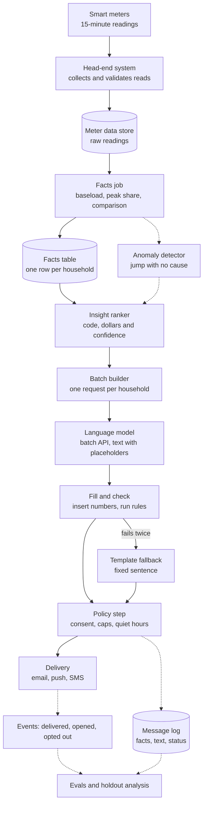
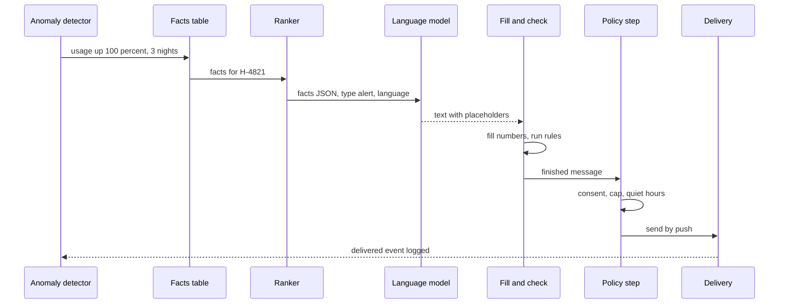

# Home energy advisor for a utility with 3M smart meters

> [!NOTE]
> The utility in this case study is fictional. Its numbers are made up to make the design concrete. Prices are stated assumptions, not real quotes. New to AI terms? Start with [the word list](#words-used-in-this-case-study), and see [the layers and tools](#layers-and-tools) for what to build each part with.

## At a glance

| | |
|---|---|
| **Problem** | Turn smart meter readings into short, personal savings advice that is always numerically correct, and send it without annoying anyone. |
| **Scale** | 3M meters, a reading every 15 minutes, about 1.8M households who opted in to advice, one monthly message each plus alerts. |
| **Key patterns** | Numbers computed by code, language model explains, batch insights, proactive messages with consent and frequency caps, a holdout group to measure real savings. |
| **Difficulty** | Advanced. |
| **Read time** | About 30 minutes. |

## The scenario

Northgrid Power is a made-up electricity utility with 3 million residential smart meters. Each meter reports usage every 15 minutes. Customers can see a chart in the app, but few open it. Northgrid wants to send each opted-in household a short note, such as "your always-on standby load costs you about $13 a month more than similar homes", and to warn people when usage jumps for no clear reason.

The risk is obvious. A language model that does arithmetic on meter data will sooner or later send a wrong dollar figure to a customer, and a bill is a regulated, sensitive topic. So this design never lets the model calculate. Code computes every number. The model only turns verified facts into friendly words.

| Measure | Today | Target |
|---|---|---|
| Smart meters | 3M | 3M |
| Households opted in to advice | 0 (a chart in the app) | 1.8M (60%) |
| Personal advice messages per household per month | 0 | 1, plus alerts when needed |
| Wrong numbers in messages | Not applicable | 0 by construction |
| Message opt-outs per month | Not applicable | Under 0.5% |
| Measured drop in household use (versus a holdout group) | 0% | 1% or more |
| Model and delivery cost per message | Not applicable | Under $0.001 |

## Requirements

The system has two jobs that must not mix. The first is to find true, useful facts in meter data. The second is to explain them well. The requirements below keep these jobs apart and give each a number.

Functional requirements:

| Requirement | Priority |
|---|---|
| Compute household facts from meter data: usage by hour, baseload, peak share, change from last month, comparison with similar homes | P0 |
| Rank candidate insights by estimated dollar savings and confidence | P0 |
| Write a short message that states only computed numbers | P0 |
| Send monthly messages in batch to opted-in households only | P0 |
| Send an alert when usage jumps with no explained cause | P0 |
| Respect opt-outs, quiet hours and a cap on messages per household | P0 |
| Keep a 5% holdout group that gets no messages, to measure real savings | P1 |
| Answer "why did you tell me this?" with the facts behind each message | P1 |
| Send in the customer's language | P1 |

Non-functional requirements, each with the reason for the number:

| Requirement | Target | Why |
|---|---|---|
| Monthly batch finished | Within 24 hours of start | Messages should land in the same week as the bill, and a batch API promises completion inside that window |
| Alert sent after detection | Under 15 minutes at p95 | An alert about a leaking hot-water system loses value by the hour |
| Numbers in text not from the facts table | Zero | A wrong bill figure creates complaints and possibly regulator contact |
| Messages that fail a policy check and still go out | Zero | Consent and quiet hours are legal rules, not preferences |
| Re-running a batch | Same messages, no duplicates | Batch jobs fail halfway and get re-run |
| Availability of the alert path | 99.9% | Alerts are the part customers notice |

Security and compliance needs: meter data shows when people are home, so it is personal data. Use it only for the purposes the customer agreed to, keep a record of consent, and delete advice history when the account closes. Never send raw meter series to a model provider when a few computed facts are enough. The facts sent to the model carry no name, address or account number, only a message ID. Check the rules in each region where you operate, because energy-data, marketing-message and privacy rules differ. Customers who depend on electrical medical equipment must never receive advice that tells them to turn things off. Mark them in the data and exclude them from usage-reduction tips.

## Numbers

Before drawing anything, we estimate the data, the message volume and the bill. The formulas follow the [design method](../DESIGN-METHOD.md). Every assumption is stated so you can change it.

Meter data:

- Readings per meter per day = 24 hours × 4 readings per hour = 96.
- Readings per day = 3,000,000 × 96 = 288,000,000.
- Storage per day = readings per day × bytes per reading = 288,000,000 × 60 = 17.28 GB. The 60 bytes per reading (meter ID, timestamp, kWh, quality flag) is an assumption.
- Storage per year = 17.28 GB × 365 = about 6.3 TB before compression.
- Readings scanned for one monthly run = 3,000,000 × 96 × 30 = 8.64 billion.

Message volume:

- Households opted in = 3,000,000 × 60% = 1,800,000. The 60% opt-in rate is an assumption.
- Alert messages per month = opted-in households × alert rate = 1,800,000 × 4% = 72,000. The 4% rate is an assumption.
- Messages per month = 1,800,000 + 72,000 = 1,872,000.
- Alert peak rate = alerts per day × peak factor ÷ 86,400 = (72,000 ÷ 30) × 5 ÷ 86,400 = 2,400 × 5 ÷ 86,400 = 0.14 per second. The alert path is tiny.
- Batch rate if we sent the monthly messages within a 6-hour window = 1,800,000 ÷ (6 × 3,600) = 83 messages per second.

Language model cost. Assume a small model at $0.25 per 1M input tokens and $1.25 per 1M output tokens (placeholders). Batch processing is assumed to cost 50% less, which matches what [OpenAI's Batch API](https://developers.openai.com/api/docs/guides/batch) and [Anthropic's Message Batches API](https://platform.claude.com/docs/en/build-with-claude/batch-processing) document as of November 2026. Check your provider's page before you rely on it.

- Input tokens per message = instructions 600 + facts for this household 500 + tip wording rules 400 = 1,500.
- Output tokens per message = 180.
- Real-time cost per message = 1,500 ÷ 1,000,000 × $0.25 + 180 ÷ 1,000,000 × $1.25 = $0.000375 + $0.000225 = $0.0006.
- Batch cost per message = $0.0006 × 50% = $0.0003.
- Monthly messages cost = 1,800,000 × $0.0003 = $540.
- Alerts, sent in real time = 72,000 × $0.0006 = $43.20.
- Rewrites when a check fails (assume 3% of all messages, at batch price) = 1,872,000 × 3% × $0.0003 = $16.85.
- Model total per month = $540 + $43.20 + $16.85 = about $600.
- Model cost per message = $600 ÷ 1,872,000 = $0.00032.

Delivery cost. Assume 70% email at $0.0001, 25% push at $0, and 5% SMS at $0.01 per message (all placeholders).

- Delivery per message = 0.70 × $0.0001 + 0.25 × $0 + 0.05 × $0.01 = $0.00007 + $0 + $0.0005 = $0.00057.
- Delivery per month = 1,872,000 × $0.00057 = about $1,067.

The model is the cheaper part. Delivery costs almost twice as much as the model, and the SMS share drives it.

Compute for facts:

- CPU time per household per run = 2 ms (assumption) × 1 pass. Total = 3,000,000 × 0.002 s = 6,000 CPU-seconds = 100 CPU-minutes.
- On 50 cores that takes about 100 ÷ 50 = 2 minutes of pure compute, so reading the data from storage, not the maths, sets the run time.

Value of the program:

- Average household use = 650 kWh a month and a blended price of $0.18 per kWh (assumptions). Monthly bill = 650 × $0.18 = $117.
- A 1% drop saves 1% × $117 = $1.17 per household per month.
- Across opted-in households = 1,800,000 × $1.17 = about $2.1 million a month saved by customers.
- Total running cost = $600 + $1,067 = about $1,667 a month, plus data and infrastructure. The saving per dollar of message cost is around 1,260 to 1. The reference point is the research on mailed home energy reports: [Allcott's study](https://ceepr.mit.edu/workingpaper/social-norms-and-energy-conservation/) of 80,000 treatment and control households in Minnesota estimated a 1.9 to 2.0 percent reduction. We assume 1%, half of that, because a short message is a weaker nudge than a full report. Measure your own number with the holdout group.

What does this tell us? The language model is a small line in the budget. The costs that move are delivery channel mix and the value of each insight, so the engineering effort goes into correct facts and good targeting, not into token savings.

## Choosing the shape

The simplest design that could work is a template: compute a few numbers, drop them into fixed sentences, and send. It is cheap and always right. It fails in one place: after a few months every customer reads the same sentence and stops reading. People respond to advice that sounds like it was written for them, in their language, about their own pattern.

Walking up the ladder from the [design method](../DESIGN-METHOD.md):

| Rung | Verdict |
|---|---|
| One model call with raw meter data | Fails. A model that reads thousands of numbers will make arithmetic and ranking mistakes, and the cost grows with the data. |
| Fixed pipeline: code computes facts, model writes words | Fits. The steps are always the same and each has a clear owner. |
| Router | Small use only: pick the message type (monthly, alert) and the language. Plain code, not a model. |
| Tool-calling agent | Not needed. The model has nothing to look up, because code already put the facts in the prompt. |
| Multiple agents | Not needed. |

We stop at a fixed pipeline run as a batch, with a second path for alerts. The model never sees raw readings, never chooses which insight matters most, and never writes a digit on its own. A later version can add a chat box ("why is my bill high?"). That chat would be a tool-calling agent whose tools return the same computed facts, and it is outside this case study.

## Architecture

Meter readings land in a data store. A scheduled job turns them into a small table of facts per household. Code ranks candidate insights, and the language model writes text for the top ones, using placeholders instead of digits. A check fills in the real numbers and rejects bad text. A policy step decides whether the message may be sent now, and then delivery sends it.



The next three parts are written for readers who are new to AI. The word list explains the terms. The layers part says what each box does here and which kind of tool can build it. The build order shows a sensible order for a small team.

### Words used in this case study

If a word on this page is new to you, find it here. Each entry says what the word means in this design, not in general.

| Word | What it means here |
|---|---|
| Smart meter | An electricity meter that sends readings to the utility by itself, here every 15 minutes. |
| kWh | Kilowatt-hour, the unit that bills use. A 1 kW heater running for one hour uses 1 kWh. |
| Interval reading | One meter value for one 15-minute slot. |
| Baseload | The power a home draws all the time, such as the fridge, the router and devices on standby. We estimate it from the lowest readings of the night. |
| Peak and off-peak | Hours when electricity costs more (peak) and less (off-peak) under a time-of-use tariff. |
| Facts table | A table with one row per household holding the numbers computed by code. The language model reads only this. |
| Insight | One piece of advice with a dollar estimate, such as "shift laundry to off-peak". |
| Token | A small piece of text (about three quarters of a word) that a model reads and writes. Models are priced per token. |
| Language model (LLM) | The program that reads text and writes text. LLM stands for large language model. |
| Prompt | Everything sent to the model in one request. |
| Placeholder | A marker such as `[[savings]]` in the model's text. Code swaps it for the real number. |
| Structured output | A model answer forced into a fixed shape, such as JSON with named fields. |
| Batch API | A model service where you send many requests at once and get results later, at a lower price. |
| Guardrail | A check that blocks or changes something unsafe before it reaches the customer. |
| Idempotent | Safe to repeat. Running it twice has the same effect as running it once. |
| Holdout group | A random set of households that receive no messages, so we can measure what the messages change. |
| Embedding | A list of numbers that stands for the meaning of a piece of text. This design does not need embeddings. |
| RAG | Retrieval-augmented generation: search documents first, then give the best passages to the model. We skip it here because the tips come from a small reviewed library. |
| Cache | A saved result that we reuse instead of computing it again. |
| Memory | What the system remembers about a customer, here the last messages sent and the customer's choices. |
| p95 | The time that 95 out of 100 requests beat. It shows slow cases that an average hides. |
| Golden set | A fixed list of households with known correct facts and reviewed messages, used to test every change. |

### Layers and tools

We split the system into eight layers. Each has one job. The most important design rule sits between layers 2 and 3: the facts layer and the ranking layer are code, and the language model layer comes after them and cannot change them.

Tool names are examples as of November 2026. They are not endorsements, and tools change faster than categories. Before choosing, check that the project is maintained and that its license suits you.

Three layers are easy to mix up here: the meter data store, the facts table and the message log. They all hold numbers about a household, but for different reasons.

| | Meter data store | Facts table | Message log (memory) |
|---|---|---|---|
| The question it answers | What did the meter read, and when? | What is true about this household this month? | What did we already tell this customer, and what did they choose? |
| What it holds | Raw readings, 96 per meter per day | About 30 computed values per household | Each message, the facts behind it, send status and consent |
| Size | About 6.3 TB a year (from the numbers above) | 3,000,000 rows × 30 values | 1,872,000 rows a month |
| How it changes | Appended all day | Rebuilt each run | Appended after each send |
| Risk if wrong | Wrong facts downstream | Wrong numbers in a message | Repeated or forbidden messages |

#### Layer 1: meter data store

This layer keeps the raw readings and answers questions such as "give me the 2,880 readings for this household for the last 30 days". It must handle fast writes all day and large scans once a month. Data from the head-end system (the utility software that collects meter reads) often arrives late or with gaps, so the store keeps a quality flag per reading: measured, estimated or missing.

| Category | Examples | Pick it when |
|---|---|---|
| Columnar files in object storage | Apache Parquet files in cloud storage, queried by Spark or DuckDB | You mostly scan large ranges once a day or month, and want low storage cost |
| Analytic database | ClickHouse | You also need fast ad-hoc queries on the same data |
| Time-series extension of a relational database | TimescaleDB on Postgres | The volume is smaller or your team already runs Postgres |

First version: Parquet files partitioned by date, queried with Spark. What goes wrong: late readings arrive after the monthly run started. Fix the cut-off time in the run configuration and record it with every facts row.

#### Layer 2: facts job and insight ranker (code)

The facts job turns 2,880 readings per household into about 30 values. The ranker takes those values, applies simple, reviewed rules, and produces candidate insights with a dollar estimate and a confidence label. This layer is plain code with unit tests. No model is involved.

The usual facts are:

- Baseload = the 5th percentile of the interval power values at night, in kW. Baseload kWh per month = baseload kW × 720 hours.
- Peak share = kWh used in peak hours ÷ total kWh.
- Change from last month = (this month − last month) ÷ last month.
- Comparison group median = the median baseload of homes in the same size band and region.

Two example insights, with numbers you can recompute:

- **Standby load.** A home has a baseload of 0.25 kW. The comparison median is 0.15 kW. Excess = (0.25 − 0.15) × 720 hours = 72 kWh a month. At the blended price of $0.18, the estimated saving is 72 × $0.18 = $12.96. We say "up to", because not all of the excess can be removed.
- **Shift from peak.** The home used 120 kWh in peak hours. The reviewed tip library says that 25% of that is shiftable (an assumption for the example). Shifted kWh = 120 × 25% = 30. With a peak price of $0.30 and an off-peak price of $0.12, the saving is 30 × ($0.30 − $0.12) = $5.40.

The ranker keeps the insights whose confidence is high enough, sorts them by dollars, and passes the best two to the batch builder. It also drops anything the policy forbids, for example usage-reduction tips for medical-equipment households.

| Category | Examples | Pick it when |
|---|---|---|
| Distributed data processing | Apache Spark, Dask, a SQL engine over Parquet | The job scans billions of readings |
| SQL transformations with tests | dbt on a warehouse | The facts are simple aggregates and you want tested, versioned SQL |
| Single-machine analytics | DuckDB, Polars | The data per run is under what one large machine can scan, which is true for a pilot |

First version: SQL or DataFrame code, with unit tests that compare results with a hand-checked set of 50 households. What goes wrong: a formula bug affects 1.8 million messages at once. Every formula needs a test and a reviewer.

#### Layer 3: language model

The model receives the facts for one household as a short JSON object, plus the chosen insight type and the language. It returns a structured answer: a subject line, a body, and a list of the placeholders it used. It never receives raw readings, names or addresses. A small model is enough, because the job is rewriting, not reasoning.

| Category | Examples | Pick it when |
|---|---|---|
| Hosted model with a batch API | Providers that offer batch endpoints at a discount, such as OpenAI and Anthropic | You want to start fast and you can wait up to 24 hours |
| Model inside a cloud platform | The model services of the large cloud providers | Your contracts say the data must stay in your cloud account |
| Open-weight model you host | Open models served with vLLM on your own GPUs | Volume is steady and high, or the data cannot leave your network |

First version: a hosted small model through its batch API for monthly messages, and the same model through the normal API for alerts. What goes wrong: a model update changes tone. Pin the model version and rerun the golden set before changing it.

#### Layer 4: fill and check (guardrails)

Guardrails are checks after the model. This layer replaces each placeholder with the value from the facts table and then runs rules on the result. The rules are listed in deep dive 1. They are code, not another model, so they are fast and cheap, and they never disagree with themselves.

| Category | Examples | Pick it when |
|---|---|---|
| Plain rules and regular expressions | Your own validation code | The rule has a clear shape, such as "no digits outside placeholders" |
| Schema validation | JSON Schema, Pydantic | You need the output fields to have a fixed shape |
| Safety classifier | A moderation endpoint or open classifier model | You want a second check for tone and unsafe content |

First version: schema validation and the rules from deep dive 1. What goes wrong: rules so strict that 20% of messages fail. Track the failure rate and tune the prompt, not the rule.

#### Layer 5: policy step

Policy decides whether a finished message may go out now. It checks consent, the monthly cap, quiet hours, the holdout group and the customer's chosen channel. These are legal and trust rules, so they live in code and run after the model, where nothing can talk its way past them.

| Category | Examples | Pick it when |
|---|---|---|
| Rules in your own service | A small function and a database table of consents | The rules are few and stable |
| Policy engine | Open Policy Agent | Many teams or regions need rules they can review and version |

First version: a function with a table of consents and counters in Postgres. What goes wrong: consent records that lag behind opt-outs. Read consent at send time, not at batch build time.

#### Layer 6: batch orchestration

This layer runs the monthly steps in order, remembers how far it got, and restarts after a failure without sending duplicates. A run has a run ID. Each household's message has an ID built from the run ID, the household and the message type. That ID is the idempotency key.

| Category | Examples | Pick it when |
|---|---|---|
| Workflow scheduler | Apache Airflow, Dagster | You run steps on a schedule with dependencies and retries |
| Durable workflow engine | Temporal | Flows are long and must survive restarts, such as the alert path |
| Cron plus a state table | cron and Postgres | A pilot with one job and one machine |

First version: a workflow scheduler for the monthly run and a small queue for alerts. What goes wrong: a half-finished run restarted from the beginning sends everything twice. The key above stops that.

#### Layer 7: delivery

Delivery sends the message through email, push notification or SMS, and records the result. It also receives events: delivered, opened and unsubscribed. Opt-out events must reach the policy step within minutes.

| Category | Examples | Pick it when |
|---|---|---|
| Email service | Amazon SES, SendGrid | Email is your main channel |
| Push notification service | Firebase Cloud Messaging, Apple Push Notification service | You have a mobile app |
| SMS provider | Twilio | The customer asked for texts, because SMS is the costliest channel |

First version: email and push, with SMS only for customers who choose it. What goes wrong: sending to a bounced address every month. Stop after repeated bounces.

#### Layer 8: observability and evals

Observability lets you see, for each message, the facts, the model's output, the check results and the delivery result. Evals are automatic tests that say whether a change made things better or worse. The holdout analysis belongs here as well, because it is the only way to learn whether the messages save energy.

| Category | Examples | Pick it when |
|---|---|---|
| Tracing and logs | OpenTelemetry, Langfuse | You want one view per message with each step |
| Metrics and alerts | Prometheus with Grafana, or your cloud provider's monitoring | You want dashboards and alerts on failure rates and opt-outs |
| Eval runner | promptfoo, or your own test script | You want the golden set to run on every change |
| Analysis notebooks | Python with pandas | You compare treatment and holdout groups each month |

First version: a message log table, a dashboard of failure rates and opt-outs, and a golden-set script in CI. What goes wrong: logs with names and addresses. Log message IDs and facts only.

### Build order

Build in stages and put each stage in front of real data before adding the next. The order follows the risk: first get the numbers right, then the words, then the sending.

1. **Stage 0: facts only.** Build the facts job and ranker for 50 hand-checked households. Test: every number matches a spreadsheet. Done when: all 50 match and formulas have unit tests.
2. **Stage 1: template messages to staff.** Fill fixed sentences with the facts and send to employees who volunteered. Test: do they understand and trust the figures? Done when: staff confirm the numbers against their own bills.
3. **Stage 2: model wording behind the checks.** Add the model, placeholders, fill-and-check and the template fallback. Test: the golden set, plus 1,000 adversarial fact rows (zero savings, negative change, missing data). Done when: no message passes with a number that is not in the facts.
4. **Stage 3: policy and delivery to a pilot.** Add consent, caps, quiet hours and delivery. Send to 20,000 opted-in households, with a 5% holdout. Test: opt-outs and complaints. Done when: opt-outs are under 0.5% per month.
5. **Stage 4: full batch.** Move wording to the batch API and run for all 1.8M households with idempotency keys. Test: kill the job midway and restart. Done when: a restart creates zero duplicates.
6. **Stage 5: alerts.** Add the anomaly detector and the real-time path. Test: replay a month of real data. Done when: p95 time from detection to send is under 15 minutes.
7. **Stage 6: more languages and A/B tests of wording.** Add languages one at a time, each with its own golden set, and compare wording against the holdout.

## One request, end to end

Here is one concrete case: an alert for household H-4821, whose evening usage doubled for three nights in a row. The alert path uses the normal model API, not the batch API, because the customer should hear about it today.



The time budget for the alert path, after the detector flags the household:

| Step | Budget | If it overruns |
|---|---|---|
| Load facts and rank insights | 50 ms | Use the facts from the last run |
| Model call with structured output | 2,000 ms | Fall back to the template sentence |
| Fill and check | 20 ms | Not expected; page the on-call engineer |
| Policy step | 30 ms | Hold the alert for the next window |
| Delivery request | 300 ms | Retry with backoff, then try the next channel |
| Total in the pipeline | About 2.4 s | The 15-minute target is mostly spent waiting for the detector's schedule |

The pipeline is fast. The slow part is detection: the detector runs every 10 minutes on the latest readings, so the worst case from the odd usage to the alert is about 10 minutes of waiting, plus the 15-minute meter interval, plus 2.4 seconds. We state that openly instead of promising "instant".

## Deep dives

Four parts of this design are hard. The first is how to guarantee that every number is right. The second is running 1.8M model requests safely as a batch. The third is deciding when to message people at all. The fourth is meter data that is missing, late or estimated.

### 1. Numbers by code, words by model

The problem: a language model is good at wording and poor at arithmetic. Even when it gets the arithmetic right 99.9% of the time, 0.1% of 1.8M messages is 1,800 wrong figures every month.

Options we considered:

| Option | Verdict |
|---|---|
| Give the model raw readings and let it calculate | Wrong answers, high token cost |
| Give the model facts and ask it to copy them | Better, but a model can still drop a digit or round a figure |
| Give the model facts and make it write placeholders, then fill them in with code | Chosen. The model cannot change a number it never writes |
| Have a second model check the first | Adds cost, and a model checker can miss errors |

The model's output has a fixed shape. It returns text such as "Your home uses about [[excess_kwh]] kWh more than similar homes each month, which could cost [[excess_usd]]." and a list of the placeholders it used. Code fills the values from the facts table, formatting them in the customer's locale.

```python
import re

PLACEHOLDER = re.compile(r"\[\[([a-z_]+)\]\]")
BANNED_PHRASES = ("guarantee", "you will save", "must switch off")

def fill_and_check(text: str, facts: dict[str, str], allowed: set[str]) -> str:
    used = set(PLACEHOLDER.findall(text))
    if not used <= allowed:
        raise ValueError(f"unknown placeholder: {used - allowed}")
    if not used:
        raise ValueError("message contains no facts")
    filled = PLACEHOLDER.sub(lambda m: facts[m.group(1)], text)
    stripped = PLACEHOLDER.sub("", text)
    if re.search(r"\d", stripped):
        raise ValueError("digit written by the model")
    if any(p in text.lower() for p in BANNED_PHRASES):
        raise ValueError("banned phrase")
    if len(filled) > 600:
        raise ValueError("too long")
    return filled
```

The rules are: every placeholder must exist in the facts for this household, at least one fact must appear, no digit may come from the model, no promise words such as "guarantee" may appear, and the message stays short. On a failure we retry once with the error in the prompt, then fall back to a template sentence. A template is dull, and it is correct, which is the right choice in a failure.

Words are not numbers, so also check claims in words: "more than similar homes" is only allowed when the insight type says the comparison is true. Each insight type has an allowed set of sentence patterns it may express, and the golden set tests that.

### 2. Running the batch safely

The problem: one run is 1.8M model requests. Batch APIs complete in up to 24 hours, individual requests can fail while the batch succeeds, and results can come back in any order. Both [OpenAI](https://developers.openai.com/api/docs/guides/batch) and [Anthropic](https://platform.claude.com/docs/en/build-with-claude/batch-processing) document a custom ID per request for this reason.

The design:

1. **Chunk.** Split the run into batches of 50,000 requests (assumption), which gives 1,800,000 ÷ 50,000 = 36 batches. A failed batch is a small loss.
2. **Key.** The custom ID of each request is `run_id:household_id:type`. Results are matched by this ID, never by position.
3. **Record.** A state table holds each household's status: built, submitted, returned, checked, sent. Every step reads and writes this table.
4. **Finish.** Households whose request errored or failed the checks get one retry in a second small batch, then the template fallback.
5. **Send window.** Sending starts only after the checks finish for a chunk, and only inside the allowed hours for each time zone.

Restart rule: a restarted run reads the state table and skips every household that already reached "sent". The send step uses the same message ID as the idempotency key at the delivery provider, so even a crash between "sent" and "recorded" cannot send twice.

### 3. When to message, and when not to

The problem: a proactive message goes to a customer who did not ask for it. Each message that is not useful costs trust, and opt-outs are permanent.

The policy has five rules, all in code:

- **Consent first.** Only opted-in households, and the consent record is read at send time.
- **Frequency cap.** At most one monthly message and two alerts per household per 30 days. Quiet hours follow local time.
- **Value threshold.** Send a monthly insight only if its estimated saving is at least $3 a month (an assumption). If nothing clears the bar, send nothing. A month with no message is better than a weak one.
- **Alert quality.** Alert only when usage is above a threshold that would have been unusual for the same household over the last 8 weeks, and no known cause (heatwave, holiday) explains it. We tune this to the 4% alert rate in the numbers section.
- **Care list.** Households flagged as dependent on electrical medical equipment, or in a payment hardship program, never receive usage-reduction tips. They can still get safety alerts through a separate, reviewed template.

Message tone follows plain rules: say "could", not "will"; give one action per message; never blame; and name the data behind it ("based on your readings from 1 to 30 October").

### 4. Bad meter data

The problem: a meter that misses readings, a clock change, or an estimated read produces facts that look real but are wrong. A wrong fact in good English is worse than no message.

Each reading carries a quality flag. A household enters the monthly run only if at least 90% of its readings in the window are measured (an assumption), and the facts row records the percentage. Daylight-saving changes produce 92 or 100 readings on two days of the year instead of 96, so the facts job works in UTC and converts for display only. Households with a recent move-in, solar panels, or an electric vehicle charger get their own baseload rules, because the usual comparison group would mislead. If the facts job cannot decide, the household is skipped and the skip reason is logged. Skips are counted, because a rise in skips is often the first sign of a data feed problem.

## Scaling from 1x to 100x

Load here means meters. At 1x we have 3M meters and 1.8M advised households. The data volume and the batch size grow with meters, while alert traffic grows slowly because alerts are rare.

| Load | What breaks first | Fix | Cost of the fix |
|---|---|---|---|
| 1x (3M meters) | Nothing yet. 17.28 GB of new readings a day | Baseline: Spark job, 36 batches, one scheduler | |
| 10x (30M meters) | The facts job: 172.8 GB a day and 86.4 billion readings a run | Partition by region and run partitions in parallel; compute only changed households | More cluster cost and a partitioning scheme to maintain |
| 10x | Batch rate limits: 18M requests a month | Spread batches over several days, or ask the provider for higher limits | Messages arrive over a longer window, so the content must not depend on the day |
| 100x (300M meters) | Storage: about 630 TB a year before compression, and the cost of scans | Move old data to cheaper tiers, keep only aggregated facts for old months | A rebuild of old facts needs a restore step |
| 100x | Delivery: 187M messages a month and sender reputation | Several sending domains, warm-up plans and a provider contract | Longer onboarding and a fixed monthly fee |
| 100x | Model cost: 187M messages × $0.0003 = about $56,000 a month | Self-host a small model, or use templates for low-value insights | Operating GPUs, or a drop in variety |

The data volume at 100x is 100 × 6.3 TB = 630 TB a year, from the storage formula above. The alert path stays small. At 100x the alert rate is 0.14 × 100 = 14 per second at peak, which one small service handles.

## Failure modes and safety

This system fails in a few quiet ways: a wrong fact that reads well, a message sent to someone who opted out, or a run that sends twice. The table lists each with how we notice it and what we do.

| Failure | How we detect it | What we do |
|---|---|---|
| Model provider down or batch late | Batch status not "completed" after 20 hours | Send templated messages for the unfinished chunks, or skip the month for them |
| Model writes a digit or an unknown placeholder | The rules in deep dive 1 | Retry once, then template fallback |
| Model makes a claim the facts do not support | The allowed sentence patterns per insight type, plus human sampling | Block, retry, template fallback |
| Wrong formula in the facts job | A golden-set test fails in CI, or a monthly sanity check shows median savings moved by more than 20% | Stop the run before the batch builder |
| Bad or missing meter data | Quality share below 90%, skip rate rising | Skip the household and alert the data team |
| Prompt injection | Facts contain only numbers and fixed labels, never free text from customers | Nothing to inject. Any free text, such as a nickname for a device, is excluded from prompts |
| Message sent without consent | Policy step reads consent at send time, and a daily audit compares sends with consent | Block the send, and treat any miss as an incident |
| Run restarted and messages duplicated | Idempotency key at the delivery provider | Provider rejects the duplicate, and the audit counts it |
| Alert flood after an outage or heatwave | Alerts per hour above a limit | Cap alerts per hour, and group them into one message per household |
| Cost spike | Spend per run above the budget | Stop the run at the budget and page the owner |
| Message reaches a care-list household with a usage tip | Care-list check in the ranker and again in policy | Block, and review how the flag was lost |

Security notes. Facts sent to a model provider carry a message ID, not a name, address or account number. The mapping from message ID to customer stays inside the utility. Prompts and outputs are logged with the same retention as other customer messages. Check each provider's terms for data use and retention before you choose one.

## Measuring quality

Quality here has three parts: are the facts right, is the message right, and did customers save energy. Different people judge each. Engineers judge the facts, an editor and a customer-care lead judge the words, and the holdout group judges the effect.

| Metric | Target | How it is measured |
|---|---|---|
| Facts match a reference calculation | 100% on the golden set | Spreadsheet or independent code on 500 households, chosen to include edge cases |
| Numbers in text not from the facts | 0 | The fill-and-check rules, counted per run |
| Unsupported claims in a sample | Under 1% | People read 0.1% of messages, which is 0.001 × 1,872,000 = 1,872 a month |
| Messages that needed the template fallback | Under 3% | Counted per run (the same 3% used in the cost estimate) |
| Opt-out rate | Under 0.5% a month | Delivery events |
| Complaints per 100,000 messages | Under 5 (assumption) | Customer care tags |
| Energy change versus holdout | At least 1% lower use | Compare mean kWh of treatment and holdout households over the same period |

The golden set has 500 households. It includes a home with solar, a home that moved in mid-month, a home with a missing week, a home on the care list, and a home with exactly zero savings. Each has expected facts and a reviewed message. It runs on every change to the prompt, the model version, the formulas or the rules. A release is blocked by any fact mismatch, any rule failure, or a fallback rate above 3%.

The holdout works like this. Assign 5% of opted-in households at random, 90,000 of 1.8M, to receive nothing. Both groups see the same weather, which removes most outside effects. Can we detect a 1% change? Assume a standard deviation of 250 kWh per household per month (an assumption). The standard error of the difference is 250 × √(1 ÷ 1,710,000 + 1 ÷ 90,000) = 250 × 0.00342 = 0.86 kWh. A 1% change is 6.5 kWh, so it is about 7.6 standard errors, which is clearly detectable. This follows the approach of the study cited earlier, which used randomized treatment and control groups.

In production we watch the skip rate, the fallback rate, bounce and opt-out rates, and the distribution of estimated savings per message. A sudden shift in the last one means a formula or data change.

## Cost

Most of the money is not in the model. It goes to message delivery, then the data platform, then the model. We computed the first two in the numbers section.

| Item | Formula | Per month |
|---|---|---|
| Monthly batch messages | 1,800,000 × $0.0003 | $540 |
| Alert messages | 72,000 × $0.0006 | $43.20 |
| Rewrites | 1,872,000 × 3% × $0.0003 | $16.85 |
| Model total | | about $600 |
| Delivery | 1,872,000 × $0.00057 | about $1,067 |
| Total per message (model plus delivery) | ($600 + $1,067) ÷ 1,872,000 | about $0.00089 |

That per-message figure is under the $0.001 target. The data platform is on top, which we do not price here because it depends on the existing meter data system and cloud contract.

The lever that moves the total most is the share of messages that carry real value. Suppose we cut messages with an estimated saving under $3 and that removes 25% of the monthly batch. Savings = 0.25 × 1,800,000 × ($0.0003 + $0.00057) = $391.50 a month, and the remaining messages earn more attention. The second lever is the channel mix. Moving half the SMS share to push saves 2.5% × 1,872,000 × $0.01 = $468 a month. Neither is large next to the $2.1 million of customer savings, so we judge success on the holdout result and on opt-outs, not on message cost.

## Trade-offs we made

We record decisions so a new team member can see why the design looks like this, and what would change our mind.

| Decision | Options | Choice | Reason | We would change it if |
|---|---|---|---|---|
| Who calculates | Model, code | Code | Models make arithmetic errors, and a bill figure must be right | Never for money figures |
| How numbers get into text | Model copies them, placeholders | Placeholders | The model cannot change a number it does not write | Never |
| Which insight to send | Model chooses, code ranks | Code ranks | Ranking by dollars is checkable and repeatable | Insights become too varied for rules |
| Monthly generation | Real time, batch | Batch | Half the price and a rate-limit pool that is separate from live traffic | Customers need advice on demand |
| Alerts | Batch, real time | Real time | An alert is worth more soon | Alerts prove not to be time sensitive |
| Model size | Large, small | Small | The task is rewriting from a fixed list of facts | Quality scores for the small model are too low |
| Fallback | Skip, template | Template | A correct dull message beats no message | Fallback exceeds 3% |
| Measuring impact | Opens and clicks, holdout | Holdout | Opens do not show energy saved | Never |
| Delivery channel default | SMS, email, push | Email and push | One SMS ($0.01) costs about 33 times one model call ($0.0003) | The regulator requires SMS for some alerts |

## What teams get wrong

A first version usually fails at the edges around the model, not in the model. These are the most common mistakes, with a way to spot each and a way to avoid it.

- **Letting the model do the arithmetic.** Spot it: a prompt that contains readings or asks for a total. Avoid it: facts in, placeholders out, as in deep dive 1.
- **Judging success by opens.** Spot it: the dashboard has open rate and no kWh. Avoid it: keep a holdout from the first pilot day, because you cannot add one later.
- **Messaging everyone every month.** Spot it: rising opt-outs and a weak savings estimate per message. Avoid it: a value threshold and a frequency cap.
- **Trusting the meter feed.** Spot it: skip rates are not tracked. Avoid it: quality flags, a 90% measured-data rule, and a skip report.
- **Re-running a half-failed batch from the start.** Spot it: customers report duplicate messages. Avoid it: a state table and idempotency keys.
- **Ignoring vulnerable customers.** Spot it: no flag for medical equipment or hardship. Avoid it: a care list that the ranker and policy both check.
- **Hiding the reason.** Spot it: customers ask "why did you send me this?". Avoid it: store the facts behind each message and show them on request.
- **Tuning tokens before targeting.** Spot it: a week spent on prompt length, while 25% of messages carry little value. Avoid it: start with the value threshold.

## Interview mode

You can present this design in 45 minutes. Spend the first 5 minutes on the job and the rule that code computes and the model explains. Spend 10 minutes on the numbers, 10 on the architecture with the facts-and-placeholders deep dive, 10 on batch, policy and failures, and the last 10 on measurement and scaling.

A timed plan:

| Minutes | Topic |
|---|---|
| 0 to 5 | Job, risks, and why numbers come from code |
| 5 to 15 | Meter data, message volume, cost formulas |
| 15 to 25 | Architecture and the placeholder check |
| 25 to 35 | Batch design, policy rules, failure modes |
| 35 to 45 | Holdout measurement, scaling to 100x, trade-offs |

**Follow-up: what happens when the model provider is down?**
<details>
<summary>Answer</summary>

The monthly run can wait, because the batch window is up to 24 hours and we can start it a day early. If a chunk is still not back after 20 hours, those households get the template message built from the same facts, or skip the month. Alerts use the template fallback at once. Because the facts and checks do not depend on the model, nothing in the numbers is at risk.

</details>

**Follow-up: why not let the model pick the most useful tip?**
<details>
<summary>Answer</summary>

Because the choice depends on dollars and confidence, which code can compute and test. A model might pick the best-sounding tip, not the best-saving one, and the choice would be hard to audit. We let code rank and the model write about the winner.

</details>

**Follow-up: how do you prove the messages work?**
<details>
<summary>Answer</summary>

With a random holdout of 5% of opted-in households. Compare mean kWh per household over the same months. With 1.71M treated and 90,000 held out, a 1% effect is about 7.6 standard errors under our assumptions, so the test is sensitive enough. Opens and clicks do not show saved energy.

</details>

**Follow-up: how do you stop one customer from getting two messages after a crash?**
<details>
<summary>Answer</summary>

Each message has an ID made from run, household and type. The state table skips households already sent, and the delivery provider receives the same ID as an idempotency key, so even a crash between sending and recording cannot cause a second send.

</details>

**Follow-up: what changes at 100 times the size?**
<details>
<summary>Answer</summary>

Storage and the facts job grow with meters: about 630 TB of readings a year and 864 billion readings per monthly scan. We process by region, keep only aggregates for old months, and compute only households whose data changed. Delivery and sender reputation become the next problem at 187M messages a month. Model cost is about $56,000 a month, so we would also consider self-hosting a small model.

</details>

## Concepts used

This case study relies on a few ideas that Part 1 explains from the beginning. Read those first if any are new to you.

Basics in Part 1:

- [Tokens and context windows](https://github.com/NeuralSaasAi/ai-engineering-playbook/blob/main/00-foundations/tokens-and-context-windows.md)
- [What are guardrails](https://github.com/NeuralSaasAi/ai-engineering-playbook/blob/main/03-ai-safety-guardrails/what-are-guardrails.md)

Advanced ideas introduced here: computing facts in code and letting the model write only placeholders, batch processing with idempotency keys, value thresholds and frequency caps for proactive messages, a care list for vulnerable customers, and a randomized holdout to measure real effect.

A related case study in this playbook is the [customer support agent](01-customer-support-agent.md). It covers a live, back-and-forth chat, where this design covers one-way proactive messages.

## Further reading

These sources cover the ideas this design depends on most.

- [Social Norms and Energy Conservation](https://ceepr.mit.edu/workingpaper/social-norms-and-energy-conservation/) by Hunt Allcott. A randomized study of mailed home energy reports. It shows the size of effect to expect and how to measure it with control groups.
- [Batch API guide](https://developers.openai.com/api/docs/guides/batch) from OpenAI and [Message Batches](https://platform.claude.com/docs/en/build-with-claude/batch-processing) from Anthropic. Read the discount, the completion window and the per-request ID rules before you plan a monthly run.
- [Structured model outputs](https://developers.openai.com/api/docs/guides/structured-outputs) from OpenAI. It explains how to force a model answer into a schema, and it states that your code must still check business rules.
- [Green Button Alliance](https://www.greenbuttonalliance.org/). The standard for giving customers and third parties access to utility usage data with the customer's consent.
