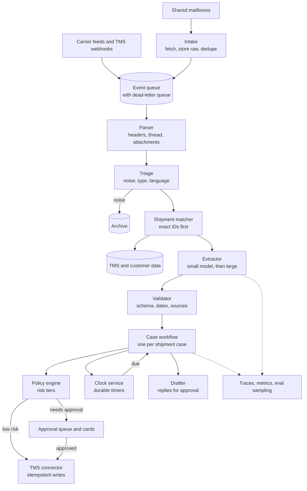
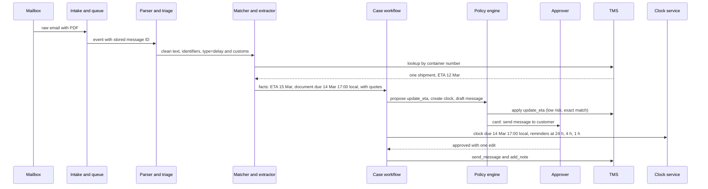

# Shipment exceptions agent

> [!NOTE]
> The company in this case study is fictional. Its numbers are made up to make the design concrete. Prices and wages are stated assumptions, not real quotes. New to AI terms? Start with [the word list](#words-used-in-this-case-study), and see [the layers and tools](#layers-and-tools) for what to build each part with.

## At a glance

| | |
|---|---|
| **Problem** | Turn a flood of delay and customs emails into correct shipment updates, approved actions and deadlines that never pass unnoticed. |
| **Scale** | 10K emails a day, plus 150K tracking events a day, about 25,000 shipments in flight, 75,000 open deadline clocks. |
| **Key patterns** | Event-driven agent, email parsing, system integration, approvals, deadline clocks. |
| **Difficulty** | Advanced. |
| **Read time** | About 35 minutes. |

## The scenario

Harbourline Forwarding is a made-up freight forwarder. It moves containers and air freight for about 2,000 importers and exporters, and it has about 25,000 shipments in flight at any time. Carriers, customs brokers, trucking firms, ports and customers send it about 10,000 emails a day about delays, customs holds, missing documents and damage. Analysts read each one, find the shipment in the transport management system (TMS), update it, and write to the customer or the carrier. The median time from an email arriving to the TMS being correct is six hours.

The pain is not only the wait. Many emails carry a deadline: a document due to customs by a set hour, or the last day a container may sit at a port before daily charges begin. A deadline hidden in paragraph four of a forwarded thread is easy to miss. The team wants an agent that reads each email as it arrives, proposes the right update, asks a person to approve anything with money or legal weight, and keeps a clock on every deadline. The goal is to remove reading and typing, not to remove the people who decide.

| Measure | Today | Target |
|---|---|---|
| Emails per day | 10,000 | 10,000 |
| Median time from email to correct TMS record | 6 hours | Under 5 minutes |
| Analyst minutes per email (average, including noise) | 4 | About 0.63 |
| Real exceptions applied with no human | 0% | 55% |
| Wrong updates written to the TMS | Not measured | Under 0.5% of auto-applied updates, on the audit sample |
| Deadline clocks missed | 0.1% (225 a month, assumed) | 0.01% (about 23 a month) |
| Cost per email (people plus AI) | $2.00 (assumed) | About $0.33 |

The mix of emails, from a sample of last quarter, is: delay notices 40%, customs holds, queries and document requests 25%, missing documents and booking changes 10%, damage and claims 5%, other real exceptions 10%, and noise (automatic replies, newsletters, duplicates) 10%. The mix tells us where automation is safe (delay notices that only move a date) and where it is not (claims, and anything that changes a customs filing).

## Requirements

An exceptions agent has two jobs that pull against each other: act on a message within minutes, and never write a wrong fact or take a costly action without a person. The tables below give each need a priority and a number.

Functional requirements:

| Requirement | Priority |
|---|---|
| Ingest every email in the shared mailboxes and never lose one | P0 |
| Match each email to the right shipment, or say it cannot | P0 |
| Extract the event (new ETA, hold, document request, damage) and any deadline, with the quote that supports it | P0 |
| Create and track a deadline clock for every deadline, with reminders and escalation | P0 |
| Apply low-risk updates to the TMS automatically, and send higher-risk actions to an approver | P0 |
| Draft the reply to the customer or carrier for a person to approve | P1 |
| Link related emails into one case, and detect duplicates | P1 |
| Answer "what is the status of this case?" for analysts | P1 |

Non-functional requirements, each with the reason for the number:

| Requirement | Target | Why |
|---|---|---|
| Email to proposed action | Under 60 s at p95 | An analyst should find the proposal ready when they open the case |
| Approval card shown | Under 10 s after the proposal | Approvers work from a queue and should not wait on the screen |
| Emails lost | Zero | A lost email can hide a deadline |
| Intake availability | 99.9% | Mail servers retry for days, but analysts will not wait |
| Auto-applied wrong updates | Under 0.5% on the audit sample | A wrong ETA reaches customers within hours |
| Clock accuracy | Reminder fires within 60 s of its due time | Reminders are only useful if they are on time |
| Deadline time zone errors | Zero on the golden set | A deadline read in the wrong time zone is wrong by hours |

Security and compliance needs: every email is untrusted input from outside the company. Attachments may contain personal data (a consignee's name and address, tax IDs), so redact before logging and keep raw mail for a limited time (here, 90 days; check the rules in each country where you operate). The agent never files anything with a customs authority. Customs filings stay with the licensed broker, and the agent only proposes and tracks. Every write to the TMS records who or what made it, which email caused it, and who approved it.

## Numbers

Before drawing anything, we estimate the load, the deadline workload and the bill. These are the same formulas as in the [design method](../DESIGN-METHOD.md), and each assumption is stated so you can change it.

Traffic and events:

- Emails per month = 10,000 × 30 = 300,000.
- Peak emails per second = 10,000 × 4 ÷ 86,400 = 0.46. The peak factor of 4 is an assumption: mail arrives around the clock from several time zones, with bursts when a port or a carrier sends a batch.
- Tracking events per day = shipments in flight × updates per shipment per day = 25,000 × 6 = 150,000. These come from carrier feeds and the TMS, not from email, and most need no model.
- All events per day = 10,000 + 150,000 = 160,000. Peak events per second = 160,000 × 4 ÷ 86,400 = 7.4.
- Approvals waiting at any moment = arrival rate × wait. Arrivals = 4,050 a day (see the people numbers below) ÷ 86,400 = 0.047 per second. With an assumed average wait of 20 minutes (1,200 s), 0.047 × 1,200 = about 56 open approvals, and about 225 at the 4× peak. These are workflows paused on a person, so they cost memory, not compute.

Deadline clocks:

- New shipments per day = shipments in flight ÷ average days in flight = 25,000 ÷ 10 = 2,500. The 10 days is an assumption.
- Clocks created per day = new shipments × clocks per shipment = 2,500 × 3 = 7,500. A clock is one deadline, such as a document cut-off, a free-time end or a delivery appointment.
- Open clocks = 25,000 × 3 = 75,000. At about 2 KB each, 75,000 × 2 KB = 150 MB, so storage is small.
- Clocks per month = 7,500 × 30 = 225,000. At 0.1% missed today, 225,000 × 0.1% = 225 misses. At $200 per miss (assumed late fee plus handling), that is 225 × $200 = $45,000 a month. At 0.01%, it is 22.5 misses, about $4,500.

Tokens per email. The steps are a triage call on every email, an extraction call on the real ones, and a draft on those that need a reply:

- Triage: 600 input and 30 output tokens, on all 10,000 emails.
- Extraction: input = instructions and schema 1,000 + email text without quoted history 900 + attachment text 1,500 = 3,400 tokens. Output = 300 tokens. It runs on the 9,000 emails that are not noise (10,000 × 90%).
- Draft: 2,500 input and 400 output tokens, on 40% of emails, which is 4,000 a day.
- Tokens per day = 10,000 × (600 + 30) + 9,000 × (3,400 + 300) + 4,000 × (2,500 + 400) = 6,300,000 + 33,300,000 + 11,600,000 = 51.2 million.
- Tokens per month = 51.2 million × 30 = 1.54 billion.
- Peak tokens per minute = peak emails per second × tokens per email × 60 = 0.46 × 5,120 × 60 = about 141,000. Here 5,120 = 51,200,000 ÷ 10,000. Compare this number with a provider's rate limit.

Model cost, using placeholder prices. Assume a small model costs $0.25 per 1M input tokens and $1.25 per 1M output tokens, and a large model costs $3 and $15.

- Triage (small) = 600 ÷ 1,000,000 × 0.25 + 30 ÷ 1,000,000 × 1.25 = $0.00015 + $0.0000375 = $0.00019.
- Extraction, small = 3,400 ÷ 1,000,000 × 0.25 + 300 ÷ 1,000,000 × 1.25 = $0.00085 + $0.000375 = $0.001225.
- Extraction, large = 3,400 ÷ 1,000,000 × 3 + 300 ÷ 1,000,000 × 15 = $0.0102 + $0.0045 = $0.0147.
- If 85% of extractions stay on the small model and 15% retry on the large one, blended extraction = 0.85 × $0.001225 + 0.15 × $0.0147 = $0.00104 + $0.0022 = $0.00325.
- Draft (small) = 2,500 ÷ 1,000,000 × 0.25 + 400 ÷ 1,000,000 × 1.25 = $0.000625 + $0.0005 = $0.001125.
- Per email = $0.00019 + 0.9 × $0.00325 + 0.4 × $0.001125 = $0.00019 + $0.002925 + $0.00045 = $0.003565.
- Per month = 300,000 × $0.003565 = about $1,070.
- Quality sampling: 2% of emails (200 a day) are graded by the large model at 6,000 input and 400 output tokens, which is $0.018 + $0.006 = $0.024 each. Per month = 200 × $0.024 × 30 = $144.
- With $4,000 a month of fixed infrastructure (assumed: queue, database, workflow engine, servers, logs), the AI system costs $1,070 + $144 + $4,000 = about **$5,200 a month**, or $5,214 ÷ 300,000 = $0.017 per email.

The people numbers matter more than the model bill. Assume a loaded analyst cost of $30 an hour, which is $0.50 a minute.

- Today = 10,000 emails × 4 minutes × $0.50 = $20,000 a day, or $600,000 a month. Analyst time = 40,000 ÷ 60 ÷ 8 = about 83 analyst-days a day.
- Target. Noise (1,000 emails) is dropped. Of the 9,000 real ones, 55% are applied automatically (4,950) and 45% need a person (4,050) at 1.5 minutes each to check the proposal. A person also reads 5% of the auto-applied ones as an audit, at 1 minute each.
- Review minutes = 4,050 × 1.5 = 6,075. Audit minutes = 4,950 × 5% × 1 = 247.5. Total = 6,322.5 minutes a day, which is 6,322.5 ÷ 60 ÷ 8 = about 13 analyst-days.
- People cost = 6,322.5 × $0.50 × 30 = about $94,800 a month.
- All-in = $94,800 + $5,200 = about **$100,000 a month**, against $600,000 today. That is $100,052 ÷ 300,000 = about $0.33 per email.

Each extra point of the 9,000 real emails moved from review to automatic saves 90 emails × 1.5 minutes × $0.50 × 30 = $2,025 a month, which is more than the whole model bill of about $1,210. Remember this before you spend a week shaving token cost.

## Choosing the shape

The simplest design that could work is a rule engine that scans subjects for words like "delay" and updates a date. It fails on real mail: the new date sits in a PDF, the shipment is named by a booking number in one email and a container number in the next, and a forwarded thread has three dates in it.

Walking up the ladder from the [design method](../DESIGN-METHOD.md):

| Rung | Verdict |
|---|---|
| One model call | Fails. It has no access to the TMS, cannot match a shipment, and cannot wait for an approval or a deadline. |
| Fixed pipeline (parse, extract, update) | Handles clean delay notices. It cannot ask a person, hold a deadline for three weeks, or react when a later email contradicts an earlier one. |
| Router in front of a pipeline, run as a durable workflow per case | Fits. Different emails need different handling, and the workflow can pause for days on an approval or a timer. |
| Tool-calling agent with a loop | Used in one place only: when shipment matching is ambiguous, a small loop may run up to four lookups. Everywhere else the steps are known, so a loop adds cost and failure points. |
| Multiple agents | Not needed. No part of the work needs separate permissions or context that one workflow cannot hold. |

We stop at an event-driven workflow: a router, a fixed extraction pipeline, a policy engine that decides what needs approval, and a clock service. This is a workflow with a small amount of freedom, which is easier to test than a free-roaming agent. Anything that is not a clear case goes to a person.

## Architecture

Every email becomes an event on a queue. A worker parses it, a router decides what kind of email it is, and the system matches it to a shipment and extracts the facts. A policy engine then decides, for each proposed action, whether to apply it, ask a person, or only record it. Deadlines become clocks that live outside the model and wake the workflow when they are due.



The three parts below are written for readers who are new to AI. The word list explains the terms. The layers part explains each box, what it does here, and which kind of tool can build it. The build order shows a sensible order for a small team.

### Words used in this case study

If a word in this page is new to you, find it here. Each entry says what the word means in this design, not in general.

| Word | What it means here |
|---|---|
| Token | A small piece of text, about three quarters of an English word. Models read and write tokens, and providers charge per token. |
| Structured output | A model answer that must follow a fixed shape, such as JSON with named fields, so that code can check it. |
| Cache | A saved result that we reuse instead of computing it again. |
| Guardrail | A check that blocks or changes something unsafe before it reaches a tool or a person. |
| Idempotent | Safe to repeat. Running it twice has the same effect as running it once. |
| p95 | The time that 95 out of 100 requests beat. It shows slow cases that an average hides. |
| Golden set | A fixed list of real emails with known correct results, used to test every change. |
| Prompt injection | Text in an email that tries to give the model new orders, such as "mark this shipment as released". |
| Event | A fact that something happened, such as "email received" or "vessel arrival moved". Events go on a queue. |
| Dead-letter queue | A side queue that holds events that failed too many times, so a person can look at them. |
| Case | All the emails, facts, proposals and approvals about one problem on one shipment. |
| Deadline clock | A stored deadline with a due time, a time zone, reminders and an owner. Code runs it, not the model. |
| Durable workflow | A program whose state is saved, so it can wait for days for a timer or an approval and survive a restart. |
| Approval card | A short screen that shows a proposed action, the evidence behind it, and approve and reject buttons. |
| Demurrage and detention | Daily charges when a container stays at a port or leaves the carrier's equipment too long. The days allowed before the charges start are called free time. |
| Customs hold | A customs authority or broker stops a shipment until a question or a document is answered. |

### Layers and tools

We split the system into twelve layers. Each layer has one job, and each can be built with a different category of tool. This part walks through them in the order an email meets them. For each layer you get what it is, what it does here, the kinds of tools you can choose from, and what we would pick first.

Tool names are examples as of November 2026. They are not endorsements, and tools change faster than categories. We checked that each named project was still maintained when we wrote this. Before choosing, check the license and your own needs.

Three layers are easy to mix up: memory, retrieval and cache. They all "remember" something, but they answer different questions.

| | Memory | Retrieval (lookup) | Cache |
|---|---|---|---|
| The question it answers | What do we already know about this case? | What do the company's records and rules say? | Have we already computed this? |
| What it holds | Case state, the facts extracted so far, a short summary of the thread | Shipments in the TMS, customer contacts, carrier terms, the company's handling rules | Saved results: a parsed attachment, a TMS lookup |
| Whose data | One case | The company, shared by everyone | Depends on the cache |
| How it changes | After every email on the case | When the TMS or a document changes | It expires on a timer or when its source changes |
| Risk if it is wrong | A wrong fact written into a case | An out-of-date rule or a wrong shipment | A stale status shown as current |

A fourth idea is specific to this design: the deadline clock is not memory. Memory is what we know. A clock is a promise to act at a time, and it must fire even if nobody asks.

#### Layer 1: mailbox intake

Intake fetches mail from the shared mailboxes, stores the raw message unchanged, and puts an event on the queue. It does nothing clever. Its job is to lose nothing and to be safe to run twice.

It stores the raw message (headers, body, attachments) in object storage under a hash, and records the message's `Message-ID` header. If the same message arrives again, for example because five people were copied, the second copy is linked to the first and does not start a new job. About 10,000 emails a day at an assumed 150 KB each is 1.5 GB a day, so 90 days of raw mail is 10,000 × 150 KB × 90 = about 135 GB.

| Category | Examples | Pick it when |
|---|---|---|
| Mail provider API | Microsoft Graph for Microsoft 365, the Gmail API | Your mail is hosted by that provider. You get change notifications and message IDs |
| Object storage for raw mail | Amazon S3 or a similar store | You need cheap, durable storage with retention rules |

First version: the mail provider's API, with the raw message stored before anything else happens. What goes wrong: marking a message as read before the raw copy is safe, so a crash loses it. Store first, acknowledge second.

#### Layer 2: event queue

The queue carries every event: new email, tracking update, approval result, clock due. Workers take events from it at their own speed. A burst of 5,000 emails from one carrier waits in the queue instead of overloading the model.

The queue gives at-least-once delivery, which means an event may arrive twice, so every worker must be safe to repeat. After a set number of failed tries, an event moves to a dead-letter queue and raises an alert. The [Amazon SQS documentation on dead-letter queues](https://docs.aws.amazon.com/AWSSimpleQueueService/latest/SQSDeveloperGuide/sqs-dead-letter-queues.html) describes the idea: a retry limit, then a side queue to inspect and redrive.

| Category | Examples | Pick it when |
|---|---|---|
| Managed message queue | Amazon SQS, Google Pub/Sub, Azure Service Bus | You want no servers to run and your volume is a few hundred events per second at most |
| Message broker | RabbitMQ | You need routing rules and run your own infrastructure |

First version: a managed queue with a dead-letter queue. At 7.4 events per second at peak, nothing heavier is needed. What goes wrong: events that fail forever and nobody looks. Alert on the dead-letter queue depth, and put one person's name on it.

#### Layer 3: parsing and input checks

Parsing turns a raw email into clean, labeled text. It is mostly ordinary code, not AI. It reads the headers (sender, date, thread references), separates the new text from quoted history, extracts text from attachments, and checks the message for risks.

Steps, in order:

1. **Headers.** Record the sender, the date and the thread fields. Check the sender's authentication results (SPF, DKIM, DMARC) that your mail provider already computed, and mark the email as verified or unverified.
2. **Automatic mail.** Messages that carry an `Auto-Submitted` header with any value other than `no` are automatic. [RFC 3834](https://www.rfc-editor.org/rfc/rfc3834) says automatic responders should not reply to them. We apply the same rule: never send a reply to such a message, and treat it as a likely notice or noise.
3. **Quoted history.** Strip the quoted text of earlier messages, but keep it in storage. A new ETA is nearly always in the top paragraph.
4. **Attachments.** Extract text from PDFs, spreadsheets and Word files. Run OCR (reading text from an image) on scans. Record which page each piece of text came from.
5. **Identifier patterns.** Find candidate booking numbers, bill of lading numbers and container numbers with patterns. A container number is four letters followed by seven digits, and its last digit is a check digit that can be computed, so a typo is caught by code.
6. **Personal data and injection.** Mask tax IDs and similar fields in the copy sent to the model, and screen the text for instructions aimed at the model.

| Category | Examples | Pick it when |
|---|---|---|
| Email parsing libraries | The Python standard library `email` package, MIME parsers in other languages | You need headers, parts and attachments from a raw message |
| Document text extraction | Apache Tika, Unstructured | You need text from many file types with one tool |
| OCR | Tesseract, a cloud OCR service such as Amazon Textract | Scanned customs papers and photos of documents arrive |
| Pattern rules | Regular expressions with check-digit tests | The thing you match has a fixed shape, as container numbers do |

First version: standard parsing code, one text extraction tool, OCR only for attachments that have no text layer, and pattern rules. What goes wrong: text extraction scrambles a table, so a date lands next to the wrong container. Keep the page and the original attachment link with every extracted fact, so a person can check.

#### Layer 4: triage and models

Triage is the first model call. It reads about 600 tokens and returns a short structured result: noise or real, the exception type (delay, customs, documents, damage, other), the language, and an urgency guess. A small model does this. Keyword rules can raise urgency, never lower it, for words such as "hold", "seized", "last free day" and "deadline".

The extraction step uses a cascade: a small model first, a large model only when the validator rejects the result. Both are called through one gateway, so there is one place to set budgets and fail over to a second provider.

| Category | Examples | Pick it when |
|---|---|---|
| Hosted model APIs | The APIs from Anthropic, OpenAI, Google and others | You want the best quality with no servers to run |
| AI gateway | LiteLLM, Portkey, Cloudflare AI Gateway | You want fallback between providers, budgets and one log of model calls |
| Schema checking | Pydantic, JSON Schema validators | You need to reject any model output that does not match the shape |

First version: one hosted provider with a small and a large tier, behind a gateway, with structured output checked by a schema library. What goes wrong: a model upgrade changes how it reads dates. Rerun the golden set on every model change.

#### Layer 5: lookup and retrieval

Most of the retrieval here is exact lookup, not search by meaning. If the email says booking number 12345, we look up booking 12345 in the TMS. A vector search over the TMS would be slower and less accurate than a database query.

The matcher works in order: exact identifiers first (container, booking, bill of lading, customer reference), then the thread (a reply to an earlier email already linked to a case), then fuzzy candidates (same customer, same lane, vessel name close, dates near). Exact matches go straight through. Fuzzy matches go to the small loop of up to four lookups, and if more than one shipment fits, the case goes to a person with the candidates listed.

Meaning-based search has one job here: the handling rules and carrier terms. About 400 documents split into passages of about 350 tokens give 4,000 passages. Index size = passages × dimensions × bytes per number = 4,000 × 1,536 × 4 = about 25 MB, so it fits anywhere.

| Category | Examples | Pick it when |
|---|---|---|
| Direct database or API lookup | SQL on the TMS database, the TMS's own API | The identifier is exact. This is the default |
| Vector search inside your database | Postgres with pgvector | You have a small set of rules and terms and already run Postgres |

First version: SQL lookups on exact identifiers, Postgres trigram search for fuzzy names, and pgvector for the rules documents. What goes wrong: the matcher picks the wrong shipment with high confidence, because two shipments share a customer and a date. Never auto-apply a fuzzy match.

#### Layer 6: memory and case state

Memory here is mostly case state: the facts extracted so far, the emails linked to the case, the proposals, the approvals and the open clocks. It is ordinary rows in a database, not something a model "remembers".

Case state holds the current best value for each fact, where it came from (email ID, page, quote) and when that source was written, which lets a later email correct an earlier one. A short summary of about 200 tokens, rewritten after each email by a background job, goes into the prompt so the extractor knows what is already known. Never store raw tax IDs in the summary.

| Category | Examples | Pick it when |
|---|---|---|
| Relational database | Postgres, MySQL | The data is structured and long-lived. This is the default for case state |

First version: Postgres only. What goes wrong: a summary that drops a deadline. The deadline lives in the clock table, not in the summary, so a bad summary cannot lose it.

#### Layer 7: caches

A cache stores a result so we can reuse it. This design needs three, and each is safe only under certain rules.

| Cache | What it saves | Rule to stay safe |
|---|---|---|
| Attachment text cache | The extracted text of an attachment, keyed by the file's hash | Safe to keep for the retention period, because the same file always gives the same text. The same PDF is often attached to ten emails in a thread |
| TMS lookup cache | The result of a read such as "shipment 12345 and its milestones", with a 30-second life | Clear it after any write to that shipment |
| Prompt cache | The provider's work on the fixed start of the prompt (instructions and schema) | Put the fixed text first and the changing text last. Providers expire entries after minutes, so check your provider's pricing and rules |

There is no answer cache. Each email is different, and a cached answer for a shipment is a stale status waiting to happen.

First version: the attachment cache and the TMS lookup cache. What goes wrong: a TMS lookup cache that hides a change another analyst just made. Keep the life short and clear it on writes.

#### Layer 8: integration tools

Tools are the functions that read from and write to other systems: the TMS, the customer's email, the carrier's portal, the calendar. Each is a typed function with a name and arguments. The model never calls a write tool directly. It produces a proposed action, and code decides whether to run it.

The tool list:

| Tool | Type | Notes |
|---|---|---|
| `get_shipment` | Read | Shipment, bookings, milestones, open costs |
| `update_eta` | Write, low risk | Sets the expected arrival date and records the source email |
| `add_note` | Write, low risk | Adds a note and links the email and attachment |
| `send_message` | Write, needs approval | Sends an email to a customer or carrier |
| `change_appointment` | Write, needs approval | Moves a delivery or pickup appointment |
| `flag_hold` | Write, needs approval | Marks the shipment as held, and notifies the customer |

There is no tool that files with a customs authority, rebooks cargo or approves a charge. Those actions stay with people. A missing tool cannot be talked into anything.

| Category | Examples | Pick it when |
|---|---|---|
| Plain functions over the TMS API | Your own client code | You control the TMS or it has a clear API. This is the default |

First version: plain functions with timeouts and the idempotency wrapper from deep dive 2. What goes wrong: a TMS write that succeeds but times out, so a retry writes twice. The idempotency key stops this.

#### Layer 9: orchestration

Orchestration is the code that runs the steps and waits. Here each case is a durable workflow: it starts on the first email, handles each new event in order, pauses for approvals and timers, and ends when the case closes. Because its state is saved, it can wait three weeks for a document without holding a server.

| Category | Examples | Pick it when |
|---|---|---|
| Durable workflow engine | Temporal, Camunda | Cases wait for days, and the program must survive restarts. This is our default |

First version: a durable workflow engine, with one workflow per case and the model steps as ordinary functions. What goes wrong: a workflow that changes while cases are running, so old cases replay differently. Version your workflows and finish old cases on the old code.

#### Layer 10: policy engine and approvals

The policy engine decides, for each proposed action, one of three results: apply it, ask for approval, or only record it. The decision comes from rules written in code, based on the action type, the money involved, the customer, and how sure the system is. It does not come from the model.

Approvals reach people as cards in a queue. A card shows the proposed action, the evidence (the quote and a link to the page in the attachment), what the TMS shows now, and what will change. The approver picks approve, edit or reject. Every decision is saved with the approver's name and the time.

| Category | Examples | Pick it when |
|---|---|---|
| Rules in code | A small policy module with a test suite | The rules are few and change slowly. This is the default |
| Approval screen in your helpdesk or TMS | The TMS task inbox, Slack or Teams cards | Approvers already work there |

First version: rules in code and a small approval screen, with notifications in the chat tool the team already uses. What goes wrong: approvals that pile up until nobody reads them. Measure the approval rate, the time to decide and the share edited, and review the rules monthly.

#### Layer 11: deadline clocks

A clock is a stored deadline with a due time in UTC, the time zone it was read in, the source quote, an owner, a state (open, done, cancelled, breached) and a schedule of reminders. The clock service runs them. When a clock is due, it wakes the case workflow. The model is not involved after the deadline is stored.

The service keeps 75,000 open clocks, with three reminders each, so 225,000 scheduled wakeups. Durable timers in a workflow engine can do this: the [Temporal documentation on timers](https://docs.temporal.io/develop/python/timers) says timers persist across worker downtime and that one worker can run millions of them.

| Category | Examples | Pick it when |
|---|---|---|
| Timers in a durable workflow engine | Temporal timers | You already run the workflow engine. One timer per reminder, inside the case workflow |

First version: timers in the case workflow, with the clock table in Postgres as the record that people and dashboards read. What goes wrong: a timer that fires and the reminder fails to send. A clock is done only when the reminder has been acknowledged, and an overdue clock without an acknowledgment shows on a manager's board.

#### Layer 12: observability and evals

Observability means you can see, for any email, what the parser found, what the model returned, what the validator said, what the policy decided and what a person did. Evals are the automatic tests that show whether a change made things better or worse. Without them you cannot tell a good prompt from a lucky one.

| Category | Examples | Pick it when |
|---|---|---|
| Tracing | OpenTelemetry, Langfuse | You want one view per email with each step and its cost |
| Metrics and alerts | Prometheus with Grafana, or your cloud provider's monitoring | You want dashboards and alerts on queue depth, latency, clock lag and spend |
| Eval runners | promptfoo, or your own test script with a checking function | You want the golden set to run on every change |

First version: a trace per email with the request ID, a script that runs the golden set in your CI pipeline, and a weekly audit sample. Mask personal data before anything is logged. What goes wrong: tracing that stores full attachments. Store a link to the raw file, not a copy.

### Build order

Build the system in stages, and put each stage in front of real mail before you add the next. The order follows risk: read first, write low-risk facts second, ask for approval third, and add clocks and other actions after that. The steps are a sequence, not a schedule.

1. **Stage 0: read-only shadow mode.** Build the golden set from last quarter's emails. Set up intake, the queue, the parser and the attachment text extraction. Run triage, matching and extraction on live mail and write the results to a table that only the team sees. Test: analysts compare the table with what they did by hand. Done when: matching is right on at least 95% of the golden set for emails with an exact identifier, and no email is lost over a week.
2. **Stage 1: proposals in the analyst's screen.** Show each proposal as a card next to the email, with the evidence. Analysts click approve, edit or reject. Add the validator and the policy engine, with every action set to "ask". Test: the edit and reject rates by email type. Done when: for delay notices that only move a date, analysts approve at least 98% unchanged.
3. **Stage 2: automatic low-risk updates.** Turn on `update_eta`, `add_note` and `attach_document` for the delay-notice type and for exact matches only, with a kill switch and the idempotent write wrapper. Add the audit sample. Test: forced timeouts and duplicate emails. Done when: the audit shows under 0.5% wrong updates for two weeks.
4. **Stage 3: deadline clocks.** Extract deadlines, compute them in code, store them as clocks, and run reminders to a team board. Test: the time zone and date-format cases in the golden set. Done when: every deadline in a month of replayed mail is found, and reminders fire within 60 seconds.
5. **Stage 4: approvals for money and customers.** Add drafts, `send_message`, `change_appointment` and `flag_hold` behind approval cards, with escalation when a card is not decided in time. Test: injection emails. Done when: no write happens without the required approval in a test run of all the security cases.
6. **Stage 5: cascade, second provider and cost controls.** Add the large-model retry, the second provider behind the gateway, budgets and dashboards. Test: a simulated provider outage. Done when: failover works and cost per email is under target.
7. **Stage 6: scale and more channels.** Add more languages, carrier portal messages and more exception types, as the scaling section calls for. Done when: the system passes a load test at the next target size.

## One request, end to end

Here is one concrete email. A carrier writes to the shared mailbox: the vessel carrying a customer's container is late, the arrival moves from 12 March to 15 March, and customs wants the commercial invoice by 17:00 local time on 14 March, or the container stays on hold. The email has a one-page PDF attached. We follow it through the system.



The ETA update is low risk and the match is exact, so it is applied at once. The customer message goes to an approval card because it goes outside the company. The deadline becomes a clock whether or not anyone approves the message.

Latency budget from email arrival to the card appearing, using the small model:

| Step | Budget | If it overruns |
|---|---|---|
| Intake, store raw, queue | 300 ms | The queue absorbs the delay. The email is never lost |
| Parse and attachment text (cache hit skips the extraction) | 400 ms | Fall back to the email body and flag the attachment as unread |
| Triage (small model) | 400 ms | Use keyword rules for type and urgency |
| Shipment lookup | 150 ms | Retry once, then send the case to a person with the identifiers found |
| Extraction (3,400 in, 300 out) | 2,500 ms | Switch to the second provider after 4 s |
| Validation and clock computation | 70 ms | Code only. Alert if slower |
| Draft reply (2,500 in, 400 out) | 2,500 ms | Show the card without a draft |
| Approval card built and shown | 200 ms | Show a plain card with links |
| **Email to card** | **about 6,500 ms** | A large-model retry adds an assumed 4,000 ms, so about 10,500 ms |

The sum is 300 + 400 + 400 + 150 + 2,500 + 70 + 2,500 + 200 = 6,520 ms. That is far inside the 60-second target, which leaves room for queue wait during a burst. The target is set by the queue wait, not by the model: at 5,000 emails in a burst and an assumed 20 workers, each taking about 6.5 s, the last email waits about 5,000 ÷ 20 × 6.5 s = 1,625 s, which is 27 minutes. So the number of workers is a real decision, covered in the scaling section.

## Deep dives

Four parts of this design deserve more care than the rest: reading an email into trusted facts, an event pipeline that tolerates repeats and bad order, deadline clocks, and the approval policy.

### Deep dive 1: from email to trusted facts

An email is a pile of text, and a model can read it. The hard part is turning what it reads into facts that are safe to write into a system of record. We do this in four steps.

First, match the shipment before reading anything else. Matching with exact identifiers is done by code. The model is told which shipment it is looking at and is given that shipment's current record. This stops a common mistake, where the model attaches a date to the wrong container in a table with eight containers.

Second, extract into a fixed shape, and require a quote for every fact:

```python
class ExtractedFact(BaseModel):
    kind: Literal["eta", "hold", "document_request", "damage", "free_time_end"]
    value: str                 # "2026-03-15", "customs inspection", ...
    local_time: str | None     # "17:00", exactly as written in the email, if any
    place: str | None          # "Port of Hamburg", used to find the time zone
    quote: str                 # the exact words that support the fact
    source: str                # "body" or "attachment:page 1"
    confidence: float          # a hint only, never a gate by itself
```

Third, validate with code. The validator checks that the quote appears word for word in the source text, that the date is real and in a sensible range (not in the past by more than a day, not more than 180 days ahead), that the kind matches the email type, and that a container or booking number in the quote matches the matched shipment. A fact that fails any check is rejected, and the whole extraction retries once on the large model. If it fails again, the case goes to a person. The quote check is the strongest of these: a model that invents a date cannot also produce the exact words that support it.

Fourth, handle conflicts. An email can say the ETA is 15 March while the TMS says 12 March, and a later email may say 17 March. The rule is: each fact stores the time its source was written, and the newest source wins for the same field and the same sender type. If a carrier's feed and a trucker's email disagree, the case goes to a person, because the system cannot tell which one is right.

Why not ask a model for a confidence score and use it as the gate? A model's own confidence is poorly calibrated: it tends to sound sure when it is wrong. We keep the score as a hint for sorting cards, and rely on checks that come from outside the model: exact match, the quote check and the validator.

### Deep dive 2: an event pipeline that tolerates repeats and bad order

Mail systems repeat and reorder messages, queues deliver at least once, and workers crash halfway. The design has to give the right result anyway.

The problems and the fixes:

| Problem | Fix |
|---|---|
| The same email arrives five times (copied to five people) | Dedupe on `Message-ID` at intake, and again on a content hash of the new text, so forwards of the same notice link to one case |
| An event is delivered twice | Every handler is safe to repeat. Each step stores its result under an event ID and returns that result on a repeat |
| A TMS write times out and is retried | Writes carry an idempotency key built from the email ID, the action and its arguments |
| An older email is processed after a newer one | Facts carry the time their source was written, and an older fact never overwrites a newer one |
| An event fails forever | After 5 tries, it moves to the dead-letter queue and an alert fires |

The key idea behind the idempotency key is the same one that payment systems use, and the [Stripe documentation on idempotent requests](https://docs.stripe.com/api/idempotent_requests) explains it well. The wrapper looks like this:

```python
def write_tms(action, args, case):
    key = stable_hash(case.id, action, args, case.source_email_id)
    if already_done(key):
        return saved_result(key)           # a repeat: do nothing new
    result = tms_call(action, args, idempotency_key=key, timeout_seconds=3)
    save_result(key, result)
    return result
```

If the TMS has no idempotency support, the wrapper first reads the shipment to see if the change is already there. This is slower but works with any system. Either way, the audit sample catches what slips through.

A dead-lettered email on a case with a clock must not stay silent: the case gets a flag, and a person sees it on the board within the hour.

## Scaling from 1x to 100x

Load will not stay at 10,000 emails a day. Here is what changes at ten and one hundred times the load, from the numbers above. A 100x case could be a platform serving many forwarders, or a forwarder after buying competitors.

| Load | Emails per day | Peak emails per second | Peak tokens per minute | What breaks first | Fix |
|---|---|---|---|---|---|
| 1x | 10,000 | 0.46 | 0.14 million | Nothing yet. Burst handling needs enough workers | Autoscale workers on queue depth, set budgets |
| 10x | 100,000 | 4.6 | 1.4 million | Provider rate limits on tokens per minute, and the TMS API | Second provider, higher limit tier, TMS lookup cache, write rate limit |
| 100x | 1,000,000 | 46 | 14 million | The TMS write path, the approval queue, the clock table, cost | Batch TMS writes, route more to automatic, shard clocks by shipment, dedicated provider capacity |

The reasoning behind the fixes:

- **Bursts.** A burst is what breaks the 60-second target first, not the daily average. From the request section, 5,000 emails with 20 workers wait 27 minutes. To clear the same burst in 5 minutes (300 s) with 6.5 s per email, workers = 5,000 × 6.5 ÷ 300 = about 108. That is only needed for a short time, so scale workers from the queue depth. Triage first, and put real-urgency emails (words like "hold" or "deadline") in a faster lane, so a burst of newsletters never blocks a customs hold.
- **Provider limits and the TMS.** At 10x, tokens per minute = 0.14 million × 10 = 1.4 million, which can exceed a default limit, so add a second provider. Auto-applied writes reach 49,500 a day, so the connector queues writes, rate-limits them and merges changes to one shipment into one call.
- **Approvals.** Approvals scale with the share that cannot be automatic, so at 100x, 45% of 900,000 = 405,000 cards a day would need 100 times the people. Only the automation rate fixes this. Each point moved from review to automatic at 100x is worth 100 × $2,025 = $202,500 a month, so quality work on the weekly review of rejected proposals matters more than any infrastructure.
- **Cost.** The model bill scales almost linearly: about $12,100 a month at 10x and about $121,000 at 100x, before caching and the cascade share. Prompt caching and keeping the small-model share high bend the curve.

One more case is a spike with a cause, such as a port strike or a customs system outage. Hundreds of emails arrive about the same event. A cluster step groups emails with the same carrier, port and cause, and creates one parent case with a single drafted notice, which an approver can send to every affected customer. This turns 500 approvals into about 5.

## Failure modes and safety

Systems like this fail in ordinary ways more often than in dramatic ones. The table lists what we plan for, how we notice, and what happens next.

| Failure | How we notice | What we do |
|---|---|---|
| Model provider is slow or down | Timeouts, error rate above 2% for one minute | Fail over to the second provider. If both fail, keep storing and queueing mail, show rule-based triage, and let analysts work from the raw email list |
| Wrong shipment matched | Audit sample, analyst corrections, a mismatch between the container number in the quote and the shipment | Exact matches only for automatic writes. Fuzzy matches always go to a person |
| Wrong date or fact extracted | Quote check fails, audit sample, thumbs-down on a card | Reject the extraction, retry once on the large model, then send to a person |
| Wrong time zone on a deadline | Golden-set tests, reminders that look too early or late to the owner | Zone comes from the place by code. A "zone assumed" flag needs a person's confirmation |
| Prompt injection in an email or PDF | Injection screen, an action that does not fit the email type | The model has no write tools. The policy engine and approvals decide. Output is capped at 5 actions |
| TMS write fails halfway | Timeout, error code, a read that shows a partial change | Idempotency key, read-back check, then a person if two tries fail |
| Clock never fires | The nightly check finds an open clock without a timer, or a due clock still open | Rebuild the timer, alert, and put the clock on the manager board |
| Approver rubber-stamping | 100% approved unchanged, a median decision time under a few seconds | Add test cards, show reasons, review the rules |

Two points need extra care. The first is the failure that looks like success: an email that was applied automatically and was right in every field except the one that mattered. This is why the audit sample reads 5% of automatic updates against the source email. The second is silence. A system that handles 10,000 emails a day will have an email it cannot parse, and the worst outcome is that it says nothing. Every email ends in one of four visible states: applied, waiting for approval, sent to a person, or archived as noise with a reason. An email with no final state after 15 minutes raises an alert.

> [!WARNING]
> Never let the model, or the text of an email, choose who gets a message or which shipment gets a change. Recipients and the shipment ID must come from stored records and exact matches in code.

## Measuring quality

"Good" has to be defined before launch, or every change turns into an argument. We measure it in three places: a golden set before release, a canary during release, and an audit sample in production. People who run the freight desk decide what counts as correct.

Metrics and targets:

| Metric | How it is measured | Target |
|---|---|---|
| Triage accuracy | Golden set: noise versus real, and exception type | At least 97% |
| Shipment match accuracy | Golden set: correct shipment, or a correct "cannot tell" | At least 99% on exact matches, no wrong fuzzy auto-write |
| Fact accuracy | Golden set: kind, value and quote correct | At least 97%, and 100% of quotes found in the source |
| Deadline accuracy | Golden set: due time in UTC correct, including zones and date formats | 100% on the time zone and date-format cases |
| Wrong automatic updates | Audit sample: 5% of automatic updates read against the source | Under 0.5% |
| Approval quality | Share approved unchanged, share edited, share rejected, by type | Edit plus reject rate tracked, and review when it moves by 5 points |
| Clocks missed | Clocks still open after the due time | 0.01% |
| Email to card | Measured from receipt to the card shown | Under 60 s at p95 |
| Cost per email | Tokens times price, plus fixed cost | Under $0.02 for the AI system |

The golden set is built from real mail. We take about 1,000 emails from last quarter, split by type in the same proportions as the mix above, plus 150 harder ones: forwarded chains with several dates, tables with many containers, scanned PDFs, emails in three languages, and time zone and date-format cases. Two senior analysts write the correct shipment, facts and deadline for each. We add 60 security cases (injection text, spoofed senders, a request to change an address) and 40 emails that have no shipment at all. Personal data is removed first.

The release rule is simple: no email type may drop more than one point against the current version, every deadline case must pass, and every security case must pass. An automatic judge, a large model told to compare an extraction with the reference, makes the set cheap to run on the free-text fields. We trust the judge only after checking it: people label 200 results, and the judge must agree with them at least 85% of the time. Dates, identifiers and quotes are checked by exact comparison in code, not by a judge.

Release process: new prompts, models and rules go to 5% of mail (chosen by sender, so a thread stays together), then 25%, then 100%. At each step the system compares the audit error rate, the card reject rate and the cost per email against the control group, and rolls back if a limit is crossed. Every rejected card is read by a person each week, and rejected cards are the best source of new test cases.

## Cost

Money goes to three places: people, models, and everything else. The formulas in the numbers section gave the unit costs, and the monthly view shows where it matters.

| Item | Calculation | Per month |
|---|---|---|
| Triage, extraction and drafts | 300,000 × $0.003565 | about $1,070 |
| Quality sampling (judge) | 200 × $0.024 × 30 | $144 |
| Fixed infrastructure | Assumed | $4,000 |
| **AI system total** | | **about $5,200** |
| People: review of the 45% that need a person | 4,050 × 1.5 min × $0.50 × 30 | about $91,100 |
| People: audit of 5% of automatic updates | 4,950 × 5% × 1 min × $0.50 × 30 | about $3,700 |
| **All-in** | | **about $100,000** |
| Human-only baseline | 10,000 × 4 min × $0.50 × 30 | $600,000 |
| Late fees avoided (misses fall from 225 to about 23) | (225 − 22.5) × $200 | about $40,500 |

The AI system is about 5% of the all-in total. The people cost is where the money is, so the main lever is the share of emails that need no person at the review step, worth $2,025 a month for each point. The second lever is the cost of a miss: late fees avoided are worth about $40,500 a month, about 40% of the whole bill, and they depend on the clocks, not on the model.

Cost levers in order of impact:

1. Raise the automatic share by fixing the top reasons for a person's review: unknown senders, fuzzy matches and missing carrier terms. Each is a data fix more than a model fix.
2. Keep the clocks honest. A missed clock costs $200 against $0.0036 for the model call that found the deadline.
3. Keep the small-model share of extraction high. If it falls from 85% to 60%, blended extraction = 0.6 × $0.001225 + 0.4 × $0.0147 = $0.00662, about twice the $0.00325. Watch it on the dashboard.
4. Use the prompt cache for the fixed 1,000 instruction tokens. If cached input costs 10% of normal (an assumption), the saving per small extraction = 1,000 ÷ 1,000,000 × $0.25 × 0.9 = $0.000225, about 18% of $0.001225.

## Trade-offs we made

We recorded the decisions, the options, and the conditions under which we would change our mind. Revisit this table when numbers shift.

| Decision | Options | Choice | Why | Revisit when |
|---|---|---|---|---|
| Orchestration | Free agent loop, queue workers with a state table, durable workflow per case | Durable workflow per case | Cases wait for days, and replays and timers come built in | The team cannot run the engine, or cases are all short |
| Deadline arithmetic | Model computes the date, code computes it | Code computes it | Models make date and zone errors, and code can be tested | Never for the arithmetic. Extraction of the words may change |
| Shipment matching | Vector search over shipments, exact lookup then fuzzy | Exact lookup first, fuzzy second | Exact identifiers are in most mail and a lookup is fast and correct | Mail without identifiers becomes a large share |
| Automatic writes | None, low-risk only, many | Low-risk only, exact matches, verified senders | Saves most review time without risking money or customers | The audit shows under 0.2% errors for a quarter |
| Confidence | Model's own score, outside checks | Outside checks, score as a sort hint | Self-reported confidence is poorly calibrated | We have enough labeled data to calibrate one |
| Reminders | Ping everyone, board plus last ping | Board first, ping last | 225 interrupts a day against 3,225 | Teams ask for earlier pings on certain customers |
| Customs filings | Agent files, agent proposes | Agent proposes, broker files | A wrong filing has legal weight | A regulator-approved process exists and the broker agrees |

Versions: v1 is intake, matching, extraction, proposals in the analyst screen, and the golden set. v2 adds automatic low-risk updates, clocks, and approvals for messages. v3 adds cluster handling for events such as strikes, more languages, carrier portal messages, and a small agent for multi-step cases such as re-planning a delayed shipment.

## What teams get wrong

Most failures of first versions come from the same few mistakes. Each one below comes with a sign that you are making it.

- **Letting the model do the date math.** The model reads "17:00 on 14 March, Hamburg time" and returns a UTC time that is an hour off. Sign: deadline errors cluster around daylight saving changes.
- **Matching by meaning when an exact identifier exists.** A vector search finds a similar shipment and the update goes to the wrong customer. Sign: corrections where the container number in the email differs from the shipment.
- **Approvals that are not reviews.** Cards without evidence, or approvers who see 400 a day. Sign: a decision time of seconds and almost no edits.
- **No final state for every email.** Mail that fails parsing disappears into logs. Sign: the sum of applied, approved, sent to a person and noise is less than the emails received.
- **Reminders for everything.** A thousand pings a day train people to ignore them. Sign: reminders acknowledged within a second or never.
- **Writes without idempotency.** A retry sends two customer messages or creates two tasks. Sign: duplicates after any outage.
- **Trusting the text of an email.** A recipient or a command read from the body changes what happens. Sign: any tool argument that comes from email text and not from a stored record.

## Interview mode

If you get this problem in an interview, you have about 45 minutes. Spend the time like this, and say your assumptions out loud as you go.

| Minutes | What to do |
|---|---|
| 0 to 5 | Ask about volume, mail sources, the TMS and its API, what a wrong update costs, which deadlines matter, and who may approve what |
| 5 to 10 | State requirements as numbers, and do the traffic, deadline and cost math on the board |
| 10 to 15 | Argue for the simplest shape: an event-driven workflow with a router and fixed extraction, and say why not a free agent |
| 15 to 30 | Draw the architecture, walk one email, then go deep on trusted facts, idempotent events and clocks |
| 30 to 38 | Scale to 10x and 100x, and list failure modes, including injection and approvals |
| 38 to 43 | Define quality metrics, the golden set, and the audit sample |
| 43 to 45 | Summarize the trade-offs and what you would build in v2 |

Follow-up questions an interviewer may ask:

**1. The model provider goes down for an hour. What happens?**

<details>
<summary>Answer</summary>

Intake and the queue do not use a model, so mail keeps arriving and is stored. The gateway fails over to the second provider after a few seconds per request. If both are down, triage falls back to keyword rules, and the cases appear on the analysts' board with the raw email, so they work as they do today. Deadlines found by simple patterns (a date and the word "deadline") still create clocks that a person must confirm. When models return, the backlog drains from the queue, with urgent types first. We check the golden set on the backup model, because a different model reads dates differently.

</details>

**2. How do you make sure a deadline is never missed?**

<details>
<summary>Answer</summary>

We cannot promise zero, but we can make misses visible and rare. Code, not the model, turns the quoted words into a UTC time using the time zone of the place. Ambiguous dates go to a person. Each clock has durable timers and reminders at 24, 4 and 1 hours, and it closes only when its task is done. A nightly job compares open clocks with timers and lists clocks that are overdue. Any email with no final state after 15 minutes raises an alert, so a parse failure cannot hide a deadline. We measure the miss rate against a target of 0.01%.

</details>

**3. What stops a malicious email from changing a shipment?**

<details>
<summary>Answer</summary>

The model has no write tools. It returns facts and proposals in a fixed shape, and the policy engine decides. Automatic writes need an exact match, a verified sender, a small change and no cost. Messages and appointment changes always need an approval, and recipients come from stored records. The approver sees the quote and the page, so the decision rests on evidence. We run injection and spoofing cases on every release, and a failure blocks it.

</details>

**4. Two emails disagree about the new arrival date. What does the system do?**

<details>
<summary>Answer</summary>

Each fact stores the time its source was written and the kind of sender. If both come from the same kind of sender, the newer one wins. If they come from different kinds, for example a carrier feed and a trucker, the system cannot know which is right, so it opens an approval card that shows both quotes. Any clock built on the older date stays open until the person decides, and then it is recomputed.

</details>

## Concepts used

This case study relies on a few ideas that Part 1 explains from the beginning. Read those first if any are new to you.

Basics in Part 1:

- [Tokens and context windows](https://github.com/NeuralSaasAi/ai-engineering-playbook/blob/main/00-foundations/tokens-and-context-windows.md)
- [Tool calling](https://github.com/NeuralSaasAi/ai-engineering-playbook/blob/main/02-building-agents/tool-calling.md)
- [Human in the loop](https://github.com/NeuralSaasAi/ai-engineering-playbook/blob/main/02-building-agents/human-in-the-loop.md)
- [Prompt injection](https://github.com/NeuralSaasAi/ai-engineering-playbook/blob/main/04-llm-security/prompt-injection.md)

Advanced ideas introduced here: event-driven workflows with a durable workflow per case, structured extraction with a required quote, exact-first shipment matching, idempotent writes into a system of record, a policy engine in front of every write, deadline clocks computed by code, reminder budgets, and the audit sample for automatic updates.

Related case study in this playbook: the [customer support agent](01-customer-support-agent.md) covers the model cascade, grounded answers and warm handoff in more depth. This one reads inbound mail and acts on a system of record, and adds time as a first-class input.

## Further reading

These sources cover the ideas this design depends on most.

- [RFC 3834: Recommendations for automatic responses to electronic mail](https://www.rfc-editor.org/rfc/rfc3834). The standard for the `Auto-Submitted` header and for when a program should not reply to a message.
- [Using dead-letter queues in Amazon SQS](https://docs.aws.amazon.com/AWSSimpleQueueService/latest/SQSDeveloperGuide/sqs-dead-letter-queues.html). Explains retry limits and what to do with messages that keep failing.
- [Timers in Temporal](https://docs.temporal.io/develop/python/timers). Shows how a durable workflow waits for months and survives restarts.
- [Idempotent requests](https://docs.stripe.com/api/idempotent_requests) from Stripe. A short, clear explanation of making retries safe.
- [LLM01: Prompt injection](https://genai.owasp.org/llmrisk/llm01-prompt-injection/) from the OWASP GenAI project. Describes the risk behind the untrusted-email rules, with examples and ways to reduce it.
