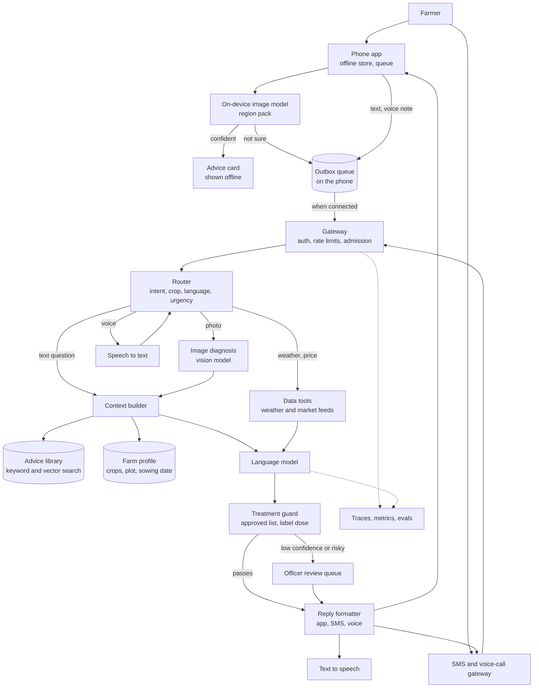
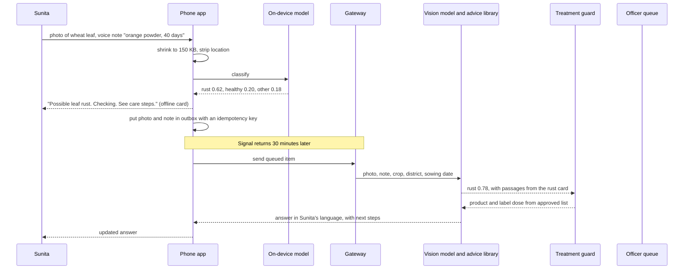

# Farmer advisory with photo diagnosis

> [!NOTE]
> The cooperative in this case study is fictional. Its numbers are made up to make the design concrete. Prices are stated assumptions, not real quotes. New to AI terms? Start with [the word list](#words-used-in-this-case-study), and see [the layers and tools](#layers-and-tools) for what to build each part with.

## At a glance

| | |
|---|---|
| **Problem** | Tell a farmer what is wrong with a crop, what the weather will do and what the market pays, on a phone with a weak or missing network, in the farmer's own language. |
| **Scale** | 2M registered farmers, about 600K active in a month, 2.4M questions a month, peak near 4 questions per second. |
| **Key patterns** | On-device image diagnosis, server photo diagnosis with expert review, local-language voice, offline-first sync, SMS fallback, safe treatment advice. |
| **Difficulty** | Advanced. |
| **Read time** | About 35 minutes. |

## The scenario

FieldWise is a made-up farming cooperative network with 2 million registered farmers. Most grow wheat, rice, tomato, cotton and a few other crops on plots of one to three hectares. Farmers ask three kinds of questions: "what is wrong with my crop?", "will it rain this week?" and "what price will I get at the market?". Today they ask a neighbor, call a field officer who has 800 farmers to look after, or guess.

The network is the hard part. Many villages have a slow 2G or patchy 3G signal, coverage disappears in the fields, and about 30% of farmers use a basic phone that can only send and receive SMS and make calls. Many cannot comfortably read long text in the national language, and speak a local language or dialect. The cooperative wants a system that works on a bad network first and works better on a good one.

The numbers below are made up for this design. The answer time for a photo question is the time until the farmer sees a first useful answer, and "usable" is judged by field officers.

| Measure | Today | Target |
|---|---|---|
| Registered farmers | 2M | 2M |
| Farmers asking at least once a month | 70K (phone line and visits) | 600K |
| Questions per month | 60K | 2.4M |
| Time to a first useful answer to a crop photo | 2 to 5 days (officer visit) | Under 2 s offline for common diseases, under 60 s once connected |
| Share of questions answered in the farmer's own language | Low (officers cover 2 languages) | All 8 supported languages, by text and voice |
| Wrong treatment advice given | Not measured | Zero unsafe advice on the test set |
| Cost per question | About $1.50 (officer time, assumed) | About $0.016 all-in, of which officer review is 56% (see the numbers) |

The mix of questions, from a sample of last season's phone line records, is: plant disease and pests 25%, weather 35%, market prices 30%, and everything else (seeds, soil, schemes, how to use a product) 10%. Weather and prices are mostly data lookups. The disease questions are the ones that need image understanding and careful safety rules, and they are where this design spends most of its effort.

## Requirements

A farmer advisory system has to be useful when the network fails, honest when it is unsure, and safe when it recommends a chemical. The requirements below give each need a priority and a number, because "works offline" and "safe" are only useful as goals once they are measurable.

Functional requirements:

| Requirement | Priority |
|---|---|
| Diagnose a crop problem from a photo, with the top three likely causes and a confidence for each | P0 |
| Give the first photo answer on the phone with no network, for the 10 most common crops | P0 |
| Answer weather and price questions from the last data the phone holds, and show how old that data is | P0 |
| Take questions by text, voice note or phone call in 8 local languages | P0 |
| Answer by SMS in at most three messages, for farmers with basic phones | P0 |
| Send hard or risky cases to a field officer, with the photo and the farmer's notes attached | P0 |
| Recommend treatments only from an approved list for the farmer's region, with the label dose | P0 |
| Send alerts for storms, frost and pest outbreaks by district | P1 |
| Remember the farmer's crops, plot size and sowing dates | P1 |
| Ask one follow-up question (for example, "how many days since you sowed?") | P1 |

Non-functional requirements, each with the reason for the number:

| Requirement | Target | Why |
|---|---|---|
| First answer on the phone for a common disease | Under 2 s, offline | The farmer is standing in the field, often with no signal |
| First answer for a photo sent over the network | Under 60 s from the moment the phone is connected | A photo upload alone takes about 24 s on a slow link (see the numbers) |
| Offline use | All core screens work with no network for 7 days | Coverage gaps last days in remote areas |
| Reply length by SMS | Three messages at most | More than that costs money and often arrives out of order |
| Unsafe treatment advice | Zero on the test set | A wrong dose can damage a crop or hurt a person |
| Data age | Weather under 12 hours and prices under 24 hours, or shown as stale | A farmer who sells on an old price loses money |
| Availability of the server path | 99.5% | The phone and SMS paths cover most of the rest |
| Voice word error rate | Under 15% in each supported language on the test set | A misheard crop name gives a wrong answer |

Security and compliance needs: photos can show a farm location in their metadata, so the phone removes location data before upload, unless the farmer allows it for outbreak maps. Phone numbers are personal data and are stored encrypted. Photos and voice notes are kept 12 months for quality review, then deleted, and farmers can ask for their data to be removed. Chemicals are regulated, and the approved list for each region is owned by the agronomy team, never by the model. Check the data protection, telecom and pesticide rules in each country where you launch.

## Numbers

Before drawing anything, we estimate the load, the network time and the bill. These formulas follow the [design method](../DESIGN-METHOD.md), and every assumption is stated so you can change it. The result is surprising: the question rate is tiny, and the hard parts are the network and the cost of replies, not server capacity.

Traffic:

- Active farmers per month = registered farmers × share active = 2,000,000 × 0.30 = 600,000.
- Questions per month = active farmers × questions each = 600,000 × 4 = 2,400,000.
- Questions per day = 2,400,000 ÷ 30 = 80,000.
- Average questions per second = 80,000 ÷ 86,400 = 0.93.
- Peak questions per second = average × peak factor = 0.93 × 4 = 3.7. The peak factor of 4 is an assumption for the early-morning hours before work in the fields starts.

Question types, from the mix in the scenario:

- Disease and pest questions = 2,400,000 × 0.25 = 600,000.
- Weather questions = 2,400,000 × 0.35 = 840,000.
- Price questions = 2,400,000 × 0.30 = 720,000.
- Other questions = 2,400,000 × 0.10 = 240,000.

Channels, all assumptions:

- Voice (voice notes in the app, or a phone call) = 15% of questions = 360,000.
- SMS = 30% of questions = 720,000.
- App with text and buttons = the remaining 55%.

Photo traffic:

- Questions with a photo = disease questions × share with a photo = 600,000 × 0.60 = 360,000. The rest are described in words, by SMS or by voice, because a basic phone cannot send a photo.
- Photos the phone model answers alone = 360,000 × 0.60 = 216,000. We assume the on-device model is confident on 60% of photos.
- Photos sent to the server = 360,000 × 0.40 = 144,000.
- Server photos that need an officer = 144,000 × 0.10 = 14,400. This 10% share is an assumption, set by the review rules in deep dive 2.
- Officers needed = 14,400 ÷ (reviews per officer per month) = 14,400 ÷ (25 per day × 22 days = 550) = about 26.

The network is the main cost for the farmer:

- Upload time = file size in kilobits ÷ link speed in kilobits per second. A phone photo is about 3 MB, which is 24,000 kilobits. At an assumed 50 kbit/s of real throughput, that takes 24,000 ÷ 50 = 480 seconds, or 8 minutes.
- The phone shrinks the photo to a long edge of 1,024 pixels and about 150 KB, which is 1,200 kilobits. Upload time = 1,200 ÷ 50 = 24 seconds.
- A 20-second voice note at an assumed 16 kbit/s is 320 kilobits, which is 40 KB. Upload time = 320 ÷ 50 = 6.4 seconds.
- The region pack (the on-device model and the advice cards, see the architecture) is 5 MB model + 0.12 MB cards = about 5.1 MB, which is about 41,000 kilobits. Download time = 41,000 ÷ 50 = 820 seconds, about 14 minutes. The phone downloads it in resumable chunks, so a lost signal costs seconds, not the whole file.

Stored photos:

- Storage per month = server photos × file size = 144,000 × 150 KB = 21.6 GB.
- Storage for 12 months of retention = 21.6 × 12 = about 259 GB.

Model calls. Prices are placeholders: assume $1 per 1M input tokens and $4 per 1M output tokens for the language model that reads text and images.

- Text turn: input = instructions 800 + data from weather or prices 600 + farm facts and history 250 + question 150 = 1,800 tokens. Output = 250 tokens. Local scripts often use more tokens per word than English, so we assume 250 and not 150.
- Text-turn cost = 1,800 ÷ 1,000,000 × $1 + 250 ÷ 1,000,000 × $4 = $0.0018 + $0.0010 = $0.0028.
- Photo turn: input = image 1,500 + instructions 1,000 + four retrieved advice passages at 350 each 1,400 + question and farm facts 50 = 3,950 tokens. Output = 300 tokens.
- Photo-turn cost = 3,950 ÷ 1,000,000 × $1 + 300 ÷ 1,000,000 × $4 = $0.00395 + $0.0012 = $0.00515.

How many model calls? Half of the weather and price questions come from menu buttons or SMS keywords (for example `PRICE WHEAT INDORE`) and need no model. The other half, and all other questions, do.

- Text-model calls = (840,000 + 720,000) × 0.5 + 240,000 other + 240,000 disease questions with no photo = 780,000 + 240,000 + 240,000 = 1,260,000.
- Text-model cost = 1,260,000 × $0.0028 = $3,528 per month.
- Photo-model cost = 144,000 × $0.00515 = $741.60 per month.

Voice and SMS. Assume speech-to-text costs $0.006 per minute of audio and text-to-speech costs $15 per 1M characters. Assume a voice question lasts 20 seconds, and a spoken reply has 600 characters (250 tokens × an assumed 2.4 characters per token).

- Speech-to-text cost = 360,000 questions × 20 ÷ 60 minutes × $0.006 = 120,000 minutes × $0.006 = $720.
- Text-to-speech cost = 360,000 × 600 characters ÷ 1,000,000 × $15 = 216 × $15 = $3,240.
- SMS cost = SMS questions × segments per reply × price per segment = 720,000 × 2.5 × $0.002 = $3,600. The price of $0.002 per segment and the average of 2.5 segments are assumptions. Deep dive 4 shows why the segment count depends on the script.

People and fixed costs:

- Officer review cost = 14,400 reviews × $1.50 = $21,600. The $1.50 is an assumption: about 5 minutes of officer time at $18 an hour.
- Fixed infrastructure (servers, database, queues, logs, monitoring) = $5,000 a month, assumed.

Total per month = $3,528 + $741.60 + $720 + $3,240 + $3,600 + $21,600 + $5,000 = about $38,430. That is 38,430 ÷ 2,400,000 = about $0.016 per question, $0.064 per active farmer per month, or $0.019 per registered farmer.

Two points stand out. The model calls are only $4,270 of the bill (3,528 + 741.60), or 11%. Officer review is $21,600, which is 56%. The number that moves the bill most is the share of photos that need a person.

Alerts add a separate cost. A storm alert to every farmer = 2,000,000 × 2 segments × $0.002 = $8,000. The same alert sent only to the 5% of districts in the storm's path costs $400. Target alerts by district.

## Choosing the shape

The simplest design that could work is one model call: send the photo and question to a large vision model and show the reply. It fails here for four reasons. The farmer often has no network, a basic phone cannot send a photo at all, a model alone can state a wrong chemical dose with full confidence, and prices and weather change every day, so the model cannot know them.

Walking up the ladder from the [design method](../DESIGN-METHOD.md):

| Rung | Verdict |
|---|---|
| One model call | Fails. No offline path, no SMS path, no live data, no safety rule for chemicals. |
| Fixed pipeline (retrieve, then answer) | Handles a typed question about a known disease. Cannot take a photo, a voice note or an SMS keyword by itself. |
| Router in front of pipelines | Fits. Photos, voice, weather lookups, price lookups and free text each need different handling. |
| Tool-calling agent with a loop | Not needed. Each question needs zero or one data lookup, and the lookups are known in advance. |
| Multiple agents | Not needed. It adds cost and failure points with no clear gain. |

We stop at a router with fixed pipelines and a few read-only data tools. The image path has two stages: a small model on the phone, then a larger model on the server if the phone model is not sure. Anything the server is not sure about goes to a human. This is a cascade with a person at the end of it. A free-roaming agent would be harder to test and impossible to run on a phone with no signal.

## Architecture

Three parts make up the system. The phone holds an offline copy of what the farmer needs most (a small image model, advice cards, the last forecast and the last prices) and a queue of questions waiting to be sent. The server holds the larger models, the full advice library, the live data feeds and the expert review queue. SMS and phone calls reach the same server through gateways, so a farmer with a basic phone gets the same advice.



The three parts below are written for readers who are new to AI. The word list explains the terms. The layers part explains each box, what it does here and which kind of tool can build it. The build order shows a sensible order for a small team.

### Words used in this case study

If a word in this page is new to you, find it here. Each entry says what the word means in this design, not in general.

| Word | What it means here |
|---|---|
| Token | A small piece of text (about three quarters of an English word). Models read and write tokens, and providers charge per token. Some scripts use more tokens per word. |
| Model (LLM) | The program that reads text, and sometimes images, and writes text. LLM stands for large language model. |
| Embedding | A list of numbers that stands for the meaning of a piece of text. Texts with similar meaning get similar numbers. |
| RAG | Retrieval-augmented generation. Search the advice library first, then give the best passages to the model so it answers from them. |
| Cache | A saved result that we reuse instead of computing it again. |
| Memory | What the system remembers about this farmer: crops, plot size, sowing dates and language. |
| Guardrail | A check that blocks or changes something unsafe before the farmer sees it. |
| p95 | The time that 95 out of 100 requests beat. It shows slow cases that an average hides. |
| Offline-first | A design where the phone works with no network by default, and the network only adds more. |
| Region pack | A download for one region: a small image model, advice cards in the local language, and the latest forecast and prices for nearby markets. |
| On-device model | A small model that runs on the phone itself, so it needs no network. |
| Quantization | Storing a model's numbers with fewer bits, for example 8 bits instead of 32, so the model is smaller and faster. |
| Confidence | The model's score for how likely its answer is. It is only useful if it is checked against real outcomes (see calibration). |
| Abstain | To say "I am not sure" and pass the case on, instead of guessing. |
| Field image | A photo taken by a farmer in real light, with a real background. It looks different from a clean photo taken for a dataset. |
| Outbox queue | A list on the phone of questions waiting for a network. Each has a unique idempotency key, so a repeated send counts once. |
| Speech to text (STT) | Turning a voice recording into written text. |
| Text to speech (TTS) | Turning written text into spoken audio. |
| SMS segment | One text message on the wire. Long messages are cut into segments and each one is billed. |
| GSM-7 and UCS-2 | Two ways to encode an SMS. GSM-7 fits 160 characters per segment. UCS-2, which most Indian-language scripts need, fits 70. |
| Approved treatment list | A table, kept by the agronomy team, of which products may be recommended for which crop, problem and region, with the label dose. |

### Layers and tools

We split the system into eleven layers. Each layer has one job, and each can be built with a different category of tool. This part walks through them roughly in the order a question meets them. For each layer you get what it is, what it does here, the kinds of tools to choose from, and what we would pick first.

Tool names are examples as of November 2026. They are not endorsements, and tools change faster than categories. Before choosing, check that the project is maintained and that its license suits you.

Four layers hold something that "remembers", and they answer different questions.

| | Offline store on the phone | Memory (farm profile) | Retrieval (advice library) | Cache |
|---|---|---|---|---|
| The question it answers | What can this phone show with no network? | What do we know about this farmer's plot? | What does the agronomy guidance say? | Have we already computed this? |
| What it holds | The region pack, the last forecast and prices, the outbox queue | Crops, plot size, sowing dates, language, past diagnoses | Disease cards, treatment tables, crop calendars | Saved weather and price lookups, saved answers |
| Whose data | One phone | One farmer | The cooperative, shared by everyone | Depends on the cache |
| How it changes | When the phone syncs | After each conversation or when the farmer edits it | When the agronomy team updates a card | It expires on a timer |
| Risk if it is wrong | An old price or forecast looks current | A wrong crop or date gives the wrong advice | An outdated or unsafe treatment | A stale answer, or one farmer's answer shown to another |

#### Layer 1: the phone app and its offline store

The app is the farmer's main window. Offline-first means the app reads from a local database and writes to a local queue, and a separate sync step moves data to and from the server when a network exists. The screen never waits for the network.

In this design the app stores the region pack, the last 7 days of forecast, the price rows for the farmer's 5 nearest markets and 10 crops (50 rows of about 40 bytes, which is 2 KB), and an outbox of up to 20 waiting questions. Every row shows when it was fetched.

| Category | Examples | Pick it when |
|---|---|---|
| Local database | SQLite (through Room on Android or a similar wrapper) | You need structured data and queries on the phone |
| Web app that works offline | A progressive web app with a service worker and IndexedDB, with Workbox | You cannot ask farmers to install an app, or you need one code base |
| Background sync | Android WorkManager, the browser Background Sync API through Workbox | Queued requests must be retried when the network returns, even after the app closes |

First version: a native Android app with SQLite and WorkManager, because most phones in this audience run Android, and a plain outbox table. What goes wrong: sync code that retries forever and drains the battery. Use backoff, a retry limit, and an expiry on each queued item. The [Workbox documentation](https://developer.chrome.com/docs/workbox/modules/workbox-background-sync) explains how a service worker queues failed requests and replays them later, and notes that the browser decides when to replay.

#### Layer 2: SMS and voice-call gateways

A gateway is a service that connects phone networks to your code. An SMS gateway receives a text message and calls your server, and sends your reply as texts. A voice gateway answers a phone call, plays audio and records what the farmer says. Together they give basic phones the same advice.

| Category | Examples | Pick it when |
|---|---|---|
| SMS aggregators with an API | Twilio, Africa's Talking, Infobip, Vonage, and local providers | You need to send and receive texts through one API in many countries |
| Voice (IVR) platform | Twilio Voice, Exotel, and local providers | Farmers will call a phone number and speak |

First version: one SMS aggregator and one voice number, with keyword commands and free text. What goes wrong: sending a long reply in a script that doubles the segment count. Deep dive 4 shows how to plan reply length. Check which sender names and message templates each country requires before launch.

#### Layer 3: gateway and admission control

The gateway is the server's front door. It checks the farmer's phone number or app token, applies rate limits, and decides which requests to accept right now. This matters because networks come back in waves: when a village market gets signal, thousands of phones may send their queued questions in the same minute.

For example, 5,000 farmers at one market, each with 3 queued questions, create 5,000 × 3 ÷ 60 = 250 requests per second in one minute. The normal peak is 3.7 per second. The gateway needs a way to say "come back in a few seconds" without losing the question.

| Category | Examples | Pick it when |
|---|---|---|
| API gateway or reverse proxy | NGINX, Envoy, a cloud provider's API gateway | You need authentication, TLS and rate limits at the edge |
| Counters and tokens in a fast store | Redis or Valkey | You need shared rate-limit counters across many servers |
| Message queue in front of workers | SQS, RabbitMQ, Kafka | Work can wait a few seconds, and you want to smooth out bursts |

First version: an API gateway with per-phone rate limits, a message queue in front of the image and language workers, and a `Retry-After` response when the queue is long. What goes wrong: accepting every request, filling the queue, and answering all of them late. Shed the lowest-priority work first (see deep dive 3).

#### Layer 4: speech (voice in, voice out)

Speech to text turns a voice note or a call into text. Text to speech turns the reply into audio. Both must work in the farmer's language and, ideally, dialect. Voice is how many farmers will use the system, so it needs its own quality checks per language.

| Category | Examples | Pick it when |
|---|---|---|
| Hosted speech APIs | Google Cloud Speech-to-Text and Text-to-Speech, Azure AI Speech, Amazon Transcribe and Polly | Your languages are supported and you want to start quickly |
| Speech models built for many languages | Whisper (open weights), Meta MMS, AI4Bharat models for Indian languages | You need a language that the hosted APIs cover poorly, and you can host and tune the model |

First version: a hosted speech API for the languages it supports well, plus a measured word error rate per language on 200 farmer recordings. Always confirm what the system heard before acting: "You asked for the wheat price in Indore. Is that right?" What goes wrong: a model that works well on clean studio audio and badly on a noisy field. Test with real recordings from tractors, wind and shared phones.

#### Layer 5: router and checks

The router reads the question (after speech to text) and returns a short structured result: the intent (disease, weather, price, other, urgent), the crop, the language, the district, and an urgency flag. Input checks run next to it. They remove personal data from free text, screen for attempts to trick the model, and catch emergencies.

An emergency is a message such as "my child drank the spray". The system does not try to advise. It shows the local emergency number set for that region, then alerts an officer.

| Category | Examples | Pick it when |
|---|---|---|
| Keyword and menu rules | A fixed list of SMS commands and button IDs | Many questions are already structured, as with `PRICE WHEAT INDORE` |
| Small language model with structured output | A small hosted model told to return JSON that follows a schema | Free text and voice need intent, crop and language |
| Pattern rules and personal-data detection | Regular expressions, Microsoft Presidio | You need to hide phone numbers and names before a model or a log sees them |

First version: rules first, then a small model only for what the rules cannot read, with keyword rules that can raise the urgency level but never lower it. What goes wrong: the router sends a poisoning message down the weather path. Test the urgent cases first.

#### Layer 6: image diagnosis (on the phone, then on the server)

Image diagnosis looks at a crop photo and names the likely problem. It runs in two stages. The first is a small classifier on the phone, which names the crop and the likely disease from a list of known classes. If it is confident, the phone shows an advice card at once. If not, the phone queues the compressed photo, and a larger vision model on the server looks at it with the farmer's notes and crop facts.

The phone model must be small. Assume 5 million parameters. In 32-bit format it takes 5,000,000 × 4 bytes = 20 MB. In 8-bit format it takes 5,000,000 × 1 byte = 5 MB, which matches the 4x reduction that the [LiteRT quantization guide](https://developers.google.com/edge/litert/conversion/tensorflow/quantization/post_training_quantization) lists for 8-bit weights. That page also notes that its converter-based path is deprecated in favor of the LiteRT Quantizer, so check the current guide before you build.

| Category | Examples | Pick it when |
|---|---|---|
| On-device runtime | LiteRT (formerly TensorFlow Lite), ONNX Runtime Mobile, PyTorch ExecuTorch | The model must run on the phone with no network |
| Small image models to start from | MobileNet and EfficientNet families, fine-tuned on your crop photos | You have thousands of labeled field photos per crop |
| Large vision-language model on the server | Hosted multimodal APIs, open vision-language models you host | The farmer's photo needs reasoning and a written explanation |

First version: a small classifier for 10 crops and about 60 classes (crop and problem pairs, plus "healthy" and "unknown"), with a "not a plant" and "too blurry" check before it. On the server, a hosted vision model that reads the photo and retrieves advice. What goes wrong: a model trained on clean dataset photos that fails on real field photos. In one well-known study, a model scored 99.35% on held-out lab images and 31.4% on photos taken under other conditions (see [Mohanty and colleagues](https://www.frontiersin.org/journals/plant-science/articles/10.3389/fpls.2016.01419/full)). Collect real farmer photos from day one and test on those.

#### Layer 7: retrieval (RAG) over the advice library

Retrieval finds the advice passages that match the crop, the problem and the region, so the model answers from the cooperative's own agronomy guidance and not from memory. The library holds disease cards, pest cards, treatment tables, crop calendars and scheme information.

1. **Ingestion.** Agronomists write a card per crop and problem in the main language. Each card has symptoms, look-alikes, cause, what to do first, approved treatments, and when to see an officer. The text is split into passages of about 350 tokens at headings. Each passage stores crop, problem, region, language, version and last-updated date.
2. **Translation.** Each card is translated into the 8 languages and checked by a native-speaking agronomist. Do not rely on a model alone for the safety-critical lines.
3. **Embedding and index.** Each passage becomes an embedding, stored in a vector index beside a keyword index.
4. **Filters.** A search for wheat in one region only sees wheat cards approved for that region.

The library is small. Assume 10 crops × 8 problems × 8 languages × 4 passages = 2,560 passages. Index size = 2,560 × 1,024 dimensions × 4 bytes = about 10.5 MB. That fits in memory on any server.

| Category | Examples | Pick it when |
|---|---|---|
| Vector search inside your database | Postgres with pgvector | You already run Postgres and have under a few million passages |
| Dedicated vector database | Qdrant, Weaviate, Milvus | The library grows large or needs heavy filtering |
| Multilingual embedding models | Hosted multilingual embedding APIs, open models such as multilingual-e5 or BGE-M3 | Questions and cards are in several languages and scripts |

First version: Postgres with pgvector, filtered by crop and region, and the on-phone cards looked up by class ID, not by search. What goes wrong: a card that is out of date or not approved for the region. Every card carries a version and an approval date, and the treatment guard checks both.

#### Layer 8: data tools (weather and prices)

Weather and prices are facts that change, so a model must never answer from memory. Tools are plain functions that read a data feed and return a small record. The model only phrases the answer. The tools are read-only.

| Category | Examples | Pick it when |
|---|---|---|
| Forecast feeds | A national weather service, ECMWF open data, NOAA GFS, a commercial forecast API | You need rain, temperature and wind by district |
| Market price feeds | A government market information service, a commodity exchange, or the cooperative's own price survey | You need daily prices per market and crop |
| Scheduled fetchers | A cron job, a workflow engine such as Airflow or Temporal | Data should be pulled on a timer and stored with a timestamp |

First version: scheduled fetchers that store the latest forecast per district and the latest prices per market, with a timestamp, and plain read functions on top. What goes wrong: a feed goes quiet and the system keeps showing old data as if it were new. Every record has an age, and a price older than 24 hours is shown as stale and never used for "sell now" advice.

#### Layer 9: memory (the farm profile)

Memory lets the system remember the farmer's crops, plot size, sowing dates, preferred language and past diagnoses. That means a farmer does not have to repeat "I grow wheat, sown on 12 November" in every message. It also makes the advice better, because the same yellow leaf means different things at 20 days and at 80 days after sowing.

The profile is a handful of rows in the main database, about 1 KB per farmer. For 2 million farmers, that is 2,000,000 × 1 KB = 2 GB. Store only what helps. Never store raw voice, and keep location at the district level unless the farmer allows more.

| Category | Examples | Pick it when |
|---|---|---|
| Relational database | Postgres, MySQL | The data is structured and long-lived, which is the case here |

First version: plain rows, edited by the farmer in the app or confirmed in conversation ("Is your wheat still at 40 days?"). What goes wrong: a stale sowing date. Ask again when advice depends on it and the date is older than 30 days.

#### Layer 10: caches

A cache stores a result so we can reuse it. Here the best cache is on the phone, and the second best is for weather by district.

| Cache | What it saves | How it works | Rule to stay safe |
|---|---|---|---|
| Phone cache | The last forecast, prices and advice cards | Stored in the offline database with a fetch time | Show the age, and never present stale data as current |
| Weather cache per district | A forecast lookup shared by all farmers in a district | Key = district + hour of the forecast run | Expire with each forecast run |
| Price cache per market | The latest price rows | Key = market + crop + date | Expire at the next daily update |
| Prompt cache | The provider's work on the fixed start of the prompt | Put the fixed instructions first and the farmer's text last | Check the provider's pricing and expiry rules |

How much do the shared caches save? With 300 districts and 4 forecast runs a day, we fetch 300 × 4 = 1,200 forecasts per day. Weather questions arrive at 840,000 ÷ 30 = 28,000 per day. The feed is called for only 1,200 ÷ 28,000 = 4.3% of questions.

First version: the phone cache and the district weather cache, with the prompt cache turned on by ordering the prompt. What goes wrong: a cache key that leaves out the district, so a farmer in one district sees another district's forecast. Include every input that changes the answer in the key.

#### Layer 11: language models and the treatment guard

The language model writes the answer in the farmer's language, from the retrieved cards, the data tools and the farm profile. The treatment guard sits after the model and decides what may be shown.

The guard has one hard rule. The model never writes a chemical name or a dose. It writes the explanation, and the guard fills in the product and the label dose from the approved treatment list for the crop, the problem and the region. If the model names a product that is not on the list, the guard removes the line and logs it.

| Category | Examples | Pick it when |
|---|---|---|
| Hosted multimodal models | The APIs from Anthropic, OpenAI, Google and others | You want the best quality in many languages with no servers to run |
| Open-weight models you host | Open models served with vLLM or similar software | You need data to stay in your network, or have steady high volume |
| Structured lookup for the safety lines | A database table of treatments with dose and waiting period | Always. This is not a model job |

First version: one hosted model with a fallback provider, and the treatment table in the database. What goes wrong: the model translates a dose wrongly into a local unit. The guard prints the dose from the table in the same unit as the product label, and the table is reviewed by an agronomist.

Orchestration is plain code, about 400 lines: check, route, retrieve, answer, guard, send. The officer review queue can be a table plus a simple screen, or a helpdesk tool the officers already use. For tracing and evals, a tracing tool such as OpenTelemetry or Langfuse plus a script that runs the golden set in CI is enough to start. Mask phone numbers before anything is logged.

### Build order

Build the system in stages, and put each stage in front of real farmers before you add the next. The order follows the risk: first learn from officers, then offer low-risk lookups, then add photos, then offline mode and voice. The steps are a sequence, not a schedule.

1. **Stage 0: shadow mode with officers.** Collect 3,000 real farmer photos with the correct diagnosis from officers, across the 10 crops, and 500 questions in each language. Build the advice cards and the approved treatment table. Run a server pipeline that drafts an answer only officers see. Test: officers mark each draft usable or not. Done when: most drafts are usable and the golden set runs in your CI pipeline.
2. **Stage 1: SMS and app lookups for weather and prices.** Add the scheduled feeds, the data tools, the SMS gateway and keyword commands, and the age label on every data point. Test: data older than the limits shows as stale. Done when: `PRICE WHEAT INDORE` returns the right price in one segment-sized reply.
3. **Stage 2: server photo diagnosis with officer review.** Add the phone's photo shrink step, the upload queue, the vision model, retrieval, the treatment guard and the review queue. Test: the golden set of field photos, and the 60 unsafe-advice cases. Done when: zero unsafe advice and the review rate is near the planned 10%.
4. **Stage 3: offline mode.** Add the region pack, the on-device classifier, the offline store, the outbox and sync with backoff and idempotency keys. Test: airplane-mode tests for 7 days, and a simulated market day with 250 requests per second. Done when: common diseases show an advice card offline in under 2 seconds, and queued questions arrive exactly once.
5. **Stage 4: voice.** Add speech to text, text to speech and the confirm step. Test: word error rate per language on real recordings. Done when: each launch language is under the 15% target, or is not launched.
6. **Stage 5: scale and reach.** Add district alerts, more crops, more languages (one at a time), voice on the phone, and a second model provider. Done when: the system passes a load test at the next target size.

## One request, end to end

Here is one concrete request. Sunita grows wheat and has a basic Android phone with a poor 2G signal. At the edge of her field she sees orange powder on the leaves and takes a photo. She is offline. We follow what happens and budget the time for each step.



The phone model was only 62% sure, below the assumed 80% threshold, so the phone showed a cautious card with general steps (remove the worst leaves, check the neighbors' fields, do not spray yet) and queued the photo. When the signal returned, the server confirmed rust at 78%. That is above the server's review threshold of 70%, so the answer went to Sunita without an officer. The treatment guard filled in the approved product and its label dose from the table. A photo with a server score under 70%, or with a restricted product, would have gone to an officer first.

Latency budget for the networked photo path, once the phone has a connection:

| Step | Budget | If it overruns |
|---|---|---|
| Photo shrink and metadata strip (on the phone, before queueing) | 400 ms | Skip the shrink step only if the file is already under 200 KB |
| Upload of 150 KB at 50 kbit/s | 24,000 ms | Resume from the last chunk. Never restart |
| Gateway and queue | 300 ms | Return `Retry-After` and keep the item on the phone |
| Retrieval | 150 ms | Use the cards in the region pack |
| Vision model | 4,000 ms | Switch to the second provider after 8 s |
| Treatment guard | 100 ms | Block the answer and send it to review |
| **Total after connection** | **about 29,000 ms** | Inside the 60-second target |

The upload is 24 of the 29 seconds, which is why shrinking the photo matters more than choosing a faster model. If the network is not there, the offline card already answered in under 2 seconds.

## Deep dives

Four parts of this design deserve more care than the rest: the on-device and server image cascade, the review rule that decides who sees a case, the offline queue, and short answers in local scripts by SMS and voice.

### Deep dive 1: a cascade for photo diagnosis

Most photos show a common problem on a common crop, and a small model on the phone can name it. A few are rare, unclear or unsafe to guess. The design question is how to decide, cheaply and honestly, where each photo should go.

Options we considered:

1. **Only a server model.** Best accuracy per photo, but it needs a network for every photo, and the upload takes 24 seconds at best.
2. **Only an on-device model.** Works offline, but a 5 MB model cannot reason about unusual cases or explain its answer.
3. **A cascade.** The phone answers when it is confident. Otherwise the photo goes to the server, and the server abstains to an officer when it is not sure.

We chose option 3. The key is that the phone model must know when it does not know. A model that says "80%" must be right about 80% of the time, so we check calibration on real farmer photos and set the thresholds from that data, not from the model's raw scores.

```python
def route_photo(scores, on_device_floor=0.80, server_floor=0.70):
    """scores: list of (label, probability), highest first."""
    top, p = scores[0]
    if top in ("not_a_plant", "too_blurry"):
        return "ask_for_new_photo"
    if top == "unknown":
        return "send_to_server"
    if p >= on_device_floor and top in OFFLINE_SAFE_LABELS:
        return "show_card_offline"        # card has only low-risk first steps
    return "send_to_server"


def after_server(p_top, treatments_restricted, top_two_need_different_care):
    if p_top < 0.70 or treatments_restricted or top_two_need_different_care:
        return "officer_review"
    return "answer_with_guard"
```

The offline card contains only low-risk steps: remove infected leaves, check the field, do not spray yet, and a note to confirm when the network returns. A chemical product never appears on an offline card. This keeps the offline path useful but safe, and it means a wrong on-device guess costs the farmer a short delay, not a bad spray.

### Deep dive 2: who reviews, and what the review rate costs

An officer review is the most expensive step in the system, at $1.50 each in our assumption, so the review rule sets the bill. It also protects the farmer. A rule that sends too few cases to officers saves money and risks bad advice. A rule that sends too many makes the system slow and costly.

The rule sends a case to an officer when any of these is true:

- The server's top score is under 0.70.
- The top two causes need different treatments (for example, a fungus and a nutrient shortage).
- The recommended product is on a restricted list for the region.
- The farmer's notes mention people, animals, water sources or a large area.
- The crop is outside the 10 crops the library covers.

Our 10% review share is an assumption. Measure it in shadow mode, then set the thresholds to reach a share the officers can handle. With 26 officers at 550 reviews a month each, capacity is about 14,300 reviews, which matches the 14,400 estimate.

Officers also supply the best data you will ever get. Each review produces a labeled field photo. After officers confirm 1,000 new cases, add them to the training set and the golden set, and retrain the phone model on a schedule. Over time, the review share should fall. Each point of review share is 1% × 144,000 = 1,440 reviews, or 1,440 × $1.50 = $2,160 a month.

### Deep dive 3: the offline queue and the market-day burst

Offline-first means a question can wait on the phone for days. That brings three problems: duplicates, order and bursts.

**Duplicates.** The phone sends a request, the server processes it, and the connection drops before the phone hears the reply. The phone sends it again. Without protection, the farmer gets two answers, and the officer queue gets two cases. Each queued item has an idempotency key made on the phone when the question is created. The server stores the key with the result for 7 days and returns the stored result on a repeat.

**Order and age.** A question from 6 days ago may no longer matter, and a weather answer from 6 days ago is worthless. Each item has a type and an expiry. Weather and price questions expire after 12 hours, and the phone answers them from its local data when it can. Photo and voice questions about a crop expire after 7 days.

**Bursts.** When a village market gets signal, many phones send at once. At 250 requests per second against a normal peak of 3.7, the system would fall over or answer everything late. We use three rules:

1. The phone adds random delay (jitter) to its first retry and uses exponential backoff after that, so phones do not all retry in the same second.
2. The gateway accepts work up to a queue limit, and above it, returns `Retry-After` with a number of seconds. The photo stays on the phone.
3. The queue serves urgent items first, then photos, then voice notes, then other text.

```python
PRIORITY = {"urgent": 0, "photo": 1, "voice": 2, "text": 3}

def accept(item, queue_len, limit=2000):
    if queue_len < limit:
        return ("accept", 0)
    if item.kind == "urgent":
        return ("accept", 0)          # never turn away an emergency
    wait = min(300, 5 * (queue_len // limit))
    return ("retry_after", wait)
```

The Background Sync model in the [Workbox documentation](https://developer.chrome.com/docs/workbox/modules/workbox-background-sync) works the same way for web apps: the browser, not your code, picks the retry time, and it usually backs off between attempts.

### Deep dive 4: short answers in local scripts, by SMS and by voice

SMS looks simple, but language changes its cost. One SMS segment is 140 bytes. A message made only of GSM-7 characters fits 160 characters in one segment. If it holds any character outside that set, which includes the scripts used for most Indian languages, the whole message switches to UCS-2 and fits only 70 characters per segment. When a message needs more than one segment, each part carries a header, so a part holds 153 GSM-7 characters or 67 UCS-2 characters. The [Twilio documentation on SMS length](https://www.twilio.com/docs/glossary/what-sms-character-limit) lists these limits, and says that providers bill per segment.

For our three-segment limit:

- GSM-7 text = 3 × 153 = 459 characters.
- UCS-2 text = 3 × 67 = 201 characters. At an assumed 5.5 characters per word, that is about 201 ÷ 5.5 = 36 words.

So an advisory in Hindi script has room for about 36 words, and the same advice in Latin letters can have about 83 words (459 ÷ 5.5). The reply must be written for the segment budget, not trimmed at the end.

Options we considered:

1. **Cut the model's reply to fit.** It can cut the most important line, such as "do not spray yet".
2. **Ask the model for a short reply, and check the length.** Better, but the model may still run over the limit.
3. **Use a fixed reply template per problem and language.** The agronomy team writes the SMS text once per card, and the system fills in only the crop, the day and the values (for example, the price and its date).

We chose 3 for treatment advice and 2 for free-form answers. The model writes a short reply, code counts segments before sending, and if the reply is over three segments, the system asks the model to shorten it once, and then falls back to the template. The code uses a transliteration option if the farmer chooses it, since GSM-7 text costs less.

```python
def plan_sms(text, limit=3):
    if all(ch in GSM7_CHARS for ch in text):
        per_part, single = 153, 160
    else:
        per_part, single = 67, 70
    if len(text) <= single:
        return 1
    parts = -(-len(text) // per_part)      # round up
    return parts if parts <= limit else None   # None means: shorten first
```

Voice has a similar issue: a spoken reply of 600 characters takes about 40 seconds at 15 characters a second, which is too long for a phone call. We keep voice replies under 300 characters, give the main action first, and offer "press 1 to hear more". Halving the spoken length also halves the text-to-speech bill. The voice path always repeats back what it heard before it acts, and it passes to an officer if the farmer fails to be understood twice.

## Scaling from 1x to 100x

The question rate is small, so scale here means more farmers, more regions and more languages, not more requests per second. What breaks first is not compute. It is bursts after a network returns, review capacity, and the cost of SMS and voice.

| Load | What breaks first | Fix | Cost of the fix |
|---|---|---|---|
| 1x (2M farmers, 3.7 peak per second) | Review capacity at harvest and outbreak time | Priority queue and an honest wait time. Hire seasonal officers | About 26 officers, or $21,600 a month at the assumed rate |
| 10x (20M farmers, 37 peak per second) | The market-day burst, and one model provider's rate limit | Jitter, admission control, a second provider, per-district queues | Extra queue workers and a second contract |
| 10x | Review capacity: 260 officers needed at the same review share | Retrain the phone model on officer labels, so the review share falls from 10% | A monthly retraining job and a labeling tool |
| 100x (200M farmers, 370 peak per second) | SMS and voice cost, which grow in direct proportion to farmers | Push more farmers to the app, shorter replies, direct operator connections | App support work, negotiated rates, SMPP integration |
| 100x | Regional data: weather, prices and advice cards differ in every region | A per-region owner for cards and treatment tables, and per-region eval sets | An agronomy team per region. This is the real limit |

Notice what does not break: the vision model's call rate. At 4,800 server photos a day, the average is 4,800 ÷ 86,400 = 0.056 per second. At peak, 0.056 × 4 = 0.22 per second. At about 6 seconds per call, requests in flight = 0.22 × 6 = 1.3. At 100x that is about 130 in flight, which a managed provider or a small GPU pool handles.

A pest outbreak can also raise photo questions in one district several times over in a few days. Use district-level counters, and alarm on officer queue length.

## Failure modes and safety

This system fails in four places: the network, the image model, the language model and the people who review. Most failures are quiet. A stale price looks like a fresh one, and a confident wrong disease name looks like a right one. The table lists each failure, how we notice it and what we do.

| Failure | How we detect it | Response |
|---|---|---|
| No network | The phone knows it is offline | Answer from the phone: the offline card, the last forecast and prices with their age. Queue the rest |
| Photo is not a plant, or is blurry | The "not a plant" and "too blurry" classes on the phone | Ask for a new photo with a simple example image |
| On-device model is wrong but confident | Officers disagree with phone cards in sampled audits | Raise the on-device floor, add the case to training data, keep offline cards low-risk |
| Server model names a wrong disease | Officer review and the golden set | Review rules (deep dive 2), look-alike lists in cards, retrain |
| Model invents a product or dose | The treatment guard finds a name not in the table | Remove it, print the table's product and dose, log the event, alert if it repeats |
| Model provider is down or slow | Timeouts at the gateway | Fail over to the second provider, else show the on-phone card and put the case in the officer queue |
| Voice is misheard | Confirmation step ("Is this right?") and low speech score | Ask again once, then pass to an officer or a call-back |
| Stale data shown as current | Age check on every data point | Show "updated 2 days ago". Refuse "sell now" advice if the price is over 24 hours old |
| Prompt injection, such as text on a photo or in a voice note | Input checks and output guard | Treat farmer text as data. The guard blocks any product not on the list |
| Poisoning or other emergency in the text | Urgent keywords in each language | Show the emergency number for the region, alert an officer, give no treatment advice |
| Burst after a network returns | Queue length and admission rate | Backoff and `Retry-After`, priority by type |
| Cost spike from a loop or abuse | Spend per hour, per phone number | Per-number daily limits and a budget alarm |

Two points need extra care. The first is the failure that looks like success: a farmer who gets an answer, does not trust it, and does nothing. We measure follow-through with an SMS on day 7 ("Did the advice help? 1 yes, 2 no, 3 not tried"), because accuracy on a test set does not show this.

The second is language fairness. A system that works well in one language and badly in a smaller one fails the farmers with the fewest alternatives. Every metric is reported per language and per crop.

> [!WARNING]
> Never let the model choose a chemical or a dose. The product and the dose come from a table the agronomy team owns. If a prompt can change a dose, one wrong translation or one trick message can harm a crop, or a person.

## Measuring quality

"Good" has to be defined before launch, or every change turns into an argument. Officers judge diagnosis quality, native-speaking agronomists judge language quality, and farmers judge usefulness. We measure in three places: a test set before release, a canary during release, and sampling in production.

Metrics and targets. These targets are design choices for this fictional system, not benchmarks.

| Metric | How it is measured | Target |
|---|---|---|
| Top-1 diagnosis accuracy on field photos, by crop | Golden photo set, labeled by two officers | At least 85% on the 10 launch crops, none below 75% |
| Top-3 accuracy | Same set | At least 95% |
| Unsafe advice | 60 test cases covering restricted products, wrong doses and injected text | Zero |
| Officer agreement | Share of reviewed cases where the officer accepts the model's diagnosis | At least 85% |
| Review share | Reviewed cases ÷ server photos | About 10%, falling over time |
| Word error rate for voice | Real farmer recordings, per language | Under 15% |
| Data age | Share of price and weather answers older than the limit | Under 1%, and always labeled |
| First answer on the phone | Measured on mid-range phones | Under 2 s offline, under 60 s once connected, at p95 |
| Follow-through | Day-7 SMS, "advice helped" or "tried it" | Tracked per language and crop |
| Cost per question | Formulas in the numbers section | Under $0.02 |

The golden photo set is the part that most teams skip. We take 3,000 real farmer photos from shadow mode, across crops, seasons, phones and lighting, and have two officers label each one, with a third to settle disagreements. The treatment guard is tested with exact cases, not graded by a model judge.

Release process: new models, cards and prompts go to 5% of farmers in two districts, then 25%, then everyone. At each step we compare officer agreement, review share, follow-through and cost against the control group, and roll back automatically if a safety metric moves. A new phone model is also staged: it ships first to phones that opt in, because it cannot be recalled once it is downloaded and used offline.

## Cost

Money goes to four places: people (reviewing officers), SMS and voice, model calls and fixed infrastructure. The formulas in the numbers section gave the unit costs, and the monthly view shows where it matters.

| Item | Calculation | Per month |
|---|---|---|
| Text-model calls | 1,260,000 × $0.0028 | $3,528 |
| Photo-model calls | 144,000 × $0.00515 | $742 |
| Speech to text | 120,000 minutes × $0.006 | $720 |
| Text to speech | 216M characters × $15 per 1M | $3,240 |
| SMS replies | 720,000 × 2.5 segments × $0.002 | $3,600 |
| Officer review | 14,400 × $1.50 | $21,600 |
| Fixed infrastructure | Assumed | $5,000 |
| **Total** | | **about $38,430** |

That is about $0.016 per question. The offline path handles 216,000 photos with no server call, so its cost is close to zero. A photo that goes to the server costs $0.00515 for the model plus 10% × $1.50 for expected review, which is $0.00515 + $0.15 = about $0.155. So every point of on-device share (1% × 360,000 = 3,600 photos) saves 3,600 × $0.155 = about $558 a month.

The biggest lever is the review share, at $2,160 for each point. The second is the on-device share, at about $558 a month per point. The third is SMS length: cutting the average from 2.5 to 1.5 segments saves 720,000 × 1 × $0.002 = $1,440. Cost levers in order of impact:

1. Lower the review share with better calibrated confidence, look-alike notes in the cards, and retraining on officer labels.
2. Raise the on-device share with more field photos, and better phone models.
3. Write shorter replies. This lowers SMS, speech and text-model costs at once.
4. Push farmers from SMS and voice to the app, where a lookup costs close to nothing.
5. Cache weather and prices per district (already included).

Watch the broadcast alert: sent to everyone it costs 2,000,000 × 2 × $0.002 = $8,000, a fifth of the monthly bill in one message.

## Trade-offs we made

We recorded the decisions, the options and the conditions under which we would change our mind. Revisit this table when numbers shift.

| Decision | Options | Choice | Why | Revisit when |
|---|---|---|---|---|
| Where the first answer comes from | Server only, phone only, cascade | Cascade, phone first | Offline is a requirement, and 60% of photos need no server | The phone model's accuracy on field photos stays below the floor |
| Orchestration | Free agent loop, router plus fixed pipelines | Router plus pipelines | Each question needs zero or one data lookup | Multi-step planning (a whole crop plan) becomes common |
| Treatment advice | Model writes it, table writes it | Table writes product and dose | A wrong dose is a safety problem | Never for the dose. The list of products can grow |
| Offline cards | Include chemical advice, low-risk steps only | Low-risk steps only | A wrong offline guess cannot be undone by a review | Officers audit offline cards for a full season with no harm |
| Review rule | Review all server photos, rules and thresholds | Rules and thresholds | Reviewing all 144,000 server photos costs 144,000 × $1.50 = $216,000, ten times the $21,600 for 10% | Calibration is poor in a new crop |
| Languages | Translate answers with a model, write cards per language | Cards written and checked per language, the model writes the rest | Safety lines must be exact | Reviewer capacity limits new languages |
| SMS reply length | Cut to fit, fixed template, model with a length check | Template for treatment, length check for the rest | Cutting can remove "do not spray yet" | The farmer base moves to the app |

Versions: v1 is SMS and app lookups, server photo diagnosis with officer review, and the golden set. v2 adds the offline region pack, the on-device model and the outbox. v3 adds voice, more languages and district alerts. v4 adds voice on the phone, outbreak maps built from consented photos and locations, and a model retrained each season on officer labels.

## What teams get wrong

Most failures of first versions come from the same few mistakes. Each one below comes with a sign that you are making it.

- **Testing on clean photos.** The model scores 99% on a dataset and 40% in the field. Sign: your test set has no farmer photos.
- **Showing old data as current.** A price from last week looks fresh. Sign: no age label on prices and forecasts.
- **Letting the model write the dose.** Sign: the dose in an answer is not copied from a table.
- **Ignoring the cost of local scripts.** A reply that is one segment in English is three in Hindi, and a voice reply costs per character. Sign: cost per question is much higher in some languages.
- **Trusting the model's confidence.** Sign: wrong answers in the "high confidence" bucket.
- **Retrying without a key.** The farmer gets two answers, and the officer sees two cases. Sign: duplicate cases in the queue after a network outage.
- **Forgetting the officers.** The system sends cases faster than people can read them. Sign: the review queue grows every week of the season.
- **No budget limit.** One loop bug or one alert to everyone can cost a week of normal spend. Sign: no alert on spend per hour.

## Interview mode

If you get this problem in an interview, you have about 45 minutes. Spend the time like this, and say your assumptions out loud as you go.

| Minutes | What to do |
|---|---|
| 0 to 5 | Ask about languages, phone types, network quality, who the officers are, what a wrong treatment costs, and which chemicals may be recommended |
| 5 to 10 | State requirements as numbers, and do the traffic, upload-time and cost math on the board |
| 10 to 15 | Argue for the simplest shape: a router, fixed pipelines and a phone-first cascade. Say why not an agent |
| 15 to 30 | Draw the architecture, walk one photo request, then go deep on the offline queue and the treatment guard |
| 30 to 38 | Scale to 10x and 100x, and list failure modes |
| 38 to 43 | Define quality metrics, the field-photo golden set, and the release gate |
| 43 to 45 | Summarize the trade-offs and what you would build in v2 |

Follow-up questions an interviewer may ask:

**1. The model provider goes down for 20 minutes. What happens?**

<details>
<summary>Answer</summary>

The gateway fails over to the second provider after a short timeout. If both are down, the phone still shows the offline cards, the last forecast and the last prices. Photos wait in the outbox, and the officer queue takes urgent cases. SMS lookups for weather and prices keep working, because they do not use a model. After recovery, we run the golden set on the backup model, because a different model changes tone and language quality.

</details>

**2. How do you stop the system from recommending a wrong or dangerous chemical dose?**

<details>
<summary>Answer</summary>

The model never writes the product or the dose. It writes the explanation. Code fills in the product and the label dose from a table that agronomists own, filtered by crop, problem and region. If the model names a product that is not in the table, the guard removes that line. Restricted products always go to an officer. A test set of unsafe cases, including injected text, runs on every release with a target of zero failures.

</details>

**3. Your on-device model scored 98% in testing but farmers say it is often wrong. Why, and what do you do?**

<details>
<summary>Answer</summary>

The test images probably came from a clean dataset, not from farmers. Lab-style photos have plain backgrounds and good light. Field photos have soil, shadows, dirt and odd angles, and a model can fall sharply on them. In the Mohanty study, accuracy dropped from 99.35% to 31.4% when the photos were taken under other conditions. We rebuild the test set from real farmer photos labeled by officers, measure accuracy and calibration there, and raise the on-device confidence floor until the accepted answers are right at the rate we promise. Then we add every officer-labeled photo to training.

</details>

**4. How do you handle 5,000 farmers reaching a market and sending their queued questions at once?**

<details>
<summary>Answer</summary>

That is 5,000 × 3 ÷ 60 = 250 requests per second, against a normal peak of 3.7. The phones add random delay before the first retry, and use exponential backoff. The gateway accepts up to a queue limit, then answers with `Retry-After` and leaves the item on the phone. The queue serves urgent items first, then photos, then voice, then text. Idempotency keys make sure that a repeat is not processed twice.

</details>

## Concepts used

This case study relies on a few ideas that Part 1 explains from the beginning. Read those first if any are new to you.

Basics in Part 1:

- [Tokens and context windows](https://github.com/NeuralSaasAi/ai-engineering-playbook/blob/main/00-foundations/tokens-and-context-windows.md)
- [Embeddings and vector search](https://github.com/NeuralSaasAi/ai-engineering-playbook/blob/main/00-foundations/embeddings.md)
- [RAG in one page](https://github.com/NeuralSaasAi/ai-engineering-playbook/blob/main/00-foundations/rag-in-one-page.md)
- [Tool calling](https://github.com/NeuralSaasAi/ai-engineering-playbook/blob/main/02-building-agents/tool-calling.md)
- [Human in the loop](https://github.com/NeuralSaasAi/ai-engineering-playbook/blob/main/02-building-agents/human-in-the-loop.md)
- [What are guardrails](https://github.com/NeuralSaasAi/ai-engineering-playbook/blob/main/03-ai-safety-guardrails/what-are-guardrails.md)

Advanced ideas introduced here: a phone-first image cascade with calibrated confidence, offline-first sync with an outbox and idempotency keys, admission control for network-return bursts, treatment tables that keep dosing out of the model, SMS segment planning by script, and cost per point of review share.

Related case studies in this playbook: the customer support agent (01) covers the model cascade and human handoff in more depth, and the retail WhatsApp agent (02) covers messaging channel rules and Indian languages.

## Further reading

These sources cover the ideas this design depends on most.

- [Using Deep Learning for Image-Based Plant Disease Detection](https://www.frontiersin.org/journals/plant-science/articles/10.3389/fpls.2016.01419/full) by Mohanty, Hughes and Salathé. Read the part about testing on images taken under other conditions, and why your test set must look like your users' photos.
- [How long can a message be?](https://www.twilio.com/docs/glossary/what-sms-character-limit) from Twilio. It lists SMS character limits for GSM-7 and UCS-2 encodings, and how segments are billed.
- [workbox-background-sync](https://developer.chrome.com/docs/workbox/modules/workbox-background-sync) from Chrome for Developers. It shows how a web app queues failed requests and replays them when the network returns.
- [Post-training quantization](https://developers.google.com/edge/litert/conversion/tensorflow/quantization/post_training_quantization) from Google's LiteRT documentation. It explains how to shrink a model for a phone, with the size and speed trade-offs of each method.
