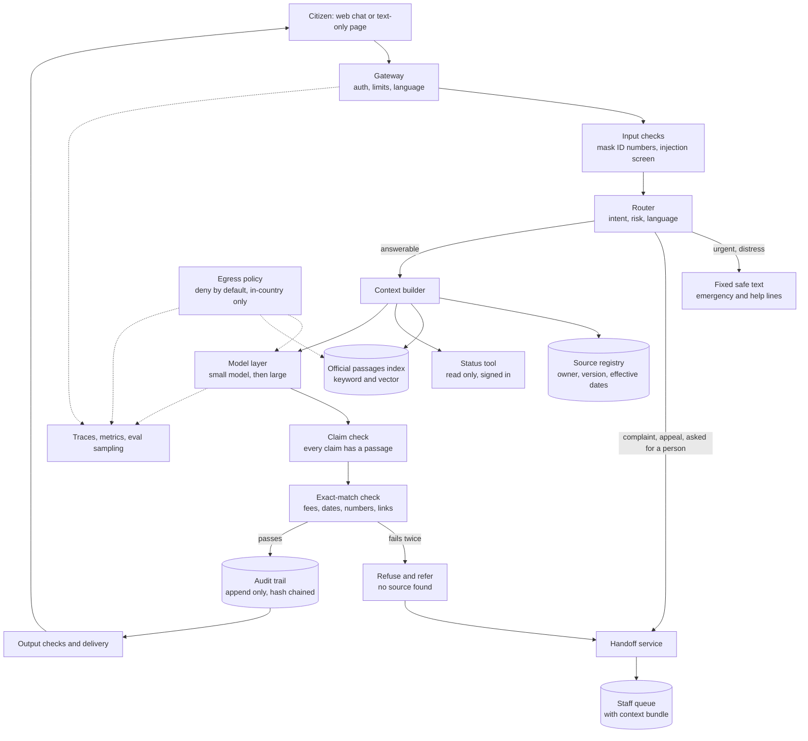
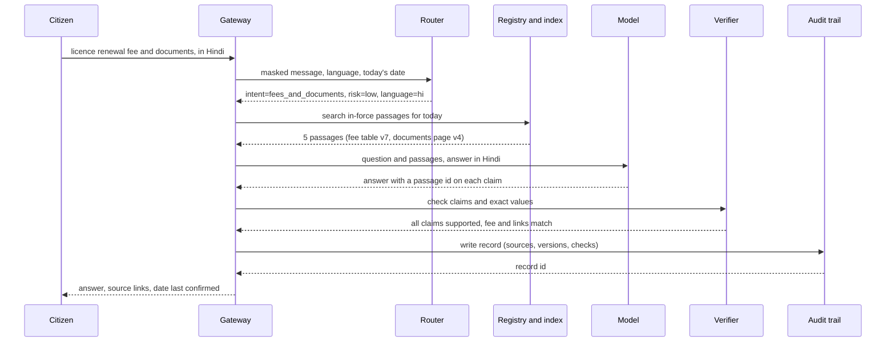

# Citizen services assistant for a state portal

> [!NOTE]
> The state in this case study is fictional. Its numbers are made up to make the design concrete. Prices are stated assumptions, not real quotes. New to AI terms? Start with [the word list](#words-used-in-this-case-study), and see [the layers and tools](#layers-and-tools) for what to build each part with. Laws on records, privacy, accessibility and data location differ by country and state, so check the rules that apply to you with your own legal team.

## At a glance

| | |
|---|---|
| **Problem** | Answer citizens' questions about public services in their own language, using only official sources, with a record of every answer and an interface that everyone can use. |
| **Scale** | 20M citizens, 12 languages, 2.4M conversations a month, about 5 turns each, peak near 28 turns per second. |
| **Key patterns** | Strict grounding in official sources, effective-dated retrieval, exact-match checks on facts, tamper-evident audit trail, accessibility, data residency. |
| **Difficulty** | Advanced. |
| **Read time** | About 40 minutes. |

## The scenario

The State of Northvale is a made-up state with 20 million citizens. Its portal lists about 400 services: renewing a driving licence, applying for a birth certificate, paying property tax, claiming a benefit, registering a small business. Citizens speak 12 languages, and one of them is written right to left. Today most people give up on the portal and phone a contact centre. The median wait on the phone is 22 minutes, and staff spend most of the day reading the same fee table and the same list of required documents aloud.

The state wants an assistant on the portal that answers questions about services and procedures in the citizen's language. It must say only what official sources say, and it must say which source. A wrong fee or a wrong deadline can cost a citizen money or a benefit, and a public body is expected to explain afterwards why it told someone something. The goal is to remove waiting for simple questions. The assistant does not decide whether anyone is eligible for anything.

| Measure | Today | Target |
|---|---|---|
| Contacts per month (phone, email, chat) | 2.4M | 2.4M |
| Median wait for a first answer | 22 minutes (phone) | Under 10 seconds |
| Resolved without staff | 0% (static FAQ pages only) | 50% |
| Factual claims shipped without an official source | Not measured | 0 |
| Wrong answers on the golden set | Not measured | Under 1% per language |
| Quality gap between languages | Not measured | Within 3 points of the English score |
| Accessibility | Portal audited, no chat | Meets WCAG 2.2 level AA |
| Cost per contact | About $6 (staff time and tools, assumed) | About $3.05 blended (0.5 × $6 + $0.054 for the AI system) |

We assume every contact today ends with staff, so the assistant takes over a share of the same 2.4M contacts, not extra ones. The mix of questions, from a sample of last year's contact logs, is: how do I apply or renew 35%, what do I need to bring 20%, fees and deadlines 18%, where to go and when 10%, status of my own case 9%, complaints and appeals 5%, and urgent or distressed messages 3%. The first four groups are public information and fit an assistant. The last three need a person, a login, or both.

## Requirements

A citizen assistant has to be fast and also provable. The requirements below give each need a priority and a number. The hardest two are "no claim without a source" and "keep the data in the country", because they limit every other choice.

Functional requirements:

| Requirement | Priority |
|---|---|
| Answer questions about services using official pages and forms, and cite each source | P0 |
| Reply in the citizen's language, and show the link to the official text | P0 |
| Say "I can't confirm that from official sources" and offer a person when the sources do not answer | P0 |
| Hand off to staff with a summary, on request or when unsure | P0 |
| Keep a record of every answer, with the exact sources used | P0 |
| Show the date the information was last confirmed, and use the rules in force on the day | P1 |
| Read-only lookup of the signed-in citizen's own application status | P1 |
| Ask one clarifying question when the request is vague | P1 |

Non-functional requirements, each with the reason for the number:

| Requirement | Target | Why |
|---|---|---|
| Full answer shown | Under 8 s at p95 | Answers are checked before they are shown, so we budget for the full text |
| Availability | 99.9% for the answer path | On deadline days the portal is the main way in. A static fallback covers the rest |
| Wrong answers | Under 1% per language on the golden set | A wrong fee or date has a real cost, so the bar is higher than for a shop |
| Unsupported claims shipped | Zero | Every fact must trace to an official passage |
| Audit record written | 100% of answers, before the answer is shown | If we cannot record it, we do not send it |
| Data stored or processed outside the country | Zero | Law or policy often requires citizen data to stay in the country |
| Accessibility | WCAG 2.2 level AA | Public bodies often have a legal duty here. It also makes the chat usable for everyone |

Security and compliance needs: all processing, storage, backups and logs stay in approved in-country regions, including the model, the search index, the translation step and the monitoring tools. Citizens may type national ID numbers, health details or addresses by mistake, so these are masked before they reach a model or a log. Raw transcripts are kept for 30 days. The audit record is kept for a period set by the state's records law, which we assume is 7 years. Citizens are told they are talking to an AI, can ask for a person at any time, and can see how the assistant works on a public page.

## Numbers

Before drawing anything, we estimate the load, the storage and the bill. These formulas are the ones from the [design method](../DESIGN-METHOD.md), and every assumption is stated so you can change it.

Traffic:

- Turns per month = conversations × turns per conversation = 2,400,000 × 5 = 12,000,000.
- Turns per day = 12,000,000 ÷ 30 = 400,000.
- Average turns per second = 400,000 ÷ 86,400 = 4.63.
- Peak turns per second = average × peak factor = 4.63 × 6 = 27.8. The peak factor of 6 is an assumption for deadline days, such as the last week for property tax.
- Requests in flight at peak = peak rate × seconds per turn = 27.8 × 8 = about 222. Here 8 seconds is the assumed time from message to the checked answer.

Tokens per turn:

- Input = system prompt and tool definitions 900 + conversation so far 900 + five retrieved passages at 400 each 2,000 + citizen message 80 + context facts 120 = 4,000 tokens.
- Output = 300 tokens.
- Tokens per month = 12,000,000 × (4,000 + 300) = 51.6 billion, of which 48 billion is input.
- Peak tokens per minute = 27.8 × 4,300 × 60 = about 7.2 million. This is the number to compare with a provider's rate limit, or with your own GPU capacity.
- Text in some languages takes more tokens than the same text in English. We keep the 4,300 figure and test the effect in the cost section.

Model cost, using two placeholder price points. Assume a small model costs $0.25 per 1M input tokens and $1.25 per 1M output tokens, and a large model costs $3 and $15.

- Small-model turn = 4,000 ÷ 1,000,000 × 0.25 + 300 ÷ 1,000,000 × 1.25 = $0.00100 + $0.000375 = $0.001375.
- Large-model turn = 4,000 ÷ 1,000,000 × 3 + 300 ÷ 1,000,000 × 15 = $0.012 + $0.0045 = $0.0165.
- If 80% of turns use the small model and 20% use the large one, the blended turn = 0.8 × $0.001375 + 0.2 × $0.0165 = $0.0011 + $0.0033 = $0.0044.
- Per conversation = 5 × $0.0044 = $0.022.

The other parts of a turn:

- Router (small model, 700 tokens in, 40 out) = 700 ÷ 1,000,000 × 0.25 + 40 ÷ 1,000,000 × 1.25 = $0.000225 per turn, so $0.001125 per conversation.
- Grounding check (small model, 1,500 tokens in, 100 out) = 1,500 ÷ 1,000,000 × 0.25 + 100 ÷ 1,000,000 × 1.25 = $0.000375 + $0.000125 = $0.0005 per turn, so $0.0025 per conversation.
- Retrieval and re-ranking, assumed at $0.0005 per turn, so $0.0025 per conversation.
- Quality sampling: 3% of conversations are graded by the large model (8,000 tokens in, 500 out) = 8,000 ÷ 1,000,000 × 3 + 500 ÷ 1,000,000 × 15 = $0.024 + $0.0075 = $0.0315 each, so 0.03 × $0.0315 = $0.000945 per conversation.
- Total per conversation = $0.022 + $0.001125 + $0.0025 + $0.0025 + $0.000945 = about **$0.029**.
- Monthly model and retrieval bill = 2,400,000 × $0.029 = about $69,800. With $60,000 a month of fixed infrastructure (two in-country zones, search, queues, audit storage, monitoring, accessibility testing tools), the AI system costs about **$129,800 a month**, or $0.054 per conversation.

Storage:

- Search index = passages × dimensions × bytes per number. With 40,000 official pages at 6 passages each we have 240,000 passages. Index size = 240,000 × 1,024 × 4 = about 983 MB, roughly 1 GB. We keep the last 3 versions of every passage so we can show what a source said on a past date, so the index is about 3 GB. That fits on one ordinary server.
- Audit record per turn is about 6 KB (ids, hashes, the answer text, check results). Audit growth per month = 12,000,000 × 6 KB = 72 GB.
- Audit store after 7 years = 72 GB × 84 months = 6,048 GB, about 6 TB. At an assumed $0.02 per GB-month, that is about $120 a month once full. Keeping the audit trail is cheap. Not keeping it is expensive.

Self-hosted model capacity, if data rules rule out a hosted service:

- Output tokens per second at peak = 27.8 × 300 = 8,340.
- Servers needed = peak output rate ÷ rate per server. If one GPU server produces 2,500 output tokens per second for our model (an assumption you must measure), we need 8,340 ÷ 2,500 = 3.3, so 4 servers. Each of two zones must carry the full load alone, so we run 4 + 4 = 8.

The most important number is not in those lists. If a person handles a contact at $6 (an assumption that covers their time and tools), the human bill today is 2,400,000 × $6 = $14.4 million a month. Automating 50% leaves 1,200,000 contacts for people: 1,200,000 × $6 = $7.2 million, plus $129,800 for the AI system. That is about $7.33 million a month.

Each extra point of automation saves 1% × 2,400,000 × $6 = $144,000 a month. That is more than the whole AI bill. Remember this when you are tempted to spend a month trimming token cost, and also when you are tempted to push the automation rate by loosening the grounding rules. A wrong answer sent to a citizen costs more than a handoff.

## Choosing the shape

The simplest design that could work is one model call with the portal's pages pasted in. It fails here for four reasons: 240,000 passages do not fit in a prompt, the answer must name its source, the rules change on set dates, and every answer needs a record that someone can check years later.

Walking up the ladder from the [design method](../DESIGN-METHOD.md):

| Rung | Verdict |
|---|---|
| One model call | Fails. No access to the full source set, no citations, no record. |
| Fixed pipeline (retrieve, then answer) | Fits most questions. Needs extra steps: a grounding check, a fact check and an audit write. |
| Router in front of a pipeline | Fits. Urgent, personal and complaint messages need different handling from how-to questions. |
| Tool-calling agent with a loop | Not needed. The only tools are a read-only status lookup and a link builder. |
| Multiple agents | Not needed. It adds cost and ways to fail, and it makes the audit trail harder to read. |

We stop at a router plus a pipeline, with a verify step after the model. This is a workflow with very little freedom, which is what a public body wants: the same question gets the same kind of answer, and each step can be logged. If a later version needs multi-step help, such as "help me work out which of these five benefits I should apply for", that stays with staff or becomes a separate, reviewed tool behind the same router.

## Architecture

A message passes through checks, then a router decides how to handle it. The answer is written only from official passages that are in force today. It is then verified, in two ways, before it is recorded and shown. Anything the system cannot support goes to a person. Every box runs in the approved in-country regions.



The three parts below are written for readers who are new to AI. The word list explains the terms. The layers part explains each box, what it does here, and which kind of tool can build it. The build order shows a sensible order for a small team.

### Words used in this case study

If a word in this page is new to you, find it here. Each entry says what the word means in this design, not in general.

| Word | What it means here |
|---|---|
| Token | A small piece of text, about three quarters of an English word. Models read and write tokens, and providers charge per token. Some languages need more tokens for the same text. |
| Embedding | A list of numbers that stands for the meaning of a piece of text. Texts with similar meaning get similar numbers, even in different languages if the embedding model is multilingual. |
| RAG | Retrieval-augmented generation. Search first, then give the best passages to the model so it answers from them. |
| Grounding | Making each claim in an answer rest on a passage from an official source. A claim with no passage is removed or the answer is refused. |
| Official source | A page, form or legal text published by the agency that owns the service. Blogs, forums and news are not official sources here. |
| Audit trail | An append-only record of what the system answered and why, kept so that someone can check it later. |
| Hash chain | A way to make a log tamper-evident. Each record stores a fingerprint (hash) of the record before it, so changing an old record breaks every fingerprint after it. |
| Data residency | The rule that data is stored and processed only in approved places, here inside the country. |
| WCAG | The Web Content Accessibility Guidelines from the W3C. They set the tests for sites to work with screen readers, keyboards, zoom and more. |
| Guardrail | A check that blocks or changes something unsafe before it reaches the citizen or a tool. |
| Handoff | Passing the conversation from the assistant to a person. |
| p95 | The time that 95 out of 100 requests beat. It shows slow cases that an average hides. |
| Golden set | A fixed list of real questions with known good answers, used to test every change. |

### Layers and tools

We split the system into eleven layers. Each layer has one job, and each can be built with a different category of tool. This part walks through them in the order a request meets them. For each layer you get what it is, what it does here, the kinds of tools you can choose from, and what we would pick first.

Tool names are examples as of November 2026. They are not endorsements, and tools change faster than categories. Before choosing, check that the project is maintained, that its license suits you, and that it can run inside your approved regions.

Three layers are easy to mix up: memory, retrieval and cache. They all "remember" something, but they answer different questions. Here memory is kept very small on purpose, because a public body should store as little about a citizen as it can.

| | Memory | Retrieval (RAG) | Cache |
|---|---|---|---|
| The question it answers | What was said earlier in this chat? | What do the official sources say, and on which date? | Have we already computed this? |
| What it holds | The recent messages and a short summary, for this chat only | Official passages with owner, version and effective dates | Saved results: a processed prompt, a passage list, a tool result |
| Whose data | One citizen, one conversation | The state, shared by everyone | Depends on the kind of cache |
| How it changes | After every turn, and is deleted after the chat | When an official source changes | It expires on a timer or when its source changes |
| Risk if it is wrong | A private fact kept longer than needed | An out-of-date rule | A stale answer, or an answer meant for someone else |

#### Layer 1: gateway

The gateway is the front door. It checks who the citizen is when they are signed in, applies limits, detects the language, and sends the answer back. It also sits in front of the models, so every model call passes through one place where we can set budgets and enforce the rule that calls go only to approved in-country endpoints.

In this design the gateway reads the citizen ID from the login session, applies a per-user rate limit, and caps tokens per user per day. Anonymous use is allowed for public questions. The gateway also serves a plain text-only chat page that works without scripts, which helps older browsers, slow links and some assistive tools.

Reuse the portal's sign-in and API gateway. For model calls, an AI gateway such as LiteLLM, Portkey or Kong AI Gateway gives budgets, one log and an allow list of endpoints, if it can be self-hosted in-country. Redis or Valkey hold the rate-limit counters.

First version: reuse the portal's sign-in and put a self-hosted AI gateway in front of the model calls, with an allow list of in-country endpoints. What goes wrong: a gateway that falls back to a provider in another region when the first one is slow. Make the fallback list contain only approved regions.

#### Layer 2: checks and guardrails

Guardrails are checks before and after the model. Input checks hide national ID numbers, bank details and health terms, and screen for attempts to trick the model. Output checks stop personal data, unknown links, promises such as "your application will be approved", and any statement that sounds like legal advice or an eligibility decision. Most of them are rules, not AI, so they are fast and cheap.

| Category | Examples | Pick it when |
|---|---|---|
| Pattern rules | Regular expressions for ID and bank number formats, an allow list of link domains | The thing you block has a clear shape |
| Personal-data detection | Microsoft Presidio and similar libraries | You need to find names, addresses and numbers in free text. Test each of your 12 languages |
| Safety and injection classifiers | Llama Guard, other classifier models | You want a model that scores risky input or output |

First version: pattern rules, an allow list of official domains for links, and the two verify steps from deep dive 2. What goes wrong: personal-data detectors trained mostly on English miss names and ID formats in other languages. Test every language and add rules for local formats.

#### Layer 3: router

The router reads the message and returns a short, structured result: the intent (apply, documents, fees, location, status, complaint, urgent), the risk level, the language, and a distress flag. Everything after it depends on this result, so it must be fast and cheap. It reads about 700 tokens and writes about 40.

| Category | Examples | Pick it when |
|---|---|---|
| Keyword rules | Lists of words in each language for emergencies, self-harm, violence, appeals | A few words must always trigger the same action |
| Small language model with structured output | A small hosted model told to return JSON that follows a schema | You want to start now, with no training data |

First version: a small language model with structured output, plus keyword rules in all 12 languages that can raise the risk level but never lower it. What goes wrong: an urgent message in a less common language is read as a routine question. Test the urgent cases first, in every language.

#### Layer 4: models

This layer holds the models that write and check the answers. The cascade uses a small, cheap model for most turns and a large one for hard turns. All calls go through the gateway to endpoints that run in the approved regions.

| Category | Examples | Pick it when |
|---|---|---|
| Hosted model APIs with a contract for in-country processing | The APIs from Anthropic, OpenAI, Google and others, where the provider commits in writing to process in your region | You want the best quality with no servers to run, and the contract and the technical setting both enforce the region |
| Models inside a cloud platform region | The model services of the large cloud providers, such as Amazon Bedrock and Google Vertex AI, pinned to an in-country region | Your data rules say the data must stay inside your cloud account and your country |
| Open-weight models you host | Open models served with vLLM or similar software on your own GPUs | Data cannot leave your network, or volume is steady and high. Use the capacity formula in the numbers section |

First version: models inside a cloud platform region in the country, with a small and a large tier behind the gateway. What goes wrong: a model swap changes tone, language quality and refusals, so rerun the golden set for every language on every change. Also check where the provider's own staff and subcontractors can see your prompts.

#### Layer 5: retrieval (RAG)

Retrieval finds the official passages that answer the question, so the model reads facts instead of guessing. It has five parts.

1. **Source registry.** Before anything is indexed, each source gets a row: owner agency, page address, language, version, status (in force, replaced, withdrawn), and the dates it applies from and to. Only sources in the registry are searched. This is how "official" is enforced.
2. **Ingestion.** Read each source, split it into passages of about 400 tokens at the headings, and store the registry fields next to each passage. A passage that contains a fee, a deadline or a form number also keeps that value as a separate field, for the exact-match check in deep dive 2.
3. **Embedding.** Turn each passage into an embedding with a multilingual model, so a question in one language can find a passage in another. The same step runs on the question at search time.
4. **Index.** Store the embeddings so they can be searched, with a keyword index beside them. Search filters on status and dates first: only passages in force on the day of the question are candidates.
5. **Re-ranking.** Take the top 50 or so results from both searches, score them again with a more careful model, and keep the best five.

The index size is in the numbers section: about 1 GB, or about 3 GB with three versions of each passage kept for the audit trail. That fits on one ordinary server, so a large search system is not needed on day one.

| Category | Examples | Pick it when |
|---|---|---|
| Vector search inside your database | Postgres with pgvector | You already run Postgres and have under a few million passages |
| Dedicated vector database | Qdrant, Weaviate, Milvus | Your index is large, or you need heavy filtering and high search volume. Run it self-hosted in-country |
| Search engine with keyword and vector search | Elasticsearch, OpenSearch | You need exact-term and meaning search in one place |
| Embedding models | Open-source multilingual embedding models you run, hosted embedding APIs with in-country processing | Open-source when residency is strict, hosted for speed to start |
| Re-rankers | Open-source cross-encoder models, hosted rerank APIs with in-country processing | You want better top results without changing the index |

First version: Postgres with pgvector for meaning search, Postgres full-text search for keywords, one multilingual embedding model you host, and a re-ranker you host. What goes wrong: the index goes stale after a rule change. Re-index on every change event from the agency's publishing system, not on a nightly guess, and mark replaced sources as not in force the moment their end date passes.

#### Layer 6: memory

Memory lets the assistant remember what was said earlier in the chat, so the citizen never has to repeat themselves. Here there is only one kind, and it is short-lived.

- **Short-term memory, for this conversation.** The last few turns word for word (up to about 600 tokens), plus a short running summary of older turns (about 300 tokens). That is the 900-token history from the numbers section. The chat is deleted from this store when it ends or after 30 minutes of silence.
- **No long-term memory about the citizen.** The assistant does not build a profile. If a signed-in citizen asks about their own case, the status tool fetches it live from the case system, and nothing is copied into memory. The 120 tokens of context facts in the prompt hold only the language, the page the citizen is on, and the current date.

Store only what helps. Never store ID numbers, passwords or anything typed by mistake. The audit trail is a separate store with its own rules, described in Layer 11.

| Category | Examples | Pick it when |
|---|---|---|
| Key-value store with expiry | Redis or Valkey | The data is short-lived, such as the recent turns of a live chat |

First version: Redis with a 30-minute expiry for the live chat, and nothing else. What goes wrong: a summary that keeps an ID number the masking step missed. Run the personal-data scan on summaries too.

#### Layer 7: caches

A cache stores a result so we can reuse it. A public portal repeats the same questions all day, so caches help a lot. Each kind is safe only under certain rules.

| Cache | What it saves | How it works | Rule to stay safe |
|---|---|---|---|
| Prompt cache | The provider's work on the part of the prompt that never changes | Put the fixed text (instructions, tool list) first and the changing text last. The provider reuses its work on the matching beginning | Providers charge more to write a cache entry and expire it after minutes. Check your provider's pricing page |
| Answer cache | The whole answer to a common question | Key = normalized question + language + effective date + source versions. Store only answers that passed both checks | Never cache an answer built from a citizen's own case data. Clear it when a source version changes |

The answer cache is more valuable here than in a shop, for two reasons. The questions repeat heavily, and a cached answer has already passed every check, so it is safe to show again. Each cached answer also keeps its original audit record ID, so a later check can point to the same evidence. How much it saves: first turns are 20% of all turns (1 in 5, since we assume 5 turns per conversation). Suppose 60% of first turns match a cached question. Then 12% of turns skip the model. Saving = 12,000,000 turns × 12% × $0.0044 = about $6,300 a month in model calls, plus a faster reply. Matching questions that mean the same thing needs a strict similarity rule, because "renew my licence" and "replace my lost licence" are close in meaning but have different fees and forms.

First version: the prompt cache, and the answer cache for the top 500 questions that staff have reviewed. What goes wrong: serving an answer after the rule changed. Key every entry with source versions, and clear on any version change.

#### Layer 8: tools and actions

Tools let the assistant fetch something, not only say something. Each tool is a function with a name, a description and typed inputs. The model asks to call one, and our code checks the request and runs it.

The tool list is short on purpose:

| Tool | Type | Notes |
|---|---|---|
| `get_application_status` | Read | Status of the signed-in citizen's own applications. Returns a fixed set of fields |
| `build_official_link` | Read | Returns the official page address from the registry. The model never writes a link itself |
| `find_office` | Read | Office address, hours and queue notice from the official locations table |

There are no write tools: the assistant cannot submit, change or cancel anything. An application, a payment or an appeal is something a citizen does on the official form, where their identity is checked. A missing tool cannot be talked into anything.

Build these as plain functions that call your internal case and location services. A standard such as MCP (Model Context Protocol) helps when several agencies share tools, and a workflow engine such as Temporal helps if you add write actions later.

First version: plain functions with a three-second timeout, where the citizen ID is set from the session, never by the model. What goes wrong: a status tool that returns more fields than it needs. Return only the fields the answer will use.

#### Layer 9: orchestration

Orchestration is the code that runs the steps in order: check, route, retrieve, answer, verify, record, deliver or refuse. In this design the order is fixed, so it is a normal function with a few branches. A fixed order also makes the audit trail simple to read.

Use plain code when the flow is fixed, as it is here. Agent frameworks such as LangGraph, LlamaIndex or Pydantic AI help if you need pause and resume, and a durable workflow engine such as Temporal helps for flows that run for hours.

First version: plain code, with one rule that the audit write comes before delivery. What goes wrong: a framework hides the real prompts. If you use one, log the final prompt of every call.

#### Layer 10: human handoff

Handoff passes the conversation to a person, with the summary, the sources already shown and the question that could not be answered. It also covers complaints and appeals, which always go to staff. Citizens can ask for a person at any time, by text, by phone call-back or by booking an in-person visit.

Use the helpdesk your staff already use, such as Zendesk, Freshdesk, Salesforce Service Cloud or the state's own case system, if it meets the residency rule. Otherwise build a simple queue: a Postgres table and a small staff screen.

First version: use the system the contact centre staff already use, if it meets the residency rule, or the simple queue if it does not. What goes wrong: a handoff in a language no staff member reads. Route by language, and show the citizen an honest wait time.

#### Layer 11: audit trail, observability and evals

Two records exist, for two readers. **Traces** are for engineers: the prompt, the passages, the time and the cost, with personal data masked, kept for a short time (30 days). The **audit trail** is for the public, courts and auditors: for each answer, what the citizen was told, which official passages and versions it rested on, which model and prompt version wrote it, and which checks passed. It is kept for the legal retention period. Evals are the automatic tests that tell you whether a change made things better or worse.

| Category | Examples | Pick it when |
|---|---|---|
| Write-once storage | Object storage with retention locks, such as Amazon S3 Object Lock or Azure immutable blob storage, in your region | You need records that nobody, including administrators, can change before the retention date |
| Append-only database table with hash chain | Postgres with insert-only permissions and the chain from deep dive 3 | Volume is moderate and you want to query the records easily |
| Tracing | OpenTelemetry, Langfuse, Arize Phoenix | You want one view per request. Self-host it in-country |
| Accessibility testing | axe-core, Pa11y, and manual tests with real screen readers such as NVDA | You must show that the chat meets WCAG |

First version: the append-only table with a hash chain, written to write-once storage each day, plus self-hosted tracing and a script that runs the golden set in CI. What goes wrong: sending traces to a monitoring service outside the country. Self-host it, or check the service's region in writing.

### Build order

Build the system in stages, and put each stage in front of real people before you add the next. The order below follows the risk: we learn from staff first, then from public questions in one language, then from more languages and account data. The steps are a sequence, not a schedule.

1. **Stage 0: source registry and shadow mode.** List the official sources in the registry, with owners and effective dates. Build the golden set from last year's contact logs. Index the sources in Postgres with pgvector. Write one pipeline that retrieves passages and drafts a reply that only staff see. Test: staff mark each draft as usable or not. Done when: most drafts are usable and the golden set runs in CI.
2. **Stage 1: public answers in the main language with the two checks and the audit trail.** Add the router, the models, the claim check, the exact-match check, the refusal path and the audit write. Turn it on for 5% of traffic on three high-volume services, with a kill switch. Test: the golden set, the injection cases and an accessibility audit. Done when: wrong answers are under 1% and no answer ships without an audit record.
3. **Stage 2: accessibility and the text-only page.** Pass the WCAG tests with automated tools and with screen reader users. Add the plain text page and the "human help" path that is the same on every screen. Test: manual sessions with people who use assistive tools. Done when: the chat meets the target level and testers can finish the top five tasks without help.
4. **Stage 3: more languages, one at a time.** For each language, build its golden set with bilingual reviewers, test the personal-data rules and the urgent-message rules, and launch behind the canary. Test: the per-language release gate. Done when: the language is within 3 points of the English score.
5. **Stage 4: signed-in status lookup.** Add the read-only status tool, the personal-data checks on its output, and the rule that its answers are never cached. Test: a cross-citizen test suite. Done when: no cross-citizen test fails.
6. **Stage 5: scale, cost and deadline days.** Add the answer cache, the second zone, budgets, dashboards, and the known-deadline banner. Test: a simulated zone outage and a load test at 3 times peak. Done when: failover works and cost per conversation is under target.

## One request, end to end

Here is one concrete turn. A citizen who chose Hindi writes, in Hindi, a question that means: "How much is the fee to renew my driving licence, and what do I need to bring?" We follow it through the system and budget the time for each step. The language here is only an example, since Northvale is fictional.



This request is low risk, and both checks pass. A request such as "I disagree with my property valuation, how do I appeal?" would follow a different path: the router marks it as an appeal, the assistant gives the fixed official steps and a link, and offers a person. A message that signals danger would skip the model and show fixed text with the state's emergency numbers from the official table.

The answer is not streamed word by word, because we only show text that has passed the checks. The page shows a status line, "Checking official sources", through a polite live region so that screen readers announce it once. Then the whole answer appears at once, which is also easier on screen reader users than text that keeps moving.

Latency budget for the answer path, with the small model:

| Step | Budget | If it overruns |
|---|---|---|
| Gateway and auth | 40 ms | Check the session cache |
| Input checks and router (in parallel) | 300 ms | Skip the distress model, keep the keyword rules |
| Retrieval and re-rank | 350 ms | Return top results without re-ranking |
| Model: first token and full answer (300 tokens at about 80 per second) | 3,800 ms | Switch to the second zone after 5 s, or refuse and refer |
| Claim check and exact-match check (in parallel) | 600 ms | Treat a timeout as a failure, never as a pass |
| Audit write and output checks | 150 ms | If the audit write fails, do not send the answer |
| **Answer shown** | **about 5,240 ms** | Large-model path adds roughly 600 ms |

The total, 40 + 300 + 350 + 3,800 + 600 + 150 = 5,240 ms, sits inside the 8-second target at p95 with room for slow cases. A shorter answer is also easier to read, so we cap answers at about 120 words.

## Deep dives

Four parts of this design deserve more care than the rest: strict grounding and effective-dated sources, answers in 12 languages, the audit trail, and data residency with accessibility.

### Deep dive 1: strict grounding and sources that change by date

Government rules change on set dates. A fee, an age limit or a deadline is true on one day and false on another. An assistant that answers from last year's page, or from a news story, can do real harm. We make it hard in four ways.

First, only registered, official, in-force sources are searched. A passage is a candidate only if its registry status is "in force" on the day of the question. If a citizen asks "what was the fee last March?", the system uses the passage version that applied then, and says so. This is why the index keeps three versions of each passage.

Second, the model gets a strict job. The prompt tells it to answer only from the passages given, to attach the passage ID to every claim, and to say so if the passages do not contain the answer. It must not give advice about what the citizen should do, or say whether they qualify.

Third, each answer shows its source and the date it was last confirmed. The citizen can open the official page. If the source is a translation, the page labels the language of the official original.

Fourth, when the sources do not answer, the assistant refuses in a useful way. It says that it cannot confirm this from official sources, links the most relevant official page, and offers a person. We count a good refusal as a success, not a failure. The release gate checks the refusal rate on out-of-scope questions: the assistant must refuse at least 98% of them.

### Deep dive 2: two checks before an answer is shown

The first check is a claim check. It splits the answer into claims and asks a small model, for each claim, whether the cited passage supports it. The model reads the passage in the source language, and the claim in the answer language, so it must handle both. A claim that fails is removed, and if the answer no longer makes sense, the answer is rejected.

The second check is not a model. It is an exact-match check on the values that cost people money or time: amounts, dates, deadlines, phone numbers, form numbers, percentages and links. It extracts these from the answer with rules, and each one must appear as the same value in one of the cited passages' stored fields. A language model can write "$40" when the passage says "$14". A string comparison cannot make that mistake.

```python
def exact_values_ok(answer, passages):
    allowed = {v for p in passages for v in p.fields}      # fees, dates, ids, links, phones
    for value in extract_values(answer):                   # numbers, dates, links, phones
        if normalize(value) not in allowed:
            return False                                   # unknown value: do not ship
    return True

def check_answer(answer, passages):
    return claims_supported(answer, passages) and exact_values_ok(answer, passages)
```

Numbers need care across languages. The answer may write a date or a number in the native digits and the style of that language, so `normalize` maps digits, separators and date formats to one internal form before comparing. For links, only addresses that exist in the source registry may appear.

If a check fails once, the system retries on the large model. If it fails again, the citizen gets the refusal path. The claim check costs about $0.0005 per turn and the exact-match check is free, which is small next to a wrong fee. A failed check never turns into a pass: a timeout, an error or a missing field all count as a failure.

### Deep dive 3: a tamper-evident audit trail

When a citizen says "your assistant told me the fee was $14", the state must be able to show what it said, which source it used, and why. A normal application log is not enough: it can be edited, it is full of personal data, and it gets deleted after a month.

What goes in each record:

| Field | Why |
|---|---|
| Record ID, time, pseudonymous session ID | To find the record without storing the citizen's name |
| Language and router result | To explain how the question was handled |
| Passage IDs, source versions, content hashes | To prove what the sources said when the answer was written |
| Model name and version, prompt template version | To reproduce the setup |
| The question (masked) and the answer as shown | The thing the citizen saw |
| Check results, and the handoff reason if any | To show that the checks ran |
| Hash of the previous record | To make the log tamper-evident |

The hash chain works like this: each record stores a fingerprint of the record before it, so changing an old record breaks the fingerprint of every record that follows.

```python
import hashlib, json

def append_record(store, record):
    prev_hash = store.last_hash()                      # "" for the first record
    body = json.dumps(record, sort_keys=True)
    record_hash = hashlib.sha256((prev_hash + body).encode()).hexdigest()
    store.insert(body=body, prev_hash=prev_hash, hash=record_hash)
    return record_hash
```

Once a day, the last hash is signed and copied to write-once storage in a different account, so even an administrator cannot rewrite history without being noticed. A weekly job walks the chain and alerts on any break.

Two rules keep the audit trail from becoming a privacy problem. The masked question is stored, not the raw one. And the session ID is a pseudonym: the mapping to a real citizen exists only for signed-in sessions, sits in a separate store with its own access rules, and is read only under a logged request. Every read of the audit trail is itself logged.

Cost and size: 6 KB × 12,000,000 turns = 72 GB a month, about 6 TB after 7 years, and about $120 a month at the assumed storage price. The more important cost is the extra step in the request: the audit write is 150 ms in the budget, and an answer is never shown if the write fails.

### Deep dive 4: data residency and accessibility

These two look unrelated, but both are about being able to say "this is true of every request", not "of most".

**Data residency.** The rule is that citizen data stays in approved in-country regions. The easy mistake is to protect the database and forget the other places a prompt travels. List every place text goes: the gateway, the model host, the embedding service, the re-ranker, the translation step, the traces, the metrics tool, backups, error reports, the support tool used by staff, and the provider's own staff access. For each, record the region and who can read it.

We then enforce it with the network, not with good intentions. The servers run with deny-all outbound traffic and an allow list of in-country endpoints. A test in CI fails if any configuration names an endpoint that is not on the list. Encryption keys are held in an in-country key service. If the primary model host is down, the fallback is another in-country zone, or the static fallback page. It is never a provider abroad, even when the abroad option is faster. Document each decision, because an auditor will ask.

**Accessibility.** The target is [WCAG 2.2](https://www.w3.org/TR/WCAG22/) level AA. A chat has specific traps, so we list the criteria that matter most:

| Need | WCAG 2.2 criterion | What we do |
|---|---|---|
| Replies announced to screen readers | 4.1.3 Status Messages | A polite live region announces "Checking official sources" and then the reply, once |
| No time limit that traps people | 2.2.1 Timing Adjustable | A chat does not close while someone is typing. Warn first, and let people extend the time |
| Buttons easy to hit | 2.5.8 Target Size (Minimum) | Buttons and links at least 24 by 24 CSS pixels |
| Each language announced correctly | 3.1.1 Language of Page, 3.1.2 Language of Parts | Mark each reply with its language tag, and mark the right-to-left language with the right direction |
| Help in the same place | 3.2.6 Consistent Help | The "talk to a person" option is always in the same place |

Automated tools such as axe-core catch only some accessibility problems, so we also test by hand with real screen readers and with keyboard-only use, and we invite people who use assistive tools to test every release. Language tags use the format in [BCP 47](https://www.rfc-editor.org/rfc/rfc5646). The W3C explains [how to declare language in HTML](https://www.w3.org/International/questions/qa-html-language-declarations). Plain language is part of accessibility too: answers aim for short sentences, the main action first, and no unexplained acronyms. We check the reading level of the answers in each language as part of the golden set.

## Scaling from 1x to 100x

Load will not stay at 2.4M conversations a month. A reasonable growth path is more agencies joining the same assistant (10x), and a national platform for several states (100x). Here is what changes, computed from the numbers above.

| Load | Peak turns per second | In flight | Peak tokens per minute | Self-hosted servers (two zones) | What breaks first | Fix |
|---|---|---|---|---|---|---|
| 1x | 27.8 | about 222 | 7.2 million | 8 | Nothing yet. Check provider limits and set budgets | Per-user limits, global cost cap |
| 10x | 278 | about 2,220 | 72 million | 68 | Provider limits, the re-ranker, the human queue | Prompt and answer caches, higher limit tier, more model capacity in-country |
| 100x | 2,780 | about 22,200 | 717 million | 668 | Capacity of one region, audit write rate, cost | More in-country zones, partition the audit chain, raise the automation rate |

The self-hosted server counts follow the formula in the numbers section: servers = ceil(peak turns per second × 300 ÷ 2,500), doubled for two zones. At 10x: 83,400 ÷ 2,500 = 33.4, so 34, and 68 with two zones. At 100x: 834,000 ÷ 2,500 = 333.6, so 334, and 668.

The reasoning behind the fixes:

- **Answer cache.** At 1x it saves about $6,300 a month (Layer 7). At 10x it saves about $63,000, and it is also the best way to flatten deadline-day peaks, because those peaks are mostly the same questions.
- **Audit write rate.** One hash chain is one sequence, so writes are serialized. At 2,780 turns per second this becomes a bottleneck. We split the chain into partitions, for example one per agency or per hour, and sign a root that covers all of them.
- **The human queue.** This is the hidden scaling limit. At 100x with 50% automation, 50% of 240 million contacts still need a person. The only fix that scales is raising the automation rate, which is why the evals and the weekly review of handoffs matter more than any infrastructure work.
One more scaling case is a spike, not growth. A deadline, a storm, a public emergency or a benefit change can send traffic up by a factor of ten in hours. Autoscaling is too slow for that. The better fix is a known-event banner: staff publish a pre-reviewed message for the event, the router answers with it and a link, and only unusual conversations reach the model. The static fallback page must also exist and be tested, and it must be hosted in-country.

## Failure modes and safety

Systems like this fail in ordinary ways more often than in dramatic ones. The table lists what we plan for, how we notice, and what happens next.

| Failure | How we notice | What we do |
|---|---|---|
| Model host is slow or down | Timeouts, error rate above 2% for one minute | Fail over to the second in-country zone. If both fail, show the static fallback page with official links and the phone number |
| Wrong or invented answer | Claim check or exact-match fails, thumbs-down, golden set regressions | Retry on the large model once, then refuse and refer |
| Wrong value in a translation | Exact-match check, per-language golden set | Block the answer. Add the case to the language's test set |
| Prompt injection in a message or in a page | Injection screen, answers that cite passages not in the registry | Only registry passages are shown to the model. Tools are read-only and scoped to one citizen. Output check blocks unknown links |
| Cross-citizen data exposure | Test suite on every release, alert on any tool call with a mismatched ID | ID set by the system from the session. Block release if a test fails |
| Personal data in logs or prompts | Scanner on stored traces and summaries | Mask before logging. Alert and purge if found |
| Data leaves the country | Egress deny logs, CI test on configuration, monthly review of subcontractors | Block the call, page the on-call engineer. Never fall back abroad |
| Audit write fails | Write error | Do not send the answer. Retry once, then show the refusal path |
| Urgent or distress message | Keywords in each language, distress flag | Skip the model. Show fixed text with emergency numbers and offer a person |
| Cost spike from a bug or abuse | Spend per hour above 3 times the average | Per-user token budget, global circuit breaker that switches to the small model only |

Two points need extra care. A conversation that ends without staff may mean the citizen gave up, so a "resolved" label needs no repeat contact within seven days. And the assistant must never say "you qualify" or "you will be approved". Those phrases are blocked by rule.

> [!WARNING]
> Never fall back to a model or a service outside the approved regions to fix an outage. A slower correct answer or a static page is better than a fast answer that breaks the data rules. Put this in the gateway's configuration, not in a runbook that people may skip under pressure.

The [OWASP Top 10 for LLM applications](https://genai.owasp.org/llm-top-10/) lists risks that apply directly here, including prompt injection, sensitive information disclosure, excessive agency and misinformation. We use it as a checklist for the injection cases in the golden set.

## Measuring quality

"Good" has to be defined before launch, or every change turns into an argument. For a public body, a second question comes first: can we show, afterwards, that we checked? We measure in three places: a test set before release, a canary during release, and sampling in production.

Metrics and targets:

| Metric | How it is measured | Target |
|---|---|---|
| Wrong-answer rate | Golden set, graded against reference answers from the owning agency | Under 1% in every language |
| Unsupported claims shipped | Audit sample: share of claims with no passage | 0 |
| Exact-value errors shipped | Audit sample: fees, dates and links that differ from the source | 0 |
| Correct refusal on out-of-scope questions | Golden set of questions the sources cannot answer | At least 98% |
| Automated resolution | Conversations ended without staff and not reopened within 7 days | 50% |
| Escalation quality | Of handoffs, share where staff agreed it was needed (precision), and of conversations staff had to rescue, share we handed off in time (recall) | Precision over 80%, recall over 90% |
| Language gap | Difference between each language's score and the English score | Within 3 points |
| Accessibility | Automated tests in CI plus manual test sessions with screen reader and keyboard users | Level AA with no open blocker |
| Answer shown | Measured at the browser | Under 8 s at p95 |
| Cost per conversation | Tokens times price, plus retrieval | Under $0.035 |

The golden set is built from real contacts. We take about 1,200 from last year's contact logs, split by intent in the same proportions as real traffic, remove personal data, and have staff from the owning agencies write the correct answer or the correct handoff. We add 150 questions the sources cannot answer, 80 urgent or distress messages, and 60 security cases (other people's case numbers, injection attempts, ID numbers). Then we build a separate set for each of the other 11 languages with bilingual reviewers, because an average over languages hides a bad one. If a language set has 300 questions, then one point is 3 questions, so we also report the counts, not only percentages.

The release rule is simple: no language or intent may drop more than one point against the current version, every security case and every urgent case must pass, and the exact-value error count must be zero. Release also needs a sign-off from a named person at the owning agency for any change to prompts or sources that affects their service.

An automatic judge, a large model told to grade an answer against the reference, makes the golden set cheap to run. We trust the judge only after checking it. We have bilingual reviewers label 200 answers per language, compare them with the judge's grades, and require agreement of at least 85% before we use the judge to gate a release in that language. See the Part 1 notes on [golden datasets](https://github.com/NeuralSaasAi/ai-engineering-playbook/blob/main/05-evaluation/golden-datasets.md) and [LLM judges](https://github.com/NeuralSaasAi/ai-engineering-playbook/blob/main/05-evaluation/llm-as-judge.md).

Release process: new prompts, models and indexes go to 5% of traffic, then 25%, then 100%. At each step, the system compares escalation rate, satisfaction, thumbs-down rate, refusal rate and cost per conversation against the control group, and rolls back automatically if any metric crosses its limit. In production, 3% of conversations are graded by the judge, and every conversation with a thumbs-down, a refusal or a handoff reason of "unsure" is read by staff each week. The weekly findings also feed the agencies: a question that gets refused often points to a page that needs to be written.

## Cost

Money goes to three places: people, models, and everything else. The cost formulas in the numbers section gave us the unit cost, and the monthly view shows where it matters.

| Item | Calculation | Per month |
|---|---|---|
| Answer models (cascade) | 2,400,000 × $0.022 | $52,800 |
| Router | 2,400,000 × $0.001125 | $2,700 |
| Grounding check | 2,400,000 × $0.0025 | $6,000 |
| Retrieval and re-ranking | 2,400,000 × $0.0025 | $6,000 |
| Quality sampling (judge) | 2,400,000 × $0.000945 | about $2,300 |
| Fixed infrastructure (assumed) | Two zones, search, queues, audit storage, monitoring | $60,000 |
| **AI system total** | | **about $129,800** |
| People for the 50% handled by staff | 0.5 × 2,400,000 × $6 | $7,200,000 |
| **All-in** | | **about $7.33 million** |
| Staff-only baseline | 2,400,000 × $6 | $14,400,000 |

The AI system is under 2% of the total. The people cost is where the money is, so the lever that matters most is the automation rate, at $144,000 a month for each point. The second lever is the refusal and handoff reasons: if the weekly review shows that "no official page" causes 15% of handoffs, asking the agency to publish five clearer pages may be worth more than any model change.

Test one assumption: tokens in other languages. If the average token count were 30% higher in every part of the prompt and the answer, the model lines would rise by about 30%: 0.3 × $69,800 = about $20,900 a month, or 0.15 of one point of automation. The language effect is real, but small next to the people cost.

Cost levers in order of impact:

1. Raise the automation rate with clearer official pages, better retrieval thresholds and fixes from handoff reasons.
2. Keep the cascade share on the small model high. If the small share falls from 80% to 50%, the blended turn becomes 0.5 × $0.001375 + 0.5 × $0.0165 = $0.00894, about twice the current $0.0044.
3. Use the prompt cache for the static prefix.
4. Use the answer cache for reviewed, common questions: about $6,300 a month at 1x.
5. Trim retrieved context to the passages that were actually cited.

## Trade-offs we made

We recorded the decisions, the options, and the conditions under which we would change our mind. Revisit this table when numbers shift.

| Decision | Options | Choice | Why | Revisit when |
|---|---|---|---|---|
| Orchestration | Free agent loop, router plus pipeline | Router plus pipeline | Predictable, cheap, easy to test and to log | Multi-step tasks become a large share of traffic |
| Delivery | Stream words as written, show the whole checked answer | Whole answer after the checks | We never show text that has not passed both checks. It is also calmer for screen readers | Checks can run fast enough on partial text |
| Verification | One model check, model check plus exact match | Both | Models can write a wrong number that sounds right. A string comparison cannot | A single check reaches zero exact-value errors on a large test |
| Language approach | Translate everything first, answer directly in the language, official translations only | Answer directly in the language, with a multilingual index | Cheaper and better coverage than translating the whole source set | Official translations exist for all services, then prefer them |
| Model hosting | Hosted API with in-country contract, cloud region, self-hosted | Cloud region first, self-hosted if rules require | Quality and speed to start, while keeping data in the country | Rules ban shared cloud, or volume makes GPUs cheaper |
| Audit trail | Normal logs, append-only table with hash chain, write-once storage | Hash chain plus daily copy to write-once storage | Tamper-evident and easy to query | Volume makes a single chain a bottleneck |

Versions: v1 is the router, pipeline, two checks, audit trail and refusal path, in the main language for three services. v2 adds accessibility sign-off, more languages and the answer cache. v3 adds status lookup, the second zone and the deadline-day banner.

## What teams get wrong

Most failures of first versions come from the same few mistakes. Each one below comes with a sign that you are making it.

- **Ignoring effective dates.** The answer is right for last month. Sign: a thumbs-down cluster on the day a rule changes.
- **Trusting the model with numbers.** Sign: a fee in an answer that is not in any passage. Use the exact-match check.
- **Counting deflection as success.** If you measure "contacts with no staff" and not "citizen did not come back", the assistant looks great while people give up. Sign: automated resolution rises while repeat contacts also rise.
- **Adding accessibility at the end.** A live region, focus order and zoom behaviour are hard to fix after the design is set. Sign: the first screen reader test happens after launch.
- **Protecting only the database for residency.** Traces, translation, error reports and support tools also carry text. Sign: nobody can list every place a prompt is sent.
- **An audit trail that is only a log.** If an administrator can edit it, it will not stand up later. Sign: no hash chain and no write-once copy.

## Interview mode

If you get this problem in an interview, you have about 45 minutes. Spend the time like this, and say your assumptions out loud as you go.

| Minutes | What to do |
|---|---|
| 0 to 5 | Ask about volume, channels, languages, who owns the source content, legal rules on data location and records, and what a wrong answer costs |
| 5 to 10 | State requirements as numbers, and do the traffic, storage and cost math on the board |
| 10 to 15 | Argue for the simplest shape: a router plus a pipeline with verification, and say why not an agent |
| 15 to 30 | Draw the architecture, walk one request, then go deep on grounding, the audit trail and residency |
| 30 to 38 | Scale to 10x and 100x, and list failure modes |
| 38 to 43 | Define quality metrics per language, the golden set, and the release gate |
| 43 to 45 | Summarize the trade-offs and what you would build in v2 |

Follow-up questions an interviewer may ask:

**1. The model host in your region goes down for 20 minutes. What happens?**

<details>
<summary>Answer</summary>

The gateway sees timeouts and fails over to the second in-country zone after about 5 seconds per request. If both are down, the system stops calling models. The portal shows the static fallback page with the top official links and the phone number, and the staff queue grows, so we show wait times honestly. We do not send traffic to a provider in another country, even though it would restore service faster. After recovery, we check the golden set against the backup path and read the traces from the incident.

</details>

**2. How do you stop the assistant from stating a wrong fee?**

<details>
<summary>Answer</summary>

Three layers. The model may only answer from registered, in-force passages. A claim check asks whether each claim is supported by its cited passage. Then a rule-based exact-match check extracts every amount, date, link and phone number from the answer and requires each to appear as the same value in the cited passages. A failed check retries once on the larger model, and then the citizen gets a refusal with a link and an offer of a person. The audit record shows which version of the fee table was used.

</details>

**3. You have no labeled data and 12 languages on day one. How do you evaluate before launch?**

<details>
<summary>Answer</summary>

Start with the main language and last year's contact logs, with staff from the owning agencies writing the correct answers. Run the assistant in shadow mode first, so staff see drafts and mark them as good or bad. Add each other language one at a time, with bilingual reviewers building a smaller golden set and testing the urgent-message rules and the personal-data rules in that language. A language does not launch until it passes its own gate. We do not infer one language's quality from another's.

</details>

## Concepts used

This case study relies on a few ideas that Part 1 explains from the beginning. Read those first if any are new to you.

Basics in Part 1:

- [Tokens and context windows](https://github.com/NeuralSaasAi/ai-engineering-playbook/blob/main/00-foundations/tokens-and-context-windows.md)
- [Embeddings and vector search](https://github.com/NeuralSaasAi/ai-engineering-playbook/blob/main/00-foundations/embeddings.md)
- [RAG in one page](https://github.com/NeuralSaasAi/ai-engineering-playbook/blob/main/00-foundations/rag-in-one-page.md)
- [What are guardrails](https://github.com/NeuralSaasAi/ai-engineering-playbook/blob/main/03-ai-safety-guardrails/what-are-guardrails.md)
- [Human in the loop](https://github.com/NeuralSaasAi/ai-engineering-playbook/blob/main/02-building-agents/human-in-the-loop.md)
- [Prompt injection](https://github.com/NeuralSaasAi/ai-engineering-playbook/blob/main/04-llm-security/prompt-injection.md)

Advanced ideas introduced here: a source registry with effective dates, strict grounding with an exact-match check on values, a hash-chained audit trail with write-once copies, residency enforced by network policy, accessible chat delivery, and per-language release gates.

Related case studies in this playbook: the [customer support agent](01-customer-support-agent.md) covers the model cascade and warm handoff in more depth, and the [law firm knowledge assistant](04-law-firm-knowledge-assistant.md) goes deeper on access control and keeping documents in sync.

## Further reading

These primary sources cover the standards this design leans on most: accessibility, language tagging, LLM security risks and AI risk management. Read the first one before you design the chat screen.

- [WCAG 2.2](https://www.w3.org/TR/WCAG22/): the W3C Recommendation that defines the accessibility criteria used in deep dive 4, including status messages and target size.
- [WCAG overview from the W3C Web Accessibility Initiative](https://www.w3.org/WAI/standards-guidelines/wcag/): a plainer starting point, with quick references and what changed between versions.
- [BCP 47 language tags (RFC 5646)](https://www.rfc-editor.org/rfc/rfc5646): the format for the language tags used to mark each reply.
- [W3C: declaring language in HTML](https://www.w3.org/International/questions/qa-html-language-declarations): how to mark the language and direction of page parts so screen readers and browsers handle them correctly.
- [OWASP Top 10 for LLM applications](https://genai.owasp.org/llm-top-10/): the standard list of risks for systems like this one, including prompt injection and misinformation.
- [NIST AI Risk Management Framework](https://www.nist.gov/itl/ai-risk-management-framework): a framework for governing and measuring AI risk, useful when writing the public description of the system.
