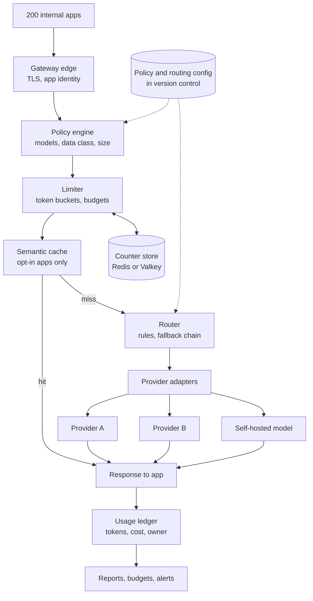
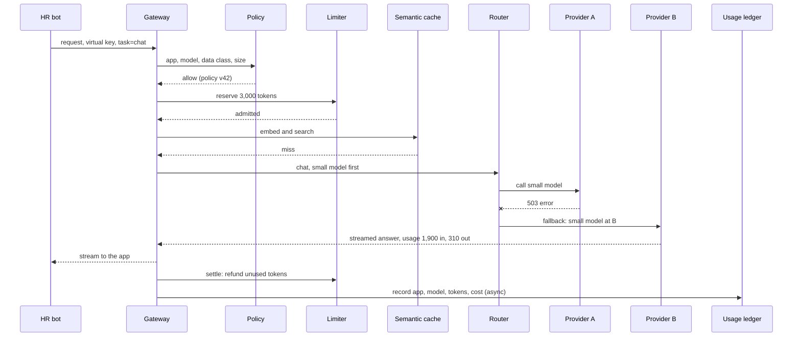

# Company AI gateway and model router

> [!NOTE]
> The company in this case study is fictional. Its numbers are made up to make the design concrete. Prices are stated assumptions, not real quotes. New to AI terms? Start with [the word list](#words-used-in-this-case-study), and see [the layers and tools](#layers-and-tools) for what to build each part with.

## At a glance

| | |
|---|---|
| **Problem** | Give 200 internal apps safe, fair and measured access to language models, inside one monthly budget. |
| **Scale** | 60M model requests a month, about 93 requests per second at peak, 13.3M tokens per minute at peak. |
| **Key patterns** | Token-based rate limits, fallback, cost attribution, semantic cache, policy enforcement. |
| **Difficulty** | Advanced. |
| **Read time** | About 30 minutes. |

## The scenario

Meridian Group is a made-up company with 200 internal applications that call language models: a claims summarizer, an HR helpdesk bot, a code review tool, a sales email drafter, and many smaller ones. Each team signed its own contract with a model provider, kept its own API key in its own config, and pays on its own card. Finance cannot say which team spent what. Two apps have leaked keys into a public repository. In March one batch job used the whole company's token limit at a provider, and the HR bot stopped answering for two hours.

The platform team will build one AI gateway. Every app sends model calls to it, and only the gateway holds provider keys. The gateway checks who is calling, applies limits, enforces company policy, routes to a model, falls back when a provider fails, caches repeat questions, and records the cost against the app that caused it. The goal is not to make apps smarter. It is to make the shared resource predictable, safe and billable.

| Measure | Today | Target |
|---|---|---|
| Internal apps calling models | 200 (about 40 provider accounts) | 200 (one gateway) |
| Model requests per month | 60M | 60M |
| Monthly model spend | About $720,000 (all calls on a large model, assumed) | Under $250,000 |
| Spend that can be tied to an app | About 15% | Over 99% |
| Provider keys held by app teams | About 200 | 0 |
| Outage from one app starving the others | Twice this year | None |
| Extra delay added by the gateway | Not applicable | Under 50 ms at p95 |

The traffic is uneven. Ten apps send 70% of the requests. The other 190 apps share the remaining 30%. Roughly 25% of tokens come from user-facing apps where a person waits (critical), 50% from internal tools used during work hours (standard), and 25% from batch jobs that can wait (batch). This unevenness shapes every limit and every fallback rule below.

## Requirements

A gateway is shared by everyone, so a mistake in it hurts everyone at once. The requirements therefore favor predictable behavior over clever behavior: every rejection has a reason, every dollar has an owner, and every rule is written down as code.

Functional requirements:

| Requirement | Priority |
|---|---|
| Authenticate each app and attribute every request to an app, team and cost center | P0 |
| Limit tokens per minute per app, with a guaranteed share and a shared burst pool | P0 |
| Enforce a monthly budget per app and one global budget | P0 |
| Enforce company policy before a request leaves the network: allowed models, data classes, size limits | P0 |
| Route to a model based on the app's declared task and rules | P0 |
| Fall back to a second model or provider when the first fails or is overloaded | P0 |
| Serve repeat questions from a semantic cache, for apps that opt in | P1 |
| Show each team its own usage and cost, and export to finance | P1 |
| Let a team test a new model on a share of its own traffic | P1 |

Non-functional requirements, each with the reason for the number:

| Requirement | Target | Why |
|---|---|---|
| Gateway overhead | Under 50 ms at p95 (cache miss path) | Model calls take seconds. The gateway should be a small part of that |
| Availability | 99.95% | Every AI feature in the company depends on it |
| Streaming | First token passes through with no buffering | Users read the answer as it is written |
| Attribution accuracy | Gateway totals within 1% of provider invoices | Finance will not accept numbers that do not reconcile |
| Wrong cache hits | Under 1% of sampled hits judged wrong | A fast wrong answer is worse than a slow right one |
| Policy decisions | 100% logged, with the policy version | Auditors ask why a request was allowed |
| Provider outage | Critical apps keep working | The main reason for fallback |

Security and compliance needs: apps never hold provider keys. Prompts and answers are not stored by default. The gateway keeps only metadata (app, model, token counts, cost, policy decision), and an app owner may opt in to storing content for debugging, for a short fixed period. Data is sorted into classes (public, internal, confidential, restricted), and each class has a list of providers and models that may receive it. Check your own legal and contract rules, because they differ by country and by customer.

## Numbers

We estimate load and cost before drawing anything, because the numbers decide where the limits sit and how much a cache can save. Every assumption is stated so you can change it.

Traffic:

- Requests per day = 60,000,000 ÷ 30 = 2,000,000.
- Average requests per second = 2,000,000 ÷ 86,400 = 23.1.
- Peak requests per second = average × peak factor = 23.1 × 4 = 92.6. The peak factor of 4 is an assumption for office-hours traffic.

Tokens, assuming an average request has 2,000 input tokens and 400 output tokens:

- Tokens per request = 2,000 + 400 = 2,400.
- Tokens per day = 2,000,000 × 2,400 = 4.8 billion.
- Average tokens per minute = 4.8 billion ÷ 1,440 = 3.33 million.
- Peak tokens per minute = 3.33 million × 4 = 13.3 million. This is the number to compare with provider limits.

Provider capacity, assuming each of two providers gives Meridian 8M tokens per minute for its large model (placeholder numbers, because real limits depend on the contract and the usage tier):

- Combined capacity = 2 × 8M = 16M tokens per minute.
- Headroom at peak = 16M ÷ 13.3M = 1.2, which is 20% spare when both providers work.
- With one provider down, capacity = 8M against a peak of 13.3M. The gap is 13.3M − 8M = 5.3M tokens per minute (40% of peak), so something must be shed. The fallback section shows what.

Model cost, using placeholder prices. Assume a large model costs $3 per 1M input tokens and $15 per 1M output tokens, and a small model costs $0.25 and $1.25.

- Large-model request = 2,000 ÷ 1,000,000 × $3 + 400 ÷ 1,000,000 × $15 = $0.006 + $0.006 = $0.012.
- Small-model request = 2,000 ÷ 1,000,000 × $0.25 + 400 ÷ 1,000,000 × $1.25 = $0.0005 + $0.0005 = $0.001.
- Today, everything runs on the large model: 60M × $0.012 = **$720,000 a month**.

With the gateway, assume routing sends 70% of requests to the small model, and the cache serves 10% of all requests:

- Blended request = 0.7 × $0.001 + 0.3 × $0.012 = $0.0007 + $0.0036 = $0.0043.
- Cache lookup (one embedding of about 500 tokens at an assumed $0.02 per 1M tokens, plus a vector search) = about $0.00001 per request.
- Average cost per request = 0.9 × $0.0043 + $0.00001 = $0.00387 + $0.00001 = $0.00388.
- Model spend = 60M × $0.00388 = $232,800 a month.
- Fixed infrastructure (gateway servers, Redis, Postgres, vector index, logs, assumed) = $12,000 a month.
- Total = $232,800 + $12,000 = **$244,800 a month**, which is $5,200 under the $250,000 budget. The margin is small on purpose. It shows that the budget is reachable and not comfortable.

Other sizes:

- Cache index = entries × dimensions × bytes per number = 1,000,000 × 1,536 × 4 bytes = 6.1 GB. The 1M entry limit is an assumption.
- Usage log = requests per month × bytes per row = 60,000,000 × 1 KB = 60 GB a month of metadata.
- Gateway servers = ceil(peak requests per second ÷ requests per server) + 1 spare = ceil(92.6 ÷ 300) + 1 = 2 servers, and we run at least 3 so a zone failure does not stop us. The 300 requests per second per server is an assumption.

## Choosing the shape

The simplest design that could work is a shared library that every app imports. It fails for three reasons: 200 apps will run 200 different versions, a library cannot enforce a limit across apps (each copy only sees its own traffic), and the provider keys would still sit in every app.

Walking up the ladder from the [design method](../DESIGN-METHOD.md):

| Rung | Verdict |
|---|---|
| One model call | This is what apps do today. No shared limits, no shared record |
| Fixed pipeline | The gateway is one: authenticate, check policy, check limits, look in the cache, call, record. The steps never change order |
| Router | Fits. Different apps need different models, and a failed provider needs another route |
| Tool-calling agent | Not needed. The gateway does not plan or choose tools. Apps do that themselves |
| Multiple agents | Not needed |

We stop at a fixed pipeline with a router inside it. The gateway is deliberately boring: no language model decides who is allowed in, how much they may spend, or whether a policy applies. Those decisions are plain code that can be tested and explained to an auditor. The only AI inside the gateway is the embedding model for the cache, and an optional small classifier that helps route by difficulty.

## Architecture

A request enters through the gateway, which identifies the app and runs a fixed series of checks. A router picks a model, and the call goes to a provider through an adapter that hides provider differences. Every request ends in a usage record that feeds cost reports, budgets and alerts.



The three parts below are written for readers who are new to AI. The word list explains the terms. The layers part explains each box, what it does here, and which kind of tool can build it. The build order shows a sensible order for a small team.

### Words used in this case study

If a word in this page is new to you, find it here. Each entry says what the word means in this design, not in general.

| Word | What it means here |
|---|---|
| Token | A small piece of text, about three quarters of an English word. Models read and write tokens, and providers charge and limit by token. |
| Model (LLM) | The program that reads text and writes text. LLM stands for large language model. |
| Embedding | A list of numbers that stands for the meaning of a piece of text. Texts with similar meaning get similar numbers. |
| RAG | Retrieval-augmented generation. Search first, then give the best passages to the model. Apps do this. The gateway only sees the final prompt. |
| Cache | A saved result that we reuse instead of computing it again. |
| Semantic cache | A cache that matches questions with the same meaning, not only the same text. It compares embeddings. |
| Memory | What an app remembers about a user or a chat. The gateway keeps none. It treats every request on its own. |
| Guardrail | A check that blocks or changes something unsafe. Here it means the policy checks on the way in, such as data class rules. |
| Gateway | One front door that all model calls pass through. |
| Router | The part that chooses which model or provider handles a request. |
| Token bucket | A counter that refills at a steady rate up to a maximum. A request spends tokens from it. If the bucket is empty, the request waits or is rejected. |
| Rate limit | A cap on use over time. Here it is counted in model tokens per minute, not only in requests. |
| Budget | A cap on money for a period, for example per app per month. |
| Fallback | Sending a request to another model or provider when the first one fails or is full. |
| Showback and chargeback | Showback reports each team's cost. Chargeback moves that cost to the team's own budget. |
| Virtual key | A key the gateway issues to an app. It maps to the app's identity, limits and budget. The real provider key never leaves the gateway. |
| Data class | A label for how sensitive data is, such as public or restricted. It decides which providers may see it. |
| Policy as code | Rules written as files in version control, tested and reviewed like software. |
| Circuit breaker | A switch that stops sending traffic to a failing provider for a short time, then tries again. |
| Load shedding | Rejecting low-priority work on purpose so important work still succeeds. |
| p95 | The time that 95 out of 100 requests beat. It shows slow cases that an average hides. |
| Canary release | Sending a change to a small share of traffic first, to catch problems early. |

### Layers and tools

We split the gateway into nine layers. Each layer has one job, and each can be built with a different category of tool. This part walks through them in the order a request meets them. For each layer you get what it is, what it does here, the kinds of tools you can choose from, and what we would pick first.

Tool names are examples as of November 2026. They are not endorsements, and tools change faster than categories. Before choosing, check that the project is maintained and that its license suits you.

Three layers are easy to mix up: the limiter, the budget and the policy engine. All three can say "no", but they answer different questions.

| | Policy engine | Limiter | Budget |
|---|---|---|---|
| The question it answers | Is this request allowed at all? | Is the app sending too much, too fast? | Has the app used up its money? |
| Unit | Rules on model, data class, size | Tokens per minute | Dollars per month |
| Time scale | Instant | Seconds to minutes | Days to a month |
| What a "no" means | Fix the request. Retrying will not help | Wait a moment and try again | Ask the owner for more budget |
| Where the state lives | Config in version control | Fast counters | A database of spend |

#### Layer 1: gateway edge and identity

The edge terminates the network connection and identifies the app. Each app gets a virtual key, or better, a workload identity from the company's identity system. The key maps to an app record: owner team, cost center, data classes allowed, limits, budget, and fallback chain. The gateway holds the real provider keys. Apps never see them.

| Category | Examples | Pick it when |
|---|---|---|
| Existing API gateway or ingress | Envoy, NGINX, a cloud provider's API gateway | You already run one and want TLS, mutual authentication and network rules in one place |
| AI gateway product or proxy | LiteLLM, Cloudflare AI Gateway, Kong AI Gateway, Portkey | You want virtual keys, budgets and provider adapters without writing them |
| Company identity system | OIDC, workload identity, a secrets manager | Apps already have service identities. Prefer these over long-lived keys |

First version: an open-source AI gateway proxy behind the existing ingress, with one virtual key per app. LiteLLM's documentation, for example, describes budgets and rate limits attached to virtual keys and teams ([LiteLLM budgets](https://docs.litellm.ai/docs/proxy/users)). What goes wrong: a shared key between two apps destroys attribution. Issue one key per app, and refuse requests with no app label.

#### Layer 2: policy engine

The policy engine decides whether a request may go out at all. A policy is a rule such as "apps that handle restricted data may only use the self-hosted model", "no request may exceed 100,000 input tokens", or "the HR bot may not use the experimental model". Rules live in files in version control, are reviewed like code, and are loaded by the gateway. Each decision is logged with the policy version.

The engine reads facts the gateway already knows (app, data class, model, size) and returns allow or deny with a reason code. Optional content checks, such as scanning for card numbers, run here too. They cost time, so only apps whose data class needs them pay for them.

| Category | Examples | Pick it when |
|---|---|---|
| Policy engine with its own rule language | Open Policy Agent (Rego), Cedar | You want rules that are tested, versioned and shared with other systems |
| Rules in the gateway config | The allow lists in your gateway product | Your rules are a few lists of models per app |
| Personal data detection | Microsoft Presidio and similar libraries | A data class requires finding and masking personal data in prompts |
| Content safety classifiers | Classifier models for risky input | An app needs prompt screening, and accepts the added delay |

First version: rules in the gateway config for model and size, plus one denial reason code per rule. Add a rule language when the lists get long. What goes wrong: a policy written for 20 apps that nobody tests for the 21st. Keep a test file of allowed and denied requests, and run it on every change.

#### Layer 3: limiter (token-based rate limits)

Providers limit by tokens as well as by requests, so the gateway must too. A limit counted only in requests lets one app send a few huge prompts and use all the capacity. We use a token bucket for each app. Anthropic's documentation says its API uses a token bucket for rate limiting, so capacity refills continuously up to a maximum and does not reset at fixed intervals ([Anthropic rate limits](https://platform.claude.com/docs/en/api/rate-limits)). The gateway applies the same idea to each internal app.

Each app has a committed rate (tokens per minute it is promised) and a burst size. Spare capacity sits in a shared pool that any app can borrow from, in priority order. The bucket works in three steps:

1. **Reserve.** Before the call, estimate the cost: input tokens (counted by the gateway with the model's tokenizer) plus the app's `max_tokens` for output. Take that many tokens from the bucket.
2. **Call.** Send the request.
3. **Settle.** After the answer, take the real usage from the provider's response and refund the difference.

```python
def admit(app, request, now):
    needed = count_tokens(request.prompt) + request.max_tokens   # worst case
    bucket = buckets.get(app.id)
    bucket.refill(now)                        # tokens += rate * seconds, capped at burst
    if bucket.level >= needed:
        bucket.level -= needed
        return Admit(reserved=needed)
    if pool.try_borrow(app.priority, needed):  # shared burst pool, by priority
        return Admit(reserved=needed, borrowed=True)
    return Reject(retry_after=bucket.seconds_until(needed))

def settle(app, reserved, actual_tokens):
    buckets.get(app.id).level += reserved - actual_tokens   # refund the unused part
```

A worked example. An app has a committed rate of 56,000 tokens per minute (the company average, see below) and a burst size of two minutes, so the bucket holds 2 × 56,000 = 112,000 tokens. A request with 2,000 input tokens and `max_tokens` of 1,000 reserves 3,000. It actually uses 2,400, so 600 tokens are refunded. Reserving the worst case is safe for the provider limit, and the refund keeps the bucket honest.

How big are the commitments? Guaranteed capacity should stay below combined provider capacity, so the shared pool always has room. Assume we promise 70% of 16M, which is 11.2M tokens per minute. Spread over 200 apps, that is 11.2M ÷ 200 = 56,000 tokens per minute on average. Real commitments are not equal: the ten largest apps get bigger shares, and many small apps get a small share each. The remaining 30% of capacity (4.8M tokens per minute) is the burst pool.

A "no" from the limiter returns HTTP 429 with a `Retry-After` header, so well-written clients wait instead of hammering. The Google SRE book has useful rules for clients: cap retries at three per request and keep retries below about 10% of traffic, so retries do not multiply an overload ([Handling overload](https://sre.google/sre-book/handling-overload/)).

| Category | Examples | Pick it when |
|---|---|---|
| Counter store | Redis or Valkey with a small atomic script | Many gateway servers must share one count |
| Limits in the gateway product | The rate limit settings of an AI gateway | Per-key limits are enough, and you do not need a borrowing pool |
| Local counters plus periodic sync | In-memory buckets that sync every second | You accept small overshoot to avoid a network call per request |

First version: Redis token buckets with an atomic reserve step, and a local fallback if Redis is unreachable (see failure modes). What goes wrong: counting tokens with the wrong tokenizer. Different models count the same text differently, so the estimate can be 10% off. Settle with the provider's numbers, and track the estimation error.

#### Layer 4: budget and cost attribution

A budget is money, not tokens. Each request writes one usage record: app, team, cost center, model, input tokens, output tokens, cached tokens, price version, cost, and a request ID. The cost formula is the one from the numbers section: cost = input tokens ÷ 1,000,000 × input price + output tokens ÷ 1,000,000 × output price. The gateway keeps its own price table with a version and an effective date, so an old record can be recalculated.

Spend is added up per app per month. At 80% of an app's budget the owner gets an alert. At 100% the gateway applies the app's rule: stop, or move to the small model only. A global budget works the same way for the whole company. LiteLLM's documentation shows the same structure: budgets for the whole proxy, for teams and for keys, each with a reset period, and it says these budgets need a database to be enforced ([LiteLLM budgets](https://docs.litellm.ai/docs/proxy/users)).

Shared costs need a rule. The fixed infrastructure ($12,000 a month) is spread by each app's share of tokens. Example: an app with 3M requests a month sends 3M ÷ 60M = 5% of traffic. Its direct model cost is 3M × $0.00388 = $11,640. Its share of infrastructure is 5% × $12,000 = $600. Its monthly charge is $11,640 + $600 = $12,240.

Reconciliation is the test. Once a month, finance compares the sum of gateway records with each provider's invoice. We require the gap to be under 1%. A bigger gap means a missing app label, a wrong price, a streamed response whose usage was never recorded, or a team that still calls a provider directly.

| Category | Examples | Pick it when |
|---|---|---|
| Usage store | Postgres, a columnar analytics database | You need monthly totals and per-app drill-down |
| Event pipeline | A message queue or log stream feeding the store | You do not want logging to slow the request |
| Gateway budgets | The budget feature of an AI gateway | Per-key and per-team budgets cover your rules |
| Finance export | A scheduled export or a cloud cost tool | Finance already uses one |

First version: the gateway writes records to a queue, a worker inserts them into Postgres, and a nightly job builds per-app totals. What goes wrong: a budget that is only checked once a day. A runaway loop can spend a month of budget in an hour, so the limiter also holds a short-term spend cap per app (see failure modes).

#### Layer 5: semantic cache

A cache stores a result so we can reuse it. A normal cache needs the same text. A semantic cache converts the prompt to an embedding, looks for an earlier prompt whose embedding is close, and returns that earlier answer. It is useful where many users ask the same thing in different words, such as an HR helpdesk bot. It is useless, and dangerous, where the answer depends on the user.

The Cloudflare AI Gateway documentation shows the simpler version: its cache matches only identical requests, and it lists semantic matching as planned ([Cloudflare AI Gateway caching](https://developers.cloudflare.com/ai-gateway/features/caching/)). Check the current state of any product before you rely on a feature.

Rules that keep a semantic cache safe:

- **Opt in per app.** Only apps whose answers do not depend on the user turn it on. In our numbers that is 40% of requests.
- **Scope the key.** An entry is only shared inside the same app group, the same model family, the same system prompt hash and the same data class. A confidential answer is never served to an app without the same access.
- **Skip personal requests.** No caching when the prompt includes user-specific data or when the call uses tools.
- **Strict similarity.** Return a hit only above a similarity threshold. We start at a cosine similarity of 0.95 and tune it from labeled pairs of "same question" and "different question". "Cancel my plan" and "pause my plan" are close in meaning and need different answers.
- **Short life.** Entries expire after 24 hours, and an app can clear its entries when its source documents change.

Is it worth it? Break-even hit rate = lookup cost ÷ cost saved per hit = $0.00001 ÷ $0.0043 = 0.23%. Almost any hit rate pays for the lookup. The real cost of a cache is the wrong hit, so we measure that, not the hit rate. We assume 25% of eligible requests hit, and 40% of requests are eligible, so the overall rate is 0.4 × 0.25 = 10%. That saves 60M × 10% × $0.0043 = $25,800 a month before lookup cost.

| Category | Examples | Pick it when |
|---|---|---|
| Vector search in your database | Postgres with pgvector | Under a few million entries, and you already run Postgres |
| Dedicated vector database | Qdrant, Milvus, Weaviate | Large index or high lookup rate |
| In-memory cache with vector search | Redis with its vector search feature | You want lookups in the same store as your counters |
| Embedding model | A small hosted embedding API, or a small open-source model you run | Hosted to start, self-run when volume makes it cheaper |

First version: exact-match cache first (a hash of the full request), then semantic matching for two or three apps with a high share of repeated questions. What goes wrong: a threshold chosen once and never checked. Sample hits every week, have a judge or a person label them, and lower the threshold if wrong hits rise.

#### Layer 6: router

The router picks the model for a request. It follows rules, in this order:

1. The app's allowed models, from policy. A request for a model the app may not use is rejected, not rerouted.
2. The task the app declares in a header, such as `summarize`, `extract`, `chat` or `code`. Each task has a default model.
3. Optionally, a difficulty hint. A small classifier looks at the prompt and says "easy" or "hard", and easy requests go to the small model. Apps opt in, and only after an evaluation shows the quality holds (see measuring quality).
4. The fallback chain, used when a model fails or is full.

We assume these rules send 70% of requests to the small model. That share is the largest cost lever in the whole design, so the dashboard shows it for each app.

| Category | Examples | Pick it when |
|---|---|---|
| Static rules per app and task | Config in the gateway | You can name the model for each task. This should cover most traffic |
| Weighted split | Percent-based routing in the gateway | You are canarying a new model on 5% of an app's traffic |
| Learned or classifier-based routing | A small classifier, or a router model from a vendor | You have labeled data and the cost gap between models is large |

First version: static rules per app and task, plus a weighted split for canaries. Add the classifier only for an app with a large, mixed workload. What goes wrong: silent downgrades. If the router moves an app to a cheaper model, the app owner must know. Return the model used in a response header and show it in the app's dashboard.

#### Layer 7: provider adapters and fallback

Providers differ: request formats, error codes, how they count tokens, how they stream. An adapter turns one internal format into each provider's format and back, so apps do not change when a provider does. The adapter also reads usage from each response so the ledger is right.

Fallback is a chain per app and task: for example, large model at provider A, then the same class of model at provider B, then the small model at A. A circuit breaker watches each target. When the error rate passes 5% over one minute, or the timeouts pass a limit, the breaker opens and the router skips that target for 30 seconds, then sends a few test requests.

| Category | Examples | Pick it when |
|---|---|---|
| Provider adapters in a gateway | LiteLLM, Cloudflare AI Gateway and other AI gateways | You want many providers behind one format |
| Cloud model platforms | The model services of the large cloud providers | Contracts or data rules keep traffic inside one cloud account |
| Self-hosted models | Open-weight models on your own GPUs, served by an inference server | Restricted data cannot leave your network, or volume is steady and high |

First version: two hosted providers and one adapter per provider. What goes wrong: fallback to a model that was never tested for that app. We only allow a fallback target that has passed the app's evaluation set, and a request never falls back to a provider that its data class forbids.

#### Layer 8: usage ledger, reports and alerts

The ledger is the record of what happened. Reports turn it into answers: spend per team, cost per request type, cache hit rate, rejected requests per app, and the share going to each model. Alerts watch for spend running ahead of the month, error spikes and a falling cache quality.

| Category | Examples | Pick it when |
|---|---|---|
| Tracing and metrics standard | OpenTelemetry, which has published conventions for generative AI calls | You want gateway data in the same tools as the rest of your services |
| Dashboards and alerts | Prometheus with Grafana, or your cloud monitoring | You already run them |
| LLM tracing tools | Langfuse, Arize Phoenix | Teams want to read prompts and answers for debugging, with consent |
| Warehouse and BI | Your data warehouse and a BI tool | Finance wants monthly reports and forecasts |

First version: metrics to your existing monitoring, the ledger in Postgres, one dashboard per team, and one alert on budget burn. What goes wrong: metrics labeled by user or by prompt. These explode in number and slow the monitoring system. Label by app, model, and outcome only.

#### Layer 9: control plane

The control plane is where people change the gateway: add an app, set a limit, change a policy, move a route. It must be boring and safe. All settings are files in version control, changes go through review, and the gateway loads a new version without a restart. Each ledger record and each policy decision carries the config version, so you can explain behavior later.

| Category | Examples | Pick it when |
|---|---|---|
| Config in version control with review | Git, pull requests, a CI pipeline that runs policy tests | Always. This is the default |
| Self-service portal | An internal developer portal or a small web form | Teams request keys and limits often, and tickets are slow |
| Kubernetes custom resources | Kubernetes with an operator for gateway settings | You already run everything on Kubernetes |

First version: one repository of YAML files, a CI job that checks that limits add up to below capacity, and a script that issues a virtual key. What goes wrong: a limit change that allows total commitments above real capacity. The CI check computes the sum of commitments and fails the change if it passes 70% of capacity.

### Build order

Build the gateway in stages, and move teams onto it a few at a time. Each stage should be useful on its own, because teams only move if the gateway helps them. The steps are a sequence, not a schedule.

1. **Stage 0: a pass-through proxy with logging.** Put one gateway in front of one provider. Issue virtual keys to three friendly apps. Record every request in the ledger. Test: gateway totals against the provider invoice. Done when: the gap is under 1% and the added delay is under 50 ms at p95.
2. **Stage 1: visibility for everyone.** Move the ten largest apps onto the gateway and remove their provider keys. Add the per-team dashboard and the monthly showback report. Done when: over 90% of spend has an owner.
3. **Stage 2: limits and budgets.** Add token buckets with committed rates and the shared pool. Add per-app budgets with 80% alerts. Test: a load script that makes one app send ten times its share, while other apps' latency stays flat. Done when: the greedy app gets 429 responses and nobody else notices.
4. **Stage 3: policy.** Add model allow lists, data classes, size limits and decision logs. Write the policy test file. Done when: a restricted-data app cannot reach a hosted model, and the test file runs in CI.
5. **Stage 4: fallback.** Add the second provider, the circuit breaker and load shedding by priority. Test: a simulated provider outage during a load test. Done when: critical apps stay up and batch apps are slowed, as designed.
6. **Stage 5: routing and cache.** Add task-based routing with canaries, the exact-match cache, and then the semantic cache for opted-in apps. Done when: spend is under budget and sampled wrong hits are under 1%.
7. **Stage 6: scale and self-service.** Add the self-service portal, more regions, a self-hosted model for restricted data, and chargeback. Done when: the gateway passes a load test at the next target size.

## One request, end to end

Here is one concrete request. The HR helpdesk bot (a standard-priority app that opted in to the semantic cache) sends: "How many days of parental leave do I get?" with a task header of `chat`. We follow it through the gateway and budget the time for each step.



The cache missed here, and Provider A failed, so the fallback ran. On a hit, the gateway would return the stored answer right after the cache step and skip the router and providers. The reservation would be refunded in full.

Latency budget for the gateway's own work on the cache miss path, before the provider call:

| Step | Budget | If it overruns |
|---|---|---|
| Authenticate virtual key (in-memory table) | 3 ms | Check the key cache. Refresh in the background |
| Policy check | 5 ms | Use the last good policy set, never skip the check |
| Limiter reserve (one Redis call) | 3 ms | Use local counters at a fraction of the app's limit |
| Cache lookup (embed 15 ms, search 10 ms) | 25 ms | Skip the cache and go to the model. A slow cache must not slow the request |
| Router decision | 2 ms | Use the app's default route |
| **Gateway overhead before the call** | **38 ms** | Target is under 50 ms at p95 |
| Provider call, first token | 400 to 1,500 ms | Switch to the fallback after the time limit set for the task (2 s for chat) |
| Settle and ledger write | Off the request path | Queue the record. Retry until stored |

The sum is 3 + 5 + 3 + 25 + 2 = 38 ms. Streaming passes straight through, so the gateway adds no wait at the end. Usage is read from the provider's last chunk. If a stream is cut early, the gateway counts the tokens it sent and records the request as partial.

## Deep dives

Four parts of this design deserve more care than the rest: fair token limits under shared capacity, fallback and load shedding, the semantic cache, and policy as code with cost attribution.

### Deep dive 1: fair limits when everyone shares capacity

A hard limit per app is fair but wasteful: capacity sits idle while an app is blocked. A free-for-all is efficient but lets one batch job starve the HR bot, which is what happened in March. We need both a guarantee and the ability to borrow.

Options we considered:

1. **One global limit.** Simple. One greedy app uses everything. This is today's problem.
2. **Fixed limit per app, no borrowing.** Fair. At the average load of 3.33M tokens per minute against 16M of capacity, most capacity would sit idle, and an app with a legitimate spike would be blocked while others do nothing.
3. **Guaranteed share plus a shared pool, ordered by priority.** Each app always gets its committed rate. Unused capacity goes into a pool. When the pool is short, critical traffic is served before standard, and standard before batch.

We chose option 3. The pool is 30% of capacity: 0.3 × 16M = 4.8M tokens per minute. Borrowing rules are simple: an app may borrow up to its burst size, and batch apps may borrow only when pool usage is below 50%, so they cannot drain it.

The numbers show why this works. Peak demand is 13.3M tokens per minute. The commitments are 11.2M. Peak minus commitments is 2.1M, well inside the 4.8M pool, so at peak the pool covers the load unless several apps spike together. If they do, the priority order decides who waits.

The idea of tagging traffic by importance and shedding the least important first is described in the Google SRE book, which uses four levels and rejects lower levels first when a customer runs out of quota ([Handling overload](https://sre.google/sre-book/handling-overload/)). We use three levels (critical, standard, batch) because three is enough to name in a config file and to explain to a team.

One more detail: the reserve-then-settle step makes streaming safe. A request that reserves 3,000 tokens and uses 2,400 returns 600 tokens within a second of finishing. A request that is cut off returns what it did not use. Without the refund, the bucket drains faster than real usage, and apps see false rejections.

### Deep dive 2: fallback and load shedding

Fallback has two jobs that need different handling: a provider that is broken, and a provider that is full.

- **Broken** means errors and timeouts. The circuit breaker opens, and traffic goes to the next target in the chain.
- **Full** means 429 responses or slow replies. Retrying makes it worse. The gateway should not retry immediately, and it should apply the retry rules from the SRE book: at most three tries per request, and retries only while they are below about 10% of requests ([Handling overload](https://sre.google/sre-book/handling-overload/)).

Fallback also changes the load on the other provider. With both providers up, capacity is 16M tokens per minute. If Provider A fails at peak, Provider B has 8M. Peak demand is 13.3M, so the system is short by 5.3M tokens per minute. We split demand by priority, using the shares from the scenario:

- Critical = 25% × 13.3M = 3.3M tokens per minute.
- Standard = 50% × 13.3M = 6.7M.
- Batch = 25% × 13.3M = 3.3M.
- Critical goes first and takes 3.3M of the 8M. That leaves 8M − 3.3M = 4.7M.
- Standard gets 4.7M of its 6.7M, which is 4.7 ÷ 6.7 = 70% of its demand.
- Batch gets nothing until Provider A returns, and its jobs wait in their own queues.

This is a deliberate decision made in advance, and it is written in the config. Without it, the outage would shed traffic at random.

How much does a second provider help availability? If each provider is available 99.5% of the time (an assumption) and failures are independent, then both are down together for 0.005 × 0.005 = 0.000025 of the time, so combined availability is 99.9975%. The independence assumption is weak: both providers may share a cloud region or a network path, and a bad model update can hurt both. Treat 99.9975% as an upper bound and test the fallback with real failure drills.

Fallback has risks beyond load:

- **Quality.** A different model answers differently. Fallback targets must pass the app's evaluation set before they are allowed.
- **Data rules.** A fallback must respect the data class. A request for restricted data does not fall back to a hosted provider. It fails, and the app shows its own error.
- **Hidden cost.** Fallback to a more expensive model raises spend. The ledger records the model actually used, and a budget alert fires if fallback traffic lasts more than a few minutes.

### Deep dive 3: the semantic cache, and when not to use it

A semantic cache is the part of this design most likely to hurt someone, so we give it the strictest rules.

The failure we fear is a confident wrong answer from an earlier, different question. Examples: "What is the leave policy in Germany?" and "What is the leave policy in India?" are close in meaning. A cache that treats them as the same serves the wrong policy.

```python
def lookup(request, app):
    if not app.cache_enabled or request.has_user_data or request.uses_tools:
        return None
    key_scope = (app.cache_group, request.model_family,
                 hash(request.system_prompt), app.data_class)
    vec = embed(request.prompt)
    hit = index.nearest(vec, scope=key_scope)        # same scope only
    if hit and hit.similarity >= app.cache_threshold and not hit.expired():
        return hit.answer
    return None
```

Four protections do the work:

1. **Scope first, similarity second.** The search only looks inside entries with the same app group, system prompt and data class. A wrong match across groups cannot happen.
2. **Opt in.** The app owner reads this section and chooses to enable it.
3. **Per-app threshold from data.** We label 300 pairs of prompts from the app as "same intent" or "different intent". We pick the threshold where the cache gives the same answer to different intents less than 1% of the time. Different apps get different thresholds.
4. **Constant sampling.** Every week, 200 hits are judged against a fresh model answer. If more than 1% differ in meaning, the app's threshold is raised and its cache is cleared.

What the cache should not hold: answers that depend on the user, answers from tools, and anything with a short truth window, such as prices or stock levels.

A real saving is small next to routing. Routing saves 60M × (0.012 − 0.0043) = $462,000 a month. The cache saves $25,800 (before $600 of lookups). That is a 6% addition to the routing savings, so the cache is a good second step and a bad first one.

### Deep dive 4: policy as code and honest cost attribution

Policy and attribution share a habit: both turn something people argue about into something a program can check.

**Policy as code.** A policy file says what is allowed, for example:

```yaml
- id: restricted-data-self-hosted-only
  when: { data_class: restricted }
  allow_models: [selfhosted-large]
  reason: "Restricted data may not leave the company network"
- id: max-input-size
  when: { any_app: true }
  deny_if: { input_tokens_over: 100000 }
  reason: "Input too large. Split the request"
```

Each rule has an ID and a reason that the gateway returns to the app, so a developer knows what to fix. Rules are denied by default: a request that matches no allow rule is rejected. The policy repository has a test file with at least one allowed and one denied request per rule, and CI runs it on every change. When an auditor asks "why was this allowed?", the answer is the policy version and rule ID stored in the decision log.

Do not use a model to make policy decisions. A model can be argued with. A rule cannot.

**Cost attribution that finance accepts.** Three things make attribution trustworthy:

1. **One owner per key.** A request with no app label is rejected. A shared key is a policy violation.
2. **Versioned prices.** The ledger stores the price table version with each record. When a provider changes a price, we add a new version with an effective date and never change old records.
3. **Reconciliation.** Gateway sums are compared with invoices each month, and the gap target is 1%. A gap above 1% is a bug to find, not a number to round away.

Cached hits cost almost nothing, but they still belong to an app. The ledger records them with a cost of the lookup only, and a "saved" amount of the model cost we avoided. Teams that enable the cache see their own savings, which gives them a reason to use it well.

## Scaling from 1x to 100x

Load will not stay at 60M requests a month. Here is what changes at ten and one hundred times the load, computed from the numbers above. The 100x case is a gateway that serves a whole group of companies, or an organization where nearly every workflow calls a model.

| Load | Peak requests per second | Peak tokens per minute | Gateway servers | What breaks first | Fix |
|---|---|---|---|---|---|
| 1x | 93 | 13.3M | 3 | Nothing yet. Provider limits are 20% above peak | Limits, budgets, two providers |
| 10x | 926 | 133M | 5 | Provider limits (16M against 133M) | More providers and regions, higher contract tiers, cloud-hosted model capacity, self-hosted models for steady load |
| 100x | 9,259 | 1.33B | 32 | Counter store, usage log, and cost | Shard counters, local-first limits with periodic sync, a streaming log pipeline, dedicated capacity |

Server counts follow the formula ceil(peak requests per second ÷ 300) + 1 spare, with a minimum of 3. At 10x it is ceil(926 ÷ 300) + 1 = 4 + 1 = 5. At 100x it is ceil(9,259 ÷ 300) + 1 = 31 + 1 = 32.

The reasoning behind the fixes:

- **Provider limits come first, long before the gateway.** At 10x, peak demand of 133M tokens per minute is 8 times the 16M we have today. No amount of gateway work fixes that. The fixes are contracts, more providers, and self-hosting. The cache and routing reduce demand but only by tens of percent.
- **The counter store.** Each request makes two counter operations (reserve and settle), so operations per second at 1x are about 2 × 93 = 185. At 100x it is 2 × 9,259 = 18,518 a second. A single Redis instance handles that, but latency and failure risk rise. Shard by app ID, and let each gateway server keep a local share of each app's bucket that it syncs about once a second. The cost is a small overshoot, which is fine because the provider limit has headroom.
- **The usage log.** At 1 KB a record, 1x writes 60 GB a month, 10x writes 600 GB, and 100x writes 6 TB. Use a streaming pipeline and a columnar store, keep raw rows for 90 days, and keep daily totals longer.
- **The cache.** The index grows with the number of unique questions, not with traffic. Cap it by entries, evict the least recently used, and expire by age.
- **Cost.** Model spend scales linearly: about $2.3 million a month at 10x and $23 million at 100x. At that size, even a 5% change in the small-model share (5 × $6,600 = $33,000 a month at 1x, $330,000 at 10x) pays for a team.
- **One gateway, many regions.** Each region runs its own gateway and counters, and the committed rates are split among regions. Global budgets are summed with a delay of a few minutes. A short overshoot is accepted. A shorter delay would need a global lock on every request.

Spikes are a different case from growth. A new feature may send 20 times the normal traffic from one app within minutes. The token bucket stops it from taking more than its share, and the burst pool absorbs the first few minutes. Autoscaling the gateway servers is too slow for that, which is why the limits come first.

## Failure modes and safety

Gateways usually fail in dull ways: a limit that is wrong, a config that is stale, a dependency that is slow. The table lists what we plan for, how we notice, and what happens next.

| Failure | How we notice | What we do |
|---|---|---|
| Provider is down or slow | Error rate above 5% for one minute, timeouts | Circuit breaker opens. Fallback chain. Shed batch first |
| Counter store (Redis) is down | Errors on reserve calls | Switch to local counters set to each app's commitment divided by the number of gateway servers. Alert. Never fail open without limits |
| Gateway server crash or bad deploy | Health checks, error rate | Run at least 3 servers across zones. Canary each release on 5% of traffic with automatic rollback |
| One app loops and spends fast | Spend per hour above 3 times the app's normal rate | Per-app hourly spend cap in the limiter. Page the owner |
| Budget fully spent | Global spend at 100% | Apps move to the small model only. Critical apps get a reserve of 5% of the budget ($12,500 of $250,000) that stays available until the month ends |
| Wrong cache hit | Sampled hits judged wrong above 1% | Raise the app's threshold, clear its cache, review the labeled pairs |
| Cache serves data across access levels | Scope tests, review of cache keys | Scope includes data class. Test this on every release. Disable the cache for the app on any finding |
| Policy bug allows a forbidden request | Policy test file, audit sampling | Deny by default. Block the release if a test fails. Roll back the config version |
| Policy bug blocks good traffic | Spike in denials for one rule | Show the rule ID in the response. Roll back the rule. Review the rule's tests |
| Prompt injection inside an app | Out of the gateway's scope for content, but visible in odd tool or model patterns | The gateway limits damage by scope: apps only reach allowed models, and size and rate limits apply. Apps own their own injection defenses |
| Leaked virtual key | Use from an unknown network, a spend spike | Revoke the key. Each key is tied to one app, so the blast radius is one app. Rotate on a schedule |
| Silent price change at a provider | Reconciliation gap above 1% | Update the price table version. Recompute affected records |
| Stale config on some servers | Config version metric differs between servers | Servers report their version. Alert if they differ for more than 5 minutes |
| Prompt content stored by mistake | Scanner on stored data | Metadata only by default. Content storage needs an opt-in with an expiry date |

Two points need extra care. The first is the gateway as a single point of failure: it is on the path of every AI feature. We run it in several zones, keep it stateless apart from counters, and keep its logic small. The second is the failure that looks like success: cost that is attributed to the wrong app. A report with a wrong number is trusted more than a missing one. This is why reconciliation is a release gate, not a nice extra.

> [!WARNING]
> Never let an app name its own identity in a header and trust it. The app identity must come from the key or the workload identity that the gateway verified. If an app can claim to be another app, attribution, budgets and policy all stop meaning anything.

## Measuring quality

For a gateway, "good" means three things: the platform behaves (fast, available, fair), the numbers are right (cost, limits, attribution), and the AI choices do not make answers worse (routing, cache, fallback). A person or a test decides each before release.

Metrics and targets:

| Metric | How it is measured | Target |
|---|---|---|
| Gateway overhead | Time at the gateway minus provider time, p95 | Under 50 ms |
| Availability | Successful requests that were not the app's or provider's fault | 99.95% |
| Attribution accuracy | Gateway total against provider invoices | Within 1% |
| Requests with an owner | Share of records with a known app and cost center | Over 99% |
| Limiter fairness | During a load test, latency change for apps that stay in budget while one app overuses | Under 5% |
| False rejections | Requests rejected by the limiter while the app was under its commitment | Under 0.1% |
| Wrong cache hits | A weekly sample of 200 hits, judged against a fresh answer | Under 1% |
| Routing quality | Score of the small model against the large one on each app's evaluation set | Within 2 points on the app's own metric |
| Fallback success | During outage drills, share of critical requests served | Over 99.5% |
| Policy correctness | Test file of allowed and denied requests | 100% pass |

Each app that wants cheaper routing or the cache brings an evaluation set: 200 or more real or realistic requests with known good answers or a clear grading rule. The platform team provides the harness, and the app team owns the examples because they know what a good answer looks like. A move to the small model or a new fallback target only goes live if the score stays within the allowed gap.

Release rules for the gateway itself: the policy and config test files pass; a load test shows the overhead target holds at 2x the peak; a failure drill (provider down, Redis down) passes; and reconciliation for the last month is within 1%. Changes roll out to 5% of traffic, then 25%, then all, with automatic rollback when error rate or overhead passes its limit.

In production we watch the small-model share per app, the cache hit rate and the wrong-hit sample, 429 counts per app, fallback counts, and spend against the monthly forecast. The forecast is simple: spend to date ÷ days elapsed × days in the month. At day 10, spend above $250,000 × 10 ÷ 30 = $83,333 means the app or the company is running ahead of its budget.

## Cost

Money goes to model calls and to the gateway's own infrastructure. The model calls are 95% of the total. The cost formulas in the numbers section give the unit cost, and the monthly view shows where it matters.

| Item | Calculation | Per month |
|---|---|---|
| Model calls after routing and cache | 60M × $0.00388 | $232,800 |
| Fixed infrastructure | Assumed | $12,000 |
| **Gateway-era total** | | **$244,800** |
| Budget | Set by finance | $250,000 |
| Model calls with no gateway | 60M × $0.012 | $720,000 |
| **Savings** | $720,000 − $244,800 | **$475,200** |

The savings split: routing saves 60M × ($0.012 − $0.0043) = $462,000. The cache saves 60M × 0.10 × $0.0043 = $25,800, and it costs 60M × $0.00001 = $600 in lookups. Infrastructure costs $12,000. Check: $462,000 + $25,800 − $600 − $12,000 = $475,200.

The gateway pays for itself many times over, but only because of one number: the share of requests that moves to the small model. Each point of that share is worth 60M × 1% × ($0.012 − $0.001) = $6,600 a month. That is the lever that matters most. Cost levers in order of impact:

1. Raise the small-model share, one app at a time, behind its evaluation set.
2. Fix bad usage: oversized prompts, retries in a loop, and prompts that repeat a long instruction on every call. The showback report makes these visible, and team owners fix them.
3. Turn on the semantic cache for the right apps ($25,800 a month at the assumed hit rate).
4. Use the provider's own prompt caching for long fixed prompts. Read the provider's pricing and expiry rules before you count on the savings.
5. Move steady, high-volume traffic to self-hosted models when the cost per token falls below the hosted price, after counting GPU, staff and idle time.

Costs to watch for: fallback traffic to a pricier model, a growing prompt size (every extra 500 input tokens on the average request adds 60M × 500 ÷ 1,000,000 × $3 = $90,000 a month if it lands on the large model), and teams that skip the gateway and call a provider directly, which breaks attribution.

## Trade-offs we made

We recorded the decisions, the options, and the conditions under which we would change our mind. Revisit this table when numbers shift.

| Decision | Options | Choice | Why | Revisit when |
|---|---|---|---|---|
| Shape | Shared library, gateway service | Gateway service | One place to enforce limits and hold keys | Latency needs force in-process checks for a few apps |
| Build or buy | Write it, adopt an open-source gateway, buy a product | Open-source gateway plus our own policy and ledger | Provider adapters change often. Policy and attribution are ours | A product covers our policy and ledger needs at lower cost |
| Limit unit | Requests, tokens | Tokens, with a worst-case reserve and a refund | Providers limit and charge by tokens | Provider limits change shape |
| Limit sharing | Fixed per app, shared pool | Guaranteed share plus pool by priority | Fair and efficient | Pool fights become frequent. Then raise commitments |
| Counter store | One Redis, sharded, local with sync | One Redis at 1x, local with sync at 10x and up | Simple first. Sync is cheap at scale | Redis latency passes 5 ms at p95 |
| Policy engine | Config lists, rule language | Config lists first, rule language at 20 or more rules | Start simple | Rules are copied between apps |
| Policy decisions by a model | Yes, no | No | Rules must be testable and explainable | Never for allow and deny |
| Cache | None, exact, semantic | Exact for all, semantic opt-in | Semantic is useful for few apps and risky for the rest | Wrong-hit data stays under 1% for a quarter |
| Fallback scope | Any model, tested models only | Tested models within the data class | Quality and data rules matter in an outage | An evaluation harness exists for every app |
| Content storage | Store prompts, metadata only | Metadata only by default | Prompts hold secrets and personal data | An app opts in with an expiry |
| Budget at 100% | Hard stop, move to small model, alert only | Move to small model, keep a 5% critical reserve | Keeps important apps alive | Finance wants hard stops for some teams |
| Attribution | Showback, chargeback | Showback first, chargeback in stage 6 | Teams need to trust the numbers first | Reconciliation is stable for three months |

Versions: v1 is the pass-through proxy, the ledger, virtual keys, limits and budgets. v2 adds policy, fallback, routing and the exact-match cache. v3 adds the semantic cache, self-service, chargeback, regions and self-hosted models.

## What teams get wrong

Most failures of first gateways come from the same few mistakes. Each one below comes with a sign that you are making it.

- **Limiting requests, not tokens.** One app sends a few giant prompts and drains the provider limit. Sign: the provider returns 429 while your gateway shows low request counts.
- **Counting tokens only after the call.** Without a reserve, ten parallel calls from one app each pass the check and together blow the limit. Sign: overshoot during bursts.
- **No refund after a short answer.** Buckets drain faster than real use. Sign: apps are rejected while far below their usage.
- **Failing open on every error.** When Redis is slow, the gateway lets everything through, and a runaway app takes the shared limit. Sign: the gateway has no local fallback limits.
- **Fallback with no plan for capacity.** The second provider is smaller than the load. Sign: an outage drill drops all traffic instead of low-priority traffic.
- **Fallback to an untested model.** Quality changes without warning. Sign: no evaluation set is tied to the fallback target.
- **Caching across scopes.** One group's answer reaches another. Sign: cache keys without an app group or a data class.
- **A cache threshold set once.** Sign: nobody has read a sample of hits in a month.
- **A model deciding policy.** Sign: the allow decision changes between two identical requests.
- **Shared keys.** Sign: a key is used by more than one app, and costs show up under "unknown".
- **Attribution with no reconciliation.** Sign: nobody has compared gateway totals with an invoice.
- **Gateway as a bottleneck for ideas.** Teams wait weeks for a new model or a limit change, then bypass the gateway. Sign: direct provider traffic appears in invoices. Keep the control plane self-service and fast.

## Interview mode

If you get this problem in an interview, you have about 45 minutes. Spend the time like this, and say your assumptions out loud as you go.

| Minutes | What to do |
|---|---|
| 0 to 5 | Ask about the number of apps, traffic mix, provider contracts, data classes, current spend, and who pays |
| 5 to 10 | State requirements as numbers, then do the token and cost math on the board |
| 10 to 15 | Argue for a gateway service with a fixed pipeline, and say why not a library or an agent |
| 15 to 30 | Draw the architecture, walk one request, then go deep on token limits, fallback and the cache |
| 30 to 38 | Scale to 10x and 100x, and list failure modes |
| 38 to 43 | Define the metrics, the evaluation sets and the release gate |
| 43 to 45 | Summarize the trade-offs and what you would build in v2 |

Follow-up questions an interviewer may ask:

**1. Why count limits in tokens and not requests?**

<details>
<summary>Answer</summary>

Cost and provider limits both follow tokens. Two requests can differ by 100 times in size, so a request count says little about load. The gateway reserves an estimate (input tokens plus the allowed output) before the call and refunds the difference after it, so concurrent calls cannot overshoot and short answers do not drain the bucket.

</details>

**2. Provider A fails at peak. What happens?**

<details>
<summary>Answer</summary>

The circuit breaker opens after the error rate passes its threshold, and the router sends traffic down each app's fallback chain. Provider B has 8M tokens per minute against a peak of 13.3M, so the load is shed by priority: critical apps (3.3M) are served in full, standard apps get 4.7M of 6.7M (70%), and batch waits. Fallback targets must be models that passed the app's evaluation and are allowed for its data class. After recovery, the breaker lets a few test requests through before it closes.

</details>

**3. How do you stop one team from using the whole budget?**

<details>
<summary>Answer</summary>

Each app has a monthly budget, an hourly spend cap for loops, and a token bucket. At 80% the owner is alerted, and at 100% the app moves to the small model or stops, by its rule. A global budget with a 5% reserve for critical apps protects the company as a whole. A forecast of spend to date ÷ days elapsed × days in the month flags overspend early.

</details>

**4. Is a semantic cache worth the risk?**

<details>
<summary>Answer</summary>

For some apps. Break-even hit rate is lookup cost divided by saving per hit, which is $0.00001 ÷ $0.0043 = 0.23%, so the lookup is nearly free. The risk is a wrong hit. We scope entries by app group, system prompt and data class, set a per-app similarity threshold from labeled pairs, skip user-specific requests, and sample hits each week. At our numbers it saves $25,800 a month, much less than routing at $462,000, so it comes second.

</details>

**5. How do you make cost numbers that finance trusts?**

<details>
<summary>Answer</summary>

Every request carries one verified owner, the ledger stores tokens and a price table version, and a monthly job compares gateway totals with provider invoices. We require the gap to be under 1%. Shared infrastructure is spread by token share with a stated rule. A gap above the target is treated as a bug.

</details>

**6. Why not let a model decide which requests are allowed?**

<details>
<summary>Answer</summary>

A model's answer can change between two identical requests and can be argued with. Policy needs rules that are tested, versioned and explainable to an auditor. The gateway uses plain rules with a deny-by-default stance and logs the rule ID and policy version. Models appear only where meaning matters, such as the cache embedding and an optional difficulty hint for routing.

</details>

## Concepts used

This case study relies on a few ideas that Part 1 of the playbook series explains from the beginning: tokens and context windows, embeddings and vector search, and the basics of caching and evaluation sets. Read those first if any are new to you.

Advanced ideas introduced here: token buckets with reserve and refund, a guaranteed share with a priority-ordered burst pool, load shedding by traffic class, circuit breakers and fallback chains, semantic cache scoping, policy as code with deny by default, price table versions, and reconciliation of ledger totals against invoices.

Related case studies in this playbook: the [customer support agent](01-customer-support-agent.md) shows a model cascade and a gateway from the point of view of one app, and [content moderation at scale](12-content-moderation.md) shows another cheap-to-expensive cascade, with its own cost math.

## Further reading

These sources cover the ideas this design depends on most. Each was checked in November 2026.

- [Handling overload](https://sre.google/sre-book/handling-overload/) from the Google SRE book. Per-customer quotas, request criticality, retry budgets and client-side throttling.
- [Rate limits](https://platform.claude.com/docs/en/api/rate-limits) from Anthropic. A real provider's limits by tier, the token bucket method, and what happens when a spend cap is reached.
- [Budgets and rate limits](https://docs.litellm.ai/docs/proxy/users) from LiteLLM. How an open-source gateway ties budgets and limits to keys, teams and users.
- [AI Gateway caching](https://developers.cloudflare.com/ai-gateway/features/caching/) from Cloudflare. How an exact-match cache key is built, and what a gateway cache does and does not cover.
- [OpenTelemetry GenAI semantic conventions](https://github.com/open-telemetry/semantic-conventions-genai). Shared names for attributes and metrics of model calls, so gateway data fits your other tools.
