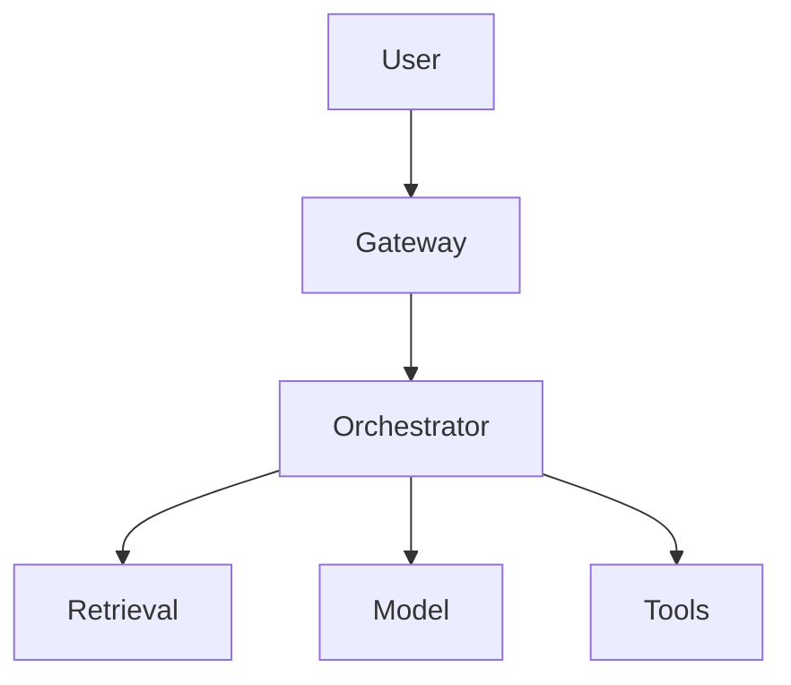
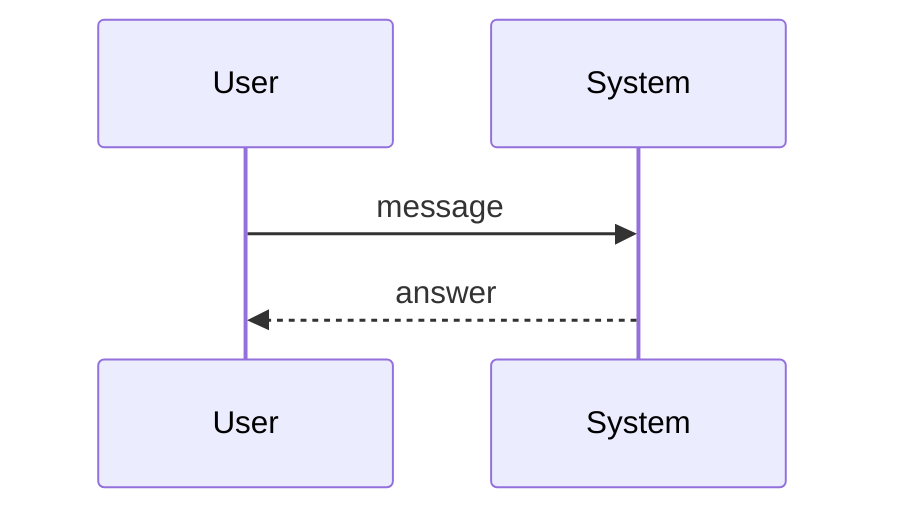

# Short name of the system

> [!NOTE]
> This scenario is fictional. The company and its numbers are made up to make the design concrete.

Copy this file to `case-studies/NN-your-slug.md`, replace every prompt in italics, and delete this note. Each section must start with two or three plain sentences. Put tables, lists and code after them.

## At a glance

| | |
|---|---|
| **Problem** | One line. |
| **Scale** | One line with numbers. |
| **Key patterns** | Three to five patterns this design teaches. |
| **Difficulty** | Intermediate or advanced. |
| **Read time** | About N minutes. |

## The scenario

*Two or three sentences about the company, who uses the system, and what is painful today. Then a table of today's numbers and target numbers.*

| Measure | Today | Target |
|---|---|---|
| Example: tickets per month | 500K | 500K |

## Requirements

*Two or three sentences on what the system must do and how well. Then three tables: functional requirements with priority (P0, P1), non-functional targets with the reason for each number, and security and compliance needs.*

## Numbers

*Two or three sentences on why we estimate before drawing anything. Then every formula, with assumptions stated. Example:*

Tokens per day = requests per day × (input tokens + output tokens).

Cost per day = tokens per day × price per token, where the price is an assumption you state.

Peak requests per second = requests per day × peak factor ÷ 86,400.

## Choosing the shape

*Two or three sentences on the simplest design that could work. Walk up the ladder: fixed pipeline, router, tool-calling agent, multi-agent. Say why each lower rung fails for this problem and where you stop.*

## Architecture

*Two or three sentences describing the main blocks and how data moves between them. Then a mermaid flowchart.*

### Words used in this case study

*Two or three plain sentences saying this table is for readers who are new to AI. Then a table of every technical term a newcomer may not know, one plain sentence each. Include at least: token, embedding, RAG, cache, memory, guardrail, p95, and any term specific to this design.*

| Word | What it means here |
|---|---|
| Example: token | A small piece of text (about three quarters of a word) that a model reads and writes. Models are priced per token. |

### Layers and tools

*Two or three plain sentences on how the system splits into layers, and a table that separates the ideas people mix up (for example memory, retrieval and cache). Then one `####` sub-section per layer. The usual layers are: gateway, checks and guardrails, router, models, retrieval (RAG), memory, caches, tools and actions, orchestration, human handoff, and observability and evals. Skip the ones you don't need.*

*For each layer, write: (1) what it is in plain words, (2) what it does in this design, what it stores and how big it is, (3) a table of tool categories with a few example tools and when to pick each, (4) your choice for the first version, and (5) what goes wrong. Name the category first and the examples second, because tools change faster than categories. Add "as of" and the month for any example list.*

#### Example layer name

*Plain words. What it does here. Then:*

| Category | Examples | Pick it when |
|---|---|---|
| Example category | Example tool A, example tool B | The situation where this category fits |

*First version: one sentence. What goes wrong: one sentence.*

### Build order

*Two or three plain sentences on why you build in stages. Then a numbered list of steps a small team could follow, from the simplest version that works to the full design. Each step says what to build, what to test, and what "done" looks like.*

## One request, end to end

*Two or three sentences introducing one concrete request. Then a mermaid sequence diagram and a latency budget table (step, budget in ms, what happens if it overruns).*

## Deep dives

*Two or three sentences naming the three or four hardest parts of this design. Then one sub-section (`###`) per part: the problem, the options you considered, the choice and why. Add a short, vendor-neutral code sample where it helps.*

## Scaling from 1x to 100x

*Two or three sentences on what changes as load grows. Then a table: load level, what breaks first, the fix, and the cost of the fix.*

| Load | What breaks first | Fix | Cost of the fix |
|---|---|---|---|
| 1x | Nothing yet | Baseline | |
| 10x | | | |
| 100x | | | |

## Failure modes and safety

*Two or three sentences on how this system fails in practice. Then a table of failure, how you detect it, and what you do about it. Include model outage, wrong answers, prompt injection, tool errors, runaway loops and cost spikes where they apply.*

## Measuring quality

*Two or three sentences on what "good" means here and who decides. Then metrics with targets, how the evaluation set is built, what blocks a release, and what you watch in production.*

## Cost

*Two or three sentences on where the money goes. Then the cost per unit of work (per conversation, per call minute, per document) from the formulas above, a monthly total, and the one lever that moves the total most.*

## Trade-offs we made

*Two or three sentences on why we record decisions. Then a table: decision, options, choice, reason, and what would make us change it.*

## What teams get wrong

*Two or three sentences on the mistakes a first version usually makes. Then a list, each with how to spot it and how to avoid it.*

## Interview mode

*Two or three sentences on how to present this design in 45 minutes. Then a timed plan, then follow-up questions an interviewer may ask, with answers hidden.*

**Follow-up: what happens when the model provider is down?**

Answer

Write a short, direct answer here.

## Concepts used

*Two or three sentences on which ideas this case study relies on. Then links to the Part 1 notes for the basics, and a list of advanced ideas introduced here.*

## Further reading

*Two to five primary sources: official docs, standards or engineering posts, each with a one-line reason to read it.*
